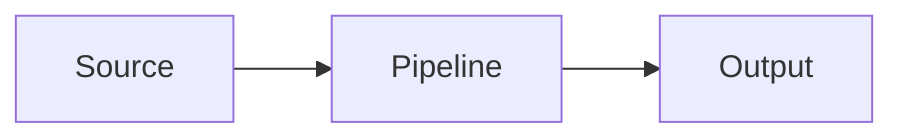

# Peter Chang — Engineering Portfolio

> 個人技術作品集靜態網站，部署於 GitHub Pages；新增一個專案只需要新增一份 Markdown。

- **Author**：Peter Chang
- **Type**：Static site（Astro 7 + Markdown + Mermaid）
- **Hosting**：GitHub Pages（GitHub Actions 自動部署）

## Quick Start (快速開始)

需求：Node.js 22+

```bash
npm ci            # 安裝（版本鎖在 package-lock.json）
npm run dev       # 本機開發 http://localhost:4321
npm run build     # 產生 dist/
npm run preview   # 預覽 build 結果
```

> [!CAUTION]
> 🔴 NEVER commit `PeterChang_rv.pdf`、`PeterChang_core.md`：內含手機、住址等個人資料，已列在 `.gitignore`。

## Project Structure (目錄結構)

```text
.
├─ src/
│  ├─ content/projects/      # 每個專案一份 .md（中文內容與日期、數字等共用資料的唯一來源）
│  ├─ content/projects-en/   # 專案頁英文版（同檔名，只放翻譯文字）
│  ├─ content.config.ts      # 專案 frontmatter schema；欄位錯誤時 build 失敗
│  ├─ data/profile.ts        # 個人資訊 SSOT：定位、介紹、能力、經歷、聯絡方式與 Contact 頁文案
│  ├─ data/profile.en.ts     # 英文版文案（只覆寫文字；日期、標籤、連結沿用 profile.ts）
│  ├─ i18n/                  # ui.ts（介面字串、語言路徑）、profile.ts（依語言取文案）
│  ├─ data/project-categories.ts  # Projects 頁篩選用的技術類型清單
│  ├─ components/            # ProjectCard、ContactLinks（頁尾）、ProfilePhoto（首頁照片）、BrandMark（P 標誌）、SocialIcon、CopyEmail
│  ├─ layouts/Base.astro     # 共用 header / footer
│  ├─ pages/[...lang]/       # 所有頁面（含 projects/[slug]）；同一份模板輸出中文 / 與英文 /en/
│  ├─ lib/url.ts             # 加上 GitHub Pages base path
│  └─ styles/global.css      # 全站唯一 CSS（含深淺色切換、手機版）
├─ public/                   # favicon、data/（去識別 CSV）、media/（照片、錄影）
├─ scripts/ · tests/          # 去識別腳本與 pytest
├─ docs/source-notes.md      # 每個數字的來源對照與 TODO 清單
├─ docs/case-study-framework.md  # 專案頁六段式框架（新增專案時照做）
└─ .github/workflows/deploy.yml
```

## Content Workflow (內容維護)

### Step 1 — 修改個人資訊

只改 `src/data/profile.ts`。首頁、About、Contact、footer 都從這裡讀取，不要在頁面裡另外寫一份。

英文版（`/en/`）的文字在 `src/data/profile.en.ts`，改中文文案時同步改英文；日期、標籤與聯絡方式只寫在 `profile.ts`。專案頁的英文版寫在 `src/content/projects-en/<同檔名>.md`，只放文字（summary、role、metric_labels、tldr 與內文）；改中文專案頁時同步改英文檔。

聯絡方式留空字串時，網站會顯示 `TODO`：

```ts
contact: {
  github:   "https://github.com/<username>",
  linkedin: "https://www.linkedin.com/in/<id>",
  email:    "you@example.com",
},
```

### Step 2 — 新增專案

在 `src/content/projects/` 新增 `<slug>.md`，檔名就是網址（`/projects/<slug>/`）。

```markdown
---
title: "Project Title"
subtitle: "中文副標"
summary: "一句話：解決什麼問題、結果是什麼。"
company: "公司名稱"
period: "2026/1 – 2026/3"
role: "個人負責範圍（與團隊共同完成的部分要寫清楚）"
stack: ["Python", "Asyncio"]
metrics:                     # 選填，最多 3 個，數字要能對回 docs/source-notes.md
  - { value: "95%", label: "人工工作量減少" }
tags: ["Automation"]
categories: ["Automation"]   # 必填，Projects 頁篩選用；可選值見 src/data/project-categories.ts
home: true                   # 選填：首頁成果地圖卡片顯示數字（沒填 = 標「建置中」）；metrics 含 XX 時不可填
# metrics 每項可加 on_home: true（首頁成果地圖卡片顯示，最多 2 個）；另填 impact: { before, after } 給成果地圖
order: 4                     # 排序，小的在前
---

## Problem Assessment
## Solution Design
## Alternative Solutions
## Selected Solution
## Result
## Impact
```

各章要放什麼、數據與去識別規則、可用的 HTML 元件，見 [docs/case-study-framework.md](docs/case-study-framework.md)；範本是 `credit-card-anomaly-detection.md`。另外兩個專案仍是舊的 8 段結構，改寫時再套用。

每個 `##` 標題會自動變成一個「章節」：頁面頂端出現 01、02… 頁標，一次顯示一章，可用上一章／下一章、頁標或鍵盤 ← → 翻頁；網址 `#ch-3` 可直接分享第 3 章。編號自動產生，不需要手動寫。沒有 JS 時會退回完整長頁。

章節標題旁的紅／黃／綠 Badge（🔴 Problem、🟡 Analysis、🟢 Result 等）由 `src/styles/global.css` 的〈Semantic badges〉區塊依標題 id 對應產生，不寫在 Markdown 裡。新增的章節標題若要加 Badge，把它的 id（標題轉小寫、空白換成 `-`，例如 `## Business Impact` → `business-impact`）加進對應顏色那一組即可；頁標上的小圓點會自動跟著變色。

### Step 3 — 畫架構圖

在 Markdown 中使用 `mermaid` code block，頁面載入時會自動渲染：

````markdown

````

標籤含中文、括號或斜線時，用 `"..."` 包起來，避免語法錯誤。

### Step 4 — 本機驗證後推送

```bash
npm run build     # frontmatter 缺欄位或型別錯誤會在這一步失敗
git push          # 推到 main 後自動部署
```

### Step 5 — 更新去識別資料（Credit Card 頁的 CSV）

原始 CSV 含交易編號、訂單編號（內含客戶 ID）與同事姓名，**不進 repo**。用腳本產生去識別版本後再推送：

```bash
python scripts/deidentify_cc_csv.py "<raw.csv>" public/data/credit-card-recon-2026-03-07.csv
python -m pytest tests            # 去識別規則的測試（只需 Python 3.10+ 與 pytest）
```

腳本只保留 2026-03 ~ 2026-07 的資料、交易編號改為 `TX-0001` 流水號、刪除訂單編號與複核人員欄位、備註中的人名改為 `<name>`；若輸出仍殘留人名會直接失敗，不會寫出檔案。頁面上的表格由 `[slug].astro` 讀取這份 CSV 渲染。

Drop-Order Monitor 頁的 CSV 來自 LarkSheet 匯出的 `.xlsx`（放在 `canva-export/drop-order/`，不進 repo），讀檔需要 `openpyxl`：

```bash
python scripts/deidentify_drop_order.py "<raw.xlsx>" public/data/drop-order-cases-2026.csv
```

腳本只讀 5 個工作表（Deposit 與 4 類 Withdraw），依上線日篩選到 2026-11-17、訂單編號改為 `TX-00001` 流水號，只保留分類欄位（狀態、渠道類型、幣別、金額、國家、原因）；輸出若仍含原始 ID、人員姓名或品牌字會直接失敗。

## Deployment (部署)

1. 在 GitHub 建立 repo，推送到 `main`。
2. Repo → **Settings → Pages → Build and deployment → Source** 選 **GitHub Actions**。
3. 每次推送到 `main`，`.github/workflows/deploy.yml` 會 build 並部署。

`astro.config.mjs` 會從 `GITHUB_REPOSITORY` 自動推算網址，repo 名稱不需要寫死：

| Repo 名稱 | 網址 |
|---|---|
| `<user>.github.io` | `https://<user>.github.io/` |
| 其他名稱，例如 `portfolio` | `https://<user>.github.io/portfolio/` |

## Future Scalability (未來擴充)

### 🟢 目前已具備

- Markdown 專案內容 + frontmatter schema 驗證
- Mermaid 架構圖（只在專案頁載入）
- Dark mode、手機版（375px 無水平溢出）
- push 到 `main` 自動部署

### 🟡 未來可擴充

- 🟡 OPTIONAL 英文版（Astro i18n routing）
- 🟡 OPTIONAL 其他專案（維碩設備 API、車身碼查詢系統等），新增 Markdown 即可
- 🟡 OPTIONAL 自訂網域（`public/CNAME`）
