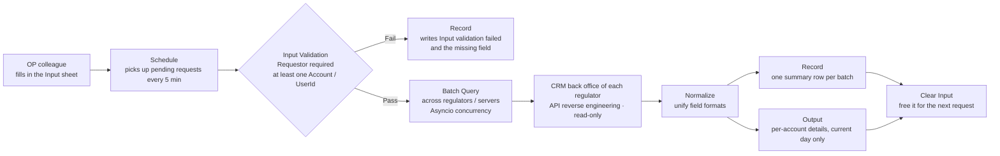

---
# English version of src/content/projects/account-automation-engine.md (draft translation, pending Peter's review).
# Dates, stack, categories, metric values and the system map come from the zh file.
summary: "Turned OP's routine of switching between multiple CRM back offices and checking accounts one by one into a batch query engine with LarkSheet as the entry point; from launch in 2026/6 to 11/16 it ran successfully 531 times and verified 381,629 accounts in total."
role: "Distilled a shared query workflow from OP's pain points; designed and built the batch query engine on my own"
metric_labels:
  - "Accounts verified (2026-06-09 ~ 11-16)"
  - "Manual query hours saved in total (estimate)"
  - "Equivalent labor cost (estimate)"
story:
  - { label: "Map", line: "Client data lives in CRM and trading accounts in MetaTrader; each account's balance, margin and P&L can only be looked up in its own regulator's CRM back office, and there are 4 of them." }
  - { label: "Why look them up", line: "Account closure, offboarding and ownership transfer all converge on one lookup: what do the accounts on the list still hold? But those accounts all look the same, and only checking shows which still hold a balance or positions; miss one and its positions get force-closed." }
  - { label: "Scattered accounts", line: "The hard part: one client often has several accounts. Each regulator has its own back office, and accounts sit wherever the client opened them." }
  - { label: "By hand vs. engine", line: "By hand, OP switches back offices and looks up one account at a time; the engine takes the whole list and fetches everything across back offices in one go." }
  - { label: "Engine flow", line: "Since all three operations are stuck on the same lookup, and all of them are \"give a list, get the same fields back\" (identity, balance, positions plus time fields, 14 in all), I built an engine: OP fills in a sheet, a schedule picks it up, validates it, queries every back office through API reverse engineering, and records both successes and failures." }
  - { label: "Worked example", line: "A real request: 68 clients expanded into 322 accounts, almost 5 per client, spread over 2 regulators and 33 servers, and the engine looked them all up in one go." }
  - { label: "How it gets queried", line: "But \"in one go\" hides the volume: 68 userIds become 68 queries, times 4 back offices. The back office is tied to the login session, so they are switched in turn and confirmed before querying; inside each, the queries go out together but share 20 concurrency slots, pages are merged in order, and an account counts as missing only if all 4 return nothing." }
  - { label: "Concurrency and retries", line: "The 20 and the 10 tries came from my own tests against the back office: the first version had no overall cap, and with a large list the back office returned 429 / 5xx and even kicked out the login, so the whole run now shares 20 slots; retrying right after a rate limit got blocked again, so each try waits 1.5 seconds longer; and a 401 means the login is dead, so the run stops instead of retrying." }
  - { label: "Key code", line: "In the code it comes down to these parts: one Semaphore(20) for the whole run, the 4 back offices switched in turn inside a loop; every request waits for a slot before it is sent; page 1 first, then the remaining pages together; and on retry a 401 is raised at once, while 429 / 5xx wait 1.5 seconds longer each time." }
  - { label: "Running for real", line: "First, the same kind of lookup done for real: on the left, someone switching CRM back offices and checking accounts one by one; on the right, OP fills in the list and the engine does the rest." }
  - { label: "Run record", line: "One real large batch: 5,696 accounts. The engine switched into the 4 back offices in turn, found nothing in FCA or ASIC and everything in the two VFSC ones; the 54 found nowhere were collected, results were written back in batches and the Input cleared, all in about 11.5 minutes. Requests missing a field are stopped before any query." }
  - { label: "Duration", line: "So run time grows linearly with the list: about 13 seconds for 100 or fewer, about 1.5 minutes for 501 to 2,000, and only around 5 minutes even above 2,000." }
  - { label: "Result", line: "After launch, teams have submitted requests on their own every month without an engineer; October was the busiest month." }
impact:
  before: "Switching between CRM back offices to check accounts one by one"
  after: "OP submits a list and gets results in bulk, with every request traceable"
  core: "High-concurrency heterogeneous system integration"
tldr:
  problem: "To check client account statuses, OP had to switch regulators across several CRM back offices and look up accounts one by one; batch cases overwhelmed the team."
  approach: "Turned the shared query workflow into a batch engine with LarkSheet as the entry point: validate the input first, query on a schedule, and record both successes and failures."
  result: "OP submits a list and the engine does the rest, so queries no longer tie up staff, and every request can be traced."
---

## Problem Assessment

<hr data-slide="Background and terms">

- Before any of three operations, account closure, offboarding of high-risk or backlogged cases, and ownership transfer, OP must first check the identity, balance and positions of every client on the list.
- IT can provide the list of UIDs to process, but not these fields. OP could only switch regulators across several CRM back offices and look up and confirm each account one by one.
- Requests come from different teams and often arrive in batches; one-by-one lookups could not keep up with batch cases.

<details class="glossary-details">
<summary>Glossary<span class="mono">11 terms · click to expand</span></summary>
<table>
<thead><tr><th>Term</th><th>Meaning</th></tr></thead>
<tbody>
<tr><td>OP</td><td>Operations colleagues who handle day-to-day client account work</td></tr>
<tr><td>CRM back office</td><td>Internal system that manages clients and trading accounts; each regulator has its own</td></tr>
<tr><td>regulator</td><td>The financial regulator a client belongs to (for example VFSC)</td></tr>
<tr><td>UID / userId</td><td>A client's unique ID in the CRM; one client can have several trading accounts</td></tr>
<tr><td>Account</td><td>MT4 / MT5 trading account number</td></tr>
<tr><td>Account Server</td><td>The trading server an account lives on (for example MT5_AU7)</td></tr>
<tr><td>Trading Account / Rebate Account</td><td>The account a client trades with / the account an IB (introducing broker) receives rebates in</td></tr>
<tr><td>Balance / Equity / Margin / Profit / Credit</td><td>Balance / equity / used margin / floating P&amp;L / bonus or credit line</td></tr>
<tr><td>Account Closure</td><td>Closing a client's trading accounts; each account's identity, balance and positions must be checked first</td></tr>
<tr><td>Customer Offboarding</td><td>For high-risk or backlogged cases: closing the client's accounts, zeroing the balance and restricting the accounts; each account's identity, balance and positions must be checked first</td></tr>
<tr><td>Ownership transfer</td><td>Moving a client to another IB or salesperson; the status of every account the client holds must be checked first</td></tr>
</tbody>
</table>
</details>

<hr data-slide="Why look them up">

Account closure, offboarding and ownership transfer all touch the client's money or ownership, so before any of them OP must answer the same question: what do the accounts on the list still hold? The catch is that the list alone does not tell you which accounts still hold a balance or positions, so every one has to be checked for identity, balance and positions before OP decides whether to go ahead; miss one and things go wrong:

<figure class="split-figure step-figure">
<div class="split-scroll">
<svg viewBox="0 0 760 460" role="img" aria-labelledby="wq-title"><title id="wq-title">Account closure, offboarding and ownership transfer all converge on one lookup; accounts on the list look the same, and only checking shows which still hold a balance or positions; miss one and it goes wrong (illustration)</title><defs><marker id="wq-arrow" viewBox="0 0 8 8" refX="7" refY="4" markerWidth="8" markerHeight="8" orient="auto"><path class="sf-head" d="M0,0 L8,4 L0,8 z"/></marker></defs><g data-b="sources"><rect class="sf-child" x="50" y="6" width="160" height="30" rx="6"/><text class="sf-t sf-small-t" x="130" y="26">Account closure</text><path class="sf-line" d="M130 36 C 130 46, 380 40, 380 48" marker-end="url(#wq-arrow)"/><rect class="sf-child" x="300" y="6" width="160" height="30" rx="6"/><text class="sf-t sf-small-t" x="380" y="26">Offboarding</text><path class="sf-line" d="M380 36 V48" marker-end="url(#wq-arrow)"/><rect class="sf-child" x="550" y="6" width="160" height="30" rx="6"/><text class="sf-t sf-small-t" x="630" y="26">Ownership transfer</text><path class="sf-line" d="M630 36 C 630 46, 380 40, 380 48" marker-end="url(#wq-arrow)"/><rect class="sf-parent" x="150" y="50" width="460" height="28" rx="6"/><text class="sf-t sf-small-t" x="380" y="69">All three must first answer: what do these accounts still hold?</text><path class="sf-line" d="M380 78 C 380 92, 170 88, 170 100" marker-end="url(#wq-arrow)"/></g><g data-b="list"><text class="sf-h sf-start" x="20" y="116">Accounts on the list: all look the same</text><rect class="sf-node" x="20" y="130" width="46" height="30" rx="5"/><text class="sf-s" x="43" y="149">?</text><rect class="sf-node" x="74" y="130" width="46" height="30" rx="5"/><text class="sf-s" x="97" y="149">?</text><rect class="sf-node" x="128" y="130" width="46" height="30" rx="5"/><text class="sf-s" x="151" y="149">?</text><rect class="sf-node" x="182" y="130" width="46" height="30" rx="5"/><text class="sf-s" x="205" y="149">?</text><rect class="sf-node" x="236" y="130" width="46" height="30" rx="5"/><text class="sf-s" x="259" y="149">?</text><rect class="sf-node" x="290" y="130" width="46" height="30" rx="5"/><text class="sf-s" x="313" y="149">?</text><rect class="sf-node" x="20" y="168" width="46" height="30" rx="5"/><text class="sf-s" x="43" y="187">?</text><rect class="sf-node" x="74" y="168" width="46" height="30" rx="5"/><text class="sf-s" x="97" y="187">?</text><rect class="sf-node" x="128" y="168" width="46" height="30" rx="5"/><text class="sf-s" x="151" y="187">?</text><rect class="sf-node" x="182" y="168" width="46" height="30" rx="5"/><text class="sf-s" x="205" y="187">?</text><rect class="sf-node" x="236" y="168" width="46" height="30" rx="5"/><text class="sf-s" x="259" y="187">?</text><rect class="sf-node" x="290" y="168" width="46" height="30" rx="5"/><text class="sf-s" x="313" y="187">?</text><rect class="sf-node" x="20" y="206" width="46" height="30" rx="5"/><text class="sf-s" x="43" y="225">?</text><rect class="sf-node" x="74" y="206" width="46" height="30" rx="5"/><text class="sf-s" x="97" y="225">?</text><rect class="sf-node" x="128" y="206" width="46" height="30" rx="5"/><text class="sf-s" x="151" y="225">?</text><rect class="sf-node" x="182" y="206" width="46" height="30" rx="5"/><text class="sf-s" x="205" y="225">?</text><rect class="sf-node" x="236" y="206" width="46" height="30" rx="5"/><text class="sf-s" x="259" y="225">?</text><rect class="sf-node" x="290" y="206" width="46" height="30" rx="5"/><text class="sf-s" x="313" y="225">?</text></g><g data-b="reveal"><path class="sf-line" d="M344 183 H400" marker-end="url(#wq-arrow)"/><text class="sf-s" x="372" y="173">check each</text><text class="sf-h sf-start" x="410" y="116">Only now you see which are not 0</text><rect class="sf-node" x="410" y="130" width="46" height="30" rx="5"/><text class="sf-s" x="433" y="149">0</text><rect class="sf-node" x="464" y="130" width="46" height="30" rx="5"/><text class="sf-s" x="487" y="149">0</text><rect class="sf-bad" x="518" y="130" width="46" height="30" rx="5"/><text class="sf-bad-t sf-small" style="font-size:9px" x="541" y="149">Positions</text><rect class="sf-node" x="572" y="130" width="46" height="30" rx="5"/><text class="sf-s" x="595" y="149">0</text><rect class="sf-node" x="626" y="130" width="46" height="30" rx="5"/><text class="sf-s" x="649" y="149">0</text><rect class="sf-node" x="680" y="130" width="46" height="30" rx="5"/><text class="sf-s" x="703" y="149">0</text><rect class="sf-node" x="410" y="168" width="46" height="30" rx="5"/><text class="sf-s" x="433" y="187">0</text><rect class="sf-node" x="464" y="168" width="46" height="30" rx="5"/><text class="sf-s" x="487" y="187">0</text><rect class="sf-node" x="518" y="168" width="46" height="30" rx="5"/><text class="sf-s" x="541" y="187">0</text><rect class="sf-node" x="572" y="168" width="46" height="30" rx="5"/><text class="sf-s" x="595" y="187">0</text><rect class="sf-bad" x="626" y="168" width="46" height="30" rx="5"/><text class="sf-bad-t sf-small" style="font-size:9px" x="649" y="187">Balance</text><rect class="sf-node" x="680" y="168" width="46" height="30" rx="5"/><text class="sf-s" x="703" y="187">0</text><rect class="sf-node" x="410" y="206" width="46" height="30" rx="5"/><text class="sf-s" x="433" y="225">0</text><rect class="sf-bad" x="464" y="206" width="46" height="30" rx="5"/><text class="sf-bad-t sf-small" style="font-size:9px" x="487" y="225">Positions</text><rect class="sf-node" x="518" y="206" width="46" height="30" rx="5"/><text class="sf-s" x="541" y="225">0</text><rect class="sf-node" x="572" y="206" width="46" height="30" rx="5"/><text class="sf-s" x="595" y="225">0</text><rect class="sf-node" x="626" y="206" width="46" height="30" rx="5"/><text class="sf-s" x="649" y="225">0</text><rect class="sf-node" x="680" y="206" width="46" height="30" rx="5"/><text class="sf-s" x="703" y="225">0</text></g><g data-b="card"><path class="sf-line sf-thin" d="M487 237 C 487 266, 400 237, 400 266"/><rect class="sf-box" x="20" y="267" width="400" height="135" rx="8"/><text class="sf-t sf-start" x="34" y="289">Open one of them</text><line class="sf-sep" x1="150" y1="300" x2="150" y2="392"/><line class="sf-sep" x1="280" y1="300" x2="280" y2="392"/><rect class="sf-bad" x="286" y="298" width="126" height="98" rx="6"/><text class="sf-t" x="85" y="314">Identity</text><text class="sf-f" x="85" y="334">UID</text><text class="sf-f" x="85" y="350">mt4_account</text><text class="sf-f" x="85" y="366">server</text><text class="sf-f" x="85" y="382">regulator</text><text class="sf-t" x="215" y="314">Balance</text><text class="sf-f" x="215" y="334">currency</text><text class="sf-f" x="215" y="350">balance</text><text class="sf-f" x="215" y="366">equity</text><text class="sf-f" x="215" y="382">credit</text><text class="sf-t sf-bad-t" x="349" y="314">Positions</text><text class="sf-f" x="349" y="334">margin</text><text class="sf-f" x="349" y="350">marginLevel</text><text class="sf-f" x="349" y="366">profit</text><text class="sf-bad-t sf-small" x="349" y="386">not 0: open trades</text></g><g data-b="chain"><path class="sf-line" d="M420 287 H446" marker-end="url(#wq-arrow)"/><rect class="sf-node" x="450" y="270" width="290" height="34" rx="6"/><text class="sf-t sf-small-t" x="595" y="292">Miss this one and offboard anyway</text><path class="sf-line" d="M595 304 V318" marker-end="url(#wq-arrow)"/><rect class="sf-bad" x="450" y="322" width="290" height="34" rx="6"/><text class="sf-bad-t" x="595" y="344">Positions force-closed</text><text class="sf-s" x="595" y="376">Miss the balance: money not returned to the client</text><text class="sf-s" x="595" y="392">Miss the identity: one back office's accounts left open</text><text class="sf-s" x="595" y="408">Ownership transfer, missed: rebates miscalculated</text></g><g data-b="scale"><text class="sf-note" x="380" y="448">Only 18 drawn here; a real batch is often over a thousand accounts, and every one must be checked</text></g></svg>
</div>
<figcaption>Figure 1　Three operations converge on one lookup: accounts that look the same, and only checking shows which are not 0. Each account needs three groups of shared fields: identity, balance and positions (field names as in the source system); whether to go ahead is OP's call after reviewing the numbers (illustration: 18 accounts with 3 not at 0 is for explanation, not an actual statistic)</figcaption>
</figure>

<hr data-slide="Where the accounts are">

The hard part is that accounts are not in one place: each regulator has its own CRM back office, and an account sits wherever the client opened it, under that regulator and on that trading server. One client (UID) often has several accounts, so by hand OP can only switch back offices and look them up one at a time (time cost in the pain points):

<figure class="split-figure step-figure">
<div class="split-scroll">
<svg viewBox="0 0 760 340" role="img" aria-labelledby="ac-title"><title id="ac-title">One client, many accounts: accounts sit in different regulators' back offices; by hand you switch one by one, the engine fetches them in one go</title><defs><marker id="ac-arrow" viewBox="0 0 8 8" refX="7" refY="4" markerWidth="8" markerHeight="8" orient="auto"><path class="sf-head" d="M0,0 L8,4 L0,8 z"/></marker></defs><g data-b="client"><rect class="sf-parent" x="20" y="100" width="140" height="60" rx="8"/><text class="sf-t" x="90" y="126">Client</text><text class="sf-s" x="90" y="146">one UID</text></g><g data-b="backends"><rect class="sf-box" x="220" y="30" width="125" height="170" rx="8"/><text class="sf-t" x="282" y="52">Regulator A</text><text class="sf-s" x="282" y="68">CRM back office</text><rect class="sf-box" x="355" y="30" width="125" height="170" rx="8"/><text class="sf-t" x="417" y="52">Regulator B</text><text class="sf-s" x="417" y="68">CRM back office</text><rect class="sf-box" x="490" y="30" width="125" height="170" rx="8"/><text class="sf-t" x="552" y="52">Regulator C</text><text class="sf-s" x="552" y="68">CRM back office</text><rect class="sf-box" x="625" y="30" width="125" height="170" rx="8"/><text class="sf-t" x="687" y="52">Regulator D</text><text class="sf-s" x="687" y="68">CRM back office</text><text class="sf-s" x="552" y="120">(none for this client)</text></g><g data-b="accounts"><path class="sf-line sf-thin" d="M160 130 C 190 130, 200 98, 228 98"/><path class="sf-line sf-thin" d="M160 130 C 190 130, 200 142, 228 142"/><path class="sf-line sf-thin" d="M160 130 C 190 130, 335 98, 363 98"/><path class="sf-line sf-thin" d="M160 130 C 190 130, 605 98, 633 98"/><path class="sf-line sf-thin" d="M160 130 C 190 130, 605 142, 633 142"/><rect class="sf-child" x="230" y="80" width="105" height="36" rx="6"/><text class="sf-t sf-small-t" x="282" y="96">Account #1</text><text class="sf-s" x="282" y="110">MT5</text><rect class="sf-child" x="230" y="124" width="105" height="36" rx="6"/><text class="sf-t sf-small-t" x="282" y="140">Account #2</text><text class="sf-s" x="282" y="154">MT4</text><rect class="sf-child" x="365" y="80" width="105" height="36" rx="6"/><text class="sf-t sf-small-t" x="417" y="96">Account #3</text><text class="sf-s" x="417" y="110">MT5</text><rect class="sf-child" x="635" y="80" width="105" height="36" rx="6"/><text class="sf-t sf-small-t" x="687" y="96">Account #4</text><text class="sf-s" x="687" y="110">MT5</text><rect class="sf-child" x="635" y="124" width="105" height="36" rx="6"/><text class="sf-t sf-small-t" x="687" y="140">Account #5</text><text class="sf-s" x="687" y="154">MT4</text></g><line class="sf-sep" x1="20" y1="222" x2="740" y2="222"/><g data-b="manual"><text class="sf-t sf-start" x="20" y="262">By hand</text><rect class="sf-node" x="110" y="240" width="150" height="34" rx="6"/><text class="sf-t sf-small-t" x="185.0" y="262">Back office A · 2</text><path class="sf-line" d="M260 257 H282" marker-end="url(#ac-arrow)"/><rect class="sf-node" x="288" y="240" width="150" height="34" rx="6"/><text class="sf-t sf-small-t" x="363.0" y="262">Back office B · 1</text><path class="sf-line" d="M438 257 H460" marker-end="url(#ac-arrow)"/><rect class="sf-node" x="466" y="240" width="150" height="34" rx="6"/><text class="sf-t sf-small-t" x="541.0" y="262">Back office D · 2</text><text class="sf-s sf-start" x="644" y="262">switch, look up one by one</text></g><g data-b="engine"><text class="sf-t sf-start" x="20" y="314">Engine</text><rect class="sf-parent" x="110" y="292" width="150" height="34" rx="6"/><text class="sf-t sf-small-t" x="185.0" y="314">Take the whole list</text><path class="sf-line" d="M260 309 H282" marker-end="url(#ac-arrow)"/><rect class="sf-parent" x="288" y="292" width="190" height="34" rx="6"/><text class="sf-t sf-small-t" x="383.0" y="314">Query all back offices at once</text><path class="sf-line" d="M478 309 H500" marker-end="url(#ac-arrow)"/><rect class="sf-parent" x="506" y="292" width="150" height="34" rx="6"/><text class="sf-t sf-small-t" x="581.0" y="314">Record / Output</text><text class="sf-s sf-start" x="684" y="314"></text></g></svg>
</div>
<figcaption>Figure 2　One client, many accounts: each regulator has its own CRM back office, and an account sits wherever the client opened it; by hand you switch back offices one by one, while the engine takes the whole list and fetches everything in one go (illustration)</figcaption>
</figure>

<hr data-slide="Engine flow">

All three operations (Figure 1) are stuck on the same lookup, and every request is "take a list of userIds / Accounts and return the same set of account fields": the 11 identity, balance and positions fields on the card in Figure 1, plus 3 time fields, approvedTime (when the account was approved), updateTime (when the back office data was last updated) and comparisionTime (when the engine looked it up). These 14 shared fields cover most requests, and every row shows when it was looked up.

So the problem to solve is not "looking up faster" but that **the same lookup was redone by hand every time, one account and one back office at a time**. I turned that shared workflow into an engine:



*Figure 3　Engine flow*

<hr data-slide="Worked example">

One real request from 2026-07-07, showing how a list moves from Input to Record and Output:

| Step | Sheet | Content |
|---|---|---|
| 1. Fill in the list | Input (illustration) | Requestor: the requester; UserId: 68 clients |
| 2. Validation passes, the schedule picks it up | — | Requestor filled in, at least one UserId |
| 3. Query across back offices, write the summary | Record | 68 clients → 322 accounts; 22 countries, 33 servers, 2 regulators, 25 account types; 0 not found |
| 4. Write the details | Output | One row per account (322 rows), 23 fields (see the output format in Result) |
| 5. Clear Input | Input | Freed for the next request |

*Rows 3 and 4 come from the Record sheet (R-0055); Input is not kept, so row 1 is an illustration.*

- **68 clients, 322 accounts**: about 4.7 accounts per client on average, across 2 regulators and 33 servers, which is why doing it by hand meant switching back offices over and over.
- **When validation fails**: nothing is queried, and Record states the missing field (examples in Result).

<hr data-slide="Pain points and evidence">

<figure class="pain-figure">
<div class="pain-grid">
<section class="pain-card tone-grey pain-wide">
<h4 class="pain-title">One by one, switching back and forth</h4>
<p class="pain-label"><span>Pain</span>Every account takes a full lookup</p>
<ul class="pain-note">
<li>Clients of different regulators live in different CRM back offices, so the right one must be opened first.</li>
<li>Balance, Margin, Profit and Server have to be opened and checked one by one for every account.</li>
</ul>
<div class="pain-evidence">
<p class="pain-evidence-title">Evidence: steps to look up one account by hand</p>
<ol class="pain-flow">
<li>Take one userId from the UID list provided by IT.</li>
<li>Work out the client's regulator and switch to that CRM back office.</li>
<li>Search for the client, open the account page and find the Trading Account / Rebate Account.</li>
<li>Note down Balance, Margin, Profit, Equity, Credit, Account Server and the other fields.</li>
<li>Go back to the list, take the next one and repeat steps 1–4.</li>
</ol>
<p class="pain-caption">About <b>45 seconds</b> per account on average (estimate) → 1,000 accounts ≈ <b>12.5 hours</b> of manual work.</p>
</div>
</section>
<section class="pain-card tone-red">
<h4 class="pain-title">Batch cases overwhelm the team</h4>
<p class="pain-label"><span>Pain</span>Case volume far exceeds one-by-one speed</p>
<ul class="pain-note">
<li>Offboarding and ownership transfers often involve thousands of accounts at once.</li>
<li>Work is held up by looking up data, not by making decisions.</li>
</ul>
<div class="pain-evidence">
<p class="pain-evidence-title">Evidence: batch requests actually submitted after launch</p>
<ul class="pain-flow">
<li>The largest single batch had <b>17,416</b> accounts, about <b>218 hours</b> of one-by-one lookups.</li>
<li><b>65</b> batches had more than 2,000 accounts.</li>
</ul>
</div>
</section>
<section class="pain-card tone-yellow">
<h4 class="pain-title">Core work gets squeezed</h4>
<p class="pain-label"><span>Pain</span>Time goes to searching, switching systems and final checks</p>
<ul class="pain-note">
<li>OP's time was taken up by searching for and organizing data.</li>
<li>Risk and compliance work that really needs human judgment got pushed back.</li>
</ul>
<div class="pain-evidence">
<p class="pain-evidence-title">Evidence: what one batch covers</p>
<ul class="pain-flow">
<li>A single batch covered up to <b>179</b> countries, <b>40</b> servers, <b>4</b> regulators and <b>48</b> account types.</li>
<li>Each account has <b>20</b>+ fields to check (see the output format in Result).</li>
</ul>
</div>
</section>
</div>
<figcaption>Figure 4　Three pain points in the original process (manual steps based on OP's routine; 45 seconds per account is an estimate; batch figures from the engine's Record sheet, 2026-06-09 ~ 2026-11-16)</figcaption>
</figure>

<hr data-slide="Why it was worth solving">

**Why it was worth solving:**

1. **The demand is real**: in the 24 weeks since launch, every single week had successful batch requests (monthly usage in Result).
2. **Single batches already exceed what people can do**: the largest batch (Figure 4) would take one person about 27 working days to look up by hand.
3. **The work is highly repetitive and generalizes well**: requests from different teams look different on the surface, but they all come down to "here is a list of userIds / Accounts, return the same set of account fields". About 80% of OP's day-to-day account queries can be covered by one workflow.

## Solution Design

The three pain points break down into five things to solve. The image below shows the usage rules users see in LarkSheet; the "Maps to" column of the table points to its rows:


*Figure 5　Usage rules in LarkSheet (Chinese section of the Rule sheet; the sheet's English section says the same, and the table below gives the content in English; click to enlarge)*

| Pain point | Solution | Maps to |
|---|---|---|
| One-by-one lookups, switching regulators | Enter the whole userId / Account list at once (two field groups: Trading Account / Rebate Account); the engine queries across regulators and servers in batch; incomplete input is stopped, recorded, and the missing field explained | Step 1: configure parameters |
| Batch cases overwhelm the team | A schedule picks up pending requests every 5 minutes, no manual trigger needed | Step 2: automatic scheduling |
| Results scattered and hard to confirm | Each batch writes a one-row summary to Record (account count, countries / servers / regulators covered, list of not-found accounts) and per-account details to Output | Step 3: review execution status |
| Several teams share one entry point | Exclusive queue: a request can be entered only when Input is empty; up to 2,000 rows per request | Core rules 1–3 |
| The entry point stays occupied | Input is cleared automatically once both Record and Output are written, freeing it for the next request | Step 4: release system resources |

**Constraints the design had to handle:**

- Users are non-technical OP colleagues, so the entry point had to be a tool they already use (LarkSheet), not a new system to learn.
- Several teams share one sheet; filling it in at the same time would overwrite each other, so a queue was needed.
- The output is client account data, so details cannot stay on a shared sheet for long: Output keeps only the current day and is deleted the next day.
- The CRM offers OP no API or database access; a request to IT for a full-field report or DB access had no foreseeable delivery date, and batch cases could not wait. So the engine uses API reverse engineering to log in to each regulator's CRM back office and fetch the account data.

## Alternative Solutions

| Option | Approach | Pros | Cons |
|---|---|---|---|
| A. Keep manual one-by-one lookups | Use IT's UID list and look up each account in each CRM back office | No development | Staff time grows linearly with case volume (time in Problem) |
| B. Ask IT for a full-field report or DB access | IT or the system owner provides an official data source | Most complete data, officially supported | Requested, but with no foreseeable delivery date; batch cases could not wait |
| C. A one-off script per request | Write a query script for each list as requests arrive | Fast for a single delivery | Needs an engineer every time; OP can't use it alone; logic scattered and hard to audit |
| **D. General batch query engine (chosen)** | Distill the shared workflow into a tool with LarkSheet as the entry point, run on a schedule | OP submits on their own; covers about 80% of day-to-day queries; every run is recorded | Shared fields and validation rules must be designed up front; the remaining ~20% of special requests still need individual handling |


## Selected Solution

<hr data-slide="Why this option">

**Chosen: D, a general batch query engine**

1. **Removes A's linear staffing problem**: the engine does the lookups; people only fill in the list and review results, so more cases don't need more people.
2. **No waiting on IT**: B's delivery date was out of our hands, so D could go live first; if an official data source arrives later, only the fetch layer needs replacing.
3. **Removes C's dependence on engineers**: once OP fills in the parameters in LarkSheet, the schedule picks the request up; no engineer is needed.
4. **Find the pattern first, then build the tool**: about 80% of requests share the same input (userId / Account) and the same output fields, which makes one tool worthwhile; the remaining special cases are not forced into the same flow.

<hr data-slide="Design notes">

**Design notes:**

- **Validate before querying, and record failures too**: when validation fails, nothing is queried; the reason (for example a missing Requestor) is written straight to Record, so the requester can see what to fix (blocked count in Result).
- **Not-found accounts are kept, not dropped**: accounts that can't be found are collected in Record's `total_missing_list` and shown alongside the successful results.
- **Exclusive queue**: while Input has data, nobody else can overwrite it; Input is cleared only after both Record and Output are written, so no request is lost.
- **Per-request limit**: the rules allow at most 2,000 rows per request (counted as input userId rows), so one request can't hold the entry point for too long; one userId expands into several accounts, so a batch can exceed 2,000 accounts.
- **Data retention**: Output details are kept only for the current day and deleted automatically the next day; Record keeps only summaries, as the long-term run history.
- **Access scope**: the engine logs in to each regulator's CRM back office with my automation account, which is read-only and writes nothing.

<hr data-slide="How a list gets queried">

**How a list gets queried:** the hard part is not a single query but the fan-out: one list becomes "number of userIds × 4 back offices" queries. The 68 userIds in the worked example already mean at least 272 queries; the largest batch had 5,696 (see Result).

<figure class="split-figure step-figure">
<div class="split-scroll">
<svg viewBox="0 0 760 360" role="img" aria-labelledby="af-title-en"><title id="af-title-en">How one list gets queried: 68 userIds become 68 queries, the 4 back offices are switched in turn, and inside each one the queries share 20 concurrency slots; pages are fetched and merged</title><defs><marker id="af-arrow-en" viewBox="0 0 8 8" refX="7" refY="4" markerWidth="8" markerHeight="8" orient="auto"><path class="sf-head" d="M0,0 L8,4 L0,8 z"/></marker></defs><g data-b="jobs"><rect class="sf-parent" x="20" y="16" width="150" height="52" rx="8"/><text class="sf-t" x="95" y="38">List</text><text class="sf-s" x="95" y="56">68 userIds</text><path class="sf-line" d="M170 42 H206" marker-end="url(#af-arrow-en)"/><rect class="sf-node" x="212" y="16" width="190" height="52" rx="8"/><text class="sf-t" x="307" y="38">Becomes 68 queries</text><text class="sf-s" x="307" y="56">one per userId</text><path class="sf-line" d="M402 42 H438" marker-end="url(#af-arrow-en)"/><text class="sf-note sf-start" x="446" y="38">× 4 back offices = at least 272 queries</text><text class="sf-s sf-start" x="446" y="56">each query is at least 1 page</text></g><g data-b="reg-lane"><rect class="sf-box" x="20" y="104" width="162" height="146" rx="8"/><text class="sf-t" x="101" y="126">FCA</text><rect class="sf-box" x="206" y="104" width="162" height="146" rx="8"/><text class="sf-t" x="287" y="126">ASIC</text><rect class="sf-box" x="392" y="104" width="162" height="146" rx="8"/><text class="sf-t" x="473" y="126">VFSC</text><rect class="sf-box" x="578" y="104" width="162" height="146" rx="8"/><text class="sf-t" x="659" y="126">VFSC2</text></g><g data-b="switch"><text class="sf-note sf-start" x="20" y="92">In turn: the regulator lives on the login session, so one back office at a time</text><text class="sf-s" x="101" y="142">switch → confirm → query</text><text class="sf-s" x="287" y="142">switch → confirm → query</text><text class="sf-s" x="473" y="142">switch → confirm → query</text><text class="sf-s" x="659" y="142">switch → confirm → query</text><path class="sf-line" d="M182 177 H200" marker-end="url(#af-arrow-en)"/><path class="sf-line" d="M368 177 H386" marker-end="url(#af-arrow-en)"/><path class="sf-line" d="M554 177 H572" marker-end="url(#af-arrow-en)"/></g><g data-b="slots"><rect class="sf-child" x="63" y="154" width="12" height="12" rx="2"/><rect class="sf-child" x="79" y="154" width="12" height="12" rx="2"/><rect class="sf-child" x="95" y="154" width="12" height="12" rx="2"/><rect class="sf-child" x="111" y="154" width="12" height="12" rx="2"/><rect class="sf-child" x="127" y="154" width="12" height="12" rx="2"/><rect class="sf-child" x="63" y="170" width="12" height="12" rx="2"/><rect class="sf-child" x="79" y="170" width="12" height="12" rx="2"/><rect class="sf-child" x="95" y="170" width="12" height="12" rx="2"/><rect class="sf-child" x="111" y="170" width="12" height="12" rx="2"/><rect class="sf-child" x="127" y="170" width="12" height="12" rx="2"/><rect class="sf-child" x="63" y="186" width="12" height="12" rx="2"/><rect class="sf-child" x="79" y="186" width="12" height="12" rx="2"/><rect class="sf-child" x="95" y="186" width="12" height="12" rx="2"/><rect class="sf-child" x="111" y="186" width="12" height="12" rx="2"/><rect class="sf-child" x="127" y="186" width="12" height="12" rx="2"/><rect class="sf-child" x="63" y="202" width="12" height="12" rx="2"/><rect class="sf-child" x="79" y="202" width="12" height="12" rx="2"/><rect class="sf-child" x="95" y="202" width="12" height="12" rx="2"/><rect class="sf-child" x="111" y="202" width="12" height="12" rx="2"/><rect class="sf-child" x="127" y="202" width="12" height="12" rx="2"/><text class="sf-s" x="101" y="240">20 shared concurrency slots</text><rect class="sf-child" x="249" y="154" width="12" height="12" rx="2"/><rect class="sf-child" x="265" y="154" width="12" height="12" rx="2"/><rect class="sf-child" x="281" y="154" width="12" height="12" rx="2"/><rect class="sf-child" x="297" y="154" width="12" height="12" rx="2"/><rect class="sf-child" x="313" y="154" width="12" height="12" rx="2"/><rect class="sf-child" x="249" y="170" width="12" height="12" rx="2"/><rect class="sf-child" x="265" y="170" width="12" height="12" rx="2"/><rect class="sf-child" x="281" y="170" width="12" height="12" rx="2"/><rect class="sf-child" x="297" y="170" width="12" height="12" rx="2"/><rect class="sf-child" x="313" y="170" width="12" height="12" rx="2"/><rect class="sf-child" x="249" y="186" width="12" height="12" rx="2"/><rect class="sf-child" x="265" y="186" width="12" height="12" rx="2"/><rect class="sf-child" x="281" y="186" width="12" height="12" rx="2"/><rect class="sf-child" x="297" y="186" width="12" height="12" rx="2"/><rect class="sf-child" x="313" y="186" width="12" height="12" rx="2"/><rect class="sf-child" x="249" y="202" width="12" height="12" rx="2"/><rect class="sf-child" x="265" y="202" width="12" height="12" rx="2"/><rect class="sf-child" x="281" y="202" width="12" height="12" rx="2"/><rect class="sf-child" x="297" y="202" width="12" height="12" rx="2"/><rect class="sf-child" x="313" y="202" width="12" height="12" rx="2"/><text class="sf-s" x="287" y="240">20 shared concurrency slots</text><rect class="sf-child" x="435" y="154" width="12" height="12" rx="2"/><rect class="sf-child" x="451" y="154" width="12" height="12" rx="2"/><rect class="sf-child" x="467" y="154" width="12" height="12" rx="2"/><rect class="sf-child" x="483" y="154" width="12" height="12" rx="2"/><rect class="sf-child" x="499" y="154" width="12" height="12" rx="2"/><rect class="sf-child" x="435" y="170" width="12" height="12" rx="2"/><rect class="sf-child" x="451" y="170" width="12" height="12" rx="2"/><rect class="sf-child" x="467" y="170" width="12" height="12" rx="2"/><rect class="sf-child" x="483" y="170" width="12" height="12" rx="2"/><rect class="sf-child" x="499" y="170" width="12" height="12" rx="2"/><rect class="sf-child" x="435" y="186" width="12" height="12" rx="2"/><rect class="sf-child" x="451" y="186" width="12" height="12" rx="2"/><rect class="sf-child" x="467" y="186" width="12" height="12" rx="2"/><rect class="sf-child" x="483" y="186" width="12" height="12" rx="2"/><rect class="sf-child" x="499" y="186" width="12" height="12" rx="2"/><rect class="sf-child" x="435" y="202" width="12" height="12" rx="2"/><rect class="sf-child" x="451" y="202" width="12" height="12" rx="2"/><rect class="sf-child" x="467" y="202" width="12" height="12" rx="2"/><rect class="sf-child" x="483" y="202" width="12" height="12" rx="2"/><rect class="sf-child" x="499" y="202" width="12" height="12" rx="2"/><text class="sf-s" x="473" y="240">20 shared concurrency slots</text><rect class="sf-child" x="621" y="154" width="12" height="12" rx="2"/><rect class="sf-child" x="637" y="154" width="12" height="12" rx="2"/><rect class="sf-child" x="653" y="154" width="12" height="12" rx="2"/><rect class="sf-child" x="669" y="154" width="12" height="12" rx="2"/><rect class="sf-child" x="685" y="154" width="12" height="12" rx="2"/><rect class="sf-child" x="621" y="170" width="12" height="12" rx="2"/><rect class="sf-child" x="637" y="170" width="12" height="12" rx="2"/><rect class="sf-child" x="653" y="170" width="12" height="12" rx="2"/><rect class="sf-child" x="669" y="170" width="12" height="12" rx="2"/><rect class="sf-child" x="685" y="170" width="12" height="12" rx="2"/><rect class="sf-child" x="621" y="186" width="12" height="12" rx="2"/><rect class="sf-child" x="637" y="186" width="12" height="12" rx="2"/><rect class="sf-child" x="653" y="186" width="12" height="12" rx="2"/><rect class="sf-child" x="669" y="186" width="12" height="12" rx="2"/><rect class="sf-child" x="685" y="186" width="12" height="12" rx="2"/><rect class="sf-child" x="621" y="202" width="12" height="12" rx="2"/><rect class="sf-child" x="637" y="202" width="12" height="12" rx="2"/><rect class="sf-child" x="653" y="202" width="12" height="12" rx="2"/><rect class="sf-child" x="669" y="202" width="12" height="12" rx="2"/><rect class="sf-child" x="685" y="202" width="12" height="12" rx="2"/><text class="sf-s" x="659" y="240">20 shared concurrency slots</text></g><g data-b="pages"><rect class="sf-node" x="20" y="270" width="350" height="78" rx="8"/><text class="sf-t" x="195" y="294">Each query: fetch page 1 to get total</text><text class="sf-s" x="195" y="314">send the remaining pages together, same slots</text><text class="sf-s" x="195" y="332">sort by page number, then merge</text></g><g data-b="merge"><path class="sf-line" d="M659 250 V264" marker-end="url(#af-arrow-en)"/><rect class="sf-parent" x="390" y="270" width="350" height="78" rx="8"/><text class="sf-t" x="565" y="294">Missing only if all 4 return nothing (empty_jobs)</text><text class="sf-s" x="565" y="314">results merged into the Output details</text><text class="sf-s" x="565" y="332">written back to LarkSheet in batches of 4,000 rows</text></g></svg>
</div>
<figcaption>Figure 6　How a list gets queried: the 4 back offices are switched in turn, the queries inside each share 20 concurrency slots, and pages are merged by page number (using the 68 userIds from the worked example; illustrative)</figcaption>
</figure>

- **Back offices in turn**: the regulator is state on the login session, so one session can sit in only one back office at a time. The 4 are handled in turn: after sending the switch, the engine polls the regulator shown on the page and starts querying only once the switch is confirmed (waiting up to 6 seconds).
- **Parallel inside, with a cap**: each userId is one query and all of them are sent at once, but they share 20 concurrency slots (`asyncio.Semaphore(20)`); why 20 is on the next slide.
- **Pagination**: each query fetches page 1 first to learn the total, fetches the remaining pages in parallel, then merges them in page order.
- **Query description separate from execution**: each query is a description (URL, payload builder and its arguments) handed to one shared runner; Trading Account and Rebate Account differ only in URL and lookup field.

<hr data-slide="Setting concurrency and retries">

**Setting concurrency and retries:** these values are not defaults; I found them by testing against the real back office. It publishes no rate limits, so the only way to know when it starts pushing back was to test:

| Setting | What testing showed | So the engine does this |
|---|---|---|
| Concurrency cap | The first version limited only each query's own pages (10 each) and sent all queries together, so there was no overall cap. With a large list the back office started returning 429 / 5xx and even kicked the login session out | From 6/5 the whole run shares 20 slots: however large the list, at most 20 requests at a time |
| Retry wait | Retrying right after being rate-limited (429) just got blocked again | After the Nth failure, wait 1.5 × N seconds (1.5, 3, 4.5… s) so requests spread out; up to 10 tries, about 82 seconds in total |
| When not to retry | Once the session is kicked out the server returns 401, and retrying reuses the same dead login | Stop at once on 401 instead of wasting retries, and log in fresh on the next run |

*No error counts or timings were kept for each concurrency level tested, so only the conclusions are given here; the change to the concurrency cap is in the source's version history (2026-06-05).*

<hr data-slide="Key code">

**Key code:** the switching, slots, pagination and retries from the last two slides map to these parts of `general.py`:

```python
global_sem = asyncio.Semaphore(20)            # shared by the whole run (first version: Semaphore(10) per query)
for brand in BRANDS:                          # the 4 back offices, in turn
    await switch_regulator(session, brand)    # switch, poll the regulator shown on the page, wait up to 6 s
    results = await asyncio.gather(*[fetch_job(session, job, global_sem) for job in brand_jobs])
async def fetch_one_page(session, job, page_no, limit, sem):
    async with sem:                           # send only after getting a slot
        payload = job["build_payload"](page_no=page_no, limit=limit, **job["payload_kwargs"])
        return await post_json_with_retry(session, url=job["url"], json_data=payload)

async def fetch_job(session, job, global_sem):
    first = await fetch_one_page(session, job, 1, limit, global_sem)    # page 1 first, for the total
    pages = await asyncio.gather(*[fetch_one_page(session, job, p, limit, global_sem)
                                   for p in range(2, math.ceil(first["total"] / limit) + 1)])
    pages.sort(key=lambda x: x["page_no"])    # merge in page order

async def post_json_with_retry(session, url, json_data, max_retry=10, base_sleep=1.5):
    for attempt in range(1, max_retry + 1):
        async with session.post(url, json=json_data) as resp:
            if resp.status == 401: raise PermissionError("Cookie expired")  # login is dead: no retry
            if resp.status in RETRY_STATUS:                   # 429, 500, 502, 503, 504
                await asyncio.sleep(base_sleep * attempt)    # Nth try waits 1.5 × N s
                continue
            return await resp.json()
    raise RuntimeError(f"Request failed after {max_retry} retries")
```

*Excerpt from `general.py` (`run_admin_jobs`, `fetch_one_page`, `fetch_job`, `post_json_with_retry`), simplified: logging, exception handling, timeouts and return structures are left out and URLs removed; function and variable names are as in the source.*

## Result

<hr data-slide="Screen recordings">

### Screen recordings: manual lookup vs the engine

The same kind of query: on the left, done by hand in the CRM back office; on the right, run by the engine in batch:

<figure class="video-figure">
<div class="video-grid">
<div class="video-item">
<p class="video-label">Before: manual lookup</p>
<video controls muted playsinline preload="metadata" src="../../../media/account-automation-engine/crm_manual.mp4"></video>
</div>
<div class="video-item">
<p class="video-label">After: run by the engine</p>
<video controls muted playsinline preload="metadata" src="../../../media/account-automation-engine/crm_system.mp4"></video>
</div>
</div>
<figcaption>Figure 7　Real screen recordings (click to play)</figcaption>
</figure>

<hr data-slide="One real run">

### A real run

Take one large batch from 2026-11-06: this is an excerpt of the engine's run log, where every line carries the run id and stage. Repeated lines are left out; requester names, sheet IDs and the account list are removed. The last three lines come from the Record sheet: the first is the summary this run wrote, the other two are requests stopped by validation (their messages are translated from Chinese):

```text
run=479850e8  2026-11-06  account-search-service
11:30:03  check_input_execution   Validation result: requestor_ok=True, data_ok=True
11:30:03  check_specific_column   Extracted IDs successfully. total_ids=5696
11:30:03  crawler_execution       Starting admin crawler. brands=['FCA', 'ASIC', 'VFSC', 'VFSC2'], total_jobs=5696
11:30:06  crawler_execution       Regulator switched successfully. brand=FCA
11:32:43  crawler_execution       No data returned. brand=FCA
11:32:44  crawler_execution       Regulator switched successfully. brand=ASIC
11:35:17  crawler_execution       No data returned. brand=ASIC
11:35:18  crawler_execution       Regulator switched successfully. brand=VFSC
11:38:07  crawler_execution       Brand execution completed. brand=VFSC, rows=2303
11:38:09  crawler_execution       Regulator switched successfully. brand=VFSC2
11:41:25  crawler_execution       Brand execution completed. brand=VFSC2, rows=3339
11:41:25  crawler_execution       Jobs returned no data across all brands. empty_jobs=[54 accounts, masked]
11:41:25  data_cleaning           Data transformation completed. output_rows=5642
11:41:28  upload_lark             Append batch success (rows=4000, total=4000)
11:41:29  upload_lark             Append batch success (rows=1642, total=5642)
11:41:30  upload_lark             Execution record uploaded successfully.
11:41:31  upload_lark             Input sheet reset completed.
Record R-0549  2026-11-06 11:41:25  Success | 3041 users | 5642 accounts validated | 129 countries | 70.53 hrs saved
Record R-0032  2026-06-26 15:05:03  Input validation failed: 'Requestor' is a required field.
Record R-0066  2026-07-15 14:10:02  Input validation failed: no query data provided; fill in at least one 'Account' or 'UserId'.
```

What this log shows:

- **You only know after checking all 4 back offices**: the engine switched into FCA, ASIC, VFSC and VFSC2 (VFSC's second back office) in turn. This batch's accounts were all in the two VFSC ones, with nothing in FCA or ASIC, yet a person would still have had to check every one of them.
- **2.5–3.5 minutes per back office**: each back office ran a full pass over the 5,696 userIds (at most 20 requests at a time), about 11 minutes for the 4 in turn; the 5,642 rows were written back in two batches of 4,000 and 1,642.
- **Nothing found is not thrown away**: the 54 accounts found in none of the four went into `empty_jobs`, kept alongside the results.
- **Traceable, never silent**: the run id in the log matches R-0549 in Record, and incomplete requests are stopped before any query, with the missing field spelled out.

<figure class="tech-figure">
<div class="tech-labels">
<div class="tech-label">
<p class="tech-label-kicker">Tech Label</p>
<p class="tech-label-name">Bounded Fan-out</p>
<p class="tech-label-desc">One list becomes one query per userId; back offices are switched in turn, and inside each the queries share 20 concurrency slots.</p>
</div>
<div class="tech-label">
<p class="tech-label-kicker">Tech Label</p>
<p class="tech-label-name">Validation &amp; Audit Record</p>
<p class="tech-label-desc">Validate before querying; both successes and failures go to Record, so every request is traceable.</p>
</div>
<div class="tech-label">
<p class="tech-label-kicker">Tech Label</p>
<p class="tech-label-name">Exclusive Queue Lock</p>
<p class="tech-label-desc">Whether Input is empty acts as the lock, so several teams can share one entry point without overwriting each other.</p>
</div>
</div>
</figure>

<hr data-slide="List size and duration">

### List size and duration (2026-08-01 ~ 2026-11-16)

Source: the engine's run logs, using only the 394 runs that match a successful Record entry (logs from June and July were not kept in full). The time is the whole run, from the schedule picking up the request to clearing Input, as a median:

<figure class="bar-figure">
<ul class="bar-list">
<li style="--v: 4.5%"><span class="bar-label">Up to 100 (253 runs)</span><span class="bar"></span><span class="bar-value">13 s</span></li>
<li style="--v: 11.5%"><span class="bar-label">101–500 (60 runs)</span><span class="bar"></span><span class="bar-value">33 s</span></li>
<li style="--v: 34%"><span class="bar-label">501–2,000 (62 runs)</span><span class="bar"></span><span class="bar-value">98 s</span></li>
<li class="is-peak" style="--v: 100%"><span class="bar-label">2,001 or more (19 runs)</span><span class="bar"></span><span class="bar-value">288 s</span></li>
</ul>
<figcaption>Figure 8　userIds per batch versus whole-run time (median; from the run logs, 2026-08-01 ~ 11-16)</figcaption>
</figure>

- **Time grows linearly with the list**: about 25 seconds per 1,000 userIds per back office (median over 336 back-office passes in lists of 500 or more); switching and confirming the regulator takes about 1 second.
- **Even the largest batch finishes in one run**: of the 19 batches above 2,000, the longest was the 11/06 batch on the previous slide, at about 11.5 minutes.

<hr data-slide="Output format">

### Output format

Output has one row per account and 23 columns. The two rows below come from the real output on 2026-11-16, with user_id, account number, client and IB names, and account group removed:

| server | accountType | countryCode | currency | balance | equity | margin | leverage | IsArchive | regulator | approvedTime | updateTime |
|---|---|---|---|---|---|---|---|---|---|---|---|
| MT5_AU7 | Hedge STP | India | USD | 0.0 | 0.0 | 0.0 | 500 | Normal | VFSC | 2026-11-05 01:03:37 | 2026-11-07 16:34:13 |
| MT5_AU4 | Hedge STP | India | USD | 0.0 | 0.0 | (blank) | (blank) | Archive | VFSC | 2026-03-11 06:19:18 | 2026-11-07 04:27:45 |

Other columns: `Requestor`, `user_id`, `ownerAlias`, `owner`, `mt4_account`, `group`, `profit`, `marginLevel`, `credit`, `enableReadonly`, `comparisionTime` (column names kept exactly as in the system).

<hr data-slide="Monthly usage">

### Monthly usage

Successful batches and accounts verified per month; October was the busiest month:

<figure class="bar-figure">
<ul class="bar-list">
<li style="--v: 51.7%"><span class="bar-label">2026-06 (from 6/9, 39 runs)</span><span class="bar"></span><span class="bar-value">58,805</span></li>
<li style="--v: 56.4%"><span class="bar-label">2026-07 (95 runs)</span><span class="bar"></span><span class="bar-value">64,060</span></li>
<li style="--v: 19.1%"><span class="bar-label">2026-08 (83 runs)</span><span class="bar"></span><span class="bar-value">21,757</span></li>
<li style="--v: 81.7%"><span class="bar-label">2026-09 (69 runs)</span><span class="bar"></span><span class="bar-value">92,890</span></li>
<li class="is-peak" style="--v: 100%"><span class="bar-label">2026-10 (207 runs)</span><span class="bar"></span><span class="bar-value">113,659</span></li>
<li style="--v: 26.8%"><span class="bar-label">2026-11 (to 11/16, 38 runs)</span><span class="bar"></span><span class="bar-value">30,458</span></li>
</ul>
<figcaption>Figure 9　Accounts verified per month (successful runs in brackets; from the Record sheet)</figcaption>
</figure>

<hr data-slide="Run statistics">

### Run statistics (2026-06-09 ~ 2026-11-16)

Source: the Record sheet (de-identified CSV below). "Successful run" means a batch whose `return_msg` starts with `Success`; account counts are the sum of each batch's `total_accounts`, so an account queried in different batches is counted each time.

| Metric | Value |
|---|---|
| Total requests | 563 |
| Successful runs | 531 (94.3%) |
| Stopped by validation | 32 (missing Requestor 23, missing Account / UserId 9) |
| Accounts verified in total | 381,629 |
| Accounts per batch | median 89, mean 719 (largest batch in Problem) |
| Days with usage | 112 |

<details class="csv-details">
<summary>Full data (de-identified)<span class="mono">563 rows · click to expand</span></summary>
<div class="csv-viewer" data-src="../../../data/account-engine-record-2026-06-11.csv">
<p><a href="../../../data/account-engine-record-2026-06-11.csv" download>Download the de-identified CSV (2026-06-09 ~ 2026-11-16, 563 rows)</a></p>
</div>
</details>

## Impact

<hr data-slide="Verified results">

### Verified results

<figure class="ba-figure">
<div class="ba-table">
<div class="ba-row ba-head"><p class="ba-item">Item</p><p class="ba-before">Before: manual one-by-one lookups</p><p class="ba-after">After: batch query engine</p></div>
<div class="ba-row"><p class="ba-item">How queries work</p><p class="ba-before">Switch to the right regulator's CRM back office for each account and look it up</p><p class="ba-after">Enter the whole list once; results come back in batch across regulators and servers<small>Basis: Rule sheet; single-batch coverage in Problem</small></p></div>
<div class="ba-row"><p class="ba-item">Time per batch</p><p class="ba-before">One by one, so bigger batches take longer; the largest needed several working days (see Problem)</p><p class="ba-after">Batches above 2,000 userIds take about 5 minutes end to end (median)<small>Basis: Result Figure 8 (run logs from 2026-08-01)</small></p></div>
<div class="ba-row"><p class="ba-item">Manual hours</p><p class="ba-before">About 45 seconds per account</p><p class="ba-after">About 4,770 hours in total now handled by the engine<small>Basis: accounts verified in total (see Result) × 45 s ÷ 3,600; 45 s is an estimate</small></p></div>
<div class="ba-row"><p class="ba-item">Labor cost</p><p class="ba-before">No record</p><p class="ba-after">About NT$1.91M in total<small>Basis: 4,770 hours × NT$400/hour (cost basis is an estimate)</small></p></div>
<div class="ba-row"><p class="ba-item">How it's used</p><p class="ba-before">OP has to work every back office in person</p><p class="ba-after">Teams submit a form themselves; the schedule runs every 5 minutes<small>Basis: Rule sheet; monthly usage in Result</small></p></div>
<div class="ba-row"><p class="ba-item">Bad input</p><p class="ba-before">No record</p><p class="ba-after">Incomplete requests are stopped before querying, with the missing field explained<small>Basis: Record's return_msg; blocked count in Result</small></p></div>
</div>
<figcaption>Figure 10　Before / After (hours and cost are estimates; basis below)</figcaption>
</figure>

<hr data-slide="Not yet quantified">

### Not yet quantified, or needing explanation

- **Calculation basis**: 45 seconds per manual lookup and NT$400/hour labor cost are both estimates. Only successful batches are counted; requests that failed validation are excluded.
- **Accounts can be counted more than once**: accounts verified in total is the sum over batches; an account queried in different batches counts each time, because each query stands for one round of manual work.
- **80% coverage**: the share of OP's day-to-day account queries this workflow can handle, estimated by request type rather than counted case by case.
- **Engine run time**: taken from the run logs from 2026-08-01 on (see Result Figure 8); logs from June and July were not kept in full. Manual lookups were never timed per batch, so this page does not claim "from X hours down to Y minutes".
- **Unit of the per-request limit**: 2,000 means input userId rows, not accounts; one userId expands into several accounts, so some batches in Record exceed 2,000 accounts (see Problem).
