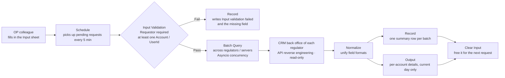
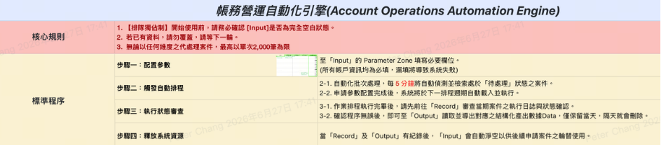

---
# English version of src/content/projects/account-automation-engine.md (draft translation, pending Peter's review).
# Dates, stack, categories, metric values and the system map come from the zh file.
summary: "Turned OP's routine of switching between multiple CRM back offices and checking accounts one by one into a batch query engine with LarkSheet as the entry point; from launch in 2026/6 to 11/16 it ran successfully 531 times and verified 381,629 accounts in total."
role: "Distilled a shared query workflow from OP's pain points; designed and built the batch query engine on my own"
metric_labels:
  - "Accounts verified (2026-06-09 ~ 11-16)"
  - "Manual query hours saved in total (estimate)"
  - "Equivalent labor cost (estimate)"
story:
  - { label: "Map", line: "Client data lives in CRM and trading accounts in MetaTrader; each account's balance, margin and P&L can only be looked up in its own regulator's CRM back office, and there are 4 of them." }
  - { label: "Why look them up", line: "Offboarding a high-risk client or moving a client to another salesperson both touch the client's money. So before either, OP must check the status of every account on the list." }
  - { label: "Scattered accounts", line: "The hard part: one client often has several accounts. Each regulator has its own back office, and accounts sit wherever the client opened them." }
  - { label: "By hand vs. engine", line: "By hand, OP switches back offices and looks up one account at a time; the engine takes the whole list and fetches everything across back offices in one go." }
  - { label: "Engine flow", line: "Requests from different teams look different but are all \"give a list, get the same fields back\". So I built an engine: OP fills in a sheet, a schedule picks it up, validates it, queries every back office through API reverse engineering, and records both successes and failures." }
  - { label: "Worked example", line: "A real request: 68 clients expanded into 322 accounts, almost 5 per client, spread over 2 regulators and 33 servers, and the engine looked them all up in one go." }
  - { label: "Running for real", line: "First, the same kind of lookup done for real: on the left, someone switching CRM back offices and checking accounts one by one; on the right, OP fills in the list and the engine does the rest." }
  - { label: "Run record", line: "Every request leaves a row in Record: a success says how many accounts and countries it covered; a request missing a field is stopped before any query, with the missing field spelled out." }
  - { label: "Result", line: "After launch, teams have submitted requests on their own every month without an engineer; October was the busiest month." }
impact:
  before: "Switching between CRM back offices to check accounts one by one"
  after: "OP submits a list and gets results in bulk, with every request traceable"
tldr:
  problem: "To check client account statuses, OP had to switch regulators across several CRM back offices and look up accounts one by one; batch cases overwhelmed the team."
  approach: "Turned the shared query workflow into a batch engine with LarkSheet as the entry point: validate the input first, query on a schedule, and record both successes and failures."
  result: "OP submits a list and the engine does the rest, so queries no longer tie up staff, and every request can be traced."
---

## Problem Assessment

<hr data-slide="Background and terms">

- Before closing accounts, offboarding high-risk clients or transferring ownership, OP must first check the account status of every client on the list: userId, Balance, Margin, Profit, Account Server and so on.
- IT can provide the list of UIDs to process, but not these fields. OP could only switch regulators across several CRM back offices and look up and confirm each account one by one.
- Requests come from different teams and often arrive in batches; one-by-one lookups could not keep up with batch cases.

<details class="glossary-details">
<summary>Glossary<span class="mono">10 terms · click to expand</span></summary>
<table>
<thead><tr><th>Term</th><th>Meaning</th></tr></thead>
<tbody>
<tr><td>OP</td><td>Operations colleagues who handle day-to-day client account work</td></tr>
<tr><td>CRM back office</td><td>Internal system that manages clients and trading accounts; each regulator has its own</td></tr>
<tr><td>regulator</td><td>The financial regulator a client belongs to (for example VFSC)</td></tr>
<tr><td>UID / userId</td><td>A client's unique ID in the CRM; one client can have several trading accounts</td></tr>
<tr><td>Account</td><td>MT4 / MT5 trading account number</td></tr>
<tr><td>Account Server</td><td>The trading server an account lives on (for example MT5_AU7)</td></tr>
<tr><td>Trading Account / Rebate Account</td><td>The account a client trades with / the account an IB (introducing broker) receives rebates in</td></tr>
<tr><td>Balance / Equity / Margin / Profit / Credit</td><td>Balance / equity / used margin / floating P&amp;L / bonus or credit line</td></tr>
<tr><td>Offboarding</td><td>Closing and settling a high-risk client's accounts; each account's balance, equity and margin must be checked first</td></tr>
<tr><td>Ownership transfer</td><td>Moving a client to another IB or salesperson; the status of every account the client holds must be checked first</td></tr>
</tbody>
</table>
</details>

<hr data-slide="What gets looked up">

Offboarding (closing and settling a high-risk client's accounts) and ownership transfer (moving a client to another IB or salesperson) both touch the client's money or ownership, so before either, OP must check the Balance, Margin, Profit and other status of every account on the list.

The hard part is that accounts are not in one place: each regulator has its own CRM back office, and an account sits wherever the client opened it, under that regulator and on that trading server. One client (UID) often has several accounts, so by hand OP can only switch back offices and look them up one at a time (time cost in the pain points):

<figure class="split-figure">
<div class="split-scroll">
<svg viewBox="0 0 760 340" role="img" aria-labelledby="ac-title"><title id="ac-title">One client, many accounts: accounts sit in different regulators' back offices; by hand you switch one by one, the engine fetches them in one go</title><defs><marker id="ac-arrow" viewBox="0 0 8 8" refX="7" refY="4" markerWidth="8" markerHeight="8" orient="auto"><path class="sf-head" d="M0,0 L8,4 L0,8 z"/></marker></defs><g data-b="client"><rect class="sf-parent" x="20" y="100" width="140" height="60" rx="8"/><text class="sf-t" x="90" y="126">Client</text><text class="sf-s" x="90" y="146">one UID</text></g><g data-b="backends"><rect class="sf-box" x="220" y="30" width="125" height="170" rx="8"/><text class="sf-t" x="282" y="52">Regulator A</text><text class="sf-s" x="282" y="68">CRM back office</text><rect class="sf-box" x="355" y="30" width="125" height="170" rx="8"/><text class="sf-t" x="417" y="52">Regulator B</text><text class="sf-s" x="417" y="68">CRM back office</text><rect class="sf-box" x="490" y="30" width="125" height="170" rx="8"/><text class="sf-t" x="552" y="52">Regulator C</text><text class="sf-s" x="552" y="68">CRM back office</text><rect class="sf-box" x="625" y="30" width="125" height="170" rx="8"/><text class="sf-t" x="687" y="52">Regulator D</text><text class="sf-s" x="687" y="68">CRM back office</text><text class="sf-s" x="552" y="120">(none for this client)</text></g><g data-b="accounts"><path class="sf-line sf-thin" d="M160 130 C 190 130, 200 98, 228 98"/><path class="sf-line sf-thin" d="M160 130 C 190 130, 200 142, 228 142"/><path class="sf-line sf-thin" d="M160 130 C 190 130, 335 98, 363 98"/><path class="sf-line sf-thin" d="M160 130 C 190 130, 605 98, 633 98"/><path class="sf-line sf-thin" d="M160 130 C 190 130, 605 142, 633 142"/><rect class="sf-child" x="230" y="80" width="105" height="36" rx="6"/><text class="sf-t sf-small-t" x="282" y="96">Account #1</text><text class="sf-s" x="282" y="110">MT5</text><rect class="sf-child" x="230" y="124" width="105" height="36" rx="6"/><text class="sf-t sf-small-t" x="282" y="140">Account #2</text><text class="sf-s" x="282" y="154">MT4</text><rect class="sf-child" x="365" y="80" width="105" height="36" rx="6"/><text class="sf-t sf-small-t" x="417" y="96">Account #3</text><text class="sf-s" x="417" y="110">MT5</text><rect class="sf-child" x="635" y="80" width="105" height="36" rx="6"/><text class="sf-t sf-small-t" x="687" y="96">Account #4</text><text class="sf-s" x="687" y="110">MT5</text><rect class="sf-child" x="635" y="124" width="105" height="36" rx="6"/><text class="sf-t sf-small-t" x="687" y="140">Account #5</text><text class="sf-s" x="687" y="154">MT4</text></g><line class="sf-sep" x1="20" y1="222" x2="740" y2="222"/><g data-b="manual"><text class="sf-t sf-start" x="20" y="262">By hand</text><rect class="sf-node" x="110" y="240" width="150" height="34" rx="6"/><text class="sf-t sf-small-t" x="185.0" y="262">Back office A · 2</text><path class="sf-line" d="M260 257 H282" marker-end="url(#ac-arrow)"/><rect class="sf-node" x="288" y="240" width="150" height="34" rx="6"/><text class="sf-t sf-small-t" x="363.0" y="262">Back office B · 1</text><path class="sf-line" d="M438 257 H460" marker-end="url(#ac-arrow)"/><rect class="sf-node" x="466" y="240" width="150" height="34" rx="6"/><text class="sf-t sf-small-t" x="541.0" y="262">Back office D · 2</text><text class="sf-s sf-start" x="644" y="262">switch, look up one by one</text></g><g data-b="engine"><text class="sf-t sf-start" x="20" y="314">Engine</text><rect class="sf-parent" x="110" y="292" width="150" height="34" rx="6"/><text class="sf-t sf-small-t" x="185.0" y="314">Take the whole list</text><path class="sf-line" d="M260 309 H282" marker-end="url(#ac-arrow)"/><rect class="sf-parent" x="288" y="292" width="190" height="34" rx="6"/><text class="sf-t sf-small-t" x="383.0" y="314">Query all back offices at once</text><path class="sf-line" d="M478 309 H500" marker-end="url(#ac-arrow)"/><rect class="sf-parent" x="506" y="292" width="150" height="34" rx="6"/><text class="sf-t sf-small-t" x="581.0" y="314">Record / Output</text><text class="sf-s sf-start" x="684" y="314"></text></g></svg>
</div>
<figcaption>Figure 1　One client, many accounts: each regulator has its own CRM back office, and an account sits wherever the client opened it; by hand you switch back offices one by one, while the engine takes the whole list and fetches everything in one go (illustration)</figcaption>
</figure>

<hr data-slide="Engine flow">

Requests from different teams look different, but they are all "take a list of userIds / Accounts and return the same set of account fields". So the problem to solve is not "looking up faster" but that **the same lookup was redone by hand every time, one account and one back office at a time**. I turned that shared workflow into an engine:



*Figure 2　Engine flow*

<hr data-slide="Worked example">

One real request from 2026-07-07, showing how a list moves from Input to Record and Output:

| Step | Sheet | Content |
|---|---|---|
| 1. Fill in the list | Input (illustration) | Requestor: the requester; UserId: 68 clients |
| 2. Validation passes, the schedule picks it up | — | Requestor filled in, at least one UserId |
| 3. Query across back offices, write the summary | Record | 68 clients → 322 accounts; 22 countries, 33 servers, 2 regulators, 25 account types; 0 not found |
| 4. Write the details | Output | One row per account (322 rows), 23 fields (see the output format in Result) |
| 5. Clear Input | Input | Freed for the next request |

*Rows 3 and 4 come from the Record sheet (R-0055); Input is not kept, so row 1 is an illustration.*

- **68 clients, 322 accounts**: about 4.7 accounts per client on average, across 2 regulators and 33 servers, which is why doing it by hand meant switching back offices over and over.
- **When validation fails**: nothing is queried, and Record states the missing field (examples in Result).

<hr data-slide="Pain points and evidence">

<figure class="pain-figure">
<div class="pain-grid">
<section class="pain-card tone-grey pain-wide">
<h4 class="pain-title">One by one, switching back and forth</h4>
<p class="pain-label"><span>Pain</span>Every account takes a full lookup</p>
<ul class="pain-note">
<li>Clients of different regulators live in different CRM back offices, so the right one must be opened first.</li>
<li>Balance, Margin, Profit and Server have to be opened and checked one by one for every account.</li>
</ul>
<div class="pain-evidence">
<p class="pain-evidence-title">Evidence: steps to look up one account by hand</p>
<ol class="pain-flow">
<li>Take one userId from the UID list provided by IT.</li>
<li>Work out the client's regulator and switch to that CRM back office.</li>
<li>Search for the client, open the account page and find the Trading Account / Rebate Account.</li>
<li>Note down Balance, Margin, Profit, Equity, Credit, Account Server and the other fields.</li>
<li>Go back to the list, take the next one and repeat steps 1–4.</li>
</ol>
<p class="pain-caption">About <b>45 seconds</b> per account on average (estimate) → 1,000 accounts ≈ <b>12.5 hours</b> of manual work.</p>
</div>
</section>
<section class="pain-card tone-red">
<h4 class="pain-title">Batch cases overwhelm the team</h4>
<p class="pain-label"><span>Pain</span>Case volume far exceeds one-by-one speed</p>
<ul class="pain-note">
<li>Offboarding and ownership transfers often involve thousands of accounts at once.</li>
<li>Work is held up by looking up data, not by making decisions.</li>
</ul>
<div class="pain-evidence">
<p class="pain-evidence-title">Evidence: batch requests actually submitted after launch</p>
<ul class="pain-flow">
<li>The largest single batch had <b>17,416</b> accounts, about <b>218 hours</b> of one-by-one lookups.</li>
<li><b>65</b> batches had more than 2,000 accounts.</li>
</ul>
</div>
</section>
<section class="pain-card tone-yellow">
<h4 class="pain-title">Core work gets squeezed</h4>
<p class="pain-label"><span>Pain</span>Time goes to searching, switching systems and final checks</p>
<ul class="pain-note">
<li>OP's time was taken up by searching for and organizing data.</li>
<li>Risk and compliance work that really needs human judgment got pushed back.</li>
</ul>
<div class="pain-evidence">
<p class="pain-evidence-title">Evidence: what one batch covers</p>
<ul class="pain-flow">
<li>A single batch covered up to <b>179</b> countries, <b>40</b> servers, <b>4</b> regulators and <b>48</b> account types.</li>
<li>Each account has <b>20</b>+ fields to check (see the output format in Result).</li>
</ul>
</div>
</section>
</div>
<figcaption>Figure 3　Three pain points in the original process (manual steps based on OP's routine; 45 seconds per account is an estimate; batch figures from the engine's Record sheet, 2026-06-09 ~ 2026-11-16)</figcaption>
</figure>

<hr data-slide="Why it was worth solving">

**Why it was worth solving:**

1. **The demand is real**: in the 24 weeks since launch, every single week had successful batch requests (monthly usage in Result).
2. **Single batches already exceed what people can do**: the largest batch (Figure 3) would take one person about 27 working days to look up by hand.
3. **The work is highly repetitive and generalizes well**: requests from different teams look different on the surface, but they all come down to "here is a list of userIds / Accounts, return the same set of account fields". About 80% of OP's day-to-day account queries can be covered by one workflow.

## Solution Design

The three pain points break down into five things to solve. The image below shows the usage rules users see in LarkSheet; the "Maps to" column of the table points to its rows:


*Figure 4　Usage rules in LarkSheet (Chinese section of the Rule sheet; the sheet's English section says the same, and the table below gives the content in English; click to enlarge)*

| Pain point | Solution | Maps to |
|---|---|---|
| One-by-one lookups, switching regulators | Enter the whole userId / Account list at once (two field groups: Trading Account / Rebate Account); the engine queries across regulators and servers in batch; incomplete input is stopped, recorded, and the missing field explained | Step 1: configure parameters |
| Batch cases overwhelm the team | A schedule picks up pending requests every 5 minutes, no manual trigger needed | Step 2: automatic scheduling |
| Results scattered and hard to confirm | Each batch writes a one-row summary to Record (account count, countries / servers / regulators covered, list of not-found accounts) and per-account details to Output | Step 3: review execution status |
| Several teams share one entry point | Exclusive queue: a request can be entered only when Input is empty; up to 2,000 rows per request | Core rules 1–3 |
| The entry point stays occupied | Input is cleared automatically once both Record and Output are written, freeing it for the next request | Step 4: release system resources |

**Constraints the design had to handle:**

- Users are non-technical OP colleagues, so the entry point had to be a tool they already use (LarkSheet), not a new system to learn.
- Several teams share one sheet; filling it in at the same time would overwrite each other, so a queue was needed.
- The output is client account data, so details cannot stay on a shared sheet for long: Output keeps only the current day and is deleted the next day.
- The CRM offers OP no API or database access; a request to IT for a full-field report or DB access had no foreseeable delivery date, and batch cases could not wait. So the engine uses API reverse engineering to log in to each regulator's CRM back office and fetch the account data.

## Alternative Solutions

| Option | Approach | Pros | Cons |
|---|---|---|---|
| A. Keep manual one-by-one lookups | Use IT's UID list and look up each account in each CRM back office | No development | Staff time grows linearly with case volume (time in Problem) |
| B. Ask IT for a full-field report or DB access | IT or the system owner provides an official data source | Most complete data, officially supported | Requested, but with no foreseeable delivery date; batch cases could not wait |
| C. A one-off script per request | Write a query script for each list as requests arrive | Fast for a single delivery | Needs an engineer every time; OP can't use it alone; logic scattered and hard to audit |
| **D. General batch query engine (chosen)** | Distill the shared workflow into a tool with LarkSheet as the entry point, run on a schedule | OP submits on their own; covers about 80% of day-to-day queries; every run is recorded | Shared fields and validation rules must be designed up front; the remaining ~20% of special requests still need individual handling |


## Selected Solution

<hr data-slide="Why this option">

**Chosen: D, a general batch query engine**

1. **Removes A's linear staffing problem**: the engine does the lookups; people only fill in the list and review results, so more cases don't need more people.
2. **No waiting on IT**: B's delivery date was out of our hands, so D could go live first; if an official data source arrives later, only the fetch layer needs replacing.
3. **Removes C's dependence on engineers**: once OP fills in the parameters in LarkSheet, the schedule picks the request up; no engineer is needed.
4. **Find the pattern first, then build the tool**: about 80% of requests share the same input (userId / Account) and the same output fields, which makes one tool worthwhile; the remaining special cases are not forced into the same flow.

<hr data-slide="Design notes">

**Design notes:**

- **Validate before querying, and record failures too**: when validation fails, nothing is queried; the reason (for example a missing Requestor) is written straight to Record, so the requester can see what to fix (blocked count in Result).
- **Not-found accounts are kept, not dropped**: accounts that can't be found are collected in Record's `total_missing_list` and shown alongside the successful results.
- **Exclusive queue**: while Input has data, nobody else can overwrite it; Input is cleared only after both Record and Output are written, so no request is lost.
- **Per-request limit**: the rules allow at most 2,000 rows per request (counted as input userId rows), so one request can't hold the entry point for too long; one userId expands into several accounts, so a batch can exceed 2,000 accounts.
- **Data retention**: Output details are kept only for the current day and deleted automatically the next day; Record keeps only summaries, as the long-term run history.
- **Access scope**: the engine logs in to each regulator's CRM back office with my automation account, which is read-only and writes nothing.

## Result

<hr data-slide="Screen recordings">

### Screen recordings: manual lookup vs the engine

The same kind of query: on the left, done by hand in the CRM back office; on the right, run by the engine in batch:

<figure class="video-figure">
<div class="video-grid">
<div class="video-item">
<p class="video-label">Before: manual lookup</p>
<video controls muted playsinline preload="metadata" src="../../../media/account-automation-engine/crm_manual.mp4"></video>
</div>
<div class="video-item">
<p class="video-label">After: run by the engine</p>
<video controls muted playsinline preload="metadata" src="../../../media/account-automation-engine/crm_system.mp4"></video>
</div>
</div>
<figcaption>Figure 5　Real screen recordings (click to play)</figcaption>
</figure>

<hr data-slide="One real run">

### A real run

Every run writes a one-row summary to Record. Below are a successful run on launch day (2026-06-09) and two requests stopped by validation (requester names removed; the two validation messages are translated from Chinese):

```text
2026-06-09 11:31:09  Success | 616 users | 957 accounts validated | 68 countries | 11.96 hrs saved
                     servers_covered=36  regulators_covered=2  account_types_covered=29
2026-06-26 15:05:03  Input validation failed: 'Requestor' is a required field.
2026-07-15 14:10:02  Input validation failed: no query data provided; fill in at least one 'Account' or 'UserId'.
```

What this log shows:

- **A single request covered 68 countries, 36 servers and 2 regulators**, which by hand would mean switching between several back offices.
- Every row carries the requester, run time and hours saved, so it is possible to trace afterwards who queried how many accounts and when.
- When input is incomplete, the record says exactly which field is missing instead of failing silently.

<figure class="tech-figure">
<div class="tech-labels">
<div class="tech-label">
<p class="tech-label-kicker">Tech Label</p>
<p class="tech-label-name">Batch Query Engine</p>
<p class="tech-label-desc">Enter a whole list at once and get account statuses back in batch across regulators and servers.</p>
</div>
<div class="tech-label">
<p class="tech-label-kicker">Tech Label</p>
<p class="tech-label-name">Validation &amp; Audit Record</p>
<p class="tech-label-desc">Validate before querying; both successes and failures go to Record, so every request is traceable.</p>
</div>
<div class="tech-label">
<p class="tech-label-kicker">Tech Label</p>
<p class="tech-label-name">Exclusive Queue Lock</p>
<p class="tech-label-desc">Whether Input is empty acts as the lock, so several teams can share one entry point without overwriting each other.</p>
</div>
</div>
</figure>

<hr data-slide="Output format">

### Output format

Output has one row per account and 23 columns. The two rows below come from the real output on 2026-11-16, with user_id, account number, client and IB names, and account group removed:

| server | accountType | countryCode | currency | balance | equity | margin | leverage | IsArchive | regulator | approvedTime | updateTime |
|---|---|---|---|---|---|---|---|---|---|---|---|
| MT5_AU7 | Hedge STP | India | USD | 0.0 | 0.0 | 0.0 | 500 | Normal | VFSC | 2026-11-05 01:03:37 | 2026-11-07 16:34:13 |
| MT5_AU4 | Hedge STP | India | USD | 0.0 | 0.0 | (blank) | (blank) | Archive | VFSC | 2026-03-11 06:19:18 | 2026-11-07 04:27:45 |

Other columns: `Requestor`, `user_id`, `ownerAlias`, `owner`, `mt4_account`, `group`, `profit`, `marginLevel`, `credit`, `enableReadonly`, `comparisionTime` (column names kept exactly as in the system).

<hr data-slide="Monthly usage">

### Monthly usage

Successful batches and accounts verified per month; October was the busiest month:

<figure class="bar-figure">
<ul class="bar-list">
<li style="--v: 51.7%"><span class="bar-label">2026-06 (from 6/9, 39 runs)</span><span class="bar"></span><span class="bar-value">58,805</span></li>
<li style="--v: 56.4%"><span class="bar-label">2026-07 (95 runs)</span><span class="bar"></span><span class="bar-value">64,060</span></li>
<li style="--v: 19.1%"><span class="bar-label">2026-08 (83 runs)</span><span class="bar"></span><span class="bar-value">21,757</span></li>
<li style="--v: 81.7%"><span class="bar-label">2026-09 (69 runs)</span><span class="bar"></span><span class="bar-value">92,890</span></li>
<li class="is-peak" style="--v: 100%"><span class="bar-label">2026-10 (207 runs)</span><span class="bar"></span><span class="bar-value">113,659</span></li>
<li style="--v: 26.8%"><span class="bar-label">2026-11 (to 11/16, 38 runs)</span><span class="bar"></span><span class="bar-value">30,458</span></li>
</ul>
<figcaption>Figure 6　Accounts verified per month (successful runs in brackets; from the Record sheet)</figcaption>
</figure>

<hr data-slide="Run statistics">

### Run statistics (2026-06-09 ~ 2026-11-16)

Source: the Record sheet (de-identified CSV below). "Successful run" means a batch whose `return_msg` starts with `Success`; account counts are the sum of each batch's `total_accounts`, so an account queried in different batches is counted each time.

| Metric | Value |
|---|---|
| Total requests | 563 |
| Successful runs | 531 (94.3%) |
| Stopped by validation | 32 (missing Requestor 23, missing Account / UserId 9) |
| Accounts verified in total | 381,629 |
| Accounts per batch | median 89, mean 719 (largest batch in Problem) |
| Days with usage | 112 |

<details class="csv-details">
<summary>Full data (de-identified)<span class="mono">563 rows · click to expand</span></summary>
<div class="csv-viewer" data-src="../../../data/account-engine-record-2026-06-11.csv">
<p><a href="../../../data/account-engine-record-2026-06-11.csv" download>Download the de-identified CSV (2026-06-09 ~ 2026-11-16, 563 rows)</a></p>
</div>
</details>

## Impact

<hr data-slide="Verified results">

### Verified results

<figure class="ba-figure">
<div class="ba-table">
<div class="ba-row ba-head"><p class="ba-item">Item</p><p class="ba-before">Before: manual one-by-one lookups</p><p class="ba-after">After: batch query engine</p></div>
<div class="ba-row"><p class="ba-item">How queries work</p><p class="ba-before">Switch to the right regulator's CRM back office for each account and look it up</p><p class="ba-after">Enter the whole list once; results come back in batch across regulators and servers<small>Basis: Rule sheet; single-batch coverage in Problem</small></p></div>
<div class="ba-row"><p class="ba-item">Manual hours</p><p class="ba-before">About 45 seconds per account</p><p class="ba-after">About 4,770 hours in total now handled by the engine<small>Basis: accounts verified in total (see Result) × 45 s ÷ 3,600; 45 s is an estimate</small></p></div>
<div class="ba-row"><p class="ba-item">Labor cost</p><p class="ba-before">No record</p><p class="ba-after">About NT$1.91M in total<small>Basis: 4,770 hours × NT$400/hour (cost basis is an estimate)</small></p></div>
<div class="ba-row"><p class="ba-item">How it's used</p><p class="ba-before">OP has to work every back office in person</p><p class="ba-after">Teams submit a form themselves; the schedule runs every 5 minutes<small>Basis: Rule sheet; monthly usage in Result</small></p></div>
<div class="ba-row"><p class="ba-item">Bad input</p><p class="ba-before">No record</p><p class="ba-after">Incomplete requests are stopped before querying, with the missing field explained<small>Basis: Record's return_msg; blocked count in Result</small></p></div>
</div>
<figcaption>Figure 7　Before / After (hours and cost are estimates; basis below)</figcaption>
</figure>

<hr data-slide="Not yet quantified">

### Not yet quantified, or needing explanation

- **Calculation basis**: 45 seconds per manual lookup and NT$400/hour labor cost are both estimates. Only successful batches are counted; requests that failed validation are excluded.
- **Accounts can be counted more than once**: accounts verified in total is the sum over batches; an account queried in different batches counts each time, because each query stands for one round of manual work.
- **80% coverage**: the share of OP's day-to-day account queries this workflow can handle, estimated by request type rather than counted case by case.
- **Engine run time**: Record does not store how long each batch took, so this page does not claim "from X hours down to Y minutes".
- **Unit of the per-request limit**: 2,000 means input userId rows, not accounts; one userId expands into several accounts, so some batches in Record exceed 2,000 accounts (see Problem).
