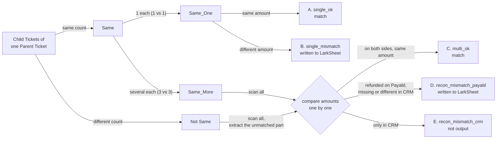
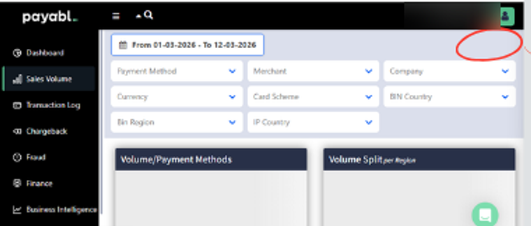
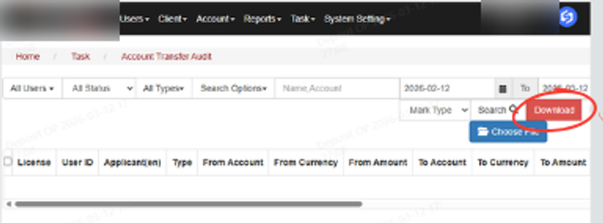
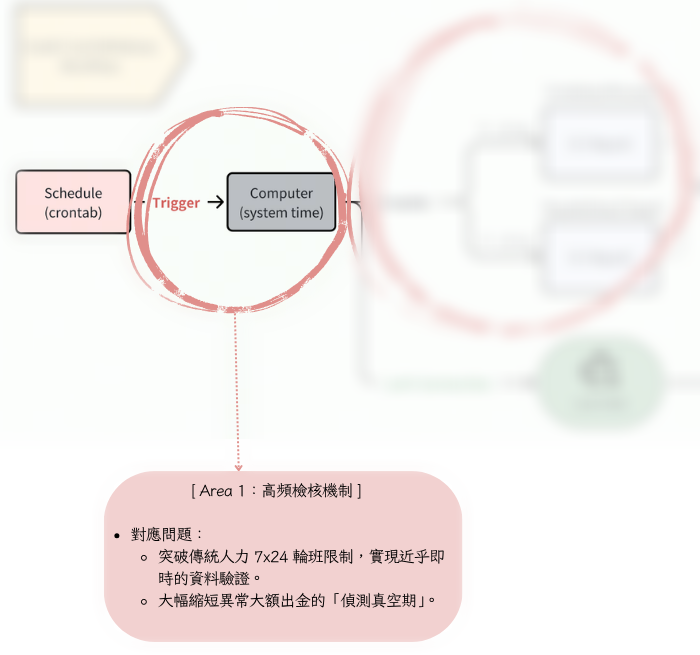
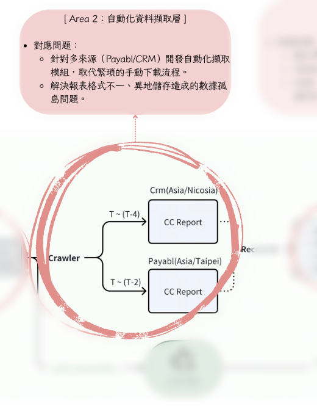
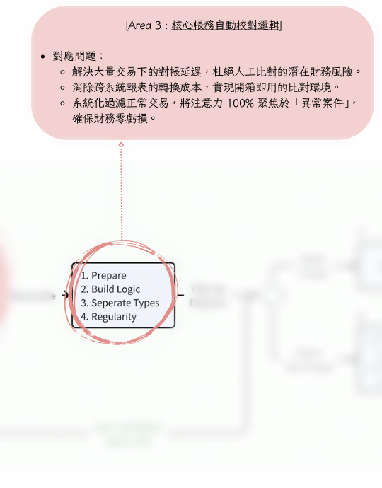
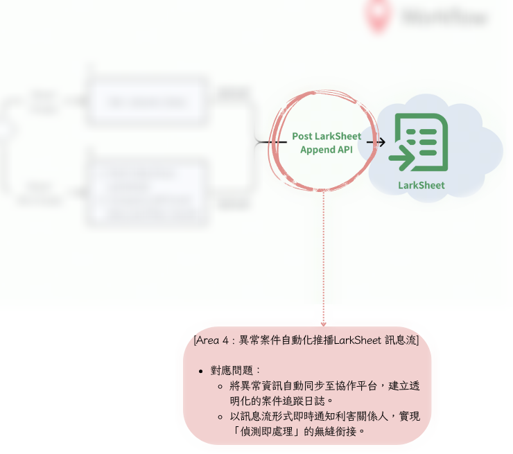
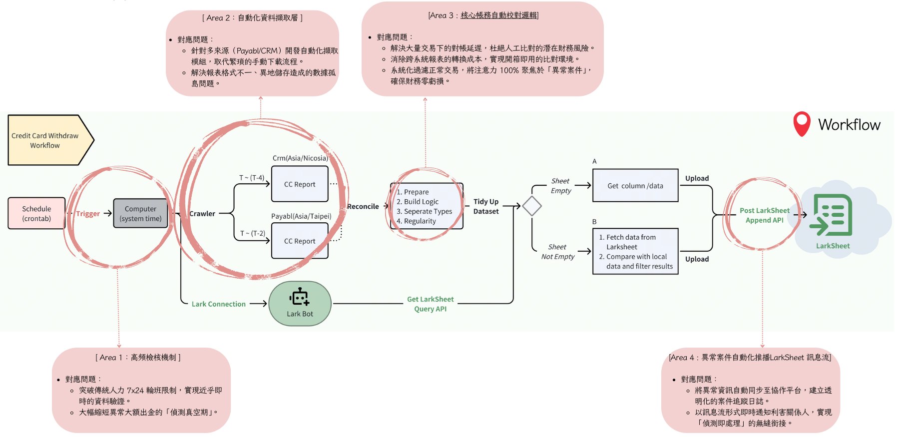
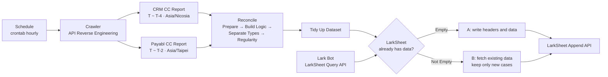
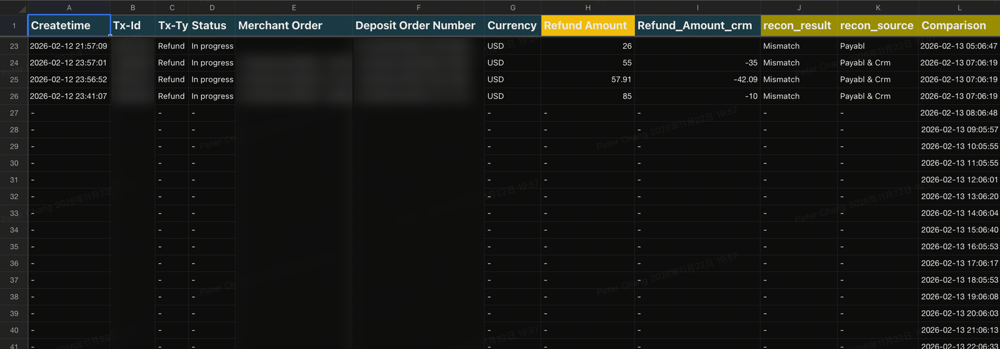

---
# English version of src/content/projects/credit-card-anomaly-detection.md (draft translation, pending Peter's review).
# Dates, stack, categories, metric values and the system map come from the zh file.
summary: "Pulls credit card withdrawal reports from Payabl and the CRM automatically via API reverse engineering and reconciles them in full every hour, replacing manual Excel comparison staffed by 5 daily shifts; ran reliably 3,162 times from March to July 2026."
role: "Aligned detection logic with operations; designed and built the pipeline"
metric_labels:
  - "Detection time once data is available (previously up to about 5 hours)"
  - "Manual comparison hours saved, Mar–Jul (estimate)"
  - "Automated reconciliation runs, Mar–Jul"
story:
  - { label: "Map", line: "Clients do everything in the Client Portal. A card recharge flows from Payabl through Bridger into CRM; a withdrawal goes the other way, with operations refunding to the card in Payabl." }
  - { label: "Serial numbers", line: "As a payment passes through Bridger, every recharge gets a unique serial (PSP trx ID). Xiao Ming's three recharges yesterday, 30, 40 and 30 USD, get serials #1, #2 and #3." }
  - { label: "Same-route rule", line: "Because every recharge has its own serial, in principle a refund has to name the one it goes back to: the same-route rule. Today's 100 USD withdrawal (Parent) is split into 30→#1, 40→#2 and 30→#3 (Children)." }
  - { label: "Data gap", line: "In practice, though, Bridger passes only the serial to Payabl, not the withdrawal. So Payabl has every refund's details but no idea which withdrawal they belong to, while CRM has the Parent and Children but no details." }
  - { label: "Problem", line: "When operations split refunds by hand in Payabl, they can't see how the withdrawal should be split, so they may refund one too many (30, 40, 30, 30) or type a wrong amount (30, 40, 20)." }
  - { label: "Matching rules", line: "So matching can't stop at the total; it has to go down to each Child Ticket: check the count, then each amount. Only what Payabl refunded but CRM doesn't match goes to operations." }
  - { label: "Worked example", line: "Walk through A to E: with a single recharge, a matching amount is A and a wrong one is B; split into three, matching refunds are C, while the mistyped 20 and the extra 30 are both D; the one not refunded yet exists only in CRM, so it is E." }
  - { label: "To operations", line: "B and D are written automatically to the LarkSheet case sheet operations already use, where they review and reverse wrong refunds." }
  - { label: "Solution", line: "But to fill that sheet automatically I need data from both sides, and neither side has an API; Payabl does not even have a download button. So I use API reverse engineering to fetch both reports every hour, run the matching and write only new anomalies to LarkSheet." }
  - { label: "Screens", line: "Back to that case sheet to see it at work: a run with anomalies adds case rows that operations review right here; every hour without one still leaves a row with the comparison time." }
  - { label: "Running for real", line: "This is a real run at 11:00 on 2026-03-16: log in to Payabl and fetch its report, download the CRM report day by day, run the matching, then write new cases to LarkSheet. This time both sides matched, so there was nothing new." }
  - { label: "Output", line: "Transactions that don't match are written to LarkSheet: the first two rows exist on both sides with different amounts; the last one was refunded in Payabl with no record in CRM. Operations review them right on this sheet." }
  - { label: "Result", line: "After launch, flagged transactions go to operations for review, and nearly all confirmed wrong refunds were reversed or had cancellation requested after detection." }
impact:
  before: "Shift staff compared reports by hand; wrong refunds were found late"
  after: "A wrong refund is flagged on the next run"
tldr:
  problem: "On credit card withdrawals, the refund Payabl actually paid may not match what the CRM recorded; manual Excel checks relied on shifts and had hit their limits on frequency and accuracy."
  approach: "Pull both reports automatically via API reverse engineering, reconcile everything every hour, and write only mismatched transactions to LarkSheet for operations to review."
  result: "A wrong refund is flagged on the next run and handed to operations to reverse; comparison no longer needs shift staff."
---

## Problem Assessment

<hr data-slide="Background and terms">

- When a client who recharged by credit card requests a withdrawal, the money is refunded to the original card at the payment provider **Payabl** and must also be recorded in the internal **CRM**.
- If the two amounts differ (wrong refund amount, duplicate refund, missing CRM record), company money has actually left without being recorded correctly.

<details class="glossary-details">
<summary>Glossary<span class="mono">14 terms · click to expand</span></summary>
<table>
<thead><tr><th>Term</th><th>Meaning</th></tr></thead>
<tbody>
<tr><td>Deposit / Withdrawal</td><td>A client putting money in / taking money out</td></tr>
<tr><td>PSP</td><td>Payment Service Provider, an external payment provider</td></tr>
<tr><td>Payabl</td><td>The payment side: the credit card PSP in this project, which actually processes recharges and refunds; it has the details of every refund but can't tell which withdrawal a refund belongs to</td></tr>
<tr><td>CRM</td><td>Internal system that manages clients and transaction records; it has Parent and Child Tickets but no transaction details</td></tr>
<tr><td>Bridger</td><td>The interface between Payabl and CRM; it gives every recharge a unique serial number (PSP trx ID) and passes only that serial, not the withdrawal (Parent), to Payabl</td></tr>
<tr><td>Recharge</td><td>A credit card deposit: the client pays by card in the Client Portal</td></tr>
<tr><td>Refunded</td><td>A credit card withdrawal: the money goes back to the card used for the recharge</td></tr>
<tr><td>Same-route rule</td><td>A credit card withdrawal must go back to the card used for the recharge and be tied to the original recharge order</td></tr>
<tr><td>Parent Ticket</td><td>One withdrawal request from a client</td></tr>
<tr><td>Child Ticket</td><td>The actual refund transactions that request is split into (possibly several)</td></tr>
<tr><td>QC</td><td>Quality Control, the operations shift that did the manual comparison</td></tr>
<tr><td>Reconcile</td><td>Checking whether the amounts in two sets of records match</td></tr>
<tr><td>T ~ T-4</td><td>Data from today back to 4 days ago</td></tr>
<tr><td>Mismatch</td><td>The two amounts differ, or one side has no record</td></tr>
</tbody>
</table>
</details>

<hr data-slide="What gets matched">

Every time a client recharges, the payment picks up a unique serial number (PSP trx ID) as it passes through Bridger. If Xiao Ming recharges three times yesterday, 30, 40 and 30 USD, there are three serials: #1, #2 and #3.

Because every recharge has its own serial, in principle credit card withdrawals follow the **same-route rule**: a refund has to name the serial it goes back to. When Xiao Ming asks to withdraw 100 USD today, that withdrawal request is the **Parent Ticket**, and it has to be split into three refunds, 30→#1, 40→#2 and 30→#3, the three **Child Tickets**.

<figure class="split-figure step-figure">
<div class="split-scroll">
<svg viewBox="0 0 760 272" role="img" aria-labelledby="sf1-title"><title id="sf1-title">Serial numbers and the same-route rule: each recharge has a serial, so a 100 USD withdrawal is split into three refunds</title><defs><marker id="sf-arrow" viewBox="0 0 8 8" refX="7" refY="4" markerWidth="8" markerHeight="8" orient="auto"><path class="sf-head" d="M0,0 L8,4 L0,8 z"/></marker></defs><rect class="sf-tag-good" x="632" y="4" width="108" height="26" rx="13"/><text class="sf-tag sf-tag-good-t" x="686" y="22">In principle</text><g transform="translate(0,52)"><g data-b="recharge"><text class="sf-note sf-start" x="20" y="-6">Xiao Ming recharged three times yesterday</text><text class="sf-s" x="85" y="24">Recharges</text><rect class="sf-node" x="20" y="40" width="130" height="44" rx="6"/><text class="sf-t" x="85" y="67">30 USD</text><rect class="sf-node" x="20" y="100" width="130" height="44" rx="6"/><text class="sf-t" x="85" y="127">40 USD</text><rect class="sf-node" x="20" y="160" width="130" height="44" rx="6"/><text class="sf-t" x="85" y="187">30 USD</text></g><g data-b="trx"><text class="sf-s" x="228" y="24">Bridger issues serials</text><path class="sf-line" d="M150 62 H174" marker-end="url(#sf-arrow)"/><rect class="sf-trx" x="180" y="46" width="96" height="32" rx="16"/><text class="sf-trx-t" x="228" y="67">trx #1</text><path class="sf-line" d="M150 122 H174" marker-end="url(#sf-arrow)"/><rect class="sf-trx" x="180" y="106" width="96" height="32" rx="16"/><text class="sf-trx-t" x="228" y="127">trx #2</text><path class="sf-line" d="M150 182 H174" marker-end="url(#sf-arrow)"/><rect class="sf-trx" x="180" y="166" width="96" height="32" rx="16"/><text class="sf-trx-t" x="228" y="187">trx #3</text></g><g data-b="parent"><text class="sf-note sf-start" x="335" y="-6">Today Xiao Ming asks for one withdrawal</text><text class="sf-s" x="410" y="24">Withdrawal request</text><rect class="sf-parent" x="335" y="92" width="150" height="64" rx="6"/><text class="sf-t" x="410" y="120">Refund 100 USD</text><text class="sf-s" x="410" y="140">Parent Ticket</text></g><g data-b="split"><text class="sf-s" x="670" y="24">Split by the same-route rule</text><path class="sf-line" d="M485 124 C 540 124, 548 62, 594 62" marker-end="url(#sf-arrow)"/><path class="sf-line" d="M485 124 H594" marker-end="url(#sf-arrow)"/><path class="sf-line" d="M485 124 C 540 124, 548 182, 594 182" marker-end="url(#sf-arrow)"/><rect class="sf-child" x="600" y="40" width="140" height="44" rx="6"/><text class="sf-t" x="670" y="60">30 USD → #1</text><text class="sf-s" x="670" y="76">Child 1</text><rect class="sf-child" x="600" y="100" width="140" height="44" rx="6"/><text class="sf-t" x="670" y="120">40 USD → #2</text><text class="sf-s" x="670" y="136">Child 2</text><rect class="sf-child" x="600" y="160" width="140" height="44" rx="6"/><text class="sf-t" x="670" y="180">30 USD → #3</text><text class="sf-s" x="670" y="196">Child 3</text></g></g></svg>
</div>
<figcaption>Figure 1　Serial numbers and the same-route rule: every recharge gets a PSP trx ID, so a 100 USD withdrawal is split into three refunds, each returned against its own serial (illustration, amounts in USD)</figcaption>
</figure>

<hr data-slide="What each side records">

In practice, though, Bridger passes only the serial to Payabl, not the withdrawal (Parent) it belongs to, and the transaction details are not written back to CRM. So each side sees only half: Payabl has the details of every refund but can't tell which withdrawal it belongs to; CRM has the Parent and Child Tickets but no transaction details. When operations split refunds by hand in Payabl, they can't see how this withdrawal should be split, and two kinds of mistakes are common:

- **The counts differ**: refunding 30, 40, 30, 30, one refund too many, which is a duplicate refund.
- **The counts match, the amount does not**: refunding 30, 40, 20, the right number of refunds with a mistyped amount.

<figure class="split-figure step-figure">
<div class="split-scroll">
<svg viewBox="0 0 760 380" role="img" aria-labelledby="sf2-title"><title id="sf2-title">What each side records: Bridger passes only the serial to Payabl, CRM and Payabl each miss half, and two common mistakes</title><defs><marker id="sf-arrow2" viewBox="0 0 8 8" refX="7" refY="4" markerWidth="8" markerHeight="8" orient="auto"><path class="sf-head" d="M0,0 L8,4 L0,8 z"/></marker></defs><rect class="sf-tag-bad" x="632" y="4" width="108" height="26" rx="13"/><text class="sf-tag sf-tag-bad-t" x="686" y="22">In practice</text><g data-b="bridger"><rect class="sf-parent" x="305" y="80" width="150" height="56" rx="28"/><text class="sf-t" x="380" y="104">Bridger</text><text class="sf-s" x="380" y="122">trx ID only</text><path class="sf-line" d="M305 108 H278" marker-end="url(#sf-arrow2)"/><path class="sf-line" d="M455 108 H482" marker-end="url(#sf-arrow2)"/><text class="sf-bad-t" x="380" y="160">Pain point: the Parent</text><text class="sf-bad-t" x="380" y="178">never reaches Payabl</text></g><g data-b="payabl"><rect class="sf-box" x="20" y="40" width="250" height="140" rx="8"/><text class="sf-t sf-start" x="36" y="64">Payabl (payment side)</text><text class="sf-k sf-start" x="36" y="92">Parent</text><text class="sf-miss sf-start" x="130" y="92">Missing</text><text class="sf-k sf-start" x="36" y="120">Child</text><text class="sf-good sf-start" x="130" y="120">#1, #2, #3</text><text class="sf-k sf-start" x="36" y="148">Details</text><text class="sf-good sf-start" x="130" y="148">30, 40, 30 USD</text></g><g data-b="crm"><rect class="sf-box" x="490" y="40" width="250" height="140" rx="8"/><text class="sf-t sf-start" x="506" y="64">CRM (internal)</text><text class="sf-k sf-start" x="506" y="92">Parent</text><text class="sf-good sf-start" x="600" y="92">Refund 100 USD</text><text class="sf-k sf-start" x="506" y="120">Child</text><text class="sf-good sf-start" x="600" y="120">#1, #2, #3</text><text class="sf-k sf-start" x="506" y="148">Details</text><text class="sf-miss sf-start" x="600" y="148">Missing</text></g><g data-b="err-head"><line class="sf-sep" x1="20" y1="206" x2="740" y2="206"/><text class="sf-h sf-start" x="20" y="232">When operations split refunds by hand in Payabl, they can't see how this withdrawal should be split:</text></g><g data-b="err1"><text class="sf-t sf-start" x="20" y="273">One too many</text><rect class="sf-node" x="150" y="250" width="70" height="36" rx="6"/><text class="sf-t" x="185" y="273">30</text><rect class="sf-node" x="230" y="250" width="70" height="36" rx="6"/><text class="sf-t" x="265" y="273">40</text><rect class="sf-node" x="310" y="250" width="70" height="36" rx="6"/><text class="sf-t" x="345" y="273">30</text><rect class="sf-bad" x="390" y="250" width="70" height="36" rx="6"/><text class="sf-t sf-bad-t" x="425" y="273">30</text><text class="sf-bad-t sf-start" x="480" y="273">Duplicate refund</text></g><g data-b="err2"><text class="sf-t sf-start" x="20" y="329">Wrong amount</text><rect class="sf-node" x="150" y="306" width="70" height="36" rx="6"/><text class="sf-t" x="185" y="329">30</text><rect class="sf-node" x="230" y="306" width="70" height="36" rx="6"/><text class="sf-t" x="265" y="329">40</text><rect class="sf-bad" x="310" y="306" width="70" height="36" rx="6"/><text class="sf-t sf-bad-t" x="345" y="329">20</text><text class="sf-bad-t sf-start" x="400" y="329">Wrong amount</text></g></svg>
</div>
<figcaption>Figure 2　What each side records: Bridger passes only the serial, so Payabl (left) has the details but no Parent, and CRM (right) has the Parent and Child but no details; below, the two mistakes when refunds are split by hand (illustration)</figcaption>
</figure>

<hr data-slide="Matching rules">

So the problem to solve is not "people make mistakes" but that **after a refund, nothing checks every Child Ticket under each Parent Ticket against both sides**. The matching rules follow the same-route rule: the unit is each Child Ticket under a Parent Ticket; compare the count first, then whether there is one or several, then the amounts, and put every Child Ticket into one of the classes A–E:


*Figure 3　Matching rules (redrawn from the project deck)*

<hr data-slide="Worked example">

Staying with the same example, a 100 USD withdrawal split into 30, 40 and 30 under the same-route rule, here is where each variation lands, in the A-to-E order of Figure 3 (A and B are the single-recharge case, with nothing to split):

| Class<br>(Figure 3 path) | Situation | Payabl refunds | CRM<br>Child Tickets | Result |
|---|---|---|---|---|
| A<br>Same_One | A single recharge | 100 | 100 | Match, not output |
| **B**<br>Same_One | A single recharge, wrong amount | <span class="val-bad">50</span> | 100 | **<span class="val-bad">50</span> written to LarkSheet** |
| C<br>Same_More | Split correctly | 30 · 40 · 30 | 30 · 40 · 30 | All three match, not output |
| **D**<br>Same_More | Wrong amount | 30 · 40 · <span class="val-bad">20</span> | 30 · 40 · 30 | 30, 40 are C; **<span class="val-bad">20</span> written to LarkSheet** |
| **D**<br>Not&nbsp;Same | Duplicate refund | 30 · 40 · 30 · <span class="val-bad">30</span> | 30 · 40 · 30 | First three are C; **the extra <span class="val-bad">30</span> written to LarkSheet** |
| E<br>Not&nbsp;Same | One not refunded yet | 30 · 40 | 30 · 40 · 30 | 30, 40 are C; CRM's extra 30 is E, not output |

*Illustration: amounts in USD, shown as positive numbers (CRM actually records refunds as negative). Real cases are in the output format in Result (a wrong amount is B, a duplicate refund is D).*

- Amounts in red are the wrong ones, the refunds written to LarkSheet for operations to review (B, D); A and C match on both sides, and E is a refund Payabl never made, so none of them is output.

<hr data-slide="Pain points and evidence">

<figure class="pain-figure">
<div class="pain-grid">
<section class="pain-card tone-grey pain-wide">
<h4 class="pain-title">A heavy process that breaks down</h4>
<p class="pain-label"><span>Pain</span>Moving data between systems by hand</p>
<ul class="pain-note">
<li>Staff had to log into Payabl and the CRM again and again to download data.</li>
<li>The process was tedious and depended heavily on personal experience.</li>
</ul>
<div class="pain-evidence">
<p class="pain-evidence-title">Evidence: every round of manual comparison goes through these two back offices</p>
<div class="pain-shots">
<div class="pain-shot">
<p class="pain-shot-title"><b>Back office 1　Payabl</b> (has transaction details)</p>



<p class="pain-shot-note"><mark>No download button</mark> (circled in red). Staff could only set a date range and filters on the View page, then copy and paste the on-screen data over and over.</p>
</div>
<div class="pain-shot">
<p class="pain-shot-title"><b>Back office 2　CRM</b> (no details)</p>



<p class="pain-shot-note"><mark>There is a download button, but many options must be set first</mark> (All Users, All Status, All Types, Search Options, Mark Type, date range) before the CRM transaction log can be downloaded.</p>
</div>
</div>
<p class="pain-evidence-title">Time for one round of manual comparison (estimate)</p>
<div class="pain-timebar">
<span class="seg-platform" style="flex: 35">Platform work: many clicks + retries　~35 min</span>
<span class="seg-excel" style="flex: 10">Tidy in Excel and post to the group　~10 min</span>
</div>
<p class="pain-caption">About <b>45 minutes</b> per round × 5 rounds a day ≈ <b>3.75 hours of manual work per day</b>.</p>
</div>
</section>
<section class="pain-card tone-red">
<h4 class="pain-title">Staffing at capacity</h4>
<p class="pain-label"><span>Pain</span>24/7 shifts still have a limit</p>
<ul class="pain-note">
<li>5 staff shifts a day worked on this continuously.</li>
<li>That was the ceiling; finer-grained checks were not possible.</li>
</ul>
<div class="pain-evidence">
<p class="pain-evidence-title">Evidence: QC shift roster (February excerpt)</p>
<div class="pain-table-wrap">
<table class="pain-schedule">
<thead><tr><th></th><th>Mon</th><th>Tue</th><th>Wed</th><th>Thu</th><th>Fri</th><th>Sat</th><th>Sun</th></tr></thead>
<tbody>
<tr><th>9AM</th><td>A</td><td>B</td><td>A</td><td>C</td><td>C</td><td>E</td><td>F</td></tr>
<tr><th>2PM</th><td>C</td><td>D</td><td>B</td><td>A</td><td>D</td><td>G</td><td>—</td></tr>
<tr><th>6PM</th><td>H</td><td>I</td><td>J</td><td>H</td><td>J/I</td><td>—</td><td>K</td></tr>
<tr><th>10PM</th><td>L</td><td>L</td><td>L</td><td>L</td><td>L</td><td>M</td><td>N</td></tr>
<tr><th>4AM</th><td>N</td><td>N</td><td>M</td><td>N</td><td>N</td><td>M</td><td>M</td></tr>
</tbody>
</table>
</div>
<p class="pain-caption">5 time slots a week, 14 colleagues on rotation (names replaced with letters). Each slot ran one round of manual comparison of about 45 minutes.</p>
</div>
</section>
<section class="pain-card tone-yellow">
<h4 class="pain-title">Risk getting out of control</h4>
<p class="pain-label"><span>Pain</span>Rising error rate + incomplete matching logic</p>
<ul class="pain-note">
<li>With so much data, Excel comparison was very error-prone.</li>
<li>An anomaly not caught in time leads to financial loss.</li>
</ul>
<div class="pain-evidence">
<p class="pain-evidence-title">Evidence: tickets on the two sides don't line up</p>
<ul class="pain-flow">
<li><b>Payabl</b> only has Child Tickets, with transaction details, but can't tell which Parent Ticket each refund belongs to; matching back to the CRM by hand often paired them wrong.</li>
<li><b>CRM</b> has Parent and Child Tickets but no details, so the CRM alone cannot show whether something is wrong.</li>
<li>Each check covers tens of thousands of transactions on each side (see the log in Result).</li>
</ul>
</div>
</section>
</div>
<figcaption>Figure 4　Three pain points in the original process (redrawn from the project deck; platform screenshots have the address bar cropped and the login account and brand logo blurred; roster names replaced with letters; hours are estimates)</figcaption>
</figure>

<hr data-slide="Why it was worth solving">

**Why it was worth solving:**

1. **Losses are direct cash outflows**: among the wrong refunds confirmed after launch were a case where Payabl refunded 60 USD while the CRM recorded only 30 USD, and a 350 EUR refund paid out twice; both were reversed by operations after detection (counts in Result).
2. **The manual approach could not scale**: each round takes a fixed amount of time (Figure 4), 5 shifts was already the limit, and checking more often would only mean adding people.

## Solution Design

The three pain points break down into four things to solve:

| Pain point | Solution | Maps to |
|---|---|---|
| Staff at capacity, limited check frequency | A schedule triggers automatically and checks every hour, independent of shifts | |
| Moving data between systems by hand | Pull both reports with code instead of downloading and copy-pasting | |
| Error-prone Excel checks, incomplete logic | Turn the matching rules into code (each rule aligned with operations first), filter out normal transactions automatically and output only anomalies | |
| Anomalies not caught in time | Push anomalies straight into the LarkSheet operations already uses, as a case-tracking record | |

**Constraints the design had to handle:**

- No official API or database access.
- The Payabl back office has no report download feature.
- The two reports become available at different times: CRM covers T ~ T-4 and Payabl covers T ~ T-2, in different time zones (CRM in Asia/Nicosia, Payabl in Asia/Taipei) (Figure 5).

## Alternative Solutions

Four options were evaluated at the time; the first three were the alternatives:

| Option | Approach | Pros | Cons |
|---|---|---|---|
| A. Add shift staff | Keep manual Excel comparison and add people to check more often | No development, available immediately | Cost grows linearly with frequency; 5 shifts still meant only 5 checks a day; Excel error rate would not drop |
| B. Request an official API or DB access | Ask the vendor or system owners for a formal data interface | Most stable, officially supported | Depends on other teams, timeline out of our control; the risk continues while waiting |
| C. Browser automation (Selenium / RPA) | Simulate a person using the back-office pages | No need to understand the system's internal interfaces | Payabl has no download button, so it would have to copy page by page; breaks when the UI changes; slow, needs a browser running all the time |
| **D. API reverse engineering (chosen)** | Analyze the HTTP APIs behind the back-office pages, then log in and fetch reports directly with code | Independent of the UI, fast, schedulable | Takes time to analyze; must be adjusted when the other side's API changes |

> Pros and cons are based on the system limits recorded in Figure 4; all four options were actually evaluated at the time.

## Selected Solution

<hr data-slide="Why this option">

**Chosen: D, API reverse engineering**

1. **Gets around "no download button"**: the data only shows on the page, but some API behind the page must be serving it; calling that API directly removes the need to simulate copy and paste.
2. **No waiting for outside resources**: B's timeline was uncontrollable, while D could put detection live first; if a formal API becomes available later, only the extraction layer needs replacing.
3. **Fits the resources at the time**: one developer, running on one computer's crontab schedule; notifications go to Lark, which operations already uses, so non-technical colleagues don't need to learn a new system.

<hr data-slide="Architecture">


*Figure 5　Credit Card Withdraw Workflow (excerpt from the project deck; click the image to enlarge)*

The same flow as Figure 5, in text:



<hr data-slide="Design notes">

**Design notes:**

- **Branch B** first queries the cases already in LarkSheet and appends only new anomalies, so the same transaction is not reported every hour.
- Every stage writes a JSON structured log (`service`, `stage`, `status`), so an error points straight to the stage that failed.
- **Access scope**: approved in advance by my manager; uses an existing account the company issued to operations, reads only reports staff could already see, and writes nothing; credentials live in environment variables, not in code.
- **Matching rules** (Area 3: Prepare → Build Logic → Separate Types → Regularity): each rule was aligned with operations; the decision flow is in Figure 3. How each class is handled:
  - **A, C**: both sides agree; not output.
  - **B, D**: Payabl refunded but CRM does not match; written to LarkSheet for operations to review, with `recon_source` showing whether CRM has a matching record (see the output format in Result).
  - **E**: no refund actually went out on Payabl, so it is not an anomaly; the Mar–Jul output contains no case that appears only in CRM.

## Result

<hr data-slide="Screens">

### Screens: the LarkSheet case sheet

Every hour the pipeline writes its results into the LarkSheet operations already use: a run with anomalies adds case rows (amounts, `recon_result`, `recon_source`) that operations review right on the sheet; a run with none still leaves a row with the comparison time, proving that run happened.


*Figure 6　The LarkSheet case sheet as it really looks (browser and document path cropped; transaction and order number columns blurred; click to enlarge)*

<hr data-slide="One real run">

### A real run

- Below is a log excerpt from the run at 2026-03-16 11:00, transcribed from the original screenshot.
- Internal URLs, report file names, brand codes and sheet ranges are removed; the internal system name is replaced with `crm`.

```text
11:00:01  download         Start download reports...
11:00:04  download_payabl  Payabl Login Success and Get Token Success
11:00:04  download_payabl  Start downloading Payabl CC Report for date: 2026-03-15...
11:00:26  download         Download Payabl CC Report Finish | Total: 21185
11:00:26  download_crm     Login attempt 1/5
11:02:43  download_crm     POST success (2026-03-13): <report>.csv, took 52.7s
11:02:46  download_crm     Download success (2026-03-13): <report>.csv, took 3.2s
   ...    (same for 2026-03-14 ~ 2026-03-16)
11:05:25  download         Download CRM CC Report Finish | Total: 21752
11:05:25  reconcile        Start reconcile...
11:05:25  reconcile        Reconcile Finish | Total Mismatch Case: 0
11:05:28  lark             Total unique keys in LarkSheet: 173, Total new mismatch cases to upload: 0
11:05:30  lark             Upload data to LarkSheet Finish
```

What this log shows:

- **A full run takes about 5.5 minutes** and compares 21,185 Payabl transactions with 21,752 CRM records.
- The CRM report uses a two-step flow, "POST to generate the report (~50 s) → then download (~3 s)", which only came to light through reverse engineering.
- With no anomalies, the run ends normally and sends no notification.

<figure class="tech-figure">
<div class="tech-labels">
<div class="tech-label">
<p class="tech-label-kicker">Tech Label</p>
<p class="tech-label-name">S2S ETL Pipeline Automation</p>
<p class="tech-label-desc">Runs on a schedule and continuously monitors the reconciliation process.</p>
</div>
<div class="tech-label">
<p class="tech-label-kicker">Tech Label</p>
<p class="tech-label-name">JSON Logging Design</p>
<p class="tech-label-desc">Every stage has a structured log, improving observability and debugging speed.</p>
</div>
</div>
</figure>

<hr data-slide="Output format">

### Output format

Anomalies are written to LarkSheet with the same columns as the CSV. The three rows below are cases operations confirmed as errors between March and July, with transaction and order numbers removed; all three have Tx-Type Refund and Status In progress, so those columns are left out, and the currency is shown with the amount:

| Refund Amount (Payabl) | Refund_Amount_crm | recon_result | recon_source |
|---|---|---|---|
| 120 USD | -200 USD | Mismatch | Payabl & Crm |
| 60 USD | -30 USD | Mismatch | Payabl & Crm |
| 350 EUR | (blank) | Mismatch | Payabl |

`recon_source` separates two kinds of anomaly:

- `Payabl & Crm`: both sides have a record, but the amounts differ.
- `Payabl`: Payabl has refunded, but the CRM has no matching record.

<hr data-slide="Review results">

### Review results (2026-03-01 ~ 2026-07-31)

The pipeline errs on the side of flagging and leaves the call to operations. "Confirmed as an error" means operations marked the transaction as error in review, or their note says it was a wrong amount, a duplicate refund or a refund to the wrong order:

<figure class="bar-figure">
<ul class="bar-list">
<li style="--v: 100%"><span class="bar-label">Flagged for review</span><span class="bar"></span><span class="bar-value">523</span></li>
<li class="is-peak" style="--v: 5.5%"><span class="bar-label">Confirmed wrong refunds</span><span class="bar"></span><span class="bar-value">29</span></li>
<li class="is-peak" style="--v: 5.4%"><span class="bar-label">Reversed or cancellation requested after detection</span><span class="bar"></span><span class="bar-value">28</span></li>
</ul>
<figcaption>Figure 7　From flagged to reversed (unique transactions; from the public CSV on this page)</figcaption>
</figure>

- **The 523 flagged**: 307 amount mismatches, 216 with no CRM record.
- **The 29 confirmed errors**: 19 wrong amounts, 9 duplicate refunds, 1 refund to the wrong order.

<hr data-slide="Run statistics">

### Run statistics during the stable period (2026-03-01 ~ 2026-07-31)

Source: the full record CSV produced by the pipeline (`Payabl QC new Template - New Data.csv`).

| Metric | Value |
|---|---|
| Automated reconciliation runs | 3,162 |
| Run interval | median 1.00 h, P90 1.02 h |
| Runs with no new anomaly | 3,042 (96.2%) |

<details class="csv-details">
<summary>Full data (de-identified)<span class="mono">3,612 rows · click to expand</span></summary>
<div class="csv-viewer" data-src="../../../data/credit-card-recon-2026-03-07.csv">
<p><a href="../../../data/credit-card-recon-2026-03-07.csv" download>Download the de-identified CSV (2026-03 ~ 2026-07, 3,612 rows)</a></p>
</div>
</details>

## Impact

### Verified results

<figure class="ba-figure">
<div class="ba-table">
<div class="ba-row ba-head"><p class="ba-item">Item</p><p class="ba-before">Before: manual reconciliation</p><p class="ba-after">After: automated detection pipeline</p></div>
<div class="ba-row"><p class="ba-item">Staff time</p><p class="ba-before">About 3.75 hours a day</p><p class="ba-after">Zero manual detection; flagged cases are reviewed by operations<small>Basis: ~45 minutes per round × 5 rounds a day (see Problem); about 574 hours saved Mar–Jul (about 1,369 hours annualized), estimate</small></p></div>
<div class="ba-row"><p class="ba-item">Check frequency</p><p class="ba-before">5 times a day</p><p class="ba-after">Scheduled once an hour; actual average 20.7 runs a day Mar–Jul (about 4.1×)<small>Basis: 5 slots on the roster; runs (see Result) ÷ 153 days, daily median 23 runs</small></p></div>
<div class="ba-row"><p class="ba-item">Detection time</p><p class="ba-before">Up to about 5 hours (the gap between two manual rounds)</p><p class="ba-after">Within 1 hour of the data becoming available<small>Basis: hourly schedule; run interval in Result</small></p></div>
<div class="ba-row"><p class="ba-item">Getting the data</p><p class="ba-before">Manual download and copy-paste, about 45 minutes per round</p><p class="ba-after">Pulled automatically via API reverse engineering; a run takes only a few minutes<small>Basis: run log in Result; manual time is an estimate</small></p></div>
<div class="ba-row"><p class="ba-item">Coverage</p><p class="ba-before">Manual Excel comparison, volume not recorded</p><p class="ba-after">Every run compares all transactions on both sides<small>Basis: run log in Result</small></p></div>
<div class="ba-row"><p class="ba-item">Actually caught</p><p class="ba-before">No record</p><p class="ba-after">Nearly all confirmed wrong refunds were reversed or had cancellation requested after detection<small>Basis: CSV review column and operations notes; counts in Result Figure 7</small></p></div>
</div>
<figcaption>Figure 8　Before / After (redrawn from the project deck). Correction: the original slide said 4 times a day, ↑600% and >24 hours; the actual roster had 5 rounds a day (about 5 hours apart), and after automation the actual average Mar–Jul was 20.7 runs a day, about 4.1×. The original "accuracy" row is left out.</figcaption>
</figure>
