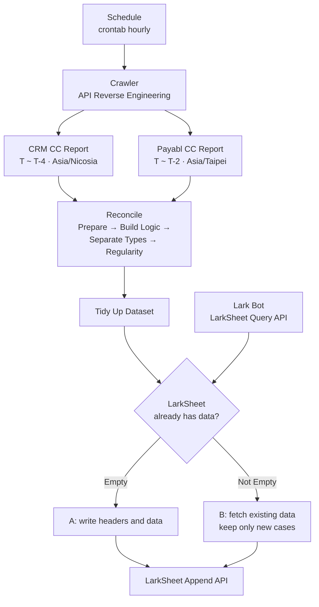

---
# English version of src/content/projects/credit-card-anomaly-detection.md (draft translation, pending Peter's review).
# Dates, stack, categories, metric values and the system map come from the zh file.
summary: "Pulls credit card withdrawal reports from Payabl and the CRM automatically via API reverse engineering and reconciles them in full every hour, replacing manual Excel comparison staffed by 5 daily shifts; ran reliably 3,162 times from March to July 2026."
role: "Aligned detection logic with operations; designed and built the pipeline"
metric_labels:
  - "Detection time once data is available (previously up to about 5 hours)"
  - "Manual comparison hours saved, Mar–Jul (estimate)"
  - "Automated reconciliation runs, Mar–Jul"
impact:
  before: "Shift staff compared reports by hand; wrong refunds were found late"
  after: "A wrong refund is flagged on the next run"
tldr:
  problem: "On credit card withdrawals, the refund Payabl actually paid may not match what the CRM recorded; manual Excel checks relied on shifts and had hit their limits on frequency and accuracy."
  approach: "Pull both reports automatically via API reverse engineering, reconcile everything every hour, and write only mismatched transactions to LarkSheet for operations to review."
  result: "A wrong refund is flagged on the next run and handed to operations to reverse; comparison no longer needs shift staff."
---

## Problem Assessment

<hr data-slide="Background and terms">

- When a client who deposited by credit card requests a withdrawal, the refund is executed at the payment provider **Payabl** and must also be recorded in the internal **CRM**.
- If the two amounts differ (wrong refund amount, duplicate refund, missing CRM record), company money has actually left without being recorded correctly.

<details class="glossary-details">
<summary>Glossary<span class="mono">11 terms · click to expand</span></summary>
<table>
<thead><tr><th>Term</th><th>Meaning</th></tr></thead>
<tbody>
<tr><td>Deposit / Withdrawal</td><td>A client putting money in / taking money out</td></tr>
<tr><td>PSP</td><td>Payment Service Provider, an external payment provider</td></tr>
<tr><td>Payabl</td><td>The credit card PSP in this project; it actually processes card payments and refunds</td></tr>
<tr><td>CRM</td><td>Internal system that manages clients and transaction records</td></tr>
<tr><td>Refund</td><td>When a client who deposited by credit card withdraws, the money goes back to the original card</td></tr>
<tr><td>Parent Ticket</td><td>One withdrawal request from a client</td></tr>
<tr><td>Child Ticket</td><td>The actual refund transactions that request is split into (possibly several)</td></tr>
<tr><td>QC</td><td>Quality Control, the operations shift that did the manual comparison</td></tr>
<tr><td>Reconcile</td><td>Checking whether the amounts in two sets of records match</td></tr>
<tr><td>T ~ T-4</td><td>Data from today back to 4 days ago</td></tr>
<tr><td>Mismatch</td><td>The two amounts differ, or one side has no record</td></tr>
</tbody>
</table>
</details>

<hr data-slide="Pain points and evidence">

<figure class="pain-figure">
<div class="pain-grid">
<section class="pain-card tone-grey pain-wide">
<h4 class="pain-title">A heavy process that breaks down</h4>
<p class="pain-label"><span>Pain</span>Moving data between systems by hand</p>
<ul class="pain-note">
<li>Staff had to log into Payabl and the CRM again and again to download data.</li>
<li>The process was tedious and depended heavily on personal experience.</li>
</ul>
<div class="pain-evidence">
<p class="pain-evidence-title">Evidence: every round of manual comparison goes through these two back offices</p>
<div class="pain-shots">
<div class="pain-shot">
<p class="pain-shot-title"><b>Back office 1　Payabl</b> (has transaction details)</p>


<p class="pain-shot-note"><mark>No download button</mark> (circled in red). Staff could only set a date range and filters on the View page, then copy and paste the on-screen data over and over.</p>
</div>
<div class="pain-shot">
<p class="pain-shot-title"><b>Back office 2　CRM</b> (no details)</p>


<p class="pain-shot-note"><mark>There is a download button, but many options must be set first</mark> (All Users, All Status, All Types, Search Options, Mark Type, date range) before the CRM transaction log can be downloaded.</p>
</div>
</div>
<p class="pain-evidence-title">Time for one round of manual comparison (estimate)</p>
<div class="pain-timebar">
<span class="seg-platform" style="flex: 35">Platform work: many clicks + retries　~35 min</span>
<span class="seg-excel" style="flex: 10">Tidy in Excel and post to the group　~10 min</span>
</div>
<p class="pain-caption">About <b>45 minutes</b> per round × 5 rounds a day ≈ <b>3.75 hours of manual work per day</b>.</p>
</div>
</section>
<section class="pain-card tone-red">
<h4 class="pain-title">Staffing at capacity</h4>
<p class="pain-label"><span>Pain</span>24/7 shifts still have a limit</p>
<ul class="pain-note">
<li>5 staff shifts a day worked on this continuously.</li>
<li>That was the ceiling; finer-grained checks were not possible.</li>
</ul>
<div class="pain-evidence">
<p class="pain-evidence-title">Evidence: QC shift roster (February excerpt)</p>
<div class="pain-table-wrap">
<table class="pain-schedule">
<thead><tr><th></th><th>Mon</th><th>Tue</th><th>Wed</th><th>Thu</th><th>Fri</th><th>Sat</th><th>Sun</th></tr></thead>
<tbody>
<tr><th>9AM</th><td>A</td><td>B</td><td>A</td><td>C</td><td>C</td><td>E</td><td>F</td></tr>
<tr><th>2PM</th><td>C</td><td>D</td><td>B</td><td>A</td><td>D</td><td>G</td><td>—</td></tr>
<tr><th>6PM</th><td>H</td><td>I</td><td>J</td><td>H</td><td>J/I</td><td>—</td><td>K</td></tr>
<tr><th>10PM</th><td>L</td><td>L</td><td>L</td><td>L</td><td>L</td><td>M</td><td>N</td></tr>
<tr><th>4AM</th><td>N</td><td>N</td><td>M</td><td>N</td><td>N</td><td>M</td><td>M</td></tr>
</tbody>
</table>
</div>
<p class="pain-caption">5 time slots a week, 14 colleagues on rotation (names replaced with letters). Each slot ran one round of manual comparison of about 45 minutes.</p>
</div>
</section>
<section class="pain-card tone-yellow">
<h4 class="pain-title">Risk getting out of control</h4>
<p class="pain-label"><span>Pain</span>Rising error rate + incomplete matching logic</p>
<ul class="pain-note">
<li>With so much data, Excel comparison was very error-prone.</li>
<li>An anomaly not caught in time leads to financial loss.</li>
</ul>
<div class="pain-evidence">
<p class="pain-evidence-title">Evidence: tickets on the two sides don't line up</p>
<ul class="pain-flow">
<li><b>Payabl</b> only has Child Tickets, with transaction details; matching back to the CRM by hand often paired the wrong Parent Ticket.</li>
<li><b>CRM</b> has Parent and Child Tickets but no details, so the CRM alone cannot show whether something is wrong.</li>
<li>Each check covers tens of thousands of transactions on each side (see the log in Result).</li>
</ul>
</div>
</section>
</div>
<figcaption>Figure 1　Three pain points in the original process (redrawn from the project deck; platform screenshots have the address bar cropped and the login account and brand logo blurred; roster names replaced with letters; hours are estimates)</figcaption>
</figure>

<hr data-slide="Why it was worth solving">

**Why it was worth solving:**

1. **Losses are direct cash outflows**: among the wrong refunds confirmed after launch were a case where Payabl refunded 60 USD while the CRM recorded only 30 USD, and a 350 EUR refund paid out twice; both were reversed by operations after detection (counts in Result).
2. **The manual approach could not scale**: each round takes a fixed amount of time (Figure 1), 5 shifts was already the limit, and checking more often would only mean adding people.

## Solution Design

The three pain points break down into four things to solve:

| Pain point | Solution | Maps to |
|---|---|---|
| Staff at capacity, limited check frequency | A schedule triggers automatically and checks every hour, independent of shifts | |
| Moving data between systems by hand | Pull both reports with code instead of downloading and copy-pasting | |
| Error-prone Excel checks, incomplete logic | Turn the matching rules into code (each rule aligned with operations first), filter out normal transactions automatically and output only anomalies | |
| Anomalies not caught in time | Push anomalies straight into the LarkSheet operations already uses, as a case-tracking record | |

**Constraints the design had to handle:**

- No official API or database access.
- The Payabl back office has no report download feature.
- The two reports become available at different times: CRM covers T ~ T-4 and Payabl covers T ~ T-2, in different time zones (CRM in Asia/Nicosia, Payabl in Asia/Taipei) (Figure 2).

## Alternative Solutions

Four options were evaluated at the time; the first three were the alternatives:

| Option | Approach | Pros | Cons |
|---|---|---|---|
| A. Add shift staff | Keep manual Excel comparison and add people to check more often | No development, available immediately | Cost grows linearly with frequency; 5 shifts still meant only 5 checks a day; Excel error rate would not drop |
| B. Request an official API or DB access | Ask the vendor or system owners for a formal data interface | Most stable, officially supported | Depends on other teams, timeline out of our control; the risk continues while waiting |
| C. Browser automation (Selenium / RPA) | Simulate a person using the back-office pages | No need to understand the system's internal interfaces | Payabl has no download button, so it would have to copy page by page; breaks when the UI changes; slow, needs a browser running all the time |
| **D. API reverse engineering (chosen)** | Analyze the HTTP APIs behind the back-office pages, then log in and fetch reports directly with code | Independent of the UI, fast, schedulable | Takes time to analyze; must be adjusted when the other side's API changes |

> Pros and cons are based on the system limits recorded in Figure 1; all four options were actually evaluated at the time.

## Selected Solution

<hr data-slide="Why this option">

**Chosen: D, API reverse engineering**

1. **Gets around "no download button"**: the data only shows on the page, but some API behind the page must be serving it; calling that API directly removes the need to simulate copy and paste.
2. **No waiting for outside resources**: B's timeline was uncontrollable, while D could put detection live first; if a formal API becomes available later, only the extraction layer needs replacing.
3. **Fits the resources at the time**: one developer, running on one computer's crontab schedule; notifications go to Lark, which operations already uses, so non-technical colleagues don't need to learn a new system.

<hr data-slide="Architecture">


*Figure 2　Credit Card Withdraw Workflow (excerpt from the project deck; click the image to enlarge)*

The same flow as Figure 2, in text:



<hr data-slide="Design notes">

**Design notes:**

- **Branch B** first queries the cases already in LarkSheet and appends only new anomalies, so the same transaction is not reported every hour.
- Every stage writes a JSON structured log (`service`, `stage`, `status`), so an error points straight to the stage that failed.
- **Access scope**: approved in advance by my manager; uses an existing account the company issued to operations, reads only reports staff could already see, and writes nothing; credentials live in environment variables, not in code.
- **Matching rules** (Area 3: Prepare → Build Logic → Separate Types → Regularity): each rule was aligned with operations. TODO: add what each step does (fields compared, amount tolerance, excluded statuses).

## Result

<hr data-slide="One real run">

### A real run

- Below is a log excerpt from the run at 2026-03-16 11:00, transcribed from the original screenshot.
- Internal URLs, report file names, brand codes and sheet ranges are removed; the internal system name is replaced with `crm`.

```text
11:00:01  download         Start download reports...
11:00:04  download_payabl  Payabl Login Success and Get Token Success
11:00:04  download_payabl  Start downloading Payabl CC Report for date: 2026-03-15...
11:00:26  download         Download Payabl CC Report Finish | Total: 21185
11:00:26  download_crm     Login attempt 1/5
11:02:43  download_crm     POST success (2026-03-13): <report>.csv, took 52.7s
11:02:46  download_crm     Download success (2026-03-13): <report>.csv, took 3.2s
   ...    (same for 2026-03-14 ~ 2026-03-16)
11:05:25  download         Download CRM CC Report Finish | Total: 21752
11:05:25  reconcile        Start reconcile...
11:05:25  reconcile        Reconcile Finish | Total Mismatch Case: 0
11:05:28  lark             Total unique keys in LarkSheet: 173, Total new mismatch cases to upload: 0
11:05:30  lark             Upload data to LarkSheet Finish
```

What this log shows:

- **A full run takes about 5.5 minutes** and compares 21,185 Payabl transactions with 21,752 CRM records.
- The CRM report uses a two-step flow, "POST to generate the report (~50 s) → then download (~3 s)", which only came to light through reverse engineering.
- With no anomalies, the run ends normally and sends no notification.

<figure class="tech-figure">
<div class="tech-labels">
<div class="tech-label">
<p class="tech-label-kicker">Tech Label</p>
<p class="tech-label-name">S2S ETL Pipeline Automation</p>
<p class="tech-label-desc">Runs on a schedule and continuously monitors the reconciliation process.</p>
</div>
<div class="tech-label">
<p class="tech-label-kicker">Tech Label</p>
<p class="tech-label-name">JSON Logging Design</p>
<p class="tech-label-desc">Every stage has a structured log, improving observability and debugging speed.</p>
</div>
</div>
</figure>

<hr data-slide="Output format">

### Output format

Anomalies are written to LarkSheet with the same columns as the CSV. The three rows below are cases operations confirmed as errors between March and July, with transaction and order numbers removed:

| Tx-Type | Status | Currency | Refund Amount (Payabl) | Refund_Amount_crm | recon_result | recon_source |
|---|---|---|---|---|---|---|
| Refund | In progress | USD | 120 | -200 | Mismatch | Payabl & Crm |
| Refund | In progress | USD | 60 | -30 | Mismatch | Payabl & Crm |
| Refund | In progress | EUR | 350 | (blank) | Mismatch | Payabl |

`recon_source` separates two kinds of anomaly:

- `Payabl & Crm`: both sides have a record, but the amounts differ.
- `Payabl`: Payabl has refunded, but the CRM has no matching record.

<hr data-slide="Review results">

### Review results (2026-03-01 ~ 2026-07-31)

The pipeline errs on the side of flagging and leaves the call to operations. "Confirmed as an error" means operations marked the transaction as error in review, or their note says it was a wrong amount, a duplicate refund or a refund to the wrong order:

<figure class="bar-figure">
<ul class="bar-list">
<li style="--v: 100%"><span class="bar-label">Flagged for review</span><span class="bar"></span><span class="bar-value">523</span></li>
<li class="is-peak" style="--v: 5.5%"><span class="bar-label">Confirmed wrong refunds</span><span class="bar"></span><span class="bar-value">29</span></li>
<li class="is-peak" style="--v: 5.4%"><span class="bar-label">Reversed or cancellation requested after detection</span><span class="bar"></span><span class="bar-value">28</span></li>
</ul>
<figcaption>Figure 3　From flagged to reversed (unique transactions; from the public CSV on this page)</figcaption>
</figure>

- **The 523 flagged**: 307 amount mismatches, 216 with no CRM record.
- **The 29 confirmed errors**: 19 wrong amounts, 9 duplicate refunds, 1 refund to the wrong order.

<hr data-slide="Run statistics">

### Run statistics during the stable period (2026-03-01 ~ 2026-07-31)

Source: the full record CSV produced by the pipeline (`Payabl QC new Template - New Data.csv`).

| Metric | Value |
|---|---|
| Automated reconciliation runs | 3,162 |
| Run interval | median 1.00 h, P90 1.02 h |
| Runs with no new anomaly | 3,042 (96.2%) |

<details class="csv-details">
<summary>Full data (de-identified)<span class="mono">3,612 rows · click to expand</span></summary>
<div class="csv-viewer" data-src="../../../data/credit-card-recon-2026-03-07.csv">
<p><a href="../../../data/credit-card-recon-2026-03-07.csv" download>Download the de-identified CSV (2026-03 ~ 2026-07, 3,612 rows)</a></p>
</div>
</details>

## Impact

### Verified results

<figure class="ba-figure">
<div class="ba-table">
<div class="ba-row ba-head"><p class="ba-item">Item</p><p class="ba-before">Before: manual reconciliation</p><p class="ba-after">After: automated detection pipeline</p></div>
<div class="ba-row"><p class="ba-item">Staff time</p><p class="ba-before">About 3.75 hours a day</p><p class="ba-after">Zero manual detection; flagged cases are reviewed by operations<small>Basis: ~45 minutes per round × 5 rounds a day (see Problem); about 574 hours saved Mar–Jul (about 1,369 hours annualized), estimate</small></p></div>
<div class="ba-row"><p class="ba-item">Check frequency</p><p class="ba-before">5 times a day</p><p class="ba-after">Scheduled once an hour; actual average 20.7 runs a day Mar–Jul (about 4.1×)<small>Basis: 5 slots on the roster; runs (see Result) ÷ 153 days, daily median 23 runs</small></p></div>
<div class="ba-row"><p class="ba-item">Detection time</p><p class="ba-before">Up to about 5 hours (the gap between two manual rounds)</p><p class="ba-after">Within 1 hour of the data becoming available<small>Basis: hourly schedule; run interval in Result</small></p></div>
<div class="ba-row"><p class="ba-item">Getting the data</p><p class="ba-before">Manual download and copy-paste, about 45 minutes per round</p><p class="ba-after">Pulled automatically via API reverse engineering; a run takes only a few minutes<small>Basis: run log in Result; manual time is an estimate</small></p></div>
<div class="ba-row"><p class="ba-item">Coverage</p><p class="ba-before">Manual Excel comparison, volume not recorded</p><p class="ba-after">Every run compares all transactions on both sides<small>Basis: run log in Result</small></p></div>
<div class="ba-row"><p class="ba-item">Actually caught</p><p class="ba-before">No record</p><p class="ba-after">Nearly all confirmed wrong refunds were reversed or had cancellation requested after detection<small>Basis: CSV review column and operations notes; counts in Result Figure 3</small></p></div>
</div>
<figcaption>Figure 4　Before / After (redrawn from the project deck). Correction: the original slide said 4 times a day, ↑600% and >24 hours; the actual roster had 5 rounds a day (about 5 hours apart), and after automation the actual average Mar–Jul was 20.7 runs a day, about 4.1×. The original "accuracy" row is left out.</figcaption>
</figure>
