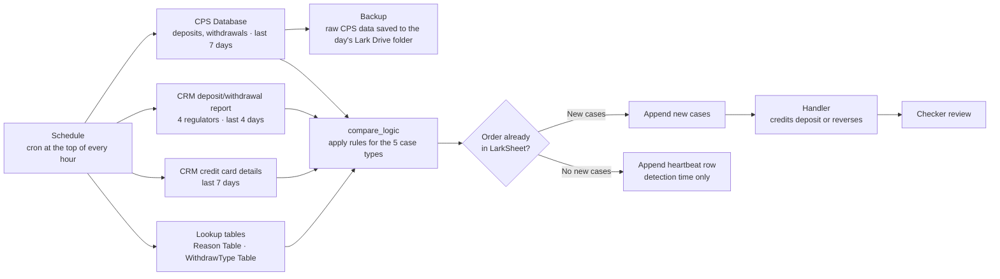
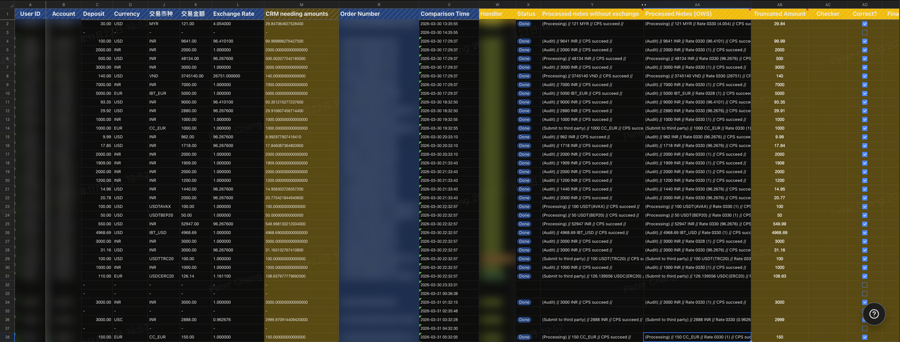
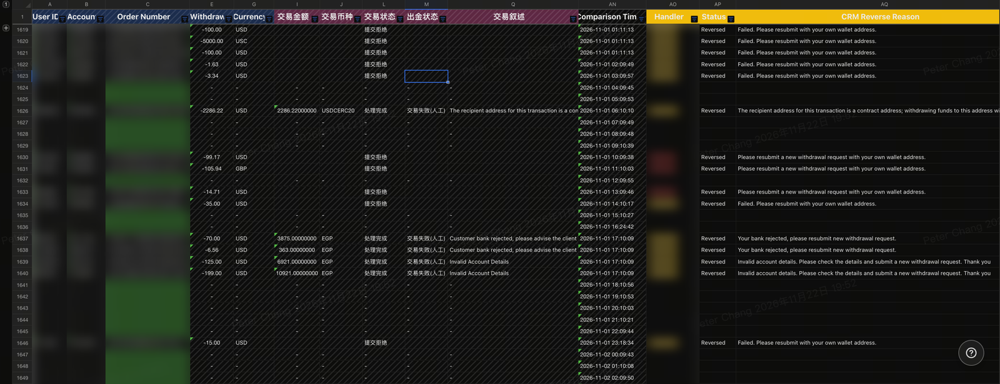
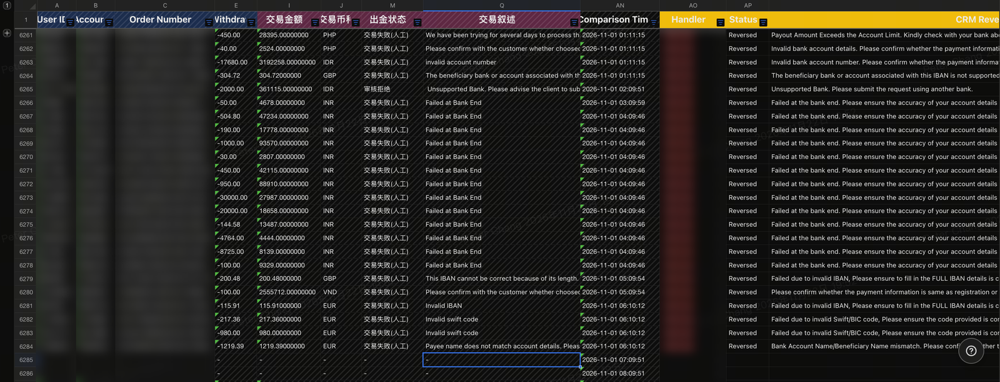
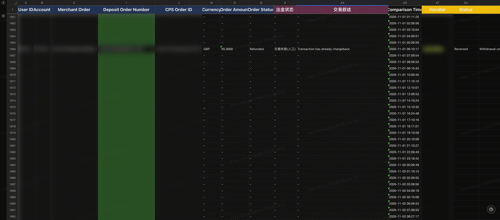
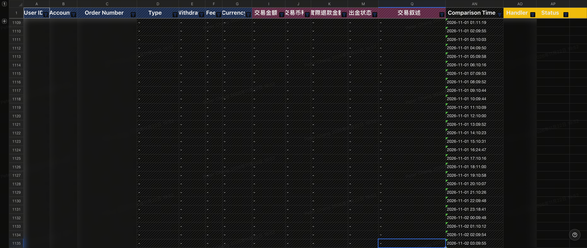

---
# English version of src/content/projects/drop-order-monitor.md (draft translation, pending Peter's review).
# Dates, phases, stack, categories, metric values and the system map come from the zh file.
summary: "Compares deposit and withdrawal statuses between the CRM and CPS every hour and turns drop orders, such as a payment made but never credited or a failed withdrawal never returned, into LarkSheet cases; it surfaced 15,393 cases through 2026/11/17, replacing manual spot checks run twice a day each for Deposit and Withdrawal."
role: "Aligned drop-order rules with operations; designed and built the pipeline"
metric_labels:
  - "Drop-order detection interval (previously manual checks twice a day each for Deposit and Withdrawal)"
  - "Manual monitoring hours saved through 2026/11/17 (estimate)"
  - "Drop-order cases surfaced automatically through 2026/11/17"
story:
  - { label: "Map", line: "After a client places an order in the Client Portal, deposits and withdrawals go to CPS, which works with channels in each country to actually move the money; CRM keeps what the client sees: for a deposit, CPS sends a deposit order to CRM; for a withdrawal, CRM sends a payout order to CPS." }
  - { label: "Write-back", line: "Only CPS knows whether money actually moved, so every order's result has to be written back to CRM. Take two real orders from India: a 9,301 INR deposit via UPI and a 55,704 INR withdrawal via local bank transfer. Normally the channel calls back CPS, and CPS writes back to CRM." }
  - { label: "Drop order", line: "The trouble starts when a channel's callback fails: operations set CPS to success or failure by hand, but that manual change is not written back to CRM. So the deposit client paid and was not credited, and the withdrawal never went out while CRM shows it as completed and nothing was returned." }
  - { label: "Why it's hard to see", line: "The catch is that each side looks fine on its own: CPS says the order was handled, and CRM says it is in progress or done. A drop order only shows when the same order's status on both sides is put side by side." }
  - { label: "Rules", line: "So operations and I agreed, rule by rule, on which status combinations count as a drop order, covering deposits, three kinds of ordinary withdrawals and card withdrawals." }
  - { label: "Worked example", line: "Back to the two orders: the deposit has CPS at Success (manual) and CRM at Audit; the withdrawal has CRM at Completed and CPS at Failed (manual). Both match the rules and are flagged as drop orders." }
  - { label: "Solution", line: "CRM has no database access, so the pipeline downloads its reports with an operations account and queries CPS directly, comparing every hour; each order is assigned once, and a heartbeat row is written even when nothing is new, proving monitoring never stopped." }
  - { label: "Screens", line: "These are the LarkSheet case sheets as they really look, one per case type: a Handler marks Status as Done or Reversed; a period with nothing new still gets a heartbeat row every hour." }
  - { label: "Running for real", line: "This is a real run at 03:00 on 2026-11-18: query CPS, download the CRM reports and lookup tables, then compare by the five case types and write only new cases; a type with nothing new gets a heartbeat row." }
  - { label: "Output", line: "Cases in LarkSheet look like this: a deposit is marked done once a Handler credits it, a withdrawal reversed once it is reversed; the last row is a heartbeat, meaning that run found nothing new." }
  - { label: "Result", line: "When an upstream system failed on 2026/11/6, callbacks failed en masse; the 10:00 and 11:00 runs alone surfaced 933 deposit drop orders, against at most 75 in a single run on other days. Twice-daily manual checks could never have kept up." }
impact:
  before: "Manual spot checks; drop orders often surfaced only after complaints"
  after: "Statuses are compared automatically and drop orders go straight out as cases"
tldr:
  problem: "Deposit and withdrawal statuses in the CRM and CPS fall out of sync (drop orders), often found only when a client asks, and tracing them means digging through two systems."
  approach: "Compare order statuses on both sides every hour, flag drop orders by rule, de-duplicate and write them to the LarkSheet case sheet operations already uses."
  result: "Drop orders went from after-the-fact complaints to hourly assignments; pulling and comparing data needs no manual work, and monitoring no longer depends on shifts."
---

## Problem Assessment

<hr data-slide="Background and terms">

- When a client deposits or withdraws, the order passes through two systems: **CPS** connects to channels in each country and actually collects and pays out, and the **CRM** records the client's account and transaction status.
- CPS results have to be written back to the CRM. When a channel's callback to CPS fails (for example during an upstream outage), operations update the CPS status by hand, but **a manual update is not written back to the CRM**, and that becomes a **drop order**: for a deposit, CPS has succeeded but the CRM is still in review or processing, so the client paid but was not credited; for a withdrawal, the CRM shows completed but CPS actually failed, so the money neither went out nor came back.
- Drop orders sit late in the process, so clients often notice first and then ask through CS, Sales or Finance.

<details class="glossary-details">
<summary>Glossary<span class="mono">14 terms · click to expand</span></summary>
<table>
<thead><tr><th>Term</th><th>Meaning</th></tr></thead>
<tbody>
<tr><td>Deposit / Withdrawal</td><td>A client putting money in / taking money out</td></tr>
<tr><td>CRM</td><td>Internal system that manages client accounts and transaction records; the order status clients and operations see comes from here</td></tr>
<tr><td>CPS</td><td>Internal payment system that connects to banks and payment channels in each country and actually collects and pays out</td></tr>
<tr><td>Channel</td><td>The external route that actually moves the money, such as local bank transfer, QR, e-wallet, crypto or credit card</td></tr>
<tr><td>Callback</td><td>The channel telling CPS the result once it has handled the money</td></tr>
<tr><td>Drop order</td><td>The CRM and CPS disagree on the status of the same order, and it is not synced back automatically</td></tr>
<tr><td>LBT</td><td>Local Bank Transfer withdrawal</td></tr>
<tr><td>IBT</td><td>International Bank Transfer withdrawal</td></tr>
<tr><td>Crypto &amp; e-Wallet</td><td>Crypto and e-wallet withdrawals</td></tr>
<tr><td>CreditCard withdrawal</td><td>When a client who recharged by credit card withdraws, the money is refunded to the original card</td></tr>
<tr><td>Same-route rule</td><td>A credit card withdrawal must go back to the card used for the recharge and be tied to the original recharge order</td></tr>
<tr><td>Reverse</td><td>When a withdrawal fails, returning the deducted amount to the client's account in the CRM</td></tr>
<tr><td>Handler / Checker</td><td>The Handler credits the deposit or reverses the withdrawal in the CRM for each case; the Checker is the operations staff member who reviews afterwards</td></tr>
<tr><td>Heartbeat row</td><td>When a run finds no new case, a row with only the detection time, proving the pipeline ran normally</td></tr>
</tbody>
</table>
</details>

<hr data-slide="An order's journey">

Only CPS knows whether money actually moved, yet the client looks at the CRM. So once CPS has handled an order, its result has to be **written back** to the CRM. Take two real orders from India: a 9,301 INR deposit via UPI and a 55,704 INR withdrawal via local bank transfer.

Normally the channel sends a **callback** to CPS when it is done, and CPS writes the result back to the CRM. The trouble comes when the callback fails: operations set CPS to "Success (manual)" or "Failed (manual)" by hand, but a manual change is not written back to the CRM, so the two systems are left in different states:

<figure class="split-figure">
<div class="split-scroll">
<svg viewBox="0 0 760 310" role="img" aria-labelledby="jr-title"><title id="jr-title">An order's journey: deposit and withdrawal results must be written back from CPS to CRM, and manual fixes after a failed callback are not</title><defs><marker id="jr-arrow" viewBox="0 0 8 8" refX="7" refY="4" markerWidth="8" markerHeight="8" orient="auto"><path class="sf-head" d="M0,0 L8,4 L0,8 z"/></marker></defs><g data-b="lanes"><text class="sf-s" x="95" y="22">CRM (what the client sees)</text><text class="sf-s" x="410" y="22">CPS (actual payment)</text><text class="sf-s" x="665" y="22">Channel</text><text class="sf-h sf-start" x="20" y="50">Deposit · 9,301 INR · UPI</text><rect class="sf-node" x="20" y="60" width="150" height="48" rx="6"/><text class="sf-t" x="95" y="89">CRM</text><rect class="sf-node" x="335" y="60" width="150" height="48" rx="6"/><text class="sf-t" x="410" y="89">CPS</text><rect class="sf-node" x="590" y="60" width="150" height="48" rx="6"/><text class="sf-t" x="665" y="89">UPI</text><line class="sf-sep" x1="20" y1="166" x2="740" y2="166"/><text class="sf-h sf-start" x="20" y="194">Withdrawal · 55,704 INR · local bank transfer</text><rect class="sf-node" x="20" y="204" width="150" height="48" rx="6"/><text class="sf-t" x="95" y="233">CRM</text><rect class="sf-node" x="335" y="204" width="150" height="48" rx="6"/><text class="sf-t" x="410" y="233">CPS</text><rect class="sf-node" x="590" y="204" width="150" height="48" rx="6"/><text class="sf-t" x="665" y="233">Local bank</text></g><g data-b="d-flow"><path class="sf-line" d="M590 84 H491" marker-end="url(#jr-arrow)"/><path class="sf-line" d="M335 84 H176" marker-end="url(#jr-arrow)"/><text class="sf-s" x="540" y="77">callback</text><text class="sf-s" x="255" y="77">write-back</text><text class="sf-s" x="665" y="128">Money received</text></g><g data-b="d-cb"><text class="sf-miss" x="540" y="102">✕ callback failed</text></g><g data-b="d-manual"><text class="sf-s" x="410" y="128">Set by hand to</text><text class="sf-link" x="410" y="146">Success (manual)</text></g><g data-b="d-stuck"><text class="sf-miss" x="255" y="102">✕ not written back</text><text class="sf-miss" x="95" y="128">Still at Audit</text><text class="sf-bad-t sf-small" x="95" y="146">Paid, not credited</text></g><g data-b="w-flow"><path class="sf-line" d="M170 220 H329" marker-end="url(#jr-arrow)"/><path class="sf-line" d="M485 220 H584" marker-end="url(#jr-arrow)"/><path class="sf-line" d="M590 240 H491" marker-end="url(#jr-arrow)"/><path class="sf-line" d="M335 240 H176" marker-end="url(#jr-arrow)"/><text class="sf-s" x="255" y="214">payout order</text><text class="sf-s" x="540" y="214">pay out</text><text class="sf-s" x="540" y="256">callback</text><text class="sf-s" x="255" y="256">write-back</text><text class="sf-s" x="95" y="276">Completed (deducted)</text><text class="sf-s" x="665" y="276">Transfer failed</text></g><g data-b="w-cb"><text class="sf-miss" x="540" y="274">✕ callback failed</text></g><g data-b="w-manual"><text class="sf-s" x="410" y="276">Set by hand to</text><text class="sf-link" x="410" y="294">Failed (manual)</text></g><g data-b="w-stuck"><text class="sf-miss" x="255" y="274">✕ not written back</text><text class="sf-bad-t sf-small" x="95" y="294">Not paid out, not returned</text></g></svg>
</div>
<figcaption>Figure 1　An order's journey: when a channel's callback to CPS fails, operations fix the CPS status by hand, but that manual fix is not written back to CRM, so a drop order forms (both are real cases from the public CSV on this page)</figcaption>
</figure>

<hr data-slide="Drop-order rules">

When a drop order happens, CRM and CPS each look normal on their own; the mismatch only shows when the same order's status on both sides is put together. So the problem to solve is not "checking faster" but that **nothing keeps checking the same order's status in CRM against CPS**.

First, operations and I agreed rule by rule on "which status combinations count as a drop order"; then the rules were written into code. The table shows the rules for the five case types:

| Case type | CRM status | CPS status | What it means | Action |
|---|---|---|---|---|
| Deposit | Not yet successful (Audit, Submit to third party, Processing, etc.) | Success, Success (manual) | Client paid, CRM not credited | Handler credits the deposit in the CRM |
| Withdraw-LBT / Crypto&Wallet / IBT | Apply Status is Completed | Transaction or payout status is failed or rejected | CRM deducted the money, the channel never paid out | Handler reverses in the CRM and replies to the client based on the failure reason |
| Withdraw-CreditCard | Success or Partial Success, and Order Status is Refunded | Payout failed | CRM recorded the refund, CPS never returned it to the card | Same as above |

<hr data-slide="Worked example">

One real case for each of the five case types, comparing the status in CRM and CPS; the first two rows are the two orders in Figure 1:

| Case type | CRM status | CPS transaction / payout status | Amount | Handling |
|---|---|---|---|---|
| Deposit | Audit | Success (manual) | 9,301 INR | Deposit credited (done) |
| Withdraw-LBT | Completed | Completed / Failed (manual) | 55,704 INR | Reverse (reversed) |
| Withdraw-Crypto&Wallet | Completed | Submission rejected | (blank) | Reverse (reversed) |
| Withdraw-CreditCard | Success | Completed / Failed (manual) | 50 EUR | Reverse (reversed) |
| Withdraw-IBT | Completed | Review rejected / Review rejected | 461.82 USD | Reverse (reversed) |

*Real cases from the public CSV on this page (April and September 2026; CPS statuses translated, the CSV keeps the source system's Chinese). The Crypto&Wallet case has no amount in the source data; the CC_ and IBT_ currency prefixes are dropped.*

- **Deposit**: operations set CPS to success by hand, but CRM is still at Audit, so the client paid and was not credited.
- **The four withdrawal types**: CRM shows completed or success, but CPS actually failed or rejected it, so the money neither went out nor came back; a Handler reverses it in CRM.

<hr data-slide="Pain points and evidence">

<figure class="pain-figure">
<div class="pain-grid">
<section class="pain-card tone-red pain-wide">
<h4 class="pain-title">Found late, clients wait first</h4>
<p class="pain-label"><span>Pain</span>By the time it's found, it's too late; only after-the-fact fixes</p>
<ul class="pain-note">
<li>Manual spot checks ran only about twice a day each for Deposit and Withdrawal; a drop order between two checks waited for the next round.</li>
<li>When CS or Finance asked about a payment, answers were slow, adding waiting and back-and-forth.</li>
</ul>
<div class="pain-evidence">
<p class="pain-evidence-title">Time for one manual spot check (estimate)</p>
<div class="pain-timebar">
<span class="seg-platform" style="flex: 33">Download the CRM and CPS reports　~30–35 min</span>
<span class="seg-excel" style="flex: 27">Excel calculation, tidying and moving data</span>
</div>
<p class="pain-caption">About <b>1 hour</b> per check in total; Deposit and Withdrawal were each checked twice a day.</p>
</div>
</section>
<section class="pain-card tone-grey">
<h4 class="pain-title">Tracing means digging layer by layer</h4>
<p class="pain-label"><span>Pain</span>Once something is stuck, people still trace it by hand</p>
<ul class="pain-note">
<li>Each order had to be checked in both the CRM and CPS, then traced to the channel and reason it got stuck.</li>
<li>With many channels of many kinds, the matching rules were hard to keep in anyone's head.</li>
</ul>
<div class="pain-evidence">
<p class="pain-evidence-title">Evidence: what has to be compared</p>
<ul class="pain-flow">
<li>Drop orders in the data period span <b>181 channel types</b>, <b>136 countries</b> and <b>64 currencies</b>.</li>
<li>Withdrawals fall into four groups (LBT, Crypto &amp; e-Wallet, CreditCard, IBT), each with its own failure statuses.</li>
<li>Withdrawal failures have 6 main reason categories and 33 subcategories (see Result).</li>
</ul>
</div>
</section>
<section class="pain-card tone-yellow">
<h4 class="pain-title">Staff can't be freed up</h4>
<p class="pain-label"><span>Pain</span>Depends on people who know the whole architecture</p>
<ul class="pain-note">
<li>Spotting a drop order requires knowing CRM statuses, CPS statuses and channel behavior all at once.</li>
<li>When someone is on leave, hands over or misses something, monitoring has a gap.</li>
</ul>
<div class="pain-evidence">
<p class="pain-evidence-title">Evidence: manual monitoring has a fixed cost</p>
<ul class="pain-flow">
<li>Each check takes about 1 hour; checking N times as often needs N times the staff.</li>
<li>Checking every hour is not feasible with people.</li>
</ul>
</div>
</section>
</div>
<figcaption>Figure 2　Three pain points in the original process (hours are estimates; coverage from the public CSV on this page)</figcaption>
</figure>

<hr data-slide="Why it was worth solving">

**Why it was worth solving:**

1. **Drop orders are routine, not rare**: after Deposit went live, 220 of 233 days had drop orders; for Withdrawal, 67 of 70 days.
2. **Upstream failures cause sudden spikes**: on 2026/11/6 an upstream system failed and many client orders got stuck (Figure 3). The 10:00 and 11:00 runs alone surfaced 933 deposit drop orders across 85 channels and 61 countries; manual checks twice a day could not have seen something this big in time.
3. **Manual cost can't scale with frequency**: each check takes about 1 hour (Figure 2); checking N times as often needs N times the staff.

<figure class="bar-figure">
<ul class="bar-list">
<li class="is-peak" style="--v: 100%"><span class="bar-label">11/6 11:00 run</span><span class="bar"></span><span class="bar-value">483</span></li>
<li class="is-peak" style="--v: 93%"><span class="bar-label">11/6 10:00 run</span><span class="bar"></span><span class="bar-value">450</span></li>
<li style="--v: 16%"><span class="bar-label">Largest single run on any other day</span><span class="bar"></span><span class="bar-value">75</span></li>
<li style="--v: 4%"><span class="bar-label">Other 22 runs on 11/6 combined</span><span class="bar"></span><span class="bar-value">18</span></li>
</ul>
<figcaption>Figure 3　Deposit drop orders surfaced per run during the 2026/11/6 upstream failure (from the public CSV on this page)</figcaption>
</figure>

## Solution Design

<hr data-slide="Pain points and solutions">

**Pain point → solution** (matches the architecture in Figure 4):

- **Found late** → an hourly scheduled comparison; a new drop order appears on the next top-of-the-hour run.
- **Tracing layer by layer** → pull the CRM report, CPS data and credit card details together and apply the drop-order rules (see Problem); withdrawal cases automatically carry the reason category and status trail.
- **Depends on people who know the architecture** → the rules live in code and cases go to LarkSheet; Handlers only work on cases already identified.
- **Nobody knows when monitoring stops** → write a heartbeat row even when there are no new cases, so "no drop orders" can be told apart from "the pipeline didn't run".

**Constraints the design had to handle:**

- The CRM has no database access; reports can only be downloaded by logging in with an operations account (with 2FA), and each report must be triggered first and then downloaded.
- Reports for the 4 regulators are generated separately and must be downloaded one by one and merged.
- The CRM and CPS differ in timing and time zone, and order statuses keep changing for several days, so the CRM deposit/withdrawal report looks back 4 days and the credit card details and CPS look back 7 days.
- Until a drop order is handled, it shows up in every hourly comparison, so it must be de-duplicated or the same order gets assigned again and again.

## Alternative Solutions

Four options were evaluated at the time; the first three were the alternatives:

| Option | Approach | Pros | Cons |
|---|---|---|---|
| A. Query the CRM database directly | Query CRM order statuses with SQL | Most timely and complete data | No CRM database access; request timeline out of our control |
| B. Ask CPS to add proactive alerts | CPS pushes a notice when an order status looks wrong | Alerts at the source, lowest delay | Needs CPS to schedule the work; timeline and spec not in our hands |
| C. Shared form | Report and track drop orders through a cross-department shared form | No development | We don't own it; fields and process are hard to control |
| **D. Cross-system drop-order pipeline (chosen)** | Download the CRM reports and query CPS data every hour, apply the rules, write to LarkSheet | No waiting on other teams; we control the rules, output fields and de-duplication | CRM downloads must handle 2FA and asynchronous report generation; must adapt when upstream formats change |

## Selected Solution

<hr data-slide="Why this option">

**Chosen: D, a cross-system drop-order pipeline**

1. **No new access needed**: A was blocked on CRM database access. Operations already downloads the CRM reports every day, so code can do the same; on the CPS side there was already read access to the database, queried directly.
2. **No waiting on outside teams**: B's timeline was uncontrollable, while D could go live first; if CPS adds proactive alerts later, only the extraction layer needs replacing.
3. **We control the output**: C was owned by another team. D writes cases to a LarkSheet we maintain, where we define the fields, de-duplication rules and handling statuses, and Handlers and Checkers work directly on it.
4. **Lower risk in phases**: phase one makes drop orders "visible and assigned"; only after about 3–6 months of stable running does phase two add automated clicking, so staff no longer have to fix things by hand in the CRM.

<hr data-slide="Architecture">

The full hourly flow:



*Figure 4　Deposit and withdrawal drop-order monitoring pipeline (summarized from the project code)*

<hr data-slide="Design notes">

**Design notes:**

- **De-duplication**: Order Number is the unique key (Merchant Order + Deposit Order Number for credit cards). Each run first reads the orders already in LarkSheet and appends only new cases, so each drop order is assigned once.
- **Orders still being written back**: there is no waiting period before the check, so an order that has just succeeded but not yet been written back can be flagged too; a Handler confirms and skips it.
- **Heartbeat row**: when a case type has no new drop orders, a row with only the detection time is still written, so the sheet shows the difference between "no new cases" and "the pipeline stopped".
- **Status trail and reason**: withdrawal cases chain the CRM and CPS statuses into one Status Workflow (for example `Risk Audit -> Accepted -> Completed -> Processed -> Failed (manual)`), and the Reason Table adds the reason category and subcategory, so Handlers can reply to the client by reason without opening both back offices.
- **Traceability**: each run gets a `uid`, and JSON logs carry `service`, `stage` and `status`; raw CPS data is backed up to Lark Drive on every run, so the data compared at the time can be audited later.
- **Access scope**: the CRM is accessed with an existing operations account (with 2FA), only downloading reports and never writing; CPS runs only SELECT queries; Lark writes to the case sheet and backup folder through a self-built app. CRM and CPS credentials are read from a read-only mounted config file, not written in code. TODO: add who approved the account use.

## Result

<hr data-slide="Screens">

### Screens: the LarkSheet case sheets

There is one sheet per case type. Once a Handler is done, `Status` is set to Done (credited) or Reversed (returned), and withdrawals also carry the reason sent to the client; a period with no new case still gets a heartbeat row each hour, holding only the detection time:

<figure class="shot-gallery">
<div class="shot-strip">
<div class="shot-item">
<p class="shot-label"><span class="mono">1 / 5</span>Deposit: marked Done once a Handler credits it</p>



</div>
<div class="shot-item">
<p class="shot-label"><span class="mono">2 / 5</span>Withdraw - Crypto&Wallet: marked Reversed, with the reason sent to the client</p>



</div>
<div class="shot-item">
<p class="shot-label"><span class="mono">3 / 5</span>Withdraw - LBT: many cases in one hour, each reversed</p>



</div>
<div class="shot-item">
<p class="shot-label"><span class="mono">4 / 5</span>Withdraw - CreditCard: one case among heartbeat rows</p>



</div>
<div class="shot-item">
<p class="shot-label"><span class="mono">5 / 5</span>Withdraw - IBT: with no new case, a heartbeat row every hour</p>



</div>
</div>
<figcaption>Figure 5　The LarkSheet case sheets as they really look (swipe to see all 5 sheets; browser and document path cropped; client IDs, account numbers, order numbers and Handler names blurred; click an image to enlarge)</figcaption>
</figure>

<hr data-slide="One real run">

### A real run

- Below is a log excerpt from the run at 2026-11-18 03:00. The original is JSON; only the time, stage and message are kept here.
- Repeated download lines are omitted; the CRM's internal system name is replaced with `CRM`, and sheet IDs, file name prefixes and URLs are removed. One Chinese log message is shown in English.

```text
03:00:02  Lark Init and Connect     Lark Access Token acquired
03:00:06  Download DataSource       Successfully connected to CPS database.
03:00:27  Download DataSource       Deposit query finished, rows=195438.
03:06:13  Download DataSource       CPS report downloaded successfully. deposit_rows=195438, withdraw_rows=1037
03:06:15  Download DataSource       Login successful
03:06:15  Download DataSource       Token obtained successfully
03:07:55  Download DataSource       Finish downloading CRM DW Report for all brands, total rows: 322159
   ...    (CRM credit card details, 3 regulators × last 7 days)
03:10:43  Download DataSource       Fetched 7078 Records                       <- Reason Table
03:10:52  Upload Failed DataSource  Upload success (file_name=<cps_withdraw_failed_cc>.csv)
03:10:55  Compare Existing Data - Deposit                 Total unique keys in LarkSheet: 6492, Total new mismatch cases to upload: 1
03:10:57  Compare Existing Data - Withdraw_CryptoWallet   Total unique keys in LarkSheet: 1080, Total new mismatch cases to upload: 1
03:11:00  Compare Existing Data - Withdraw_LBT            Total unique keys in LarkSheet: 7717, Total new mismatch cases to upload: 10
03:11:01  Compare Existing Data - Withdraw_IBT            Total unique keys in LarkSheet: 47, Total new mismatch cases to upload: 0
03:11:02  Upload Detection Time - Withdraw_IBT            Append success (total_rows=1)
03:11:02  Compare Existing Data - Withdraw_CreditCard     Total unique keys in LarkSheet: 1028, Total new mismatch cases to upload: 0
03:11:03  Upload Detection Time - Withdraw_CreditCard     Append success (total_rows=1)
03:11:03  LarkSheet Upload Complete Upload total data to LarkSheet Finish
```

What this log shows:

- **A full run takes about 11 minutes**; about 6 minutes go to the CPS withdrawal query and about 4.5 minutes to downloading the CRM reports.
- Each of the five case types first reads the orders already in LarkSheet and writes only new cases: this time 1 Deposit, 1 Crypto&Wallet and 10 LBT.
- IBT and CreditCard had no new cases, so each got a heartbeat row instead of nothing.

<figure class="tech-figure">
<div class="tech-labels">
<div class="tech-label">
<p class="tech-label-kicker">Tech Label</p>
<p class="tech-label-name">Hourly Cross-System Reconciliation</p>
<p class="tech-label-desc">Combines CRM reports and CPS data every hour and applies drop-order rules by case type.</p>
</div>
<div class="tech-label">
<p class="tech-label-kicker">Tech Label</p>
<p class="tech-label-name">Case Ledger with Heartbeat</p>
<p class="tech-label-desc">Appends only new cases after de-duplication; writes a heartbeat row when there are none, proving monitoring never stopped.</p>
</div>
<div class="tech-label">
<p class="tech-label-kicker">Tech Label</p>
<p class="tech-label-name">JSON Logging Design</p>
<p class="tech-label-desc">One uid per run, with a structured log for every stage.</p>
</div>
</div>
</figure>

<hr data-slide="Output format">

### Output format

Cases are written to LarkSheet, one sheet per case type. Below are real cases from 2026/11 plus one heartbeat row, with client IDs, account numbers, order numbers and staff names removed. The table shows only the statuses used for the check and the handling result; detection time, channel and amount are in the public CSV below (status and reason values are translated here; the CSV keeps the source system's Simplified Chinese):

| Case Type | CRM Status | CPS Status (tx / payout) | Reason (category / sub) | Handling |
|---|---|---|---|---|
| Deposit | Processing | Success | — | done |
| Withdraw-LBT | Completed | Processed / Failed (manual) | Channel / Limit issue | reversed |
| Withdraw-CreditCard | Success | Processed / Failed (manual) | Client / Bank-side failure | reversed |
| Withdraw-IBT | Completed | Processed / Failed (manual) | Client / SWIFT error | reversed |
| Withdraw-IBT | - | - | Detection time only: 2026-11-17 23:11:40 | |

- The last row is a heartbeat row: that run found no new case and only left the detection time.
- `Handling` is filled in by the Handler: done (credited) for deposits, reversed (returned) for withdrawals.

<hr data-slide="Failure reasons">

### Withdrawal failure reasons

Withdrawal cases get a reason category from the Reason Table, and Handlers reply to clients based on it. The four withdrawal types total 8,898 cases:

<figure class="bar-figure">
<ul class="bar-list">
<li class="is-peak" style="--v: 100%"><span class="bar-label">Client issue</span><span class="bar"></span><span class="bar-value">6,649</span></li>
<li style="--v: 10.1%"><span class="bar-label">Channel issue</span><span class="bar"></span><span class="bar-value">669</span></li>
<li style="--v: 1.5%"><span class="bar-label">Merchant issue</span><span class="bar"></span><span class="bar-value">102</span></li>
<li style="--v: 0.4%"><span class="bar-label">Bank issue</span><span class="bar"></span><span class="bar-value">27</span></li>
<li style="--v: 0.1%"><span class="bar-label">CPS issue, internal error</span><span class="bar"></span><span class="bar-value">7</span></li>
<li style="--v: 21.7%"><span class="bar-label">Uncategorized (reason blank)</span><span class="bar"></span><span class="bar-value">1,444</span></li>
</ul>
<figcaption>Figure 6　Withdrawal failure reason categories (Withdrawal 2026-09-09 ~ 11-17, from the public CSV on this page)</figcaption>
</figure>

- **Client issue** subcategories are mostly bank-side transaction failures, wrong account numbers, invalid accounts and wrong names.
- **Channel issue** subcategories are mostly channel maintenance, system errors and compliance / risk-control issues.

<hr data-slide="Run statistics">

### Run statistics (Deposit 2026-03-30 ~ 11-17; Withdrawal 2026-09-09 ~ 11-17)

Source: the full records the pipeline wrote to LarkSheet (public CSV). A "case" is a row whose Tx is not `-`; under the same-route rule, one credit card withdrawal can map to several original recharges, and each "withdrawal × original recharge" pair counts as one case, the same unit the pipeline de-duplicates on. "Runs" means distinct Comparison Times.

| Case type | Cases | Per day | Runs | Runs with new cases | Handling status |
|---|---|---|---|---|---|
| Deposit | 6,495 | 27.9 | 4,808 | 2,585 | done 5,540, unmarked 942, other 13 |
| Withdraw-LBT | 6,833 | 97.6 | 1,466 | 1,055 | all reversed |
| Withdraw-Crypto&Wallet | 992 | 14.2 | 1,466 | 552 | all reversed |
| Withdraw-CreditCard | 1,027 (590 withdrawals) | 14.9 | 1,436 | 93 | all reversed |
| Withdraw-IBT | 46 | 0.7 | 1,466 | 43 | all reversed |
| **Total** | **15,393** | | | | |

- **Run interval**: median 1.00 h, P90 1.03 h.
- **Of the 942 unmarked**, 930 are deposit cases surfaced on 11/6, the day of the upstream failure.

<details class="csv-details">
<summary>Full data (de-identified)<span class="mono">21,707 rows · click to expand</span></summary>
<div class="csv-viewer" data-src="../../../data/drop-order-cases-2026.csv">
<p><a href="../../../data/drop-order-cases-2026.csv" download>Download the de-identified CSV (Deposit 2026-03-30 ~ 11-17, Withdrawal 2026-09-09 ~ 11-17, 21,707 rows including heartbeat rows)</a></p>
</div>
</details>

## Impact

<hr data-slide="Verified results">

### Verified results

<figure class="ba-figure">
<div class="ba-table">
<div class="ba-row ba-head"><p class="ba-item">Item</p><p class="ba-before">Before: manual spot checks</p><p class="ba-after">After: drop-order monitoring pipeline</p></div>
<div class="ba-row"><p class="ba-item">Check frequency</p><p class="ba-before">Twice a day each for Deposit and Withdrawal; found at the next check or when a client asked</p><p class="ba-after">Scheduled once an hour; new drop orders reach LarkSheet on the next top-of-the-hour run; actual average 20.6 runs a day (Deposit) and 20.9 (Withdrawal)<small>Basis: runs ÷ days (Deposit 233 days, Withdrawal 70 days); runs and interval in Result</small></p></div>
<div class="ba-row"><p class="ba-item">Staff time</p><p class="ba-before">About 2 hours a day each for Deposit and Withdrawal</p><p class="ba-after">Zero manual work to pull and compare data; Handlers only work on identified cases<small>Basis: ~1 hour per check × 2 a day (see Problem); about 606 hours saved through 11/17 (Deposit 233 days × 2 h = 466, Withdrawal 70 days × 2 h = 140), estimate</small></p></div>
<div class="ba-row"><p class="ba-item">Coverage</p><p class="ba-before">Manual Excel comparison, volume not recorded</p><p class="ba-after">Each run compares about 195,000 CPS deposits and about 322,000 CRM deposit/withdrawal records<small>Basis: run log in Result</small></p></div>
<div class="ba-row"><p class="ba-item">Monitoring continuity</p><p class="ba-before">Depends on shifts; gaps during leave and handovers</p><p class="ba-after">Every run leaves a record: cases when there are new ones, a heartbeat row when not, 6,314 heartbeat rows in total<small>Basis: rows with Tx = - in the public CSV</small></p></div>
</div>
<figcaption>Figure 7　Before / After (manual hours are estimates)</figcaption>
</figure>

<hr data-slide="Not yet quantified">

### Not yet quantified, or needing explanation

- **Inbound inquiries**: the goal is fewer questions and follow-ups from CS, Sales and Finance about unclear payment statuses; there are no before/after inquiry statistics yet, so this is not quantified.
- **≥ 50% fewer back-and-forths, channel located within 1 hour**: these are design goals with no measurements yet.
- **What "detection time" means**: 1 hour is the schedule's check interval. The time from a drop order happening to it being surfaced also depends on when CRM and CPS data becomes available; it is not an end-to-end guarantee.
- **Fewer than 24 runs a day**: the actual averages above are below the schedule's maximum because some hours have no run record.
- **Hours are estimates**: about 1 hour per manual check is an estimate, not timed (see the time bar in Problem); counting starts from each line's launch date.
- **Handling is still manual**: phase one only makes drop orders visible and assigned; crediting deposits and reversing withdrawals are still done by Handlers in the CRM. Phase two, after about 3–6 months of stable running, plans to replace this manual work with automated clicking.
