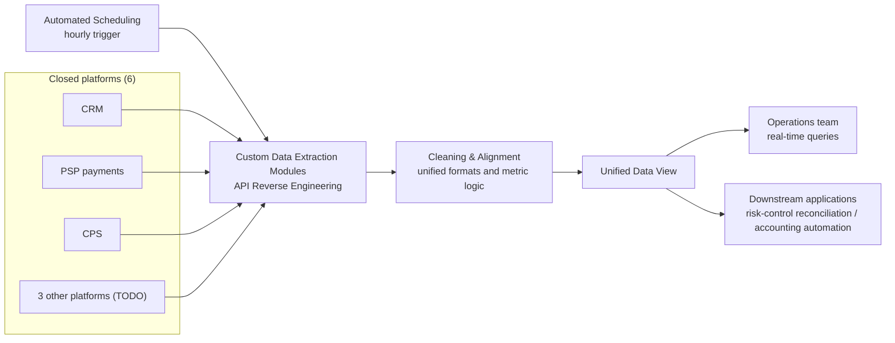

---
# English version of src/content/projects/operation-data-infrastructure.md (draft translation, pending Peter's review).
# Dates, stack, categories, metric values and the system map come from the zh file.
summary: "With no DB access and no standardized API documentation, integrated 6 closed platforms via API reverse engineering and built an hourly incremental ingestion pipeline with a unified data view."
role: "Led planning and build from 0 to 1"
metric_labels:
  - "Heterogeneous platforms integrated"
  - "Automated data ingestion"
  - "Incremental sync"
tldr:
  problem: "Operations data was scattered across closed platforms with no DB access or API docs; looking up one record meant switching between many pages by hand."
  approach: "Built an extraction module for each platform via API reverse engineering, cleaned and aligned the fields, and synced them hourly into a unified data view."
  result: "Operations now queries from a single entry point, and the later risk-control reconciliation and accounting automation are built on this data layer."
---

## Problem Assessment

- Operations data was scattered across closed platforms (CRM, PSP, CPS and others), and the company had no internal database it could query directly.
- This project built the operations data foundation from scratch; the later [Credit Card Anomaly Detection](../credit-card-anomaly-detection/) and [Account Operation Automation Engine](../account-automation-engine/) are both built on top of it.

Glossary9 terms · click to expand

<table>
<thead><tr><th>Term</th><th>Meaning</th></tr></thead>
<tbody>
<tr><td>CRM</td><td>Internal system that manages clients and trading accounts</td></tr>
<tr><td>PSP</td><td>Payment Service Provider, an external payment provider</td></tr>
<tr><td>CPS</td><td>Internal channel payment platform</td></tr>
<tr><td>DB access</td><td>Permission to query the database directly</td></tr>
<tr><td>API reverse engineering</td><td>Analyzing the APIs a web page calls behind the scenes and fetching the data directly with code</td></tr>
<tr><td>Data silos</td><td>Data spread across systems that do not talk to each other</td></tr>
<tr><td>Incremental sync</td><td>Each run fetches only data added or changed since the last run</td></tr>
<tr><td>ETL</td><td>Extract, Transform, Load</td></tr>
<tr><td>Unified data view</td><td>A single query entry point over data from many platforms, normalized to one format</td></tr>
</tbody>
</table>

<figure class="pain-figure">

<section class="pain-card tone-grey pain-wide">
<h4 class="pain-title">One lookup means switching many pages</h4>

PainData silos, searched by hand

<ul class="pain-note">
<li>Data was spread across several closed platforms that did not talk to each other.</li>
<li>In the CRM, for example, looking up one record took more than 10 page switches.</li>
</ul>
</section>
<section class="pain-card tone-red">
<h4 class="pain-title">No access to the data source</h4>

PainNo DB access and no API documentation

<ul class="pain-note">
<li>There was no usable database source.</li>
<li>The platforms had no standardized API documentation; data was only available through the web interface.</li>
</ul>
</section>
<section class="pain-card tone-yellow">
<h4 class="pain-title">Report numbers don't match</h4>

PainEvery system defines fields and metrics its own way

<ul class="pain-note">
<li>Field names and formats differed between systems.</li>
<li>Reports produced by different departments could not be reconciled.</li>
</ul>
</section>

<figcaption>Figure 1　The three pain points before the build (summarized from the résumé project description)</figcaption>
</figure>

**Why it was worth solving:**

1. **It affects every operations query**: data lived on 6 platforms, so any cross-platform question had to be pieced together by hand.
2. **It is the prerequisite for later automation**: credit card anomaly detection and the accounting automation engine both need a stable data source in a consistent format.

TODO: add numbers that quantify the problem (for example daily query count and time per query).

## Solution Design

**Pain point → solution** (matches the architecture in Figure 2):

- **No access to the data source** → analyze the APIs behind each platform's web interface and build a separate extraction module for each platform.
- **One lookup means switching many pages** → collect the extracted data into a unified data view so operations queries from one entry point.
- **Report numbers don't match** → define cross-platform cleaning and alignment rules first, unify field formats and metric logic, then serve the data downstream.
- **Data needs to be near real time** → schedule an hourly incremental sync instead of periodic manual exports.

**Constraints the design had to handle:**

- No official interface: data was only available through each platform's web interface.
- Heterogeneous sources: the 6 platforms differ in data structure, field names and metric definitions.
- Freshness: operations decisions need near-real-time data and cannot rely on periodic manual exports.
- TODO: add the technical difficulties actually met during reverse engineering (for example authentication, pagination, rate limits).

## Alternative Solutions

| Option | Approach | Pros | Cons |
|---|---|---|---|
| A. Keep pulling data by hand | Operations queries and exports from each platform when needed | No development | Many page switches; data is not timely; departments' numbers don't match |
| B. Wait for DB access or an official API | Request a formal data interface from the system owners | Most stable, officially supported | Depends on other teams; timeline out of our control |
| **C. API reverse engineering + ETL (chosen)** | Analyze the APIs behind each platform's interface and build our own extraction modules and hourly sync pipeline | No waiting for access; we control the data format | Must be adjusted when a platform's interface changes |

> TODO: confirm which options were actually evaluated at the time; A and B are currently based on the original page's "replace manual pulls" and "don't wait for DB access or an official API".

## Selected Solution

**Chosen: C, API reverse engineering + ETL**

1. **No waiting for access**: instead of waiting for DB access or an official API (B), analyze each platform's interface directly and build a separate extraction module for each.
2. **No manual pulls**: extract, transform and load run in one pipeline, and an hourly incremental sync replaces manual exports (A).
3. **Standardize before use**: unify field formats and metric logic first, then serve downstream, so each application does not interpret the raw data its own way.

*Figure 2　Operations data foundation architecture (summarized from the résumé project description)*

**Design notes:**

- **Layers**:
  - Extraction: Python, API reverse engineering, custom data extraction modules.
  - Orchestration: automated scheduling, hourly incremental sync.
  - Transformation: data cleaning, data normalization, metric alignment.
  - Serving: unified data view.
- **My scope**: led the full 0-to-1 plan; built the custom extraction modules; designed the 100% automated ingestion pipeline on my own; defined the cross-platform cleaning and alignment rules.
- TODO: confirm the tools actually used for scheduling and storage (the job listing mentions Apache Airflow and Apache Superset; not yet confirmed for this project).
- **Access scope**: TODO: add the account used, read/write scope, approver and how credentials are stored.

## Result

This infrastructure is currently the data source for two downstream projects:

- [Credit Card Anomaly Detection](../credit-card-anomaly-detection/): pulls PSP and CRM credit card reports every hour for reconciliation.
- [Account Operation Automation Engine](../account-automation-engine/): batch-queries CRM account statuses across regulators.

<figure class="tech-figure">

Tech Label

Custom Extraction Modules

One extraction module per closed platform; reverse-engineered APIs replace manual use of the interface.

Tech Label

Hourly Incremental Sync

Syncs only new or changed data every hour, replacing periodic manual exports.

</figure>

TODO: add a real run log, an output sample and run statistics.

## Impact

### Verified results

<figure class="ba-figure">

Item

Before: no infrastructure

After: infrastructure in place

Data source

Each of 6 closed platforms queried separately

Unified data view<small>Source: résumé project description</small>

How queries work

Manual search across many pages (see Problem)

Single entry point<small>Source: résumé project description</small>

Data ingestion

Pulled by hand

100% automated, hourly incremental sync<small>Source: résumé project description</small>

Data consistency

Departments' report numbers differ

Unified formats and metric logic<small>Source: résumé project description</small>

<figcaption>Figure 3　Before / After</figcaption>
</figure>

### Not yet quantified, or needing explanation

- **Query time**: there is no record of time per query before and after the build. TODO: add a quantifiable before/after comparison.
- **Platform list**: only CRM, PSP and CPS of the 6 platforms are listed so far; the other 3 are still to be added.
