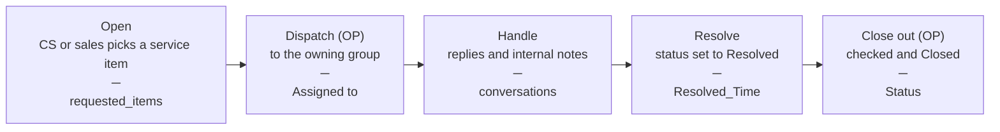
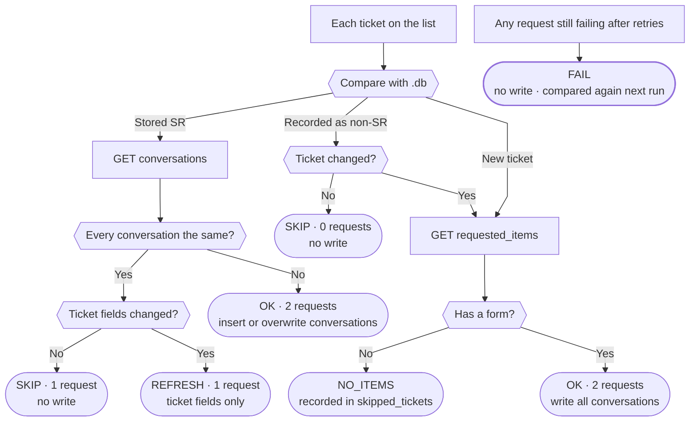

---
# English version of src/content/projects/ticket-data-mart.md (draft translation, pending Peter's review).
# Dates, stack, categories, metric values and the system map come from the zh file.
summary: "OP is the hub for tickets, but ticket data used to be requested from other teams, which was slow and often misaligned. Within the shared API quota, Q4 2026 Freshservice tickets and conversations are backfilled, diffed and written into one SQLite file per year, and exported to OP as an Excel split by handling group."
role: "Planned and built the PoC: extraction, diff-and-write, verification and scheduling"
metric_labels:
  - "Time for OP to get ticket data (previously requested from other teams, estimated)"
  - "Data preparation and workload-statistics hours saved (estimated)"
  - "October 2026 tickets matched to the workload item register (107,412 points)"
impact:
  before: "Ticket data had to be requested from other teams"
  after: "Synced daily, so OP gets the full data itself"
tldr:
  problem: "OP is the ticket hub, but data had to be requested from other teams: slow, often misaligned, never the whole picture."
  approach: "Backfill Q4 tickets and conversations within the shared API quota, diff them into SQLite, and schedule a daily run."
  result: "OP gets complete, consistent data that maps to workload points; reruns never duplicate, and interrupted runs resume where they stopped."
---

## Problem Assessment

<hr data-slide="Background and terms">

- Operations-related client issues are opened as tickets in **Freshservice**. **OP is the hub**: it dispatches each ticket to the department that owns the case, and OP closes it out at the end.
- The dispatch rules live in operations' **workload item register**: each service item maps to an owning team and a workload point value. The register has 222 service items and 14 owning teams; 132 items are handled by OP itself and 79 are transferred to other departments (Trading, Risk, Admin and others).
- A hub needs the whole picture, but ticket data used to be requested from other, non-parallel teams: slow, often with misaligned dimensions, and even after rounds of back-and-forth the current state could not be pieced together, so issues could not be fixed as soon as they appeared.

How a ticket goes from open to closed, and the data each step leaves behind that this project extracts:



*Figure 1　The life of a ticket. It may pass through statuses such as Pending or Awaiting Approval along the way; the last line in each box is the matching field or API object.*

<details class="glossary-details">
<summary>Glossary<span class="mono">15 terms · click to expand</span></summary>
<table>
<thead><tr><th>Term</th><th>Meaning</th></tr></thead>
<tbody>
<tr><td>Freshservice</td><td>A cloud ticketing system by Freshworks (similar to Jira Service Management or Zendesk), used internally to open, dispatch, answer and close tickets. <a href="https://www.freshworks.com/freshservice/" target="_blank" rel="noopener">Official site</a></td></tr>
<tr><td>OP</td><td>The operations team, which dispatches tickets to the owning department and closes them out</td></tr>
<tr><td>Ticket</td><td>The record of one case, including its status, handling group and conversations</td></tr>
<tr><td>Service Request (SR)</td><td>A ticket opened from a service catalog form, carrying form fields such as account or amount</td></tr>
<tr><td>Service item</td><td>The case type chosen when opening a ticket, such as W1. Withdrawal Status Check</td></tr>
<tr><td>Owning team</td><td>The team the workload item register assigns to each service item, such as OP-DW or Risk Team</td></tr>
<tr><td>Workload points</td><td>The workload weight the register assigns to each service item (2–8 points)</td></tr>
<tr><td>Handling group</td><td>The unit a ticket is currently assigned to, such as (OP)Withdrawal Team</td></tr>
<tr><td>Conversation</td><td>Each reply or internal note inside a ticket</td></tr>
<tr><td>View</td><td>A saved ticket filter in the admin portal, such as "tickets created in Q4"</td></tr>
<tr><td>Rate limit / 429</td><td>The cap on API calls per minute; above it the API returns HTTP 429 and asks the caller to wait</td></tr>
<tr><td>Backfill</td><td>Loading a past period of data into the database in one go</td></tr>
<tr><td>Idempotent</td><td>Running the same data again gives the same result, with no duplicates</td></tr>
<tr><td>List reconciliation</td><td>After a run, every ticket is checked: written, confirmed non-SR, or on the failure list</td></tr>
<tr><td>PoC</td><td>Proof of Concept: validating the approach on a small slice of data first</td></tr>
</tbody>
</table>
</details>

<hr data-slide="Pain points">

<figure class="pain-figure">
<div class="pain-grid">
<section class="pain-card tone-red pain-wide">
<h4 class="pain-title">The hub cannot see the whole picture</h4>
<p class="pain-label"><span>Pain</span>Data comes from requests to other teams and never adds up to the current state</p>
<ul class="pain-note">
<li>Ticket data had to be requested from other, non-parallel teams, with long waits.</li>
<li>What came back often had misaligned dimensions (fields, periods, groups) and needed more back-and-forth.</li>
<li>OP dispatches and closes tickets, yet could not see what each group was holding, so problems could not be fixed in time.</li>
</ul>
<div class="pain-evidence">
<p class="pain-evidence-title">Evidence: the cost of requesting, and the volume to track</p>
<ul class="pain-flow">
<li>Each request: <mark>XX days</mark> of waiting and XX rounds of back-and-forth; about XX requests and XX hours of tidying a month (estimated).</li>
<li>Tickets created in October 2026: <mark>47,530</mark> in one month, 1,533 a day on average.</li>
<li>Weekday median <mark>1,874</mark> (1,534–2,513); weekend median 590 (418–769).</li>
<li>Spread across 16 handling groups under OP; per the register, tickets may also be transferred to 11 other owning teams.</li>
</ul>
</div>
</section>
<section class="pain-card tone-grey">
<h4 class="pain-title">The public API cannot read the list we need</h4>
<p class="pain-label"><span>Pain</span>OP works from portal views, which the public API does not support</p>
<ul class="pain-note">
<li>The public API cannot read custom portal views; every parameter and path tried returned 400 or 404.</li>
<li>The public filter query is capped at 512 characters, too short for all the group conditions in the view.</li>
</ul>
</section>
<section class="pain-card tone-yellow">
<h4 class="pain-title">The old script flooded the shared quota</h4>
<p class="pain-label"><span>Pain</span>Fast, but everyone got blocked</p>
<ul class="pain-note">
<li>The old version ran unthrottled in parallel and, when rate-limited, neither waited nor retried; failures were simply skipped.</li>
<li>The API quota is shared across the account, so colleagues' integrations were blocked too, and an interrupted run could not resume (see next slide).</li>
</ul>
</section>
</div>
<figcaption>Figure 2　Three pain points today (request cost estimated; ticket volume from the 2026 .db)</figcaption>
</figure>

<hr data-slide="Shared quota">

<figure class="quota-figure">
<ul class="quota-list" style="--limit-sub: 13.3%; --limit-total: 41.7%">
<li class="is-over" style="--v: 100%"><span class="quota-label">Old: unthrottled parallel (peak, estimated)</span><span class="quota-bar"></span><span class="quota-value">≈1,200</span></li>
<li style="--v: 16.7%"><span class="quota-label">New: fixed rate (setting)</span><span class="quota-bar"></span><span class="quota-value">200</span></li>
</ul>
<p class="quota-legend"><span class="quota-mark is-sub"></span>Ticket API sub-limit 160/min　<span class="quota-mark is-total"></span>Account total 500/min</p>
<figcaption>Figure 3　Requests per minute against the Freshservice limits (measured). The old peak is estimated from 10 parallel workers at about 0.5 s per request; the new rate sits slightly above the sub-limit on purpose, and the excess waits for <code>Retry-After</code> before retrying.</figcaption>
</figure>

<hr data-slide="Why it is worth solving">

**Why it is worth solving:**

1. **Volume**: about 48,000 tickets a month (see pain points); requesting and tidying data by hand cannot keep up.
2. **OP closes every case**: dispatch and closing both go through OP; if OP cannot see the whole picture, delays are only caught after the fact.
3. **No more collateral damage**: the old peak was more than twice the account quota (see Figure 3), so the new approach has to stay within the shared quota.

<hr data-slide="Success criteria">

**Success criteria defined before building** (results in Impact):

1. **Faster**: OP gets ticket data automatically every day instead of requesting it from other teams (XX days).
2. **Complete**: all Q4 tickets and conversations of OP's handling groups are landed; verified by list reconciliation.
3. **Workload-ready**: every ticket maps to an owning team and points in the workload item register; verified by match rate.
4. **No impact on colleagues**: runs within the shared API quota; verified by no ticket failing because of rate limiting.
5. **Reliable**: interrupted runs resume and reruns never duplicate; verified by a rerun log.

## Solution Design

<hr data-slide="Pain points and directions">

**Pain point → direction** (maps to the architecture in 04):

- **The hub cannot see the whole picture** → extract straight from Freshservice into OP's own database, and export a fixed 17-column Excel split by handling group, with the same dimensions every time.
- **The public API cannot read views** → take the ticket list from the portal view (reusing OP's existing conditions) and fetch each ticket's details and conversations through public API v2.
- **Flooding the shared quota** → pace requests on the client side; on 429 wait for `Retry-After` and retry; tickets already stored and unchanged are only checked, not refetched.

<hr data-slide="Scope decisions">

The PoC deliberately narrows its scope to prove value first, then decide whether to expand:

| Decision | This time | Why | Trade-off |
|---|---|---|---|
| Period | Q4 only (from 2026-10-01) | Prove value on one quarter; avoid the quota and timeline risk of a full backfill | No earlier history |
| Scope | OP's handling groups only | Serve the hub's own dispatch and close-out first; reuse the two views OP already uses | Tickets transferred to other departments are not visible |
| Storage | One SQLite file per year | No database server to run; a single file is easy to move and back up | Not built for concurrent writers; no version history |
| Output | Excel split by handling group | OP can use it without learning a new tool | Not a real-time dashboard |

**Non-goals this time**: tickets in transfer departments, transfer timelines and dwell time, joins with CRM, conversation QA, BI dashboards (see the Roadmap in Impact).

<hr data-slide="Design constraints">

**Constraints the design had to face:**

- **reCAPTCHA on login**: reading views needs a portal session, so a person logs in once and the session is saved and reused.
- **Time filters only work by day**: sending "11/16 10:00–12:00" returns all of 11/16; an unrecognized condition does not raise an error but **returns every ticket**, so bad settings must be stopped before any API call.
- **A whole month is too big**: at about 40,000 tickets a month (estimate), fetching the list takes so long it looks stuck, and an interruption means starting over.
- **Backfills run for hours**: rate limits and network drops are certain along the way, so runs must resume from where they stopped and reruns must not duplicate.

## Alternative Solutions

| Option | Approach | Pros | Cons |
|---|---|---|---|
| A. Request from other teams (today) | Ask other teams to export when needed | No development | Slow; dimensions often misaligned; no whole picture |
| B. Old script | Everything through the portal's internal API, 10 parallel workers, unthrottled | Fast | Peak exceeds the account quota and blocked requests are not retried; cannot resume; lists only editable tickets, so read-only ones are missed |
| C. Public API filter only | Call `/tickets/filter` with an API key | No portal login | Cannot read views; the 512-character query cannot hold all group conditions |
| **D. View for the list + public API for details (chosen)** | Portal view for the list, API v2 for details, fixed rate into one SQLite file per year | Reuses OP's conditions; stable within the quota; resumable and rerunnable | Needs a saved portal session; an expired session needs a manual login |

## Selected Solution

<hr data-slide="Why this option">

**Choosing D: view for the list + public API for details**

1. **Replaces A's requests**: data is extracted at the source, and fields and groups are fixed by the program, so nothing gets misaligned in hand-offs.
2. **Fixes B's quota problem**: each ticket's details take 2 requests (the old version took 3), sent at a fixed rate; when rate-limited, the program waits instead of jamming everyone.
3. **Covers what C cannot**: the list reuses the views OP already set up in the portal, and the time range comes from the config file instead of editing the view each time.

```mermaid
flowchart LR
    CRON["cron daily 09:00<br/>Docker container"]
    CFG["Config check<br/>all errors listed, then stop"]
    VIEW["Step 1 Resolve list<br/>portal view · ranges split by day<br/>saved as tickets.json"]
    CMP["Step 2 Compare<br/>with tickets in the .db"]
    API["Step 3 Extract<br/>API v2 · 200/min<br/>429 retried after Retry-After"]
    DB[("One SQLite per year<br/>commit every 100 tickets")]
    VER["Step 4 List reconciliation"]
    XLS["Step 5–6 Excel<br/>17 columns · one sheet per group"]
    OP["OP"]

    CRON --> CFG --> VIEW --> CMP --> API --> DB --> VER --> XLS --> OP
```

<hr data-slide="Architecture">



*Figure 4　Daily sync flow (step numbers match the code). For the backfill, the time range is set to 10/01–10/31 and the same flow runs one day at a time.*

<hr data-slide="Design notes">

**Design notes:**

- **Resumable**: the list is frozen as `tickets.json` on the first fetch; every batch of 100 is committed, so an interruption loses at most one batch, and a rerun sees written tickets as SKIP.
- **Rerunnable**: the primary key is `(ticket_id, conversation_id)`, so a conversation never appears twice; each ticket is written in a single transaction.
- **Verifiable**: after a run, every ticket must be in the .db, in `skipped_tickets`, or on the failure list; anything else is an ERROR.
- **Traceable**: every row carries `run_id`, `source` (which view and which day) and `fetched_at`; every log line carries `run_id` and `stage`.
- **Tested**: 195 pytest test functions cover diffing, writing, config checks, retries and output; parts that need the external API use mocks.
- **Schema upgrades keep data**: an older .db is rebuilt on open, and the old table is dropped only after row counts match.
- **Access scope**: the export only reads and never creates or edits tickets; the list uses the portal session and details use the API key. TODO: account ownership, approver and how credentials are stored.

<hr data-slide="Diff logic">

Each ticket is compared with the .db first, which decides whether to call the API and what to write. A stored, unchanged ticket costs a single request to confirm, leaving the quota for tickets that actually changed:



*Figure 5　Diff flow for each ticket. Each ticket is written in a single transaction; FAIL writes nothing and is compared again on the next run, so a rerun fills the gap.*

## Result

<hr data-slide="A real run">

This chapter has two parts: **reliability** first (run log, backfill statistics), then **business output** (resolution time, workload points, a case).

Below is the log of rerunning the "tickets updated on 10/20" slice on 2026-11-20 (excerpt; view ID and run folder removed, `run_id` truncated to 8 characters):

```text
13:09:17 [run=e39c313b stage=init]    Export started (view=<view_id>, time={"from": "2026-10-20", "to": "2026-10-20"}, limit=0)
13:09:26 [run=e39c313b stage=resolve] Resolve ticket list completed (tickets=736)
13:09:27 [run=e39c313b stage=compare] Compare with .db completed (non_sr_skipped=4, to_compare=724, to_fetch=8)
13:09:27 [run=e39c313b stage=fetch]   Fetch started (tickets=732, batches=8, batch_size=100, concurrency=20)
13:10:13 [run=e39c313b stage=fetch]   Batch saved (batch=1/8, progress=100/732 14%, ok=0, refresh=0, skip=104, failed=0, new=0, updated=0, elapsed=46s)
...
13:15:21 [run=e39c313b stage=fetch]   Batch saved (batch=8/8, progress=732/732 100%, ok=8, refresh=0, skip=728, failed=0, new=77, updated=0, elapsed=5m54s)
13:15:21 [run=e39c313b stage=verify]  Verify completed (in_db=732, no_items=4, failed=0, missing=0)
13:15:22 [run=e39c313b stage=summary] 736 tickets: 728 unchanged and skipped, 0 ticket-field refreshes, 8 full fetches (8 new, 0 with changed conversations), 0 non-SR, 0 failed
13:15:22 [run=e39c313b stage=summary] conversations: 2193 existing (0 updated), 77 new
13:15:22 [run=e39c313b stage=summary] Verification passed: list 736 = 732 in .db + 4 non-SR + 0 failed
```

*The three summary lines are translated from the original Chinese log.*

What this log shows:

- **Reruns do not duplicate**: 728 of 736 tickets already existed unchanged and were skipped; only 8 new tickets were fully fetched, adding 77 conversations.
- **List reconciliation**: 736 = 732 (.db) + 4 (non-SR) + 0 (failed); nothing is missing.
- **Every step is logged**: `stage` moves through init → resolve → compare → fetch → verify → summary, with progress for every batch.

<figure class="tech-figure">
<div class="tech-labels">
<div class="tech-label">
<p class="tech-label-kicker">Tech Label</p>
<p class="tech-label-name">Quota-aware Fetching</p>
<p class="tech-label-desc">A fixed client-side request rate; 429 waits for Retry-After, and network errors retry only requests that are safe to resend.</p>
</div>
<div class="tech-label">
<p class="tech-label-kicker">Tech Label</p>
<p class="tech-label-name">Conversation-level Diff</p>
<p class="tech-label-desc">Compares (conversation_id, updated_at) one by one to choose SKIP / REFRESH / OK, so unchanged tickets are not refetched.</p>
</div>
<div class="tech-label">
<p class="tech-label-kicker">Tech Label</p>
<p class="tech-label-name">List Reconciliation</p>
<p class="tech-label-desc">Every run checks each ticket: written, non-SR or failed, one of the three, otherwise it ends with ERROR.</p>
</div>
</div>
</figure>

<hr data-slide="Backfill statistics">

Scope: the Q4 backfill started on 2026-11-19, with the "created" and "updated" views each split into 31 daily slices, 62 in total; figures as of 2026-11-20 (slice 62 still running).

| Metric | Value | Notes |
|---|---|---|
| Slices completed | 61 / 62 | 12 without failures; 49 with a few failures (rerunning the same command fetches them) |
| Rows output across slices | 288,998 | One row per conversation; tickets in both views are counted twice |
| Fetch failures | 293 | All from detail requests returning HTTP 404; cause to be confirmed (XX) |
| 429 waits and retries | 26,479 | Across all run logs; every one waited for `Retry-After`, and no ticket failed because of rate limiting |
| 2026 .db contents | 75,598 tickets, 234,177 rows | Plus 250 non-SR tickets in `skipped_tickets` |
| Conversations landed for October 2026 tickets | 146,814 | About 3.1 per ticket (ticket count: see Problem) |

<hr data-slide="Time to resolve by group">

With the data landed, OP can compare resolution times across groups for the first time:

<figure class="bar-figure">
<ul class="bar-list">
<li class="is-peak" style="--v: 100%"><span class="bar-label">(OP)Deposit Team (6,212)</span><span class="bar"></span><span class="bar-value">14.1 h</span></li>
<li class="is-peak" style="--v: 99%"><span class="bar-label">(OP)Withdrawal Team (11,361)</span><span class="bar"></span><span class="bar-value">14.0 h</span></li>
<li style="--v: 24%"><span class="bar-label">(OP)Acc-IB Adjustment (2,242)</span><span class="bar"></span><span class="bar-value">3.4 h</span></li>
<li style="--v: 11%"><span class="bar-label">(OP)Acc-QC Ranger (862)</span><span class="bar"></span><span class="bar-value">1.6 h</span></li>
<li style="--v: 6%"><span class="bar-label">(OP)Acc-CS (3,474)</span><span class="bar"></span><span class="bar-value">0.8 h</span></li>
<li style="--v: 6%"><span class="bar-label">(OP)Account Team (3,428)</span><span class="bar"></span><span class="bar-value">0.8 h</span></li>
<li style="--v: 2%"><span class="bar-label">(OP)Acc-ID/POA (4,798)</span><span class="bar"></span><span class="bar-value">0.3 h</span></li>
<li style="--v: 1%"><span class="bar-label">(OP)Acc-Account Owner Transfer (13,484)</span><span class="bar"></span><span class="bar-value">0.1 h</span></li>
</ul>
<figcaption>Figure 6　Median time from creation to resolution for resolved tickets created in October 2026 (by handling group at fetch time; ticket counts in brackets; groups with 500+ tickets only). It includes time spent waiting for clients, so it is not a department's actual handling time.</figcaption>
</figure>

<hr data-slide="Workload points">

Matching each ticket's service item against the workload item register gives every ticket an owning team and workload points automatically. Every ticket created in October 2026 matched the register (100% match rate):

| Owning team | Tickets | Workload points | Average per ticket |
|---|---|---|---|
| OP-AC | 28,935 | 69,519 | 2.40 |
| OP-DW | 17,620 | 35,943 | 2.04 |
| OP-AC,OP-DW | 965 | 1,930 | 2.00 |
| Risk Team | 10 | 20 | 2.00 |
| Total | 47,530 | 107,412 | 2.26 |

- OP-AC averages higher mainly because of 3-point account owner transfer items (register sub-category Account Owner Transfer, 10,983 tickets).
- Risk Team is the only row outside OP: the current views only cover OP's handling groups, so most transferred tickets are out of scope (see Impact).

<hr data-slide="From data to action">

**Case: XX** (a real case where OP acted on the data, to be added)

- **What the data showed**: XX (for example, a group's resolution time or backlog in Figure 6).
- **What OP did**: XX.
- **Result**: XX.

<hr data-slide="Output format">

OP's Excel has a fixed set of 17 columns, with a summary sheet plus one sheet per handling group; a conversation that appears in both views is kept once:

```text
ticket_id | conversation_id | subject | category | private | Requester | service_item | department_name |
First_ModifyTime | Last_ModifyTime | Resolved_Time | Status | Assigned to |
username | body_text | created_at | updated_at
```

- One row per conversation; `ticket_id` + `conversation_id` is the unique key.
- Times are converted to `+08:00`; codes (status, group) are converted to names, and unmatched codes are filled as `unknown (…)` rather than left blank or guessed.
- Form fields, priority and raw HTML stay in the .db only and are not exported.
- Sample rows contain client data and are not published.

## Impact

### Verified results

<figure class="ba-figure">
<div class="ba-table">
<div class="ba-row ba-head"><p class="ba-item">Item</p><p class="ba-before">Before: requested from other teams</p><p class="ba-after">After: OP Ticket Data Pipeline</p></div>
<div class="ba-row"><p class="ba-item">Getting the data</p><p class="ba-before">Requested from non-parallel teams: XX days of waiting and XX rounds each time (estimated)</p><p class="ba-after">Scheduled daily extraction (set up, track record pending); the Q4 backfill is in the .db and group resolution times can be compared directly<small>Basis: backfill statistics, Figure 6 (see Result)</small></p></div>
<div class="ba-row"><p class="ba-item">Preparation hours</p><p class="ba-before">About XX hours a month, XX people (estimated)</p><p class="ba-after">A fixed-format Excel is produced automatically, with no manual tidying<small>Basis: output format (see Result)</small></p></div>
<div class="ba-row"><p class="ba-item">Consistent dimensions</p><p class="ba-before">Fields, periods and groups often misaligned</p><p class="ba-after">Fixed 17 columns, one sheet per group, codes converted to names<small>Basis: output format (see Result)</small></p></div>
<div class="ba-row"><p class="ba-item">Workload statistics</p><p class="ba-before">Matched against the register by hand, about XX hours a month (estimated)</p><p class="ba-after">Tickets map to owning team and workload points by service item; 100% match for October 2026<small>Basis: workload points (see Result)</small></p></div>
<div class="ba-row"><p class="ba-item">Shared API quota</p><p class="ba-before">Old peak exceeded the account quota; blocked requests not retried</p><p class="ba-after">Fixed 200/min; every 429 waited and retried<small>Basis: Figure 3, backfill statistics</small></p></div>
<div class="ba-row"><p class="ba-item">Reruns and interruptions</p><p class="ba-before">The old version could not resume</p><p class="ba-after">Reruns fetch only changed tickets and pass list reconciliation<small>Basis: a real run (see Result)</small></p></div>
</div>
<figcaption>Figure 7　Before / After</figcaption>
</figure>

**Total**: about XX hours saved a month (data preparation XX + workload statistics XX, estimated). Success criteria 2–5 are verified by the table above and Result; criterion 1 awaits the estimates.

<hr data-slide="To be validated">

### Not yet quantified, or needing explanation

- **Estimates**: waiting, preparation and workload-statistics hours (XX) are estimates; they were never logged per request.
- **Usage**: OP currently has XX people using it, checking every XX (to be added).
- **Daily schedule**: the Docker + cron job at 09:00 is set up, but has only one recorded run so far; stability is still to be proven.
- **Extraction stops at OP**: both views cover only OP's handling groups; tickets for the register's 79 transfer items (11 teams such as Trading, Risk and Admin) are mostly out of scope, so the full dispatch → handle → close-out cycle is not yet visible.
- **Data range**: the PoC covers Q4 only; tickets created on 11/1–11/4 are clearly low, likely because that slice is not fully backfilled yet, so statistics use October only.
- **No version history**: ticket fields and edited conversations are overwritten with the latest values, so a run cannot be rolled back and transfers between groups are not visible.
- **What the resolution time means**: Figure 6 measures creation to resolution, including time waiting for clients; actual time spent per department needs transfer records (see Roadmap).

<hr data-slide="Roadmap">

**Roadmap (not started):**

1. **Extend to transfer teams**: add the register's transfer items to the views so OP can see the status of tickets sent to other departments.
2. **Transfer timeline**: fetch ticket activities to rebuild the dispatch → handle → close-out timeline and compute each team's actual dwell time and workload.
3. **Join with CRM**: JOIN tickets with CRM clients and deposits / withdrawals to see which clients and channels cases cluster on.
4. **Conversation QA**: count reply round-trips from the landed conversations, then evaluate adding LLM scoring.
5. **Pre-run snapshot**: copy the year's .db before each run so it can be restored to the pre-run state.
6. **Real-time alerts and dashboards**: webhook alerts for high-risk tickets; a lightweight BI dashboard on the database so OP can read charts themselves.
