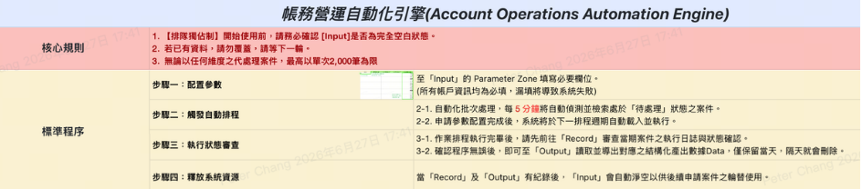
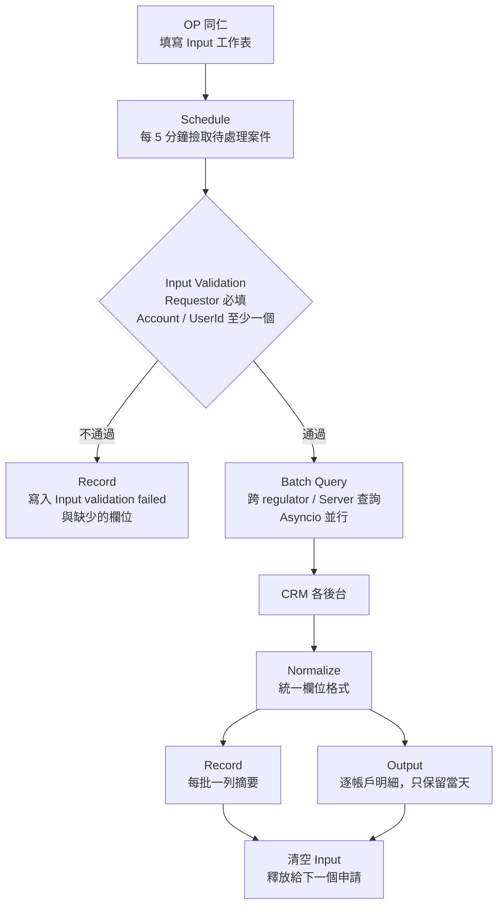

## Problem Assessment

- 帳戶關閉、高風險客戶清退、轉歸屬之前，OP 都要先確認名單上每個客戶的帳戶狀態：userId、Balance、Margin、Profit、Account Server 等。
- IT 可以提供待處理的 UID 名單，但不提供這些欄位。OP 只能在多個 CRM 後台之間反覆切換 regulator，逐筆查詢、逐筆確認。
- 需求來自不同團隊，而且常常是整批出現，逐筆查詢的作業模式撐不住批量案件。

<figure class="pain-figure">
<div class="pain-grid">
<section class="pain-card tone-grey pain-wide">
<h4 class="pain-title">🔀 逐筆查詢、反覆切換</h4>
<p class="pain-label"><span>Pain</span>一個帳戶要走一次完整查詢流程</p>
<ul class="pain-note">
<li>不同 regulator 的客戶在不同 CRM 後台，查之前要先切對後台。</li>
<li>每個帳戶的 Balance、Margin、Profit、Server 要逐項點開確認。</li>
</ul>
<div class="pain-evidence">
<p class="pain-evidence-title">證據：人工查詢一個帳戶的步驟</p>
<ul class="pain-flow">
<li>① 從 IT 給的 UID 名單取出一筆 userId。</li>
<li>② 判斷客戶所屬 regulator，切換到對應的 CRM 後台。</li>
<li>③ 搜尋客戶，進入帳戶頁，找到 Trading Account／Rebate Account。</li>
<li>④ 逐項記下 Balance、Margin、Profit、Equity、Credit、Account Server 等欄位。</li>
<li>⑤ 回到名單，換下一筆，重複 ①–④。</li>
</ul>
<p class="pain-caption">平均每個帳戶約 <b>45 秒</b>（估計）→ 1,000 個帳戶 ≈ <b>12.5 小時</b>人工。</p>
</div>
</section>
<section class="pain-card tone-red">
<h4 class="pain-title">📈 批量案件撐不住</h4>
<p class="pain-label"><span>Pain</span>案件量遠超過逐筆查詢的速度</p>
<ul class="pain-note">
<li>清退、轉歸屬這類案件常常一次就是上千個帳戶。</li>
<li>處理速度被「查資料」卡住，而不是被判斷卡住。</li>
</ul>
<div class="pain-evidence">
<p class="pain-evidence-title">證據：上線後實際送進來的批量需求</p>
<ul class="pain-flow">
<li>單批最多 <b>17,416</b> 個帳戶，逐筆查詢約需 <b>218 小時</b>。</li>
<li>超過 2,000 個帳戶的批次有 <b>65</b> 次。</li>
<li>5 個月共 <b>531</b> 次成功的批量查詢。</li>
</ul>
</div>
</section>
<section class="pain-card tone-yellow">
<h4 class="pain-title">⚠️ 核心工作被壓縮</h4>
<p class="pain-label"><span>Pain</span>人力耗在查找、切系統、最後確認</p>
<ul class="pain-note">
<li>OP 的時間被資料搜尋與整理佔滿。</li>
<li>真正需要人判斷的風控與合規工作被往後排。</li>
</ul>
<div class="pain-evidence">
<p class="pain-evidence-title">證據：一批需求的涵蓋範圍</p>
<ul class="pain-flow">
<li>單批最多涵蓋 <b>179</b> 個國家、<b>40</b> 個 Server、<b>4</b> 個 regulator、<b>48</b> 種帳戶類型。</li>
<li>每個帳戶要確認的欄位有 <b>20</b> 個以上（見 Result 的輸出格式）。</li>
</ul>
</div>
</section>
</div>
<figcaption>圖 1　原流程的三個痛點（人工步驟依 OP 作業整理；每帳戶 45 秒為估計值；批量數據取自引擎的 Record 工作表，2026-06-09 ~ 2026-11-16）</figcaption>
</figure>

**值得投入解決的理由：**

1. **需求量是真的**：上線 5 個月內有 531 次成功的批量查詢，累計 381,629 個帳戶；以每個帳戶 45 秒估計，人工需要約 4,770 小時。
2. **單批量級已經超過人工能力**：最大的一批有 17,416 個帳戶，人工逐筆查詢約 218 小時，大約是一個人 27 個工作天。
3. **流程高度重複，適合通則化**：不同團隊的需求表面不同，但都是「給一份 userId／Account 名單，回傳同一組帳戶欄位」。OP 日常的帳戶查詢需求中，約 80% 可以用同一套流程涵蓋。

## Solution Design

依照三個痛點，拆成五個要解決的面向，每一個都對應到使用規則中的一條：

| 痛點 | 解決方向 | 對應 |
|---|---|---|
| 逐筆查詢、反覆切換 regulator | 一次輸入整份 userId／Account 名單（Trading Account／Rebate Account 兩組欄位），由引擎跨 regulator、跨 Server 批量查回；輸入不完整就攔下，寫入紀錄並說明缺什麼 | 步驟一：配置參數 |
| 批量案件撐不住 | 排程每 5 分鐘自動撿取待處理案件，不需要人觸發 | 步驟二：觸發自動排程 |
| 結果分散、難以最後確認 | 每批輸出一列摘要到 Record（帳戶數、國家／Server／regulator 涵蓋數、查無資料清單），逐帳戶明細到 Output | 步驟三：執行狀態審查 |
| 多個團隊共用同一個入口 | 排隊獨佔：Input 空白才能填寫，單次上限 2,000 筆 | 核心規則 1–3 |
| 入口佔用後無法輪替 | Record 與 Output 都寫入後自動清空 Input，換下一個申請 | 步驟四：釋放系統資源 |


*圖 2　LarkSheet 上的使用規則，「對應」欄即指這張圖的各列（節錄 Rule 工作表中文部分，英文版內容相同；點擊可放大）*

**設計時必須面對的限制：**

- 使用者是非技術的 OP 同仁，入口必須是他們已經在用的工具（LarkSheet），不能要求學新系統。
- 多個團隊共用同一張表，同時填寫會互相覆蓋，需要排隊機制。
- 輸出內容是客戶帳戶資料，明細不能長期留在共用表上：Output 只保留當天，隔天刪除。
- TODO：補充 CRM 資料的取得方式與權限限制（是否有官方 API 或 DB 權限）。

## Alternative Solutions

| 方案 | 做法 | 優點 | 缺點 |
|---|---|---|---|
| A. 維持人工逐筆查詢 | 依 IT 提供的 UID 名單，在各 CRM 後台逐筆查 | 不需開發 | 每帳戶約 45 秒；單批 17,416 個帳戶需約 218 小時；人力隨案件量線性增加 |
| B. 每個需求寫一次性腳本 | 收到需求後，針對該次名單寫查詢腳本 | 單次交付快 | 每次都要工程師介入；OP 無法自行使用；邏輯分散，難以稽核 |
| **C. 通用批量查詢引擎（採用）** | 歸納共通流程，做成以 LarkSheet 為入口、排程自動執行的工具 | OP 可自行送件；一次涵蓋約 80% 的日常查詢；每次執行都有紀錄 | 需要前期設計共通欄位與驗證規則；剩下約 20% 的特殊需求仍需個別處理 |

> TODO：確認當時是否也評估過「請 IT 直接提供完整欄位報表」或 DB 查詢權限，若有，補進表格。

## Selected Solution

**選擇 C：通用批量查詢引擎**

1. **解決 A 的線性人力問題**：查詢交給引擎，人工只剩填名單與審查結果，案件量增加不需要加人。
2. **解決 B 的工程師依賴**：OP 在 LarkSheet 填完參數就會被排程撿走，不需要找工程師。
3. **先找通則，再寫工具**：約 80% 的需求共用同一組輸入（userId／Account）與同一組輸出欄位，值得做成一個工具；剩下的特殊需求不硬塞進同一套流程。

TODO：補上引擎架構圖原圖（目前只有下方的文字版流程）。

以下是引擎的流程：



**設計重點：**

- **先驗證再查詢，失敗也留紀錄**：驗證不通過時不進入查詢，直接在 Record 寫入失敗原因（例如缺少 Requestor），申請人看紀錄就知道要補什麼。上線期間共攔截 32 次不完整的申請。
- **查無資料不丟棄**：查不到的帳戶收集在 Record 的 `total_missing_list`，與成功的結果一起呈現。
- **排隊獨佔**：Input 有資料時其他人不能覆蓋；Record 與 Output 都寫入成功後才清空 Input，避免申請被吃掉。
- **單次上限**：規則上每次最多 2,000 筆，避免單一申請長時間佔住入口。
- **資料保留**：Output 明細只保留當天，隔天自動刪除；Record 只留摘要，作為長期的執行紀錄。
- **權限範圍**：TODO：補充引擎讀取 CRM 使用的帳號、讀寫範圍（預期為唯讀）、核准者、帳密存放方式。

## Result

### 一次實際執行的紀錄

每次執行都會在 Record 寫入一列摘要。以下是上線第一天（2026-06-09）的一次成功執行，以及兩種被驗證攔下的申請（申請人姓名已移除）：

```text
2026-06-09 11:31:09  Success | 616 users | 957 accounts validated | 68 countries | 11.96 hrs saved
                     servers_covered=36  regulators_covered=2  account_types_covered=29
2026-06-26 15:05:03  Input validation failed: 'Requestor' 欄位為必填欄位。
2026-07-15 14:10:02  Input validation failed: 未提供任何查詢資料，請至少填寫一個 'Account' 或 'UserId'。
```

從這段紀錄可以看到：

- **一次申請就涵蓋 68 個國家、36 個 Server、2 個 regulator**，人工要在多個後台之間切換才能查完。
- 每一列都帶有申請人、執行時間與節省工時，事後可以追溯誰在什麼時候查了多少帳戶。
- 輸入不完整時，紀錄會直接說明缺哪個欄位，而不是靜默失敗。

<figure class="tech-figure">
<div class="tech-labels">
<div class="tech-label">
<p class="tech-label-kicker">Tech Label</p>
<p class="tech-label-name">Batch Query Engine</p>
<p class="tech-label-desc">一次輸入整份名單，跨 regulator、跨 Server 批量查回帳戶狀態。</p>
</div>
<div class="tech-label">
<p class="tech-label-kicker">Tech Label</p>
<p class="tech-label-name">Validation &amp; Audit Record</p>
<p class="tech-label-desc">先驗證再查詢；成功與失敗都寫入 Record，可追溯每一次申請。</p>
</div>
<div class="tech-label">
<p class="tech-label-kicker">Tech Label</p>
<p class="tech-label-name">Exclusive Queue Lock</p>
<p class="tech-label-desc">以 Input 是否空白作為鎖，多個團隊共用同一個入口也不會互相覆蓋。</p>
</div>
</div>
</figure>

### 輸出格式

Output 每個帳戶一列，共 23 個欄位。以下兩列取自 2026-11-16 的實際輸出，已移除 user_id、帳號、客戶與 IB 姓名、帳戶群組：

| server | accountType | countryCode | currency | balance | equity | margin | leverage | IsArchive | regulator | approvedTime | updateTime |
|---|---|---|---|---|---|---|---|---|---|---|---|
| MT5_AU7 | Hedge STP | India | USD | 0.0 | 0.0 | 0.0 | 500 | Normal | VFSC | 2026-11-05 01:03:37 | 2026-11-07 16:34:13 |
| MT5_AU4 | Hedge STP | India | USD | 0.0 | 0.0 | （空白） | （空白） | Archive | VFSC | 2026-03-11 06:19:18 | 2026-11-07 04:27:45 |

其他欄位：`Requestor`、`user_id`、`ownerAlias`、`owner`、`mt4_account`、`group`、`profit`、`marginLevel`、`credit`、`enableReadonly`、`comparisionTime`（欄位名稱沿用系統原樣）。

### 執行統計（2026-06-09 ~ 2026-11-16）

資料來源：Record 工作表（去識別化 CSV 見下方）。「成功執行」指 `return_msg` 以 `Success` 開頭的批次；帳戶數為各批 `total_accounts` 加總，同一帳戶在不同批次被查詢會重複計算。

| 指標 | 數值 |
|---|---|
| 申請總數 | 563 次 |
| 成功執行 | 531 次（94.3%） |
| 驗證攔截 | 32 次（缺 Requestor 23、缺 Account／UserId 9） |
| 累計驗證帳戶 | 381,629 個 |
| 單批帳戶數 | 中位數 89、平均 719、最多 17,416 |
| 單批最大涵蓋 | 179 個國家、40 個 Server、4 個 regulator、48 種帳戶類型 |
| 有使用的天數 | 112 天 |

每月使用量：

| 月份 | 成功執行 | 驗證帳戶 |
|---|---|---|
| 2026-06（6/9 起） | 39 | 58,805 |
| 2026-07 | 95 | 64,060 |
| 2026-08 | 83 | 21,757 |
| 2026-09 | 69 | 92,890 |
| 2026-10 | 207 | 113,659 |
| 2026-11（至 11/16） | 38 | 30,458 |

<details class="csv-details">
<summary>完整資料（已去識別化）<span class="mono">563 列 · 點擊展開</span></summary>
<div class="csv-viewer" data-src="../../data/account-engine-record-2026-06-11.csv">
<p><a href="../../data/account-engine-record-2026-06-11.csv" download>下載去識別化 CSV（2026-06-09 ~ 2026-11-16，563 列）</a></p>
</div>
</details>

## Impact

### 已驗證的成果

<figure class="ba-figure">
<div class="ba-table">
<div class="ba-row ba-head"><p class="ba-item">項目</p><p class="ba-before">🔴 Before：逐筆人工查詢</p><p class="ba-after">🟢 After：批量查詢引擎</p></div>
<div class="ba-row"><p class="ba-item">查詢方式</p><p class="ba-before">每個帳戶切換對應 regulator 的 CRM 後台，逐筆查</p><p class="ba-after">一次輸入整份名單，跨 regulator、跨 Server 批量查回<small>依據：Rule 工作表；單批最多涵蓋 4 個 regulator、40 個 Server</small></p></div>
<div class="ba-row"><p class="ba-item">處理規模</p><p class="ba-before">筆數未紀錄</p><p class="ba-after">單批最多 17,416 個帳戶；累計 381,629 個<small>依據：Record，531 次成功執行</small></p></div>
<div class="ba-row"><p class="ba-item">人工工時</p><p class="ba-before">每帳戶約 45 秒；1,000 個帳戶 ≈ 12.5 小時</p><p class="ba-after">累計約 4,770 小時改由引擎處理<small>依據：381,629 × 45 秒 ÷ 3,600；45 秒為估計值</small></p></div>
<div class="ba-row"><p class="ba-item">人力成本</p><p class="ba-before">無紀錄</p><p class="ba-after">累計約 NT$1.91M<small>依據：4,770 小時 × NT$400／小時（成本基準為估計值）</small></p></div>
<div class="ba-row"><p class="ba-item">使用方式</p><p class="ba-before">需要 OP 親自操作每一個後台</p><p class="ba-after">各團隊自行填表送件，排程每 5 分鐘自動執行<small>依據：Rule 工作表；10 月單月 207 次成功執行</small></p></div>
<div class="ba-row"><p class="ba-item">錯誤輸入</p><p class="ba-before">無紀錄</p><p class="ba-after">32 次不完整申請在查詢前被攔下，並說明缺少的欄位<small>依據：Record 的 return_msg</small></p></div>
</div>
<figcaption>圖 3　Before / After 對照（工時與成本為估計值，計算基準見下方）</figcaption>
</figure>

### 尚未量化或需要說明的部分

- **計算基準**：人工查詢每帳戶 45 秒、人力成本 NT$400／小時，皆為估計值。只計算成功執行的批次，排除 32 次驗證失敗的申請。
- **帳戶數會重複計算**：381,629 是各批次帳戶數的加總；同一個帳戶在不同批次被查詢，會各算一次，因為每次查詢都對應一次人工作業。
- **80% 涵蓋率**：指 OP 日常帳戶查詢需求中可以用這套流程處理的比例，是依需求類型歸納的估計，沒有逐件統計。
- **引擎執行時間**：Record 沒有記錄每批的執行耗時，因此本頁不寫「從 X 小時縮短到 Y 分鐘」。
- **單次上限**：規則上每次最多 2,000 筆，但 Record 中有 65 批超過 2,000 個帳戶。TODO：確認 2,000 筆的計算單位（申請列數或 userId 數）。
