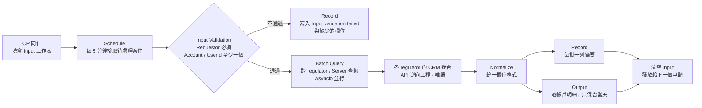

## Problem Assessment

<hr data-slide="背景與名詞">

- 帳戶關閉（Account Closure）、針對高風險或積壓案件的強制清退（Customer Offboarding）、轉歸屬，這三種作業執行前，OP 都要先確認名單上每個客戶的身分、餘額與持倉。
- IT 可以提供待處理的 UID 名單，但不提供這些欄位。OP 只能在多個 CRM 後台之間反覆切換 regulator，逐筆查詢、逐筆確認。
- 需求來自不同團隊，而且常常是整批出現，逐筆查詢的作業模式撐不住批量案件。

<details class="glossary-details">
<summary>名詞說明<span class="mono">11 個名詞 · 點擊展開</span></summary>
<table>
<thead><tr><th>名詞</th><th>說明</th></tr></thead>
<tbody>
<tr><td>OP</td><td>營運部門（Operations）同仁，負責客戶帳戶的日常處理</td></tr>
<tr><td>CRM 後台</td><td>管理客戶與交易帳戶的內部系統；每個 regulator 各有一套</td></tr>
<tr><td>regulator</td><td>客戶所屬的金融監管機構（例如 VFSC）</td></tr>
<tr><td>UID／userId</td><td>客戶在 CRM 的唯一編號；一個客戶可以有多個交易帳戶</td></tr>
<tr><td>Account</td><td>MT4／MT5 交易帳號</td></tr>
<tr><td>Account Server</td><td>交易帳戶所在的交易伺服器（例如 MT5_AU7）</td></tr>
<tr><td>Trading Account／Rebate Account</td><td>客戶交易用的帳戶／IB（介紹經紀商）收取返佣的帳戶</td></tr>
<tr><td>Balance／Equity／Margin／Profit／Credit</td><td>餘額／淨值／已用保證金／浮動損益／贈金或信用額度</td></tr>
<tr><td>帳戶關閉（Account Closure）</td><td>關閉客戶的交易帳戶；執行前要先確認每個帳戶的身分、餘額與持倉</td></tr>
<tr><td>強制清退（Customer Offboarding）</td><td>針對高風險或積壓案件，關閉客戶的帳戶，並將餘額歸零、限制帳戶；執行前要先確認每個帳戶的身分、餘額與持倉</td></tr>
<tr><td>轉歸屬</td><td>把客戶轉到另一個 IB 或業務名下；執行前要先確認客戶名下每個帳戶的狀態</td></tr>
</tbody>
</table>
</details>

<hr data-slide="為什麼要查">

帳戶關閉、強制清退、轉歸屬三種作業，都會動到客戶的錢或歸屬，所以執行前都要先回答同一個問題：名單上的帳戶，現在還有什麼？麻煩的是，光看名單分不出哪個帳戶還有餘額或持倉，所以每一個都得查過身分、餘額與持倉，再由 OP 判斷能不能執行；漏看一個，就可能出事：

<figure class="split-figure step-figure">
<div class="split-scroll">
<svg viewBox="0 0 760 460" role="img" aria-labelledby="wq-title"><title id="wq-title">帳戶關閉、強制清退、轉歸屬匯流到同一個查詢；名單上的帳戶看起來都一樣，查過才知道哪幾個還有餘額或持倉，漏看一個就會出事（示意）</title><defs><marker id="wq-arrow" viewBox="0 0 8 8" refX="7" refY="4" markerWidth="8" markerHeight="8" orient="auto"><path class="sf-head" d="M0,0 L8,4 L0,8 z"/></marker></defs><g data-b="sources"><rect class="sf-child" x="50" y="6" width="160" height="30" rx="6"/><text class="sf-t sf-small-t" x="130" y="26">帳戶關閉</text><path class="sf-line" d="M130 36 C 130 46, 380 40, 380 48" marker-end="url(#wq-arrow)"/><rect class="sf-child" x="300" y="6" width="160" height="30" rx="6"/><text class="sf-t sf-small-t" x="380" y="26">強制清退</text><path class="sf-line" d="M380 36 V48" marker-end="url(#wq-arrow)"/><rect class="sf-child" x="550" y="6" width="160" height="30" rx="6"/><text class="sf-t sf-small-t" x="630" y="26">轉歸屬</text><path class="sf-line" d="M630 36 C 630 46, 380 40, 380 48" marker-end="url(#wq-arrow)"/><rect class="sf-parent" x="150" y="50" width="460" height="28" rx="6"/><text class="sf-t sf-small-t" x="380" y="69">三種作業，都要先回答：名單上的帳戶現在還有什麼？</text><path class="sf-line" d="M380 78 C 380 92, 170 88, 170 100" marker-end="url(#wq-arrow)"/></g><g data-b="list"><text class="sf-h sf-start" x="20" y="116">名單上的帳戶：看起來都一樣</text><rect class="sf-node" x="20" y="130" width="46" height="30" rx="5"/><text class="sf-s" x="43" y="149">?</text><rect class="sf-node" x="74" y="130" width="46" height="30" rx="5"/><text class="sf-s" x="97" y="149">?</text><rect class="sf-node" x="128" y="130" width="46" height="30" rx="5"/><text class="sf-s" x="151" y="149">?</text><rect class="sf-node" x="182" y="130" width="46" height="30" rx="5"/><text class="sf-s" x="205" y="149">?</text><rect class="sf-node" x="236" y="130" width="46" height="30" rx="5"/><text class="sf-s" x="259" y="149">?</text><rect class="sf-node" x="290" y="130" width="46" height="30" rx="5"/><text class="sf-s" x="313" y="149">?</text><rect class="sf-node" x="20" y="168" width="46" height="30" rx="5"/><text class="sf-s" x="43" y="187">?</text><rect class="sf-node" x="74" y="168" width="46" height="30" rx="5"/><text class="sf-s" x="97" y="187">?</text><rect class="sf-node" x="128" y="168" width="46" height="30" rx="5"/><text class="sf-s" x="151" y="187">?</text><rect class="sf-node" x="182" y="168" width="46" height="30" rx="5"/><text class="sf-s" x="205" y="187">?</text><rect class="sf-node" x="236" y="168" width="46" height="30" rx="5"/><text class="sf-s" x="259" y="187">?</text><rect class="sf-node" x="290" y="168" width="46" height="30" rx="5"/><text class="sf-s" x="313" y="187">?</text><rect class="sf-node" x="20" y="206" width="46" height="30" rx="5"/><text class="sf-s" x="43" y="225">?</text><rect class="sf-node" x="74" y="206" width="46" height="30" rx="5"/><text class="sf-s" x="97" y="225">?</text><rect class="sf-node" x="128" y="206" width="46" height="30" rx="5"/><text class="sf-s" x="151" y="225">?</text><rect class="sf-node" x="182" y="206" width="46" height="30" rx="5"/><text class="sf-s" x="205" y="225">?</text><rect class="sf-node" x="236" y="206" width="46" height="30" rx="5"/><text class="sf-s" x="259" y="225">?</text><rect class="sf-node" x="290" y="206" width="46" height="30" rx="5"/><text class="sf-s" x="313" y="225">?</text></g><g data-b="reveal"><path class="sf-line" d="M344 183 H400" marker-end="url(#wq-arrow)"/><text class="sf-s" x="372" y="173">逐一查</text><text class="sf-h sf-start" x="410" y="116">查過才知道：哪幾個不是 0</text><rect class="sf-node" x="410" y="130" width="46" height="30" rx="5"/><text class="sf-s" x="433" y="149">0</text><rect class="sf-node" x="464" y="130" width="46" height="30" rx="5"/><text class="sf-s" x="487" y="149">0</text><rect class="sf-bad" x="518" y="130" width="46" height="30" rx="5"/><text class="sf-bad-t sf-small" x="541" y="149">持倉</text><rect class="sf-node" x="572" y="130" width="46" height="30" rx="5"/><text class="sf-s" x="595" y="149">0</text><rect class="sf-node" x="626" y="130" width="46" height="30" rx="5"/><text class="sf-s" x="649" y="149">0</text><rect class="sf-node" x="680" y="130" width="46" height="30" rx="5"/><text class="sf-s" x="703" y="149">0</text><rect class="sf-node" x="410" y="168" width="46" height="30" rx="5"/><text class="sf-s" x="433" y="187">0</text><rect class="sf-node" x="464" y="168" width="46" height="30" rx="5"/><text class="sf-s" x="487" y="187">0</text><rect class="sf-node" x="518" y="168" width="46" height="30" rx="5"/><text class="sf-s" x="541" y="187">0</text><rect class="sf-node" x="572" y="168" width="46" height="30" rx="5"/><text class="sf-s" x="595" y="187">0</text><rect class="sf-bad" x="626" y="168" width="46" height="30" rx="5"/><text class="sf-bad-t sf-small" x="649" y="187">餘額</text><rect class="sf-node" x="680" y="168" width="46" height="30" rx="5"/><text class="sf-s" x="703" y="187">0</text><rect class="sf-node" x="410" y="206" width="46" height="30" rx="5"/><text class="sf-s" x="433" y="225">0</text><rect class="sf-bad" x="464" y="206" width="46" height="30" rx="5"/><text class="sf-bad-t sf-small" x="487" y="225">持倉</text><rect class="sf-node" x="518" y="206" width="46" height="30" rx="5"/><text class="sf-s" x="541" y="225">0</text><rect class="sf-node" x="572" y="206" width="46" height="30" rx="5"/><text class="sf-s" x="595" y="225">0</text><rect class="sf-node" x="626" y="206" width="46" height="30" rx="5"/><text class="sf-s" x="649" y="225">0</text><rect class="sf-node" x="680" y="206" width="46" height="30" rx="5"/><text class="sf-s" x="703" y="225">0</text></g><g data-b="card"><path class="sf-line sf-thin" d="M487 237 C 487 266, 400 237, 400 266"/><rect class="sf-box" x="20" y="267" width="400" height="135" rx="8"/><text class="sf-t sf-start" x="34" y="289">翻開其中一張</text><line class="sf-sep" x1="150" y1="300" x2="150" y2="392"/><line class="sf-sep" x1="280" y1="300" x2="280" y2="392"/><rect class="sf-bad" x="286" y="298" width="126" height="98" rx="6"/><text class="sf-t" x="85" y="314">身分</text><text class="sf-f" x="85" y="334">UID</text><text class="sf-f" x="85" y="350">mt4_account</text><text class="sf-f" x="85" y="366">server</text><text class="sf-f" x="85" y="382">regulator</text><text class="sf-t" x="215" y="314">餘額</text><text class="sf-f" x="215" y="334">currency</text><text class="sf-f" x="215" y="350">balance</text><text class="sf-f" x="215" y="366">equity</text><text class="sf-f" x="215" y="382">credit</text><text class="sf-t sf-bad-t" x="349" y="314">持倉</text><text class="sf-f" x="349" y="334">margin</text><text class="sf-f" x="349" y="350">marginLevel</text><text class="sf-f" x="349" y="366">profit</text><text class="sf-bad-t sf-small" x="349" y="386">不是 0：有持倉</text></g><g data-b="chain"><path class="sf-line" d="M420 287 H446" marker-end="url(#wq-arrow)"/><rect class="sf-node" x="450" y="270" width="290" height="34" rx="6"/><text class="sf-t sf-small-t" x="595" y="292">漏看這一張，直接清退</text><path class="sf-line" d="M595 304 V318" marker-end="url(#wq-arrow)"/><rect class="sf-bad" x="450" y="322" width="290" height="34" rx="6"/><text class="sf-bad-t" x="595" y="344">持倉被強制平倉</text><text class="sf-s" x="595" y="376">漏看餘額：錢沒退給客戶</text><text class="sf-s" x="595" y="392">漏看身分：某個後台的帳戶沒關到</text><text class="sf-s" x="595" y="408">轉歸屬漏看：返佣算錯</text></g><g data-b="scale"><text class="sf-note" x="380" y="448">這裡只畫 18 個；真實的一批常常上千個帳戶，每一個都得查過</text></g></svg>
</div>
<figcaption>圖 1　三種作業匯流到同一個查詢：看起來一樣的帳戶，查過才知道哪幾個不是 0；每個帳戶要看身分、餘額、持倉三組通則欄位（欄位名稱沿用系統原樣），能不能執行由 OP 看完數字後判斷（示意：18 個帳戶、3 個不是 0 的比例為說明用，非實際統計）</figcaption>
</figure>

<hr data-slide="帳戶散在哪裡">

難的是帳戶並不集中：每個 regulator 各有一套 CRM 後台，客戶在哪個 regulator、哪台交易伺服器（Server）開戶，帳戶就落在哪裡。一個客戶（UID）常有好幾個帳戶，人工只能逐一切換後台、逐筆查詢（耗時見痛點與證據）：

<figure class="split-figure step-figure">
<div class="split-scroll">
<svg viewBox="0 0 760 340" role="img" aria-labelledby="ac-title"><title id="ac-title">一個客戶，多個帳戶：帳戶散在不同 regulator 的後台，人工要逐一切換，引擎一次查回</title><defs><marker id="ac-arrow" viewBox="0 0 8 8" refX="7" refY="4" markerWidth="8" markerHeight="8" orient="auto"><path class="sf-head" d="M0,0 L8,4 L0,8 z"/></marker></defs><g data-b="client"><rect class="sf-parent" x="20" y="100" width="140" height="60" rx="8"/><text class="sf-t" x="90" y="126">客戶</text><text class="sf-s" x="90" y="146">一個 UID</text></g><g data-b="backends"><rect class="sf-box" x="220" y="30" width="125" height="170" rx="8"/><text class="sf-t" x="282" y="52">Regulator A</text><text class="sf-s" x="282" y="68">CRM 後台</text><rect class="sf-box" x="355" y="30" width="125" height="170" rx="8"/><text class="sf-t" x="417" y="52">Regulator B</text><text class="sf-s" x="417" y="68">CRM 後台</text><rect class="sf-box" x="490" y="30" width="125" height="170" rx="8"/><text class="sf-t" x="552" y="52">Regulator C</text><text class="sf-s" x="552" y="68">CRM 後台</text><rect class="sf-box" x="625" y="30" width="125" height="170" rx="8"/><text class="sf-t" x="687" y="52">Regulator D</text><text class="sf-s" x="687" y="68">CRM 後台</text><text class="sf-s" x="552" y="120">（這個客戶沒有）</text></g><g data-b="accounts"><path class="sf-line sf-thin" d="M160 130 C 190 130, 200 98, 228 98"/><path class="sf-line sf-thin" d="M160 130 C 190 130, 200 142, 228 142"/><path class="sf-line sf-thin" d="M160 130 C 190 130, 335 98, 363 98"/><path class="sf-line sf-thin" d="M160 130 C 190 130, 605 98, 633 98"/><path class="sf-line sf-thin" d="M160 130 C 190 130, 605 142, 633 142"/><rect class="sf-child" x="230" y="80" width="105" height="36" rx="6"/><text class="sf-t sf-small-t" x="282" y="96">帳戶 #1</text><text class="sf-s" x="282" y="110">MT5</text><rect class="sf-child" x="230" y="124" width="105" height="36" rx="6"/><text class="sf-t sf-small-t" x="282" y="140">帳戶 #2</text><text class="sf-s" x="282" y="154">MT4</text><rect class="sf-child" x="365" y="80" width="105" height="36" rx="6"/><text class="sf-t sf-small-t" x="417" y="96">帳戶 #3</text><text class="sf-s" x="417" y="110">MT5</text><rect class="sf-child" x="635" y="80" width="105" height="36" rx="6"/><text class="sf-t sf-small-t" x="687" y="96">帳戶 #4</text><text class="sf-s" x="687" y="110">MT5</text><rect class="sf-child" x="635" y="124" width="105" height="36" rx="6"/><text class="sf-t sf-small-t" x="687" y="140">帳戶 #5</text><text class="sf-s" x="687" y="154">MT4</text></g><line class="sf-sep" x1="20" y1="222" x2="740" y2="222"/><g data-b="manual"><text class="sf-t sf-start" x="20" y="262">人工</text><rect class="sf-node" x="110" y="240" width="150" height="34" rx="6"/><text class="sf-t sf-small-t" x="185.0" y="262">切到後台 A · 查 2 個</text><path class="sf-line" d="M260 257 H282" marker-end="url(#ac-arrow)"/><rect class="sf-node" x="288" y="240" width="150" height="34" rx="6"/><text class="sf-t sf-small-t" x="363.0" y="262">切到後台 B · 查 1 個</text><path class="sf-line" d="M438 257 H460" marker-end="url(#ac-arrow)"/><rect class="sf-node" x="466" y="240" width="150" height="34" rx="6"/><text class="sf-t sf-small-t" x="541.0" y="262">切到後台 D · 查 2 個</text><text class="sf-s sf-start" x="644" y="262">逐一切換、逐筆查</text></g><g data-b="engine"><text class="sf-t sf-start" x="20" y="314">引擎</text><rect class="sf-parent" x="110" y="292" width="150" height="34" rx="6"/><text class="sf-t sf-small-t" x="185.0" y="314">收下整份名單</text><path class="sf-line" d="M260 309 H282" marker-end="url(#ac-arrow)"/><rect class="sf-parent" x="288" y="292" width="190" height="34" rx="6"/><text class="sf-t sf-small-t" x="383.0" y="314">一次跨後台批量查回</text><path class="sf-line" d="M478 309 H500" marker-end="url(#ac-arrow)"/><rect class="sf-parent" x="506" y="292" width="150" height="34" rx="6"/><text class="sf-t sf-small-t" x="581.0" y="314">Record／Output</text><text class="sf-s sf-start" x="684" y="314"></text></g></svg>
</div>
<figcaption>圖 2　一個客戶，多個帳戶：每個 regulator 各有一套 CRM 後台，帳戶落在客戶開戶的地方；人工要逐一切換後台查，引擎收下整份名單一次查回（示意）</figcaption>
</figure>

<hr data-slide="引擎流程">

三種作業（圖 1）都卡在同一個查詢，而且需求都是「給一份 userId／Account 名單，回傳同一組帳戶欄位」：圖 1 卡片上身分、餘額、持倉三組的 11 個欄位，加上 approvedTime（開戶審核通過時間）、updateTime（後台資料最後更新時間）、comparisionTime（引擎查詢的時間）3 個時間欄位，這 14 個通則欄位就能涵蓋大部分的申請，每一列也都能追溯是什麼時候查的。

因此要解決的不是「查得不夠快」，而是**同一種查詢每次都由人工逐筆、逐個後台重做**。我把這個共通流程做成引擎：



*圖 3　引擎流程*

<hr data-slide="對照範例">

以 2026-07-07 的一次實際申請為例，看一份名單怎麼從 Input 走到 Record 與 Output：

| 步驟 | 工作表 | 內容 |
|---|---|---|
| 1. 填寫名單 | Input（示意） | Requestor：申請人；UserId：68 個客戶 |
| 2. 驗證通過，排程撿取 | — | Requestor 已填、至少有一個 UserId |
| 3. 跨後台查詢，寫入摘要 | Record | 68 個客戶 → 322 個帳戶；涵蓋 22 個國家、33 個 Server、2 個 regulator、25 種帳戶類型；查無資料 0 |
| 4. 寫入明細 | Output | 每個帳戶一列（共 322 列），23 個欄位（見 Result 的輸出格式） |
| 5. 清空 Input | Input | 釋放給下一個申請 |

*第 3、4 列取自 Record 工作表（R-0055）；Input 不留存，第 1 列為示意。*

- **68 個客戶對應 322 個帳戶**：平均一個客戶約 4.7 個帳戶，分散在 2 個 regulator、33 個 Server，人工就要反覆切後台。
- **驗證不通過時**：查詢不會執行，Record 直接寫入缺少的欄位（實例見 Result）。

<hr data-slide="痛點與證據">

<figure class="pain-figure">
<div class="pain-grid">
<section class="pain-card tone-grey pain-wide">
<h4 class="pain-title">逐筆查詢、反覆切換</h4>
<p class="pain-label"><span>Pain</span>一個帳戶要走一次完整查詢流程</p>
<ul class="pain-note">
<li>不同 regulator 的客戶在不同 CRM 後台，查之前要先切對後台。</li>
<li>每個帳戶的 Balance、Margin、Profit、Server 要逐項點開確認。</li>
</ul>
<div class="pain-evidence">
<p class="pain-evidence-title">證據：人工查詢一個帳戶的步驟</p>
<ol class="pain-flow">
<li>從 IT 給的 UID 名單取出一筆 userId。</li>
<li>判斷客戶所屬 regulator，切換到對應的 CRM 後台。</li>
<li>搜尋客戶，進入帳戶頁，找到 Trading Account／Rebate Account。</li>
<li>逐項記下 Balance、Margin、Profit、Equity、Credit、Account Server 等欄位。</li>
<li>回到名單，換下一筆，重複步驟 1–4。</li>
</ol>
<p class="pain-caption">平均每個帳戶約 <b>45 秒</b>（估計）→ 1,000 個帳戶 ≈ <b>12.5 小時</b>人工。</p>
</div>
</section>
<section class="pain-card tone-red">
<h4 class="pain-title">批量案件撐不住</h4>
<p class="pain-label"><span>Pain</span>案件量遠超過逐筆查詢的速度</p>
<ul class="pain-note">
<li>清退、轉歸屬這類案件常常一次就是上千個帳戶。</li>
<li>處理速度被「查資料」卡住，而不是被判斷卡住。</li>
</ul>
<div class="pain-evidence">
<p class="pain-evidence-title">證據：上線後實際送進來的批量需求</p>
<ul class="pain-flow">
<li>單批最多 <b>17,416</b> 個帳戶，逐筆查詢約需 <b>218 小時</b>。</li>
<li>超過 2,000 個帳戶的批次有 <b>65</b> 次。</li>
</ul>
</div>
</section>
<section class="pain-card tone-yellow">
<h4 class="pain-title">核心工作被壓縮</h4>
<p class="pain-label"><span>Pain</span>人力耗在查找、切系統、最後確認</p>
<ul class="pain-note">
<li>OP 的時間被資料搜尋與整理佔滿。</li>
<li>真正需要人判斷的風控與合規工作被往後排。</li>
</ul>
<div class="pain-evidence">
<p class="pain-evidence-title">證據：一批需求的涵蓋範圍</p>
<ul class="pain-flow">
<li>單批最多涵蓋 <b>179</b> 個國家、<b>40</b> 個 Server、<b>4</b> 個 regulator、<b>48</b> 種帳戶類型。</li>
<li>每個帳戶要確認的欄位有 <b>20</b> 個以上（見 Result 的輸出格式）。</li>
</ul>
</div>
</section>
</div>
<figcaption>圖 4　原流程的三個痛點（人工步驟依 OP 作業整理；每帳戶 45 秒為估計值；批量數據取自引擎的 Record 工作表，2026-06-09 ~ 2026-11-16）</figcaption>
</figure>

<hr data-slide="值得投入的理由">

**值得投入解決的理由：**

1. **需求量是真的**：上線 24 週，每一週都有成功的批量申請（每月使用量見 Result）。
2. **單批量級已經超過人工能力**：最大的一批（圖 4）人工逐筆查詢，大約要一個人 27 個工作天。
3. **流程高度重複，適合通則化**：不同團隊的需求表面不同，但都是「給一份 userId／Account 名單，回傳同一組帳戶欄位」。OP 日常的帳戶查詢需求中，約 80% 可以用同一套流程涵蓋。

## Solution Design

依照三個痛點，拆成五個要解決的面向。下圖是 LarkSheet 上給使用者看的使用規則，表格的「對應」欄指向圖中的各列：


*圖 5　LarkSheet 上的使用規則（節錄 Rule 工作表中文部分，英文版內容相同；點擊可放大）*

| 痛點 | 解決方向 | 對應 |
|---|---|---|
| 逐筆查詢、反覆切換 regulator | 一次輸入整份 userId／Account 名單（Trading Account／Rebate Account 兩組欄位），由引擎跨 regulator、跨 Server 批量查回；輸入不完整就攔下，寫入紀錄並說明缺什麼 | 步驟一：配置參數 |
| 批量案件撐不住 | 排程每 5 分鐘自動撿取待處理案件，不需要人觸發 | 步驟二：觸發自動排程 |
| 結果分散、難以最後確認 | 每批輸出一列摘要到 Record（帳戶數、國家／Server／regulator 涵蓋數、查無資料清單），逐帳戶明細到 Output | 步驟三：執行狀態審查 |
| 多個團隊共用同一個入口 | 排隊獨佔：Input 空白才能填寫，單次上限 2,000 筆 | 核心規則 1–3 |
| 入口佔用後無法輪替 | Record 與 Output 都寫入後自動清空 Input，換下一個申請 | 步驟四：釋放系統資源 |

**設計時必須面對的限制：**

- 使用者是非技術的 OP 同仁，入口必須是他們已經在用的工具（LarkSheet），不能要求學新系統。
- 多個團隊共用同一張表，同時填寫會互相覆蓋，需要排隊機制。
- 輸出內容是客戶帳戶資料，明細不能長期留在共用表上：Output 只保留當天，隔天刪除。
- CRM 沒有開放 API 或資料庫權限給 OP；向 IT 申請完整欄位報表或 DB 權限，交期遙遙無期，批量案件等不了。因此以 API 逆向工程登入各 regulator 的 CRM 後台取得帳戶資料。

## Alternative Solutions

| 方案 | 做法 | 優點 | 缺點 |
|---|---|---|---|
| A. 維持人工逐筆查詢 | 依 IT 提供的 UID 名單，在各 CRM 後台逐筆查 | 不需開發 | 人力隨案件量線性增加（耗時見 Problem） |
| B. 請 IT 提供完整欄位報表或 DB 權限 | 由 IT 或系統負責單位提供正式的資料來源 | 資料最完整、有官方支援 | 已提出需求，但交期遙遙無期，批量案件等不了 |
| C. 每個需求寫一次性腳本 | 收到需求後，針對該次名單寫查詢腳本 | 單次交付快 | 每次都要工程師介入；OP 無法自行使用；邏輯分散，難以稽核 |
| **D. 通用批量查詢引擎（採用）** | 歸納共通流程，做成以 LarkSheet 為入口、排程自動執行的工具 | OP 可自行送件；一次涵蓋約 80% 的日常查詢；每次執行都有紀錄 | 需要前期設計共通欄位與驗證規則；剩下約 20% 的特殊需求仍需個別處理 |


## Selected Solution

<hr data-slide="選擇理由">

**選擇 D：通用批量查詢引擎**

1. **解決 A 的線性人力問題**：查詢交給引擎，人工只剩填名單與審查結果，案件量增加不需要加人。
2. **不必等待 IT**：B 的交期無法掌握，D 可以先上線；未來若取得正式資料來源，只需替換擷取層。
3. **解決 C 的工程師依賴**：OP 在 LarkSheet 填完參數就會被排程撿走，不需要找工程師。
4. **先找通則，再寫工具**：約 80% 的需求共用同一組輸入（userId／Account）與同一組輸出欄位，值得做成一個工具；剩下的特殊需求不硬塞進同一套流程。

<hr data-slide="設計重點">

**設計重點：**

- **先驗證再查詢，失敗也留紀錄**：驗證不通過時不進入查詢，直接在 Record 寫入失敗原因（例如缺少 Requestor），申請人看紀錄就知道要補什麼（攔截次數見 Result）。
- **查無資料不丟棄**：查不到的帳戶收集在 Record 的 `total_missing_list`，與成功的結果一起呈現。
- **排隊獨佔**：Input 有資料時其他人不能覆蓋；Record 與 Output 都寫入成功後才清空 Input，避免申請被吃掉。
- **單次上限**：規則上每次最多 2,000 筆（以輸入的 userId 列數計），避免單一申請長時間佔住入口；一個 userId 會展開成多個帳戶，所以一批的帳戶數可能超過 2,000。
- **資料保留**：Output 明細只保留當天，隔天自動刪除；Record 只留摘要，作為長期的執行紀錄。
- **權限範圍**：使用我的自動化帳號登入各 regulator 的 CRM 後台，權限為唯讀，不寫入任何資料。

<hr data-slide="一份名單怎麼查完">

**一份名單怎麼查完：** 引擎的難處不在單一查詢，而在一份名單會展開成「userId 數 × 4 套後台」次查詢。以對照範例的 68 個 userId 為例，至少要查 272 次；最大的一批是 5,696 個（見 Result）。

<figure class="split-figure step-figure">
<div class="split-scroll">
<svg viewBox="0 0 760 360" role="img" aria-labelledby="af-title-zh"><title id="af-title-zh">一份名單怎麼查完：68 個 userId 展開成 68 個查詢，依序切換 4 套後台，每套後台內共用 20 個並行槽位，分頁抓完後合併</title><defs><marker id="af-arrow-zh" viewBox="0 0 8 8" refX="7" refY="4" markerWidth="8" markerHeight="8" orient="auto"><path class="sf-head" d="M0,0 L8,4 L0,8 z"/></marker></defs><g data-b="jobs"><rect class="sf-parent" x="20" y="16" width="150" height="52" rx="8"/><text class="sf-t" x="95" y="38">名單</text><text class="sf-s" x="95" y="56">68 個 userId</text><path class="sf-line" d="M170 42 H206" marker-end="url(#af-arrow-zh)"/><rect class="sf-node" x="212" y="16" width="190" height="52" rx="8"/><text class="sf-t" x="307" y="38">展開成 68 個查詢</text><text class="sf-s" x="307" y="56">每個 userId 一個</text><path class="sf-line" d="M402 42 H438" marker-end="url(#af-arrow-zh)"/><text class="sf-note sf-start" x="446" y="38">× 4 套後台 = 至少 272 次查詢</text><text class="sf-s sf-start" x="446" y="56">每個查詢至少 1 頁</text></g><g data-b="reg-lane"><rect class="sf-box" x="20" y="104" width="162" height="146" rx="8"/><text class="sf-t" x="101" y="126">FCA</text><rect class="sf-box" x="206" y="104" width="162" height="146" rx="8"/><text class="sf-t" x="287" y="126">ASIC</text><rect class="sf-box" x="392" y="104" width="162" height="146" rx="8"/><text class="sf-t" x="473" y="126">VFSC</text><rect class="sf-box" x="578" y="104" width="162" height="146" rx="8"/><text class="sf-t" x="659" y="126">VFSC2</text></g><g data-b="switch"><text class="sf-note sf-start" x="20" y="92">依序切換：regulator 綁在登入 session 上，一次只能在一套後台</text><text class="sf-s" x="101" y="142">切換 → 確認 → 查</text><text class="sf-s" x="287" y="142">切換 → 確認 → 查</text><text class="sf-s" x="473" y="142">切換 → 確認 → 查</text><text class="sf-s" x="659" y="142">切換 → 確認 → 查</text><path class="sf-line" d="M182 177 H200" marker-end="url(#af-arrow-zh)"/><path class="sf-line" d="M368 177 H386" marker-end="url(#af-arrow-zh)"/><path class="sf-line" d="M554 177 H572" marker-end="url(#af-arrow-zh)"/></g><g data-b="slots"><rect class="sf-child" x="63" y="154" width="12" height="12" rx="2"/><rect class="sf-child" x="79" y="154" width="12" height="12" rx="2"/><rect class="sf-child" x="95" y="154" width="12" height="12" rx="2"/><rect class="sf-child" x="111" y="154" width="12" height="12" rx="2"/><rect class="sf-child" x="127" y="154" width="12" height="12" rx="2"/><rect class="sf-child" x="63" y="170" width="12" height="12" rx="2"/><rect class="sf-child" x="79" y="170" width="12" height="12" rx="2"/><rect class="sf-child" x="95" y="170" width="12" height="12" rx="2"/><rect class="sf-child" x="111" y="170" width="12" height="12" rx="2"/><rect class="sf-child" x="127" y="170" width="12" height="12" rx="2"/><rect class="sf-child" x="63" y="186" width="12" height="12" rx="2"/><rect class="sf-child" x="79" y="186" width="12" height="12" rx="2"/><rect class="sf-child" x="95" y="186" width="12" height="12" rx="2"/><rect class="sf-child" x="111" y="186" width="12" height="12" rx="2"/><rect class="sf-child" x="127" y="186" width="12" height="12" rx="2"/><rect class="sf-child" x="63" y="202" width="12" height="12" rx="2"/><rect class="sf-child" x="79" y="202" width="12" height="12" rx="2"/><rect class="sf-child" x="95" y="202" width="12" height="12" rx="2"/><rect class="sf-child" x="111" y="202" width="12" height="12" rx="2"/><rect class="sf-child" x="127" y="202" width="12" height="12" rx="2"/><text class="sf-s" x="101" y="240">共用 20 個並行槽位</text><rect class="sf-child" x="249" y="154" width="12" height="12" rx="2"/><rect class="sf-child" x="265" y="154" width="12" height="12" rx="2"/><rect class="sf-child" x="281" y="154" width="12" height="12" rx="2"/><rect class="sf-child" x="297" y="154" width="12" height="12" rx="2"/><rect class="sf-child" x="313" y="154" width="12" height="12" rx="2"/><rect class="sf-child" x="249" y="170" width="12" height="12" rx="2"/><rect class="sf-child" x="265" y="170" width="12" height="12" rx="2"/><rect class="sf-child" x="281" y="170" width="12" height="12" rx="2"/><rect class="sf-child" x="297" y="170" width="12" height="12" rx="2"/><rect class="sf-child" x="313" y="170" width="12" height="12" rx="2"/><rect class="sf-child" x="249" y="186" width="12" height="12" rx="2"/><rect class="sf-child" x="265" y="186" width="12" height="12" rx="2"/><rect class="sf-child" x="281" y="186" width="12" height="12" rx="2"/><rect class="sf-child" x="297" y="186" width="12" height="12" rx="2"/><rect class="sf-child" x="313" y="186" width="12" height="12" rx="2"/><rect class="sf-child" x="249" y="202" width="12" height="12" rx="2"/><rect class="sf-child" x="265" y="202" width="12" height="12" rx="2"/><rect class="sf-child" x="281" y="202" width="12" height="12" rx="2"/><rect class="sf-child" x="297" y="202" width="12" height="12" rx="2"/><rect class="sf-child" x="313" y="202" width="12" height="12" rx="2"/><text class="sf-s" x="287" y="240">共用 20 個並行槽位</text><rect class="sf-child" x="435" y="154" width="12" height="12" rx="2"/><rect class="sf-child" x="451" y="154" width="12" height="12" rx="2"/><rect class="sf-child" x="467" y="154" width="12" height="12" rx="2"/><rect class="sf-child" x="483" y="154" width="12" height="12" rx="2"/><rect class="sf-child" x="499" y="154" width="12" height="12" rx="2"/><rect class="sf-child" x="435" y="170" width="12" height="12" rx="2"/><rect class="sf-child" x="451" y="170" width="12" height="12" rx="2"/><rect class="sf-child" x="467" y="170" width="12" height="12" rx="2"/><rect class="sf-child" x="483" y="170" width="12" height="12" rx="2"/><rect class="sf-child" x="499" y="170" width="12" height="12" rx="2"/><rect class="sf-child" x="435" y="186" width="12" height="12" rx="2"/><rect class="sf-child" x="451" y="186" width="12" height="12" rx="2"/><rect class="sf-child" x="467" y="186" width="12" height="12" rx="2"/><rect class="sf-child" x="483" y="186" width="12" height="12" rx="2"/><rect class="sf-child" x="499" y="186" width="12" height="12" rx="2"/><rect class="sf-child" x="435" y="202" width="12" height="12" rx="2"/><rect class="sf-child" x="451" y="202" width="12" height="12" rx="2"/><rect class="sf-child" x="467" y="202" width="12" height="12" rx="2"/><rect class="sf-child" x="483" y="202" width="12" height="12" rx="2"/><rect class="sf-child" x="499" y="202" width="12" height="12" rx="2"/><text class="sf-s" x="473" y="240">共用 20 個並行槽位</text><rect class="sf-child" x="621" y="154" width="12" height="12" rx="2"/><rect class="sf-child" x="637" y="154" width="12" height="12" rx="2"/><rect class="sf-child" x="653" y="154" width="12" height="12" rx="2"/><rect class="sf-child" x="669" y="154" width="12" height="12" rx="2"/><rect class="sf-child" x="685" y="154" width="12" height="12" rx="2"/><rect class="sf-child" x="621" y="170" width="12" height="12" rx="2"/><rect class="sf-child" x="637" y="170" width="12" height="12" rx="2"/><rect class="sf-child" x="653" y="170" width="12" height="12" rx="2"/><rect class="sf-child" x="669" y="170" width="12" height="12" rx="2"/><rect class="sf-child" x="685" y="170" width="12" height="12" rx="2"/><rect class="sf-child" x="621" y="186" width="12" height="12" rx="2"/><rect class="sf-child" x="637" y="186" width="12" height="12" rx="2"/><rect class="sf-child" x="653" y="186" width="12" height="12" rx="2"/><rect class="sf-child" x="669" y="186" width="12" height="12" rx="2"/><rect class="sf-child" x="685" y="186" width="12" height="12" rx="2"/><rect class="sf-child" x="621" y="202" width="12" height="12" rx="2"/><rect class="sf-child" x="637" y="202" width="12" height="12" rx="2"/><rect class="sf-child" x="653" y="202" width="12" height="12" rx="2"/><rect class="sf-child" x="669" y="202" width="12" height="12" rx="2"/><rect class="sf-child" x="685" y="202" width="12" height="12" rx="2"/><text class="sf-s" x="659" y="240">共用 20 個並行槽位</text></g><g data-b="pages"><rect class="sf-node" x="20" y="270" width="350" height="78" rx="8"/><text class="sf-t" x="195" y="294">每個查詢：先抓第 1 頁拿到 total</text><text class="sf-s" x="195" y="314">其餘頁一起送出，同樣佔用槽位</text><text class="sf-s" x="195" y="332">依頁碼排序後合併</text></g><g data-b="merge"><path class="sf-line" d="M659 250 V264" marker-end="url(#af-arrow-zh)"/><rect class="sf-parent" x="390" y="270" width="350" height="78" rx="8"/><text class="sf-t" x="565" y="294">4 套都查無，才算查無（empty_jobs）</text><text class="sf-s" x="565" y="314">結果合併成 Output 明細</text><text class="sf-s" x="565" y="332">分批寫回 LarkSheet，每批 4,000 列</text></g></svg>
</div>
<figcaption>圖 6　一份名單怎麼查完：依序切換 4 套後台，每套後台內的查詢共用 20 個並行槽位，分頁抓完後依頁碼合併（以對照範例的 68 個 userId 為例；示意）</figcaption>
</figure>

- **後台依序切換**：regulator 是登入 session 上的狀態，同一個 session 一次只能停在一套後台。所以 4 套依序處理：送出切換後，輪詢頁面上顯示的 regulator，確認已切換（最多等 6 秒）才開始查。
- **後台內並行、有上限**：每個 userId 一個查詢，全部同時送出，但共用 20 個並行槽位（`asyncio.Semaphore(20)`）；為什麼是 20 見下一張。
- **分頁**：每個查詢先抓第 1 頁取得總筆數，其餘頁再並行抓取，最後依頁碼排序合併。
- **查詢描述與執行分開**：每個查詢是一份描述（網址、組 payload 的函式與參數），交給同一個執行器；Trading Account 與 Rebate Account 只差在網址與查詢欄位。

<hr data-slide="並行與重試怎麼定">

**並行與重試怎麼定：** 這兩組參數不是預設值，而是我對實際後台測出來的。後台沒有公開的限流規則，只能從測試中看它什麼時候開始擋：

| 設計項目 | 測試時看到的狀況 | 因此這樣做 |
|---|---|---|
| 並行上限 | 初版每個查詢只限制自己的分頁（各 10 個），所有查詢一起送出，整體沒有上限。名單一大，後台開始回 429／5xx，登入 session 也會被踢掉 | 6/5 起改成整次執行共用 20 個槽位：名單再大，同時也最多 20 個請求 |
| 重試間隔 | 被限流（429）後立刻重試，會再次被擋 | 第 N 次失敗等 1.5 × N 秒再試（1.5、3、4.5…秒），讓請求錯開；最多 10 次，累積約 82 秒 |
| 不重試 | session 被踢掉後回 401，再試也是同一個失效的登入 | 401 直接中止，不浪費重試，等下一輪重新登入 |

*測試時沒有留下各並行數的錯誤數與耗時紀錄，這裡只寫結論；並行上限的改版見原始碼的版本紀錄（2026-06-05）。*

<hr data-slide="關鍵程式碼">

**關鍵程式碼：** 前兩張講的切換、槽位、分頁與重試，對應到 `general.py` 的這幾段：

```python
global_sem = asyncio.Semaphore(20)            # 整次執行共用（初版是每個查詢各自 Semaphore(10)）
for brand in BRANDS:                          # 4 套後台依序處理
    await switch_regulator(session, brand)    # 送出切換，輪詢頁面上的 regulator，最多等 6 秒
    results = await asyncio.gather(*[fetch_job(session, job, global_sem) for job in brand_jobs])
async def fetch_one_page(session, job, page_no, limit, sem):
    async with sem:                           # 拿到槽位才送出請求
        payload = job["build_payload"](page_no=page_no, limit=limit, **job["payload_kwargs"])
        return await post_json_with_retry(session, url=job["url"], json_data=payload)

async def fetch_job(session, job, global_sem):
    first = await fetch_one_page(session, job, 1, limit, global_sem)    # 先抓第 1 頁拿 total
    pages = await asyncio.gather(*[fetch_one_page(session, job, p, limit, global_sem)
                                   for p in range(2, math.ceil(first["total"] / limit) + 1)])
    pages.sort(key=lambda x: x["page_no"])    # 依頁碼排序後合併

async def post_json_with_retry(session, url, json_data, max_retry=10, base_sleep=1.5):
    for attempt in range(1, max_retry + 1):
        async with session.post(url, json=json_data) as resp:
            if resp.status == 401: raise PermissionError("Cookie expired")  # 登入已失效，不重試
            if resp.status in RETRY_STATUS:                   # 429、500、502、503、504
                await asyncio.sleep(base_sleep * attempt)    # 第 N 次等 1.5 × N 秒
                continue
            return await resp.json()
    raise RuntimeError(f"Request failed after {max_retry} retries")
```

*節錄自 `general.py`（`run_admin_jobs`、`fetch_one_page`、`fetch_job`、`post_json_with_retry`），已簡化：省略 log、例外處理、timeout 與回傳結構，網址已移除；函式與變數名稱沿用原始碼。*

## Result

<hr data-slide="操作畫面">

### 操作畫面：人工查詢 vs 引擎執行

同一類查詢，左邊是在 CRM 後台人工操作，右邊是引擎批量執行：

<figure class="video-figure">
<div class="video-grid">
<div class="video-item">
<p class="video-label">Before：人工查詢</p>
<video controls muted playsinline preload="metadata" src="../../media/account-automation-engine/crm_manual.mp4"></video>
</div>
<div class="video-item">
<p class="video-label">After：引擎執行</p>
<video controls muted playsinline preload="metadata" src="../../media/account-automation-engine/crm_system.mp4"></video>
</div>
</div>
<figcaption>圖 7　實際操作錄影（點擊播放）</figcaption>
</figure>

<hr data-slide="一次實際執行">

### 一次實際執行的紀錄

以 2026-11-06 的一次大批次為例：這是引擎執行 log 的節錄，每一行都帶 run id 與 stage。重複的行已省略；申請人、工作表 ID 與帳號清單已移除。最後三行取自 Record 工作表，第一行就是這次執行寫入的摘要，另外兩行是被驗證攔下的申請：

```text
run=479850e8  2026-11-06  account-search-service
11:30:03  check_input_execution   Validation result: requestor_ok=True, data_ok=True
11:30:03  check_specific_column   Extracted IDs successfully. total_ids=5696
11:30:03  crawler_execution       Starting admin crawler. brands=['FCA', 'ASIC', 'VFSC', 'VFSC2'], total_jobs=5696
11:30:06  crawler_execution       Regulator switched successfully. brand=FCA
11:32:43  crawler_execution       No data returned. brand=FCA
11:32:44  crawler_execution       Regulator switched successfully. brand=ASIC
11:35:17  crawler_execution       No data returned. brand=ASIC
11:35:18  crawler_execution       Regulator switched successfully. brand=VFSC
11:38:07  crawler_execution       Brand execution completed. brand=VFSC, rows=2303
11:38:09  crawler_execution       Regulator switched successfully. brand=VFSC2
11:41:25  crawler_execution       Brand execution completed. brand=VFSC2, rows=3339
11:41:25  crawler_execution       Jobs returned no data across all brands. empty_jobs=[54 個帳號，已遮蔽]
11:41:25  data_cleaning           Data transformation completed. output_rows=5642
11:41:28  upload_lark             Append batch success (rows=4000, total=4000)
11:41:29  upload_lark             Append batch success (rows=1642, total=5642)
11:41:30  upload_lark             Execution record uploaded successfully.
11:41:31  upload_lark             Input sheet reset completed.
Record R-0549  2026-11-06 11:41:25  Success | 3041 users | 5642 accounts validated | 129 countries | 70.53 hrs saved
Record R-0032  2026-06-26 15:05:03  Input validation failed: 'Requestor' 欄位為必填欄位。
Record R-0066  2026-07-15 14:10:02  Input validation failed: 未提供任何查詢資料，請至少填寫一個 'Account' 或 'UserId'。
```

從這段紀錄可以看到：

- **4 套後台都得查過才知道**：引擎依序切進 FCA、ASIC、VFSC、VFSC2（VFSC 的第二套後台），這批帳戶全在 VFSC 兩套，FCA、ASIC 查無；人工一樣得每一套都進去查。
- **每套後台 2.5–3.5 分鐘**：5,696 個 userId 在每套後台都是一次完整查詢（同時最多 20 個請求），4 套依序共約 11 分鐘；寫回 5,642 列分成 4,000 與 1,642 兩批。
- **查無不丟棄**：四套都查無的 54 個帳號收進 `empty_jobs`，和結果一起留下。
- **可追溯、不靜默失敗**：log 的 run id 對得上 Record 的 R-0549；輸入不完整的申請在查詢前就被攔下，並寫明缺哪個欄位。

<figure class="tech-figure">
<div class="tech-labels">
<div class="tech-label">
<p class="tech-label-kicker">Tech Label</p>
<p class="tech-label-name">Bounded Fan-out</p>
<p class="tech-label-desc">一份名單展開成每個 userId 一個查詢；後台依序切換，後台內共用 20 個並行槽位。</p>
</div>
<div class="tech-label">
<p class="tech-label-kicker">Tech Label</p>
<p class="tech-label-name">Validation &amp; Audit Record</p>
<p class="tech-label-desc">先驗證再查詢；成功與失敗都寫入 Record，可追溯每一次申請。</p>
</div>
<div class="tech-label">
<p class="tech-label-kicker">Tech Label</p>
<p class="tech-label-name">Exclusive Queue Lock</p>
<p class="tech-label-desc">以 Input 是否空白作為鎖，多個團隊共用同一個入口也不會互相覆蓋。</p>
</div>
</div>
</figure>

<hr data-slide="名單大小與耗時">

### 名單大小與耗時（2026-08-01 ~ 2026-11-16）

資料來源：引擎的執行 log，只取對得上 Record 成功紀錄的 394 次執行（6–7 月的 log 沒有完整保留）。時間是從排程撿取到清空 Input 的整趟耗時，取中位數：

<figure class="bar-figure">
<ul class="bar-list">
<li style="--v: 4.5%"><span class="bar-label">100 個以下（253 次）</span><span class="bar"></span><span class="bar-value">13 秒</span></li>
<li style="--v: 11.5%"><span class="bar-label">101–500 個（60 次）</span><span class="bar"></span><span class="bar-value">33 秒</span></li>
<li style="--v: 34%"><span class="bar-label">501–2,000 個（62 次）</span><span class="bar"></span><span class="bar-value">98 秒</span></li>
<li class="is-peak" style="--v: 100%"><span class="bar-label">2,001 個以上（19 次）</span><span class="bar"></span><span class="bar-value">288 秒</span></li>
</ul>
<figcaption>圖 8　單批 userId 數與整趟耗時（中位數；取自執行 log，2026-08-01 ~ 11-16）</figcaption>
</figure>

- **耗時隨名單線性成長**：每套後台每 1,000 個 userId 約 25 秒（中位數，取名單 500 個以上的 336 次後台查詢）；切換並確認 regulator 約 1 秒。
- **最大的一批也在一趟內跑完**：2,001 個以上的 19 批中，最久的是上一張的 11/06 那一批，約 11.5 分鐘。

<hr data-slide="輸出格式">

### 輸出格式

Output 每個帳戶一列，共 23 個欄位。以下兩列取自 2026-11-16 的實際輸出，已移除 user_id、帳號、客戶與 IB 姓名、帳戶群組：

| server | accountType | countryCode | currency | balance | equity | margin | leverage | IsArchive | regulator | approvedTime | updateTime |
|---|---|---|---|---|---|---|---|---|---|---|---|
| MT5_AU7 | Hedge STP | India | USD | 0.0 | 0.0 | 0.0 | 500 | Normal | VFSC | 2026-11-05 01:03:37 | 2026-11-07 16:34:13 |
| MT5_AU4 | Hedge STP | India | USD | 0.0 | 0.0 | （空白） | （空白） | Archive | VFSC | 2026-03-11 06:19:18 | 2026-11-07 04:27:45 |

其他欄位：`Requestor`、`user_id`、`ownerAlias`、`owner`、`mt4_account`、`group`、`profit`、`marginLevel`、`credit`、`enableReadonly`、`comparisionTime`（欄位名稱沿用系統原樣）。

<hr data-slide="每月使用量">

### 每月使用量

各月成功執行的批次與驗證帳戶數，10 月是使用量最高的月份：

<figure class="bar-figure">
<ul class="bar-list">
<li style="--v: 51.7%"><span class="bar-label">2026-06（6/9 起，39 次）</span><span class="bar"></span><span class="bar-value">58,805</span></li>
<li style="--v: 56.4%"><span class="bar-label">2026-07（95 次）</span><span class="bar"></span><span class="bar-value">64,060</span></li>
<li style="--v: 19.1%"><span class="bar-label">2026-08（83 次）</span><span class="bar"></span><span class="bar-value">21,757</span></li>
<li style="--v: 81.7%"><span class="bar-label">2026-09（69 次）</span><span class="bar"></span><span class="bar-value">92,890</span></li>
<li class="is-peak" style="--v: 100%"><span class="bar-label">2026-10（207 次）</span><span class="bar"></span><span class="bar-value">113,659</span></li>
<li style="--v: 26.8%"><span class="bar-label">2026-11（至 11/16，38 次）</span><span class="bar"></span><span class="bar-value">30,458</span></li>
</ul>
<figcaption>圖 9　每月驗證帳戶數（括號內為成功執行次數；取自 Record 工作表）</figcaption>
</figure>

<hr data-slide="執行統計">

### 執行統計（2026-06-09 ~ 2026-11-16）

資料來源：Record 工作表（去識別化 CSV 見下方）。「成功執行」指 `return_msg` 以 `Success` 開頭的批次；帳戶數為各批 `total_accounts` 加總，同一帳戶在不同批次被查詢會重複計算。

| 指標 | 數值 |
|---|---|
| 申請總數 | 563 次 |
| 成功執行 | 531 次（94.3%） |
| 驗證攔截 | 32 次（缺 Requestor 23、缺 Account／UserId 9） |
| 累計驗證帳戶 | 381,629 個 |
| 單批帳戶數 | 中位數 89、平均 719（最大一批見 Problem） |
| 有使用的天數 | 112 天 |

<details class="csv-details">
<summary>完整資料（已去識別化）<span class="mono">563 列 · 點擊展開</span></summary>
<div class="csv-viewer" data-src="../../data/account-engine-record-2026-06-11.csv">
<p><a href="../../data/account-engine-record-2026-06-11.csv" download>下載去識別化 CSV（2026-06-09 ~ 2026-11-16，563 列）</a></p>
</div>
</details>

## Impact

<hr data-slide="已驗證的成果">

### 已驗證的成果

<figure class="ba-figure">
<div class="ba-table">
<div class="ba-row ba-head"><p class="ba-item">項目</p><p class="ba-before">Before：逐筆人工查詢</p><p class="ba-after">After：批量查詢引擎</p></div>
<div class="ba-row"><p class="ba-item">查詢方式</p><p class="ba-before">每個帳戶切換對應 regulator 的 CRM 後台，逐筆查</p><p class="ba-after">一次輸入整份名單，跨 regulator、跨 Server 批量查回<small>依據：Rule 工作表；單批涵蓋範圍見 Problem</small></p></div>
<div class="ba-row"><p class="ba-item">單批耗時</p><p class="ba-before">逐筆查，批次越大越久，最大一批要好幾個工作天（見 Problem）</p><p class="ba-after">2,001 個 userId 以上的批次，整趟中位數約 5 分鐘<small>依據：Result 圖 8（執行 log，2026-08-01 起）</small></p></div>
<div class="ba-row"><p class="ba-item">人工工時</p><p class="ba-before">每帳戶約 45 秒</p><p class="ba-after">累計約 4,770 小時改由引擎處理<small>依據：累計驗證帳戶（見 Result）× 45 秒 ÷ 3,600；45 秒為估計值</small></p></div>
<div class="ba-row"><p class="ba-item">人力成本</p><p class="ba-before">無紀錄</p><p class="ba-after">累計約 NT$1.91M<small>依據：4,770 小時 × NT$400／小時（成本基準為估計值）</small></p></div>
<div class="ba-row"><p class="ba-item">使用方式</p><p class="ba-before">需要 OP 親自操作每一個後台</p><p class="ba-after">各團隊自行填表送件，排程每 5 分鐘自動執行<small>依據：Rule 工作表；每月使用量見 Result</small></p></div>
<div class="ba-row"><p class="ba-item">錯誤輸入</p><p class="ba-before">無紀錄</p><p class="ba-after">不完整的申請在查詢前被攔下，並說明缺少的欄位<small>依據：Record 的 return_msg；攔截次數見 Result</small></p></div>
</div>
<figcaption>圖 10　Before / After 對照（工時與成本為估計值，計算基準見下方）</figcaption>
</figure>

<hr data-slide="尚未量化的部分">

### 尚未量化或需要說明的部分

- **計算基準**：人工查詢每帳戶 45 秒、人力成本 NT$400／小時，皆為估計值。只計算成功執行的批次，排除驗證失敗的申請。
- **帳戶數會重複計算**：累計驗證帳戶是各批次帳戶數的加總；同一個帳戶在不同批次被查詢，會各算一次，因為每次查詢都對應一次人工作業。
- **80% 涵蓋率**：指 OP 日常帳戶查詢需求中可以用這套流程處理的比例，是依需求類型歸納的估計，沒有逐件統計。
- **引擎執行時間**：取自 2026-08-01 起的執行 log（見 Result 圖 8），6–7 月的 log 沒有完整保留；人工查詢沒有逐批計時，因此本頁不寫「從 X 小時縮短到 Y 分鐘」。
- **單次上限的單位**：2,000 筆指輸入的 userId 列數，不是帳戶數；一個 userId 會展開成多個帳戶，所以 Record 中有批次的帳戶數超過 2,000（見 Problem）。
