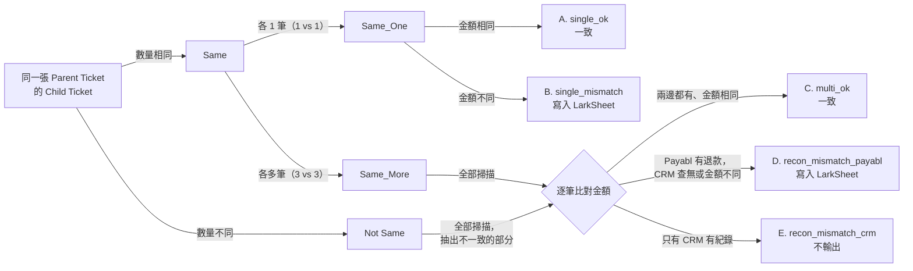
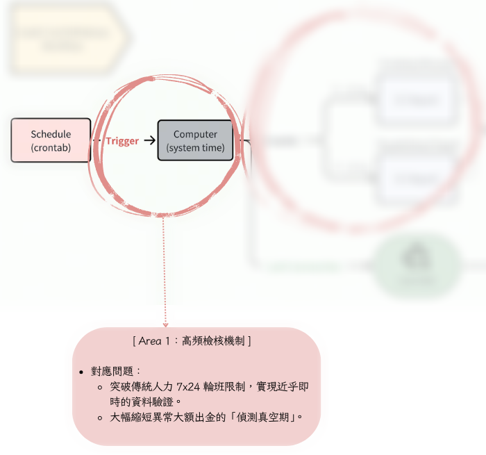
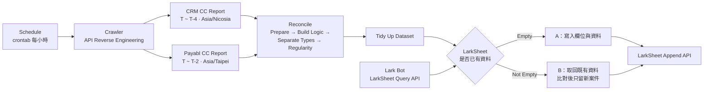
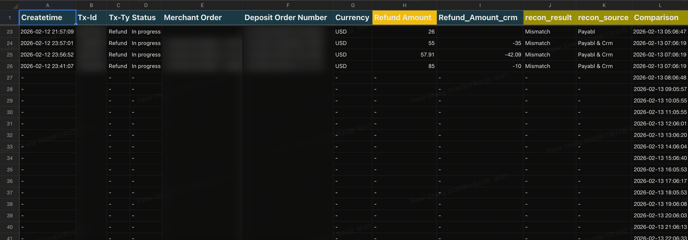

## Problem Assessment

<hr data-slide="背景與名詞">

- 客戶以信用卡充值後申請出金時，款項以退款方式在支付端 **Payabl** 退回原卡，同時要在內部 **CRM** 記帳。
- 兩邊金額不一致（退錯金額、重複退款、CRM 漏記）就代表公司的錢實際流出卻沒有被正確記錄。

<details class="glossary-details">
<summary>名詞說明<span class="mono">14 個名詞 · 點擊展開</span></summary>
<table>
<thead><tr><th>名詞</th><th>說明</th></tr></thead>
<tbody>
<tr><td>入金／出金</td><td>客戶存入／提領資金</td></tr>
<tr><td>PSP</td><td>Payment Service Provider，外部支付服務商</td></tr>
<tr><td>Payabl</td><td>支付端：本專案的信用卡 PSP，實際執行充值與退款；有每一筆退款的明細，但看不出它屬於哪張出金單</td></tr>
<tr><td>CRM</td><td>內部管理客戶與交易紀錄的系統；有 Parent 與 Child Ticket，但沒有交易明細</td></tr>
<tr><td>Bridger</td><td>串接 Payabl 與 CRM 的介面，替每一筆充值產生唯一的流水號（PSP trx ID）；只把流水號傳給 Payabl，不傳出金單（Parent）</td></tr>
<tr><td>充值（Recharge）</td><td>信用卡入金：客戶在 Client Portal 刷卡存入資金</td></tr>
<tr><td>退款（Refunded）</td><td>信用卡出金：款項退回客戶充值時使用的原卡</td></tr>
<tr><td>原入原出</td><td>信用卡出金須退回充值時使用的原卡，並對應原本的充值訂單</td></tr>
<tr><td>Parent Ticket</td><td>客戶的一筆出金申請</td></tr>
<tr><td>Child Ticket</td><td>該申請拆成的實際退款交易（可能多筆）</td></tr>
<tr><td>QC</td><td>Quality Control，負責人工比對的營運輪班</td></tr>
<tr><td>對帳（Reconcile）</td><td>比對兩邊紀錄的金額是否一致</td></tr>
<tr><td>T ~ T-4</td><td>今天往前 4 天內的資料</td></tr>
<tr><td>Mismatch</td><td>兩邊金額不一致，或一邊查無紀錄</td></tr>
</tbody>
</table>
</details>

<hr data-slide="要對的是什麼">

客戶每充值一次，款項經過 Bridger 時就會拿到一個唯一的流水號（PSP trx ID）。例如小明昨天分三次充值 30、40、30 USD，就有 #1、#2、#3 三個流水號。

正因為每筆充值都有自己的流水號，原則上信用卡出金必須遵守**原入原出**：退款要指定退回哪一個流水號。今天小明申請退 100 USD，這張出金申請就是 **Parent Ticket**，它要拆成 30→#1、40→#2、30→#3 三筆退款，也就是三個 **Child Ticket**。

<figure class="split-figure step-figure">
<div class="split-scroll">
<svg viewBox="0 0 760 272" role="img" aria-labelledby="sf1-title"><title id="sf1-title">流水號與原入原出：三筆充值各有一個流水號，100 USD 的出金拆成三筆退款各自退回</title><defs><marker id="sf-arrow" viewBox="0 0 8 8" refX="7" refY="4" markerWidth="8" markerHeight="8" orient="auto"><path class="sf-head" d="M0,0 L8,4 L0,8 z"/></marker></defs><rect class="sf-tag-good" x="668" y="4" width="72" height="26" rx="13"/><text class="sf-tag sf-tag-good-t" x="704" y="22">原則上</text><g transform="translate(0,52)"><g data-b="recharge"><text class="sf-note sf-start" x="20" y="-6">小明昨天充值三筆</text><text class="sf-s" x="85" y="24">充值</text><rect class="sf-node" x="20" y="40" width="130" height="44" rx="6"/><text class="sf-t" x="85" y="67">30 USD</text><rect class="sf-node" x="20" y="100" width="130" height="44" rx="6"/><text class="sf-t" x="85" y="127">40 USD</text><rect class="sf-node" x="20" y="160" width="130" height="44" rx="6"/><text class="sf-t" x="85" y="187">30 USD</text></g><g data-b="trx"><text class="sf-s" x="228" y="24">Bridger 發流水號</text><path class="sf-line" d="M150 62 H174" marker-end="url(#sf-arrow)"/><rect class="sf-trx" x="180" y="46" width="96" height="32" rx="16"/><text class="sf-trx-t" x="228" y="67">trx #1</text><path class="sf-line" d="M150 122 H174" marker-end="url(#sf-arrow)"/><rect class="sf-trx" x="180" y="106" width="96" height="32" rx="16"/><text class="sf-trx-t" x="228" y="127">trx #2</text><path class="sf-line" d="M150 182 H174" marker-end="url(#sf-arrow)"/><rect class="sf-trx" x="180" y="166" width="96" height="32" rx="16"/><text class="sf-trx-t" x="228" y="187">trx #3</text></g><g data-b="parent"><text class="sf-note sf-start" x="335" y="-6">小明今天申請一筆出金</text><text class="sf-s" x="410" y="24">出金申請</text><rect class="sf-parent" x="335" y="92" width="150" height="64" rx="6"/><text class="sf-t" x="410" y="120">退 100 USD</text><text class="sf-s" x="410" y="140">Parent Ticket</text></g><g data-b="split"><text class="sf-s" x="670" y="24">依原入原出拆成退款</text><path class="sf-line" d="M485 124 C 540 124, 548 62, 594 62" marker-end="url(#sf-arrow)"/><path class="sf-line" d="M485 124 H594" marker-end="url(#sf-arrow)"/><path class="sf-line" d="M485 124 C 540 124, 548 182, 594 182" marker-end="url(#sf-arrow)"/><rect class="sf-child" x="600" y="40" width="140" height="44" rx="6"/><text class="sf-t" x="670" y="60">30 USD → #1</text><text class="sf-s" x="670" y="76">Child 1</text><rect class="sf-child" x="600" y="100" width="140" height="44" rx="6"/><text class="sf-t" x="670" y="120">40 USD → #2</text><text class="sf-s" x="670" y="136">Child 2</text><rect class="sf-child" x="600" y="160" width="140" height="44" rx="6"/><text class="sf-t" x="670" y="180">30 USD → #3</text><text class="sf-s" x="670" y="196">Child 3</text></g></g></svg>
</div>
<figcaption>圖 1　流水號與原入原出：每筆充值都有一個 PSP trx ID，所以 100 USD 的出金要拆成三筆退款，各自退回對應的流水號（示意，金額單位 USD）</figcaption>
</figure>

<hr data-slide="兩邊各記了什麼">

但實務上，Bridger 只把流水號傳給 Payabl，沒有把出金單（Parent）一起傳過去，交易明細也沒有回寫到 CRM。結果兩邊各只看得到一半：Payabl 有每一筆退款的明細，卻看不出它屬於哪一張出金單；CRM 有 Parent 與 Child Ticket，但沒有交易明細。營運在 Payabl 手動拆退款時，看不到這張單該拆成哪幾筆，常見兩種錯誤：

- **數量對不上**：退成 30、40、30、30，多退了一筆，也就是重複退款。
- **數量對、金額錯**：退成 30、40、20，筆數對了，金額打錯。

<figure class="split-figure step-figure">
<div class="split-scroll">
<svg viewBox="0 0 760 380" role="img" aria-labelledby="sf2-title"><title id="sf2-title">兩邊各記了什麼：Bridger 只把流水號傳給 Payabl，CRM 與 Payabl 各缺一半，以及兩種常見錯誤</title><defs><marker id="sf-arrow2" viewBox="0 0 8 8" refX="7" refY="4" markerWidth="8" markerHeight="8" orient="auto"><path class="sf-head" d="M0,0 L8,4 L0,8 z"/></marker></defs><rect class="sf-tag-bad" x="668" y="4" width="72" height="26" rx="13"/><text class="sf-tag sf-tag-bad-t" x="704" y="22">實務上</text><g data-b="bridger"><rect class="sf-parent" x="305" y="80" width="150" height="56" rx="28"/><text class="sf-t" x="380" y="104">Bridger</text><text class="sf-s" x="380" y="122">只傳 trx ID</text><path class="sf-line" d="M305 108 H278" marker-end="url(#sf-arrow2)"/><path class="sf-line" d="M455 108 H482" marker-end="url(#sf-arrow2)"/><text class="sf-bad-t" x="380" y="160">痛點：出金單（Parent）</text><text class="sf-bad-t" x="380" y="178">沒有傳到 Payabl</text></g><g data-b="payabl"><rect class="sf-box" x="20" y="40" width="250" height="140" rx="8"/><text class="sf-t sf-start" x="36" y="64">Payabl（支付端）</text><text class="sf-k sf-start" x="36" y="92">Parent</text><text class="sf-miss sf-start" x="130" y="92">沒有</text><text class="sf-k sf-start" x="36" y="120">Child</text><text class="sf-good sf-start" x="130" y="120">#1、#2、#3</text><text class="sf-k sf-start" x="36" y="148">交易明細</text><text class="sf-good sf-start" x="130" y="148">30、40、30 USD</text></g><g data-b="crm"><rect class="sf-box" x="490" y="40" width="250" height="140" rx="8"/><text class="sf-t sf-start" x="506" y="64">CRM（內部）</text><text class="sf-k sf-start" x="506" y="92">Parent</text><text class="sf-good sf-start" x="600" y="92">退 100 USD</text><text class="sf-k sf-start" x="506" y="120">Child</text><text class="sf-good sf-start" x="600" y="120">#1、#2、#3</text><text class="sf-k sf-start" x="506" y="148">交易明細</text><text class="sf-miss sf-start" x="600" y="148">沒有</text></g><g data-b="err-head"><line class="sf-sep" x1="20" y1="206" x2="740" y2="206"/><text class="sf-h sf-start" x="20" y="232">營運在 Payabl 手動拆退款時，看不到這張單該拆成哪幾筆：</text></g><g data-b="err1"><text class="sf-t sf-start" x="20" y="273">多退一筆</text><rect class="sf-node" x="150" y="250" width="70" height="36" rx="6"/><text class="sf-t" x="185" y="273">30</text><rect class="sf-node" x="230" y="250" width="70" height="36" rx="6"/><text class="sf-t" x="265" y="273">40</text><rect class="sf-node" x="310" y="250" width="70" height="36" rx="6"/><text class="sf-t" x="345" y="273">30</text><rect class="sf-bad" x="390" y="250" width="70" height="36" rx="6"/><text class="sf-t sf-bad-t" x="425" y="273">30</text><text class="sf-bad-t sf-start" x="480" y="273">重複退款</text></g><g data-b="err2"><text class="sf-t sf-start" x="20" y="329">打錯金額</text><rect class="sf-node" x="150" y="306" width="70" height="36" rx="6"/><text class="sf-t" x="185" y="329">30</text><rect class="sf-node" x="230" y="306" width="70" height="36" rx="6"/><text class="sf-t" x="265" y="329">40</text><rect class="sf-bad" x="310" y="306" width="70" height="36" rx="6"/><text class="sf-t sf-bad-t" x="345" y="329">20</text><text class="sf-bad-t sf-start" x="400" y="329">金額錯誤</text></g></svg>
</div>
<figcaption>圖 2　兩邊各記了什麼：Bridger 只傳流水號，Payabl（左）有明細但沒有 Parent，CRM（右）有 Parent 與 Child 但沒有明細；下方是營運手動拆退款時的兩種錯誤（示意）</figcaption>
</figure>

<hr data-slide="比對規則">

因此要解決的不是「人會犯錯」，而是**退款之後，沒有機制把每張 Parent Ticket 底下的 Child Ticket 逐筆對回兩邊**。比對規則就照原入原出設計：以 Parent Ticket 底下的每一筆 Child Ticket 為單位，先比數量，再比筆數，最後比金額，每筆 Child Ticket 歸入 A–E 其中一類：


*圖 3　比對規則（依專案簡報重繪）*

<hr data-slide="對照範例">

沿用同一個例子：100 USD 的出金單依原入原出拆成 30、40、30。依圖 3 的 A 到 E 排列，看它的幾種變化各落在哪一類（A、B 是只充值一次、不必拆單的情況）：

| 分類<br>（圖 3 路徑） | 情境 | Payabl 的退款 | CRM 的<br>Child Ticket | 判定 |
|---|---|---|---|---|
| A<br>Same_One | 只充值一次 | 100 | 100 | 一致，不輸出 |
| **B**<br>Same_One | 只充值一次、金額打錯 | <span class="val-bad">50</span> | 100 | **<span class="val-bad">50</span> 寫入 LarkSheet** |
| C<br>Same_More | 正確拆成三筆 | 30&nbsp;·&nbsp;40&nbsp;·&nbsp;30 | 30&nbsp;·&nbsp;40&nbsp;·&nbsp;30 | 三筆都一致，不輸出 |
| **D**<br>Same_More | 金額打錯 | 30&nbsp;·&nbsp;40&nbsp;·&nbsp;<span class="val-bad">20</span> | 30&nbsp;·&nbsp;40&nbsp;·&nbsp;30 | 30、40 是 C；**<span class="val-bad">20</span> 寫入 LarkSheet** |
| **D**<br>Not&nbsp;Same | 重複退款 | 30&nbsp;·&nbsp;40&nbsp;·&nbsp;30&nbsp;·&nbsp;<span class="val-bad">30</span> | 30&nbsp;·&nbsp;40&nbsp;·&nbsp;30 | 前三筆是 C；**多出的 <span class="val-bad">30</span> 寫入 LarkSheet** |
| E<br>Not&nbsp;Same | 有一筆還沒退 | 30&nbsp;·&nbsp;40 | 30&nbsp;·&nbsp;40&nbsp;·&nbsp;30 | 30、40 是 C；CRM 多的 30 是 E，不輸出 |

*示意：金額單位 USD，以正數表示（CRM 實際以負數記帳）。實際案件見 Result 的輸出格式（退錯金額歸 B、重複退款歸 D）。*

- 紅字是錯誤的金額，也就是會寫入 LarkSheet、交給營運複核的那一筆（B、D）；A、C 兩邊一致，E 是 Payabl 沒有實際退款，都不輸出。

<hr data-slide="痛點與證據">

<figure class="pain-figure">
<div class="pain-grid">
<section class="pain-card tone-grey pain-wide">
<h4 class="pain-title">流程繁重導致斷層</h4>
<p class="pain-label"><span>Pain</span>跨系統手動搬運資料</p>
<ul class="pain-note">
<li>需反覆進入 Payabl／CRM 下載。</li>
<li>流程繁瑣，高度依賴個人經驗。</li>
</ul>
<div class="pain-evidence">
<p class="pain-evidence-title">證據：每一輪人工比對都要走過這兩個後台</p>
<div class="pain-shots">
<div class="pain-shot">
<p class="pain-shot-title"><b>後台 1　Payabl</b>（有交易明細）</p>


<p class="pain-shot-note"><mark>沒有下載按鈕</mark>（紅圈處）。只能在 View 頁面設定日期區間與篩選條件，再把畫面上的資料重複複製貼上。</p>
</div>
<div class="pain-shot">
<p class="pain-shot-title"><b>後台 2　CRM</b>（沒有明細）</p>


<p class="pain-shot-note"><mark>有下載按鈕，但要先點選諸多 option</mark>（All Users、All Status、All Types、Search Options、Mark Type、日期區間），才能拿到 CRM 端的 Transaction log。</p>
</div>
</div>
<p class="pain-evidence-title">一輪人工比對的耗時（估計）</p>
<div class="pain-timebar">
<span class="seg-platform" style="flex: 35">平台操作：多次點擊＋失敗重來　約 35 分</span>
<span class="seg-excel" style="flex: 10">Excel 整理並貼到群組　約 10 分</span>
</div>
<p class="pain-caption">合計每輪約 <b>45 分鐘</b> × 每日 5 輪 ≈ <b>每日 3.75 小時人工</b>。</p>
</div>
</section>
<section class="pain-card tone-red">
<h4 class="pain-title">人力資源飽和</h4>
<p class="pain-label"><span>Pain</span>7×24 輪班仍有極限</p>
<ul class="pain-note">
<li>目前配置每日 5 組人力持續作業。</li>
<li>已達上限，無法支援更小時間顆粒的檢核。</li>
</ul>
<div class="pain-evidence">
<p class="pain-evidence-title">證據：QC 輪班表（2 月節錄）</p>
<div class="pain-table-wrap">
<table class="pain-schedule">
<thead><tr><th></th><th>一</th><th>二</th><th>三</th><th>四</th><th>五</th><th>六</th><th>日</th></tr></thead>
<tbody>
<tr><th>9AM</th><td>A</td><td>B</td><td>A</td><td>C</td><td>C</td><td>E</td><td>F</td></tr>
<tr><th>2PM</th><td>C</td><td>D</td><td>B</td><td>A</td><td>D</td><td>G</td><td>—</td></tr>
<tr><th>6PM</th><td>H</td><td>I</td><td>J</td><td>H</td><td>J/I</td><td>—</td><td>K</td></tr>
<tr><th>10PM</th><td>L</td><td>L</td><td>L</td><td>L</td><td>L</td><td>M</td><td>N</td></tr>
<tr><th>4AM</th><td>N</td><td>N</td><td>M</td><td>N</td><td>N</td><td>M</td><td>M</td></tr>
</tbody>
</table>
</div>
<p class="pain-caption">一週 5 個時段、14 位同事輪值（姓名以代號取代）。每個時段跑一輪約 45 分鐘的人工比對。</p>
</div>
</section>
<section class="pain-card tone-yellow">
<h4 class="pain-title">潛在風險失控</h4>
<p class="pain-label"><span>Pain</span>錯誤率飆升＋比對邏輯不全</p>
<ul class="pain-note">
<li>大量資料導致 Excel 比對極易出錯。</li>
<li>異常若未即時發現，將導致財務損失。</li>
</ul>
<div class="pain-evidence">
<p class="pain-evidence-title">證據：兩邊的 Ticket 對不起來</p>
<ul class="pain-flow">
<li><b>Payabl</b> 只有 Child Ticket，有具體交易明細，但看不出每筆退款屬於哪張 Parent Ticket；人工對回 CRM 時容易配錯。</li>
<li><b>CRM</b> 有 Parent 與 Child Ticket，但沒有明細，無法單靠 CRM 驗證是否異常。</li>
<li>一次要對的量是兩邊各數萬筆交易（見 Result 的 log）。</li>
</ul>
</div>
</section>
</div>
<figcaption>圖 4　原流程的三個痛點（依專案簡報重繪；平台截圖已裁掉網址列，並模糊登入帳號與品牌標誌；輪班表姓名以代號取代；工時為估計值）</figcaption>
</figure>

<hr data-slide="值得投入的理由">

**值得投入解決的理由：**

1. **損失是直接的現金流出**：上線後確認的錯誤退款中，有 Payabl 退款 60 USD、CRM 只記 30 USD 的退錯金額，也有同一筆 350 EUR 被退了兩次的重複退款；兩筆都在偵測後由營運撤銷（件數見 Result）。
2. **人工方案已經無法擴充**：每輪人工比對的耗時固定（圖 4），5 組輪班已是上限，要再提高頻率只能再加人。

## Solution Design

依照三個痛點，拆成四個要解決的面向：

| 痛點 | 解決方向 | 對應 |
|---|---|---|
| 人力飽和、檢查頻率受限 | 排程自動觸發，每小時檢核一次，不受輪班限制 | |
| 跨系統手動搬運資料 | 用程式直接擷取兩邊報表，取代手動下載與複製貼上 | |
| Excel 比對易錯、邏輯不全 | 把比對規則程式化（規則先與營運端逐條對齊），自動濾掉正常交易，只輸出異常 | |
| 異常未即時發現 | 異常直接推送到營運已在使用的 LarkSheet，作為案件追蹤紀錄 | |

**設計時必須面對的限制：**

- 沒有官方 API 或資料庫權限。
- Payabl 後台沒有報表下載功能。
- 兩邊報表的可取得時間不同：CRM 取 T ~ T-4、Payabl 取 T ~ T-2，且時區不同（CRM 為 Asia/Nicosia、Payabl 為 Asia/Taipei）（圖 5）。

## Alternative Solutions

當時評估過四個方案，前三個為替代方案：

| 方案 | 做法 | 優點 | 缺點 |
|---|---|---|---|
| A. 增加輪班人力 | 維持人工 Excel 比對，加人提高頻率 | 不需開發，立即可行 | 成本隨頻率線性增加；已配置 5 組仍只有每日 5 次；Excel 比對錯誤率不會下降 |
| B. 申請官方 API 或 DB 權限 | 由廠商或系統負責單位提供正式資料介面 | 最穩定、有官方支援 | 取決於外部單位，時程無法掌握；在等待期間風險持續存在 |
| C. 瀏覽器自動化（Selenium / RPA） | 模擬人工操作後台頁面 | 不需理解系統內部介面 | Payabl 沒有下載按鈕，只能模擬逐頁複製；畫面一改就失效；執行慢，需要常駐瀏覽器 |
| **D. API 逆向工程（採用）** | 分析後台頁面背後的 HTTP API，直接以程式登入並取得報表 | 不依賴畫面、速度快、可排程 | 需要投入分析時間；對方 API 變動時要跟著調整 |

> 各方案的優缺點依圖 4 記錄的系統限制整理；四個方案皆為當時實際評估過的選項。

## Selected Solution

<hr data-slide="選擇理由">

**選擇 D： API 逆向工程**

1. **繞過「沒有下載按鈕」的限制**：資料雖然只在頁面上顯示，但頁面背後一定有 API 提供資料，直接呼叫 API，就不必模擬複製貼上。
2. **不必等待外部資源**：B 的時程不可控，D 可以先讓偵測上線；未來若取得正式 API，只需替換擷取層。
3. **符合當時資源**：一個人開發，以一台電腦的 crontab 排程即可執行；通知直接使用營運已在用的 Lark，非技術同仁不需要學新系統。

<hr data-slide="系統架構">


*圖 5　Credit Card Withdraw Workflow（節錄自專案簡報，點擊圖片可放大）*

以下是圖 5 的文字版流程：



<hr data-slide="設計重點">

**設計重點：**

- **B 分支**會先查詢 LarkSheet 已有的案件，只追加新的異常，避免同一筆交易每小時重複通知。
- **權限範圍**：事前經主管核准，使用公司配發給營運的既有帳號，只讀取人工本來就看得到的報表，不寫入任何資料；CRM 與 Payabl 的帳密從唯讀掛載進容器的設定檔讀取，不寫在程式碼中。
- **比對規則**（Area 3：Prepare → Build Logic → Separate Types → Regularity）：規則與營運端逐條對齊，判定流程見圖 3，A–E 的處理方式：
  - **A、C**：兩邊一致，不輸出。
  - **B、D**：Payabl 已退款但 CRM 對不上，寫入 LarkSheet 交給營運複核；輸出時以 `recon_source` 標示 CRM 有無對應紀錄（見 Result 的輸出格式）。
  - **E**：Payabl 沒有實際退款，不列入異常；3–7 月的輸出中沒有只出現在 CRM 的案件。

<hr data-slide="失敗時怎麼辦">

**失敗時怎麼辦：** CRM 的報表 API 常回 500／502，登入也可能被擋。每一個失敗點都要有明確的處理方式並留下紀錄，不能因為一次失敗就讓整輪對帳白跑，也不能讓跳過的資料就此消失。

| 失敗情境 | 處理方式 | 證據 |
|---|---|---|
| 登入失敗 | 登入最多重試 5 次（CRM、Payabl 皆同），連線層遇到 429／5xx 另外自動退避；CRM 被導回登入頁（帳密、TOTP 或風控）、token 是空值或 HTML，都算失敗 | 登入重試（見 Result） |
| API&nbsp;錯誤 | CRM 每天的報表分「產生 → 下載」兩步，各自最多重試 10 次、間隔 5 秒；每次失敗記一行 WARNING，寫明 regulator、日期與耗時 | 重試後成功的步驟（見 Result） |
| 重試用盡 | 只跳過那個 regulator 的那一天、記一行 ERROR，其他天照常比對；每一輪都重抓 CRM 最近 4 天、Payabl 最近 2 天，跳過的那天由下一輪補回 | 出錯時的 log（見 Result） |
| 重跑 | 寫入前先讀 LarkSheet 既有的 Merchant Order + Deposit Order Number，只追加新案件；沒有新案件也寫一列比對時間 | 圖 6 |
| 事後查核 | 每次下載的原始報表依「年／月／日／系統」存成 CSV；log 每行帶 `service`、`stage`、`status`，每天一個 JSON 檔留在主機 | 一次實際執行的 log（見 Result） |

- CRM 整個停擺時，所有天都會失敗，這一輪不會寫入 LarkSheet，表上就少了那個小時的比對時間列；缺少這一列，就是管線沒有跑完的訊號。

<hr data-slide="關鍵程式碼">

**關鍵程式碼：** 上一張的重試、跳過、滾動回補與去重，對應到這幾段：

```python
# cc_withdraw_crawler.py：CRM 報表，每天分「產生 → 下載」兩步
for day in dayrange(tz='Asia/Nicosia', DayRange=4):   # 滾動視窗：每一輪重抓最近 4 天（Payabl 2 天）
    filename = None
    for attempt in range(1, MAX_RETRIES + 1):          # MAX_RETRIES = 10（3/3 起，原本 3）
        try:
            response = session.post(generate_url, json=json_data, timeout=POST_TIMEOUT)
            response.raise_for_status()
            filename = response.json()['data']['file']
            break
        except RequestException as e:
            logger.warning(f"POST failed ({brand} {day}) attempt {attempt}: {e}")
            if attempt < MAX_RETRIES:
                time.sleep(RETRY_SLEEP)                # 間隔 5 秒
            else:
                logger.error(f"POST failed after {MAX_RETRIES} attempts ({brand} {day})")
    if not filename:
        continue                                       # 只跳過這一天，其他天照常

# main.py：寫入前去重，只追加 LarkSheet 還沒有的案件
keys = ['Merchant Order', 'Deposit Order Number']
uploaded_keys = list(df_unique[keys].itertuples(index=False, name=None))
mismatch_case1 = mismatch_case[~mismatch_case[keys].apply(tuple, axis=1).isin(uploaded_keys)]
if mismatch_case1.empty: append_sheet(..., [['-'] * 11 + [detection_time]])   # 沒有新案件也留一列比對時間
```

*節錄自 `cc_withdraw_crawler.py`（CRM 報表下載函式）與 `main.py`，已簡化：網址改成變數名稱，CRM 下載的第二步與 Payabl 部分省略，去重的欄位清單抽成 `keys`、心跳列寫成一行；內部系統名稱改為 `crm`，其他函式與變數名稱照原始碼。*

## Result

<hr data-slide="操作畫面">

### 操作畫面：LarkSheet 案件表

管線每小時把結果寫進營運在用的 LarkSheet：有異常的那一輪寫入案件列（金額、`recon_result`、`recon_source`），營運直接在表上複核；沒有異常的時段也會留下一列比對時間，證明那一輪有執行。


*圖 6　LarkSheet 案件表實際畫面（已裁掉瀏覽器與文件路徑，交易編號與訂單編號欄位已模糊；點擊可放大）*

<hr data-slide="一次實際執行">

### 一次實際執行的紀錄

- 以下是 2026-03-16 11:00 那次執行的 log 節錄，轉錄自原始截圖。
- 內部網址、報表檔名、品牌代碼與工作表範圍已移除，內部系統名稱改為 `crm`。

```text
11:00:01  download         Start download reports...
11:00:04  download_payabl  Payabl Login Success and Get Token Success
11:00:04  download_payabl  Start downloading Payabl CC Report for date: 2026-03-15...
11:00:26  download         Download Payabl CC Report Finish | Total: 21185
11:00:26  download_crm     Login attempt 1/5
11:02:43  download_crm     POST success (2026-03-13): <report>.csv, took 52.7s
11:02:46  download_crm     Download success (2026-03-13): <report>.csv, took 3.2s
   ...    (2026-03-14 ~ 2026-03-16 同上)
11:05:25  download         Download CRM CC Report Finish | Total: 21752
11:05:25  reconcile        Start reconcile...
11:05:25  reconcile        Reconcile Finish | Total Mismatch Case: 0
11:05:28  lark             Total unique keys in LarkSheet: 173, Total new mismatch cases to upload: 0
11:05:30  lark             Upload data to LarkSheet Finish
```

從這段紀錄可以看到：

- **一次完整執行約 5.5 分鐘**，比對 21,185 筆 Payabl 交易與 21,752 筆 CRM 紀錄。
- CRM 報表採「先 POST 產生報表（約 50 秒）→ 再下載（約 3 秒）」的兩段式流程，這是逆向分析後才找出的呼叫方式。
- 沒有異常時，正常結束且不推送任何通知。

<figure class="tech-figure">
<div class="tech-labels">
<div class="tech-label">
<p class="tech-label-kicker">Tech Label</p>
<p class="tech-label-name">Two-step Report Fetch</p>
<p class="tech-label-desc">CRM 報表先 POST 產生、再下載，是逆向分析後找出的呼叫方式；兩步各自重試與計時。</p>
</div>
<div class="tech-label">
<p class="tech-label-kicker">Tech Label</p>
<p class="tech-label-name">Stage-tagged JSON Logging</p>
<p class="tech-label-desc">每行帶 service、stage、status；重試中的失敗記 WARNING、放棄的步驟記 ERROR，每天一個檔。</p>
</div>
</div>
</figure>

<hr data-slide="輸出格式">

### 輸出格式

異常會寫入 LarkSheet，欄位與 CSV 相同。以下三列取自 3–7 月營運確認為錯誤的案件，已去除交易編號與訂單編號；三列的 Tx-Type 皆為 Refund、Status 皆為 In progress，表中省略，幣別併入金額欄：

| Refund Amount（Payabl） | Refund_Amount_crm | recon_result | recon_source |
|---|---|---|---|
| 120 USD | -200 USD | Mismatch | Payabl & Crm |
| 60 USD | -30 USD | Mismatch | Payabl & Crm |
| 350 EUR | （空白） | Mismatch | Payabl |

`recon_source` 區分兩種異常：

- `Payabl & Crm`：兩邊都有紀錄，但金額不一致。
- `Payabl`：Payabl 已退款，但 CRM 查無對應紀錄。

<hr data-slide="出錯時">

### 出錯時：跳過一天，下一輪補回

- 以下是 2026-03-03 13:00 與 14:00 兩次執行的 log 節錄，取自原始 log 檔（JSON），這裡保留時間、等級、stage 與訊息。
- 內部網址與報表檔名已移除，錯誤訊息只留 HTTP 狀態碼，內部系統名稱改為 `crm`。

```text
13:00:02  INFO   download      Start download reports...
13:02:48  WARN   download_crm  POST failed (VFSC 2026-03-01) attempt 1: 500, took 14.4s
   ...                         (attempt 2 ~ 9：500 與 502 交替)
13:04:58  WARN   download_crm  POST failed (VFSC 2026-03-01) attempt 10: 500, took 14.0s
13:04:58  ERROR  download_crm  POST failed after 10 attempts (VFSC 2026-03-01)
13:06:54  ERROR  download_crm  POST failed after 10 attempts (VFSC 2026-03-02)
13:07:32  INFO   download_crm  POST success (VFSC 2026-03-03): <report>.csv, took 19.2s
   ...                         (VFSC2 的 4 天全部成功)
13:11:03  INFO   lark          Upload data to LarkSheet Finish
  -----   ----------------------- 下一個整點 -----------------------
14:00:02  INFO   download      Start download reports...
14:02:50  INFO   download_crm  POST success (VFSC 2026-03-01): <report>.csv, took 18.2s
14:03:54  INFO   download_crm  POST success (VFSC 2026-03-02): <report>.csv, took 19.1s
14:09:25  INFO   lark          Upload data to LarkSheet Finish
```

從這段紀錄可以看到：

- **13:00 這一輪**：VFSC 的 3/1、3/2 各重試 10 次仍失敗，記成 ERROR 後跳過；3/3 與 VFSC2 的 4 天照常下載，這一輪仍完成比對並寫入 LarkSheet。
- **14:00 下一輪**：滾動視窗再次涵蓋 3/1、3/2，兩天都下載成功（3/2 在第 4 次成功），不需要人工補跑。
- **3/1–3/9 的 log 中**，重試 10 次仍失敗而跳過的報表共 6 次，6 次都在下一個整點補回；登入重試 5 次，都在第 2 次成功。

<figure class="tech-figure">
<div class="tech-labels">
<div class="tech-label">
<p class="tech-label-kicker">Tech Label</p>
<p class="tech-label-name">Bounded Retry, Per-day Isolation</p>
<p class="tech-label-desc">每個步驟最多重試 10 次；仍失敗只跳過那一天，不中斷整輪對帳。</p>
</div>
<div class="tech-label">
<p class="tech-label-kicker">Tech Label</p>
<p class="tech-label-name">Rolling-window Backfill</p>
<p class="tech-label-desc">每一輪都重抓最近幾天的報表，跳過的那天由下一輪自動補回；搭配去重，重抓不會重複寫入。</p>
</div>
</div>
</figure>

<hr data-slide="重試上限">

### 重試上限：從 3 次調高到 10 次

2026-03-03 13:00 起，報表 API 的重試上限從 3 次調高到 10 次。3/1–3/9 的 log 中，有 382 個步驟（某個 regulator 某一天的「產生」或「下載」）在失敗後重試成功，依第幾次成功分布如下：

<figure class="bar-figure">
<ul class="bar-list">
<li style="--v: 100%"><span class="bar-label">第 2 次成功</span><span class="bar"></span><span class="bar-value">181</span></li>
<li style="--v: 82.3%"><span class="bar-label">第 3 次成功</span><span class="bar"></span><span class="bar-value">149</span></li>
<li class="is-peak" style="--v: 28.7%"><span class="bar-label">第 4–10 次成功</span><span class="bar"></span><span class="bar-value">52</span></li>
</ul>
<figcaption>圖 7　重試後成功的 382 個步驟，依第幾次成功（2026-03-01 ~ 03-09 的原始 log）</figcaption>
</figure>

- **第 4–10 次才成功的 52 個步驟**：在原本 3 次的上限下都會被跳過，要等下一輪才補回。
- 失敗的回應全部是 HTTP 500 或 502，屬於 CRM 端暫時性的錯誤，所以適合用重試處理。

<hr data-slide="執行統計">

### 穩定期執行統計（2026-03-01 ~ 2026-07-31）

資料來源：管線輸出的完整紀錄 CSV（`Payabl QC new Template - New Data.csv`）。

| 指標 | 數值 |
|---|---|
| 自動對帳執行次數 | 3,162 次 |
| 執行間隔 | 中位數 1.00 小時、P90 1.02 小時 |
| 沒有新異常的執行 | 3,042 次（96.2%） |

<details class="csv-details">
<summary>完整資料（已去識別化）<span class="mono">3,612 列 · 點擊展開</span></summary>
<div class="csv-viewer" data-src="../../data/credit-card-recon-2026-03-07.csv">
<p><a href="../../data/credit-card-recon-2026-03-07.csv" download>下載去識別化 CSV（2026-03 ~ 2026-07，3,612 列）</a></p>
</div>
</details>

<hr data-slide="複核結果">

### 複核結果（2026-03-01 ~ 2026-07-31）

管線寧可多標、交給營運複核，「確認為錯誤」指營運複核標為 error，或營運備註寫明退錯金額、重複退款、退錯訂單的交易：

<figure class="bar-figure">
<ul class="bar-list">
<li style="--v: 100%"><span class="bar-label">被標記待複核</span><span class="bar"></span><span class="bar-value">523</span></li>
<li class="is-peak" style="--v: 5.5%"><span class="bar-label">確認為錯誤退款</span><span class="bar"></span><span class="bar-value">29</span></li>
<li class="is-peak" style="--v: 5.4%"><span class="bar-label">偵測後撤銷或要求取消</span><span class="bar"></span><span class="bar-value">28</span></li>
</ul>
<figcaption>圖 8　從標記到撤銷的筆數（不重複交易；取自本頁公開 CSV）</figcaption>
</figure>

- **被標記的 523 筆**：金額不一致 307 筆、CRM 查無紀錄 216 筆。
- **確認為錯誤的 29 筆**：退錯金額 19、重複退款 9、退錯訂單 1。

## Impact

### 已驗證的成果

<figure class="ba-figure">
<div class="ba-table">
<div class="ba-row ba-head"><p class="ba-item">項目</p><p class="ba-before">Before：傳統人工對帳</p><p class="ba-after">After：自動化偵測 Pipeline</p></div>
<div class="ba-row"><p class="ba-item">人力</p><p class="ba-before">每日約 3.75 小時</p><p class="ba-after">偵測 0 人工；被標記的案件由營運複核<small>依據：每輪約 45 分鐘 × 每日 5 輪（見 Problem）；3–7 月約節省 574 小時（年化約 1,369 小時），估計值</small></p></div>
<div class="ba-row"><p class="ba-item">監控頻率</p><p class="ba-before">每日 5 次</p><p class="ba-after">排程每小時 1 次；3–7 月實際平均每日 20.7 次（約 4.1 倍）<small>依據：輪班表 5 個時段；執行次數（見 Result）÷ 153 天，每日中位數 23 次</small></p></div>
<div class="ba-row"><p class="ba-item">偵測時效</p><p class="ba-before">最長約 5 小時（兩輪人工比對的間隔）</p><p class="ba-after">資料可取得後 1 小時內<small>依據：每小時排程；執行間隔見 Result</small></p></div>
<div class="ba-row"><p class="ba-item">資料取得</p><p class="ba-before">手動下載、複製貼上，每輪約 45 分鐘</p><p class="ba-after">API 逆向工程自動擷取，一次執行只需幾分鐘<small>依據：Result 的執行 log；人工工時為估計值</small></p></div>
<div class="ba-row"><p class="ba-item">抓取失敗</p><p class="ba-before">後台載入失敗就重新操作，含在每輪約 35 分鐘的平台操作內</p><p class="ba-after">自動重試；重試仍失敗的那一天，由下一輪自動補回<small>依據：Result 的「出錯時」與「重試上限」</small></p></div>
<div class="ba-row"><p class="ba-item">比對範圍</p><p class="ba-before">人工 Excel 比對，筆數未紀錄</p><p class="ba-after">每次全量比對兩邊所有交易<small>依據：Result 的執行 log</small></p></div>
<div class="ba-row"><p class="ba-item">實際攔截</p><p class="ba-before">無紀錄</p><p class="ba-after">確認的錯誤退款幾乎全部在偵測後撤銷或要求取消<small>依據：CSV 複核欄與營運備註；筆數見 Result 圖 8</small></p></div>
</div>
<figcaption>圖 9　Before / After 對照（依專案簡報重繪）。更正：原圖標示每日 4 次、↑600%、>24 小時；實際排班為每日 5 輪（間隔約 5 小時），自動化後 3–7 月實際平均每日 20.7 次，約 4.1 倍。原圖「準確程度」一列未納入，原因見下方說明。</figcaption>
</figure>

<!-- ### 尚未量化或需要說明的部分

- **偵測時效的起算點**：「1 小時內」是從報表資料可以取得時開始計算。PSP 與 CRM 報表本身有 T-2 到 T-4 的延遲，所以從交易發生到偵測的端到端時間會比 1 小時長。
- **準確度**：管線的設計是「每一筆都比對、寧可多標」。被標記的 523 筆中，確認為錯誤的有 29 筆（約 5.5%），其餘確認無誤，因此本頁不使用「100% 精準」的說法，而是描述為 100% 覆蓋比對 + 人工複核。
- **財務效益**：29 筆錯誤退款的金額合計約 EUR 1,409、GBP 1,510、USD 850，其中偵測後撤銷或要求取消的 28 筆約 EUR 1,409、GBP 1,510、USD 800。這是錯誤退款涉及的金額，不等於實際避免的損失（部分案件可能也會被人工發現）。
- **過渡方案**：這支程式在 2026/2 底上線，約 2026/8 隨支付平台停用而退場，因此成效只計算 3–7 月的穩定期。它的價值在於：平台停用前的這段期間，用最低成本補上人工對帳的缺口。 -->
