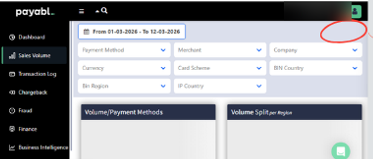
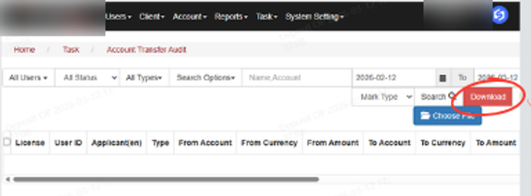
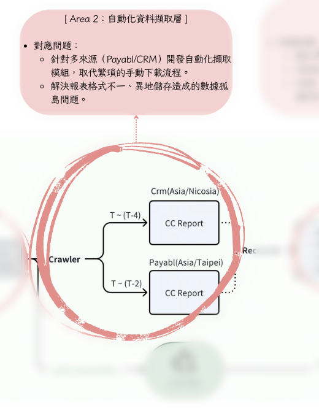
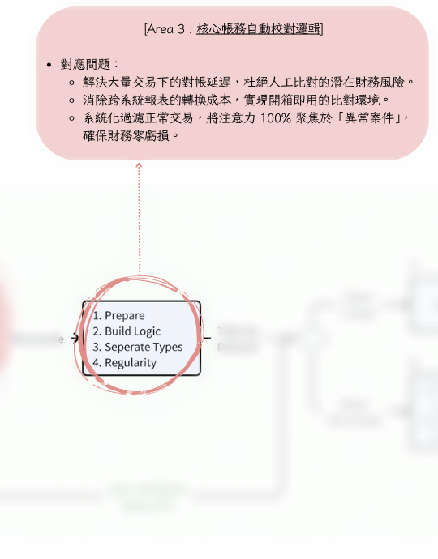
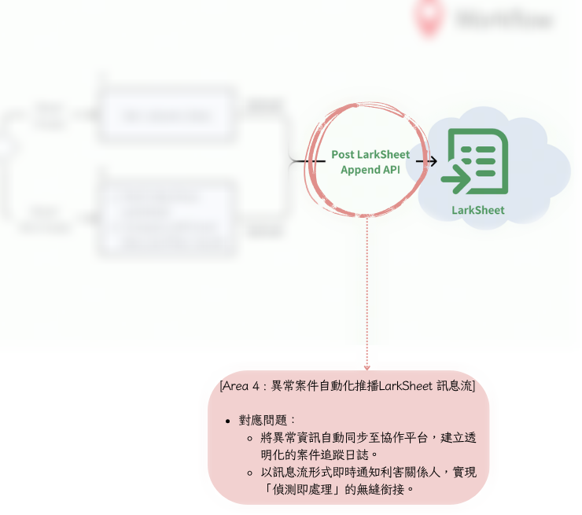
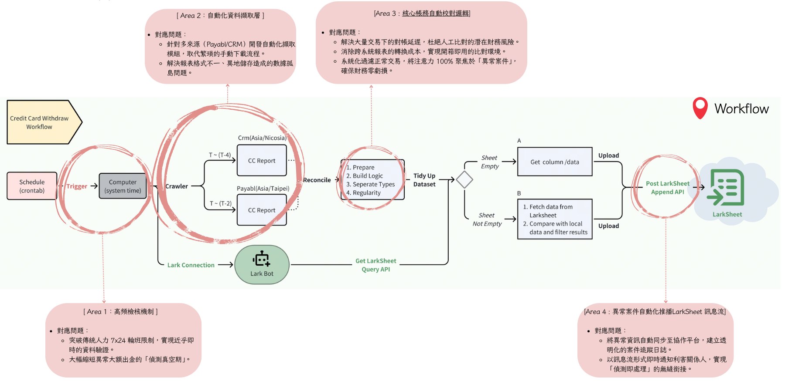
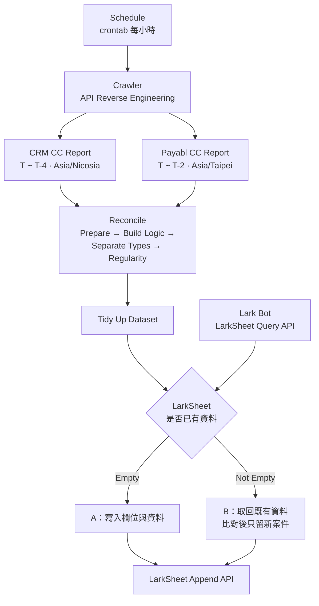

## Problem Assessment

- 信用卡入金的客戶申請出金時，退款在支付端 **Payabl** 執行，同時要在內部 **CRM** 記帳。
- 兩邊金額不一致（退錯金額、重複退款、CRM 漏記）就代表公司的錢實際流出卻沒有被正確記錄。

<figure class="pain-figure">
<div class="pain-grid">
<section class="pain-card tone-grey pain-wide">
<h4 class="pain-title">🧩 流程繁重導致斷層</h4>
<p class="pain-label"><span>Pain</span>跨系統手動搬運資料</p>
<ul class="pain-note">
<li>需反覆進入 Payabl／CRM 下載。</li>
<li>流程繁瑣，高度依賴個人經驗。</li>
</ul>
<div class="pain-evidence">
<p class="pain-evidence-title">證據：每一輪人工比對都要走過這兩個後台</p>
<div class="pain-shots">
<div class="pain-shot">
<p class="pain-shot-title"><b>① Payabl 後台</b>（有交易明細）</p>



<p class="pain-shot-note"><mark>沒有下載按鈕</mark>（紅圈處）。只能在 View 頁面設定日期區間與篩選條件，再把畫面上的資料重複複製貼上。</p>
</div>
<div class="pain-shot">
<p class="pain-shot-title"><b>② CRM 後台</b>（沒有明細）</p>



<p class="pain-shot-note"><mark>有下載按鈕，但要先點選諸多 option</mark>（All Users、All Status、All Types、Search Options、Mark Type、日期區間），才能拿到 CRM 端的 Transaction log。</p>
</div>
</div>
<p class="pain-evidence-title">一輪人工比對的耗時（估計）</p>
<div class="pain-timebar">
<span class="seg-platform" style="flex: 35">平台操作：多次點擊＋失敗重來　約 35 分</span>
<span class="seg-excel" style="flex: 10">Excel 整理並貼到群組　約 10 分</span>
</div>
<p class="pain-caption">合計每輪約 <b>45 分鐘</b> × 每日 5 輪 ≈ <b>每日 3.75 小時人工</b>。</p>
</div>
</section>
<section class="pain-card tone-red">
<h4 class="pain-title">🚨 人力資源飽和</h4>
<p class="pain-label"><span>Pain</span>7×24 輪班仍有極限</p>
<ul class="pain-note">
<li>目前配置每日 5 組人力持續作業。</li>
<li>已達上限，無法支援更小時間顆粒的檢核。</li>
</ul>
<div class="pain-evidence">
<p class="pain-evidence-title">證據：QC 輪班表（2 月節錄）</p>
<div class="pain-table-wrap">
<table class="pain-schedule">
<thead><tr><th></th><th>一</th><th>二</th><th>三</th><th>四</th><th>五</th><th>六</th><th>日</th></tr></thead>
<tbody>
<tr><th>9AM</th><td>A</td><td>B</td><td>A</td><td>C</td><td>C</td><td>E</td><td>F</td></tr>
<tr><th>2PM</th><td>C</td><td>D</td><td>B</td><td>A</td><td>D</td><td>G</td><td>—</td></tr>
<tr><th>6PM</th><td>H</td><td>I</td><td>J</td><td>H</td><td>J/I</td><td>—</td><td>K</td></tr>
<tr><th>10PM</th><td>L</td><td>L</td><td>L</td><td>L</td><td>L</td><td>M</td><td>N</td></tr>
<tr><th>4AM</th><td>N</td><td>N</td><td>M</td><td>N</td><td>N</td><td>M</td><td>M</td></tr>
</tbody>
</table>
</div>
<p class="pain-caption">一週 5 個時段、14 位同事輪值（姓名以代號取代）。每個時段跑一輪約 45 分鐘的人工比對。</p>
</div>
</section>
<section class="pain-card tone-yellow">
<h4 class="pain-title">⚠️ 潛在風險失控</h4>
<p class="pain-label"><span>Pain</span>錯誤率飆升＋比對邏輯不全</p>
<ul class="pain-note">
<li>大量資料導致 Excel 比對極易出錯。</li>
<li>異常若未即時發現，將導致財務損失。</li>
</ul>
<div class="pain-evidence">
<p class="pain-evidence-title">證據：兩邊的 Ticket 對不起來</p>
<ul class="pain-flow">
<li><b>Payabl</b> 只有 Child Ticket，有具體交易明細；人工對回 CRM 時容易配錯 Parent Ticket。</li>
<li><b>CRM</b> 有 Parent 與 Child Ticket，但沒有明細，無法單靠 CRM 驗證是否異常。</li>
<li>一次要對的量：Payabl 約 2.1 萬筆、CRM 約 2.2 萬筆（見 Result 的 log）。</li>
</ul>
</div>
</section>
</div>
<figcaption>圖 1　原流程的三個痛點（依專案簡報重繪；平台截圖已裁掉網址列，並模糊登入帳號與品牌標誌；輪班表姓名以代號取代；工時為估計值）</figcaption>
</figure>

**值得投入解決的理由：**

1. **損失是直接的現金流出**：上線後 3–7 月確認了 29 筆錯誤退款，例如 Payabl 退款 60 USD、CRM 只記 30 USD 的退錯金額，以及同一筆 350 EUR 被退了兩次的重複退款；兩筆都在偵測後由營運撤銷。
2. **人工方案已經無法擴充**：每輪人工比對約 45 分鐘，5 組輪班每日 5 輪就要約 3.75 小時，要再提高頻率只能再加人。
3. **資料量超過人工能力**：一次執行就要比對約 2.1 萬筆 Payabl 交易與 2.2 萬筆 CRM 紀錄（見 Result 的 log）。

## Solution Design

依照三個痛點，拆成四個要解決的面向：

| 痛點 | 解決方向 | 對應 |
|---|---|---|
| 人力飽和、檢查頻率受限 | 排程自動觸發，每小時檢核一次，不受輪班限制 | |
| 跨系統手動搬運資料 | 用程式直接擷取兩邊報表，取代手動下載與複製貼上 | |
| Excel 比對易錯、邏輯不全 | 把比對規則程式化（規則先與營運端逐條對齊），自動濾掉正常交易，只輸出異常 | |
| 異常未即時發現 | 異常直接推送到營運已在使用的 LarkSheet，作為案件追蹤紀錄 | |

**設計時必須面對的限制：**

- 沒有官方 API 或資料庫權限。
- Payabl 後台沒有報表下載功能。
- 兩邊報表的可取得時間不同：CRM 取 T ~ T-4、Payabl 取 T ~ T-2，且時區不同（CRM 為 Asia/Nicosia、Payabl 為 Asia/Taipei）（圖 2）。

## Alternative Solutions

當時評估過四個方案，前三個為替代方案：

| 方案 | 做法 | 優點 | 缺點 |
|---|---|---|---|
| A. 增加輪班人力 | 維持人工 Excel 比對，加人提高頻率 | 不需開發，立即可行 | 成本隨頻率線性增加；已配置 5 組仍只有每日 5 次；Excel 比對錯誤率不會下降 |
| B. 申請官方 API 或 DB 權限 | 由廠商或系統負責單位提供正式資料介面 | 最穩定、有官方支援 | 取決於外部單位，時程無法掌握；在等待期間風險持續存在 |
| C. 瀏覽器自動化（Selenium / RPA） | 模擬人工操作後台頁面 | 不需理解系統內部介面 | Payabl 沒有下載按鈕，只能模擬逐頁複製；畫面一改就失效；執行慢，需要常駐瀏覽器 |
| **D. API 逆向工程（採用）** | 分析後台頁面背後的 HTTP API，直接以程式登入並取得報表 | 不依賴畫面、速度快、可排程 | 需要投入分析時間；對方 API 變動時要跟著調整 |

> 各方案的優缺點依圖 1 記錄的系統限制整理；四個方案皆為當時實際評估過的選項。

## Selected Solution

**選擇 D： API 逆向工程**

1. **繞過「沒有下載按鈕」的限制**：資料雖然只在頁面上顯示，但頁面背後一定有 API 提供資料，直接呼叫 API，就不必模擬複製貼上。
2. **不必等待外部資源**：B 的時程不可控，D 可以先讓偵測上線；未來若取得正式 API，只需替換擷取層。
3. **符合當時資源**：一個人開發，以一台電腦的 crontab 排程即可執行；通知直接使用營運已在用的 Lark，非技術同仁不需要學新系統。


*圖 2　Credit Card Withdraw Workflow（節錄自專案簡報，點擊圖片可放大）*

以下是圖 2 的文字版流程：



**設計重點：**

- **B 分支**會先查詢 LarkSheet 已有的案件，只追加新的異常，避免同一筆交易每小時重複通知。
- 每個階段都輸出 JSON structured log（`service`、`stage`、`status`），出錯時可以直接定位是哪一個階段。
- **權限範圍**：事前經主管核准，使用公司配發給營運的既有帳號，只讀取人工本來就看得到的報表，不寫入任何資料；帳密放在環境變數，不寫在程式碼中。
- **比對規則**（Area 3：Prepare → Build Logic → Separate Types → Regularity）：規則與營運端逐條對齊。TODO：補充各步驟內容（比對欄位、金額容許誤差、排除的狀態）。

## Result

### 一次實際執行的紀錄

- 以下是 2026-03-16 11:00 那次執行的 log 節錄，轉錄自原始截圖。
- 內部網址、報表檔名、品牌代碼與工作表範圍已移除，內部系統名稱改為 `crm`。

```text
11:00:01  download         Start download reports...
11:00:04  download_payabl  Payabl Login Success and Get Token Success
11:00:04  download_payabl  Start downloading Payabl CC Report for date: 2026-03-15...
11:00:26  download         Download Payabl CC Report Finish | Total: 21185
11:00:26  download_crm     Login attempt 1/5
11:02:43  download_crm     POST success (2026-03-13): <report>.csv, took 52.7s
11:02:46  download_crm     Download success (2026-03-13): <report>.csv, took 3.2s
   ...    (2026-03-14 ~ 2026-03-16 同上)
11:05:25  download         Download CRM CC Report Finish | Total: 21752
11:05:25  reconcile        Start reconcile...
11:05:25  reconcile        Reconcile Finish | Total Mismatch Case: 0
11:05:28  lark             Total unique keys in LarkSheet: 173, Total new mismatch cases to upload: 0
11:05:30  lark             Upload data to LarkSheet Finish
```

從這段紀錄可以看到：

- **一次完整執行約 5.5 分鐘**，比對 21,185 筆 Payabl 交易與 21,752 筆 CRM 紀錄。
- CRM 報表採「先 POST 產生報表（約 50 秒）→ 再下載（約 3 秒）」的兩段式流程，這是逆向分析後才找出的呼叫方式。
- 沒有異常時，正常結束且不推送任何通知。

<figure class="tech-figure">
<div class="tech-labels">
<div class="tech-label">
<p class="tech-label-kicker">Tech Label</p>
<p class="tech-label-name">S2S ETL Pipeline Automation</p>
<p class="tech-label-desc">支援排程執行，持續監控對帳流程。</p>
</div>
<div class="tech-label">
<p class="tech-label-kicker">Tech Label</p>
<p class="tech-label-name">JSON Logging Design</p>
<p class="tech-label-desc">每個流程階段皆有 structured log，提升可觀測性與除錯效率。</p>
</div>
</div>
</figure>

### 輸出格式

異常會寫入 LarkSheet，欄位與 CSV 相同。以下三列取自 3–7 月營運確認為錯誤的案件，已去除交易編號與訂單編號：

| Tx-Type | Status | Currency | Refund Amount（Payabl） | Refund_Amount_crm | recon_result | recon_source |
|---|---|---|---|---|---|---|
| Refund | In progress | USD | 120 | -200 | Mismatch | Payabl & Crm |
| Refund | In progress | USD | 60 | -30 | Mismatch | Payabl & Crm |
| Refund | In progress | EUR | 350 | （空白） | Mismatch | Payabl |

`recon_source` 區分兩種異常：

- `Payabl & Crm`：兩邊都有紀錄，但金額不一致。
- `Payabl`：Payabl 已退款，但 CRM 查無對應紀錄。

### 穩定期執行統計（2026-03-01 ~ 2026-07-31）

資料來源：管線輸出的完整紀錄 CSV（`Payabl QC new Template - New Data.csv`）。「確認為錯誤」指營運複核標為 error，或營運備註寫明退錯金額、重複退款、退錯訂單的交易。

| 指標 | 數值 |
|---|---|
| 自動對帳執行次數 | 3,162 次 |
| 執行間隔 | 中位數 1.00 小時、P90 1.02 小時 |
| 沒有新異常的執行 | 3,042 次（96.2%） |
| 被標記待複核的交易 | 523 筆（金額不一致 307 筆、CRM 查無紀錄 216 筆） |
| 確認為錯誤退款 | 29 筆（退錯金額 19、重複退款 9、退錯訂單 1） |
| 偵測後由營運撤銷或要求 Payabl 取消 | 28 筆 |

<details class="csv-details">
<summary>完整資料（已去識別化）<span class="mono">3,612 列 · 點擊展開</span></summary>
<div class="csv-viewer" data-src="../../data/credit-card-recon-2026-03-07.csv">
<p><a href="../../data/credit-card-recon-2026-03-07.csv" download>下載去識別化 CSV（2026-03 ~ 2026-07，3,612 列）</a></p>
</div>
</details>

## Impact

### 已驗證的成果

<figure class="ba-figure">
<div class="ba-table">
<div class="ba-row ba-head"><p class="ba-item">項目</p><p class="ba-before">🔴 Before：傳統人工對帳</p><p class="ba-after">🟢 After：自動化偵測 Pipeline</p></div>
<div class="ba-row"><p class="ba-item">人力</p><p class="ba-before">每日 5 輪 × 約 45 分鐘 ≈ 每日 3.75 小時</p><p class="ba-after">偵測 0 人工；被標記的案件由營運複核<small>依據：3–7 月約節省 574 小時（年化約 1,369 小時）；工時為估計值</small></p></div>
<div class="ba-row"><p class="ba-item">監控頻率</p><p class="ba-before">每日 5 次</p><p class="ba-after">排程每小時 1 次；3–7 月實際平均每日 20.7 次（約 4.1 倍）<small>依據：輪班表 5 個時段；CSV 3,162 次 ÷ 153 天，每日中位數 23 次</small></p></div>
<div class="ba-row"><p class="ba-item">偵測時效</p><p class="ba-before">最長約 5 小時（兩輪人工比對的間隔）</p><p class="ba-after">資料可取得後 1 小時內<small>依據：每小時排程；CSV 執行間隔中位數 1.00 小時</small></p></div>
<div class="ba-row"><p class="ba-item">資料取得</p><p class="ba-before">手動下載、複製貼上，每輪約 45 分鐘</p><p class="ba-after">API 逆向工程自動擷取，一次約 5.5 分鐘<small>依據：人工工時為估計值；2026-03-16 執行 log</small></p></div>
<div class="ba-row"><p class="ba-item">比對範圍</p><p class="ba-before">人工 Excel 比對，筆數未紀錄</p><p class="ba-after">每次全量比對：Payabl 約 2.1 萬筆、CRM 約 2.2 萬筆<small>依據：2026-03-16 執行 log</small></p></div>
<div class="ba-row"><p class="ba-item">實際攔截</p><p class="ba-before">無紀錄</p><p class="ba-after">3–7 月確認 29 筆錯誤退款，其中 28 筆在偵測後撤銷或要求取消<small>依據：CSV 複核欄與營運備註</small></p></div>
</div>
<figcaption>圖 4　Before / After 對照（依專案簡報重繪）。更正：原圖標示每日 4 次、↑600%、>24 小時；實際排班為每日 5 輪（間隔約 5 小時），自動化後 3–7 月實際平均每日 20.7 次，約 4.1 倍。原圖「準確程度」一列未納入，原因見下方說明。</figcaption>
</figure>

<!-- ### 尚未量化或需要說明的部分

- **偵測時效的起算點**：「1 小時內」是從報表資料可以取得時開始計算。PSP 與 CRM 報表本身有 T-2 到 T-4 的延遲，所以從交易發生到偵測的端到端時間會比 1 小時長。
- **準確度**：管線的設計是「每一筆都比對、寧可多標」。被標記的 523 筆中，確認為錯誤的有 29 筆（約 5.5%），其餘確認無誤，因此本頁不使用「100% 精準」的說法，而是描述為 100% 覆蓋比對 + 人工複核。
- **財務效益**：29 筆錯誤退款的金額合計約 EUR 1,409、GBP 1,510、USD 850，其中偵測後撤銷或要求取消的 28 筆約 EUR 1,409、GBP 1,510、USD 800。這是錯誤退款涉及的金額，不等於實際避免的損失（部分案件可能也會被人工發現）。
- **過渡方案**：這支程式在 2026/2 底上線，約 2026/8 隨支付平台停用而退場，因此成效只計算 3–7 月的穩定期。它的價值在於：平台停用前的這段期間，用最低成本補上人工對帳的缺口。 -->
