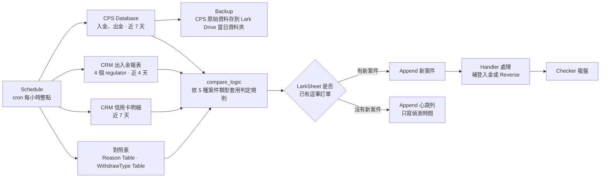
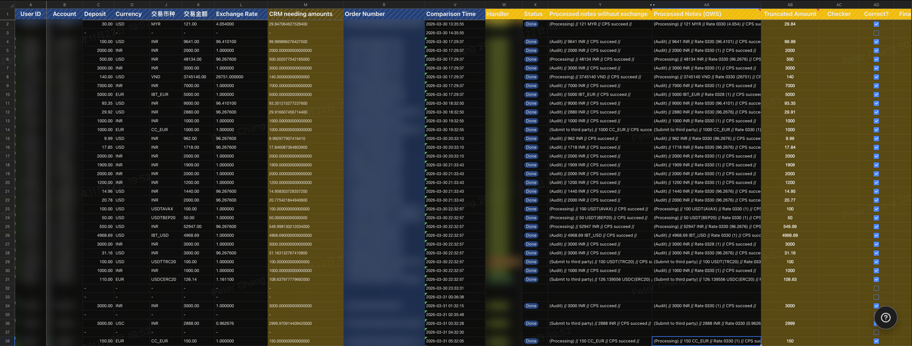
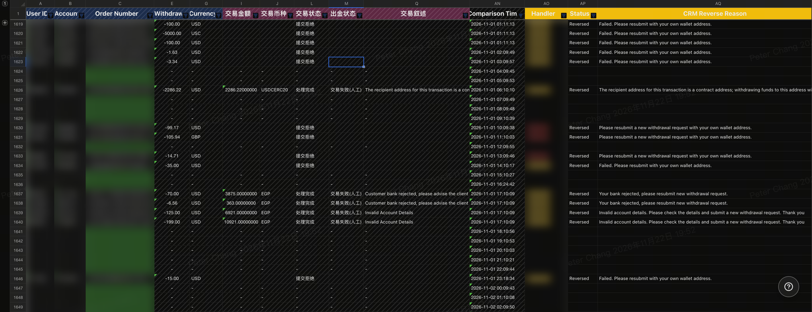
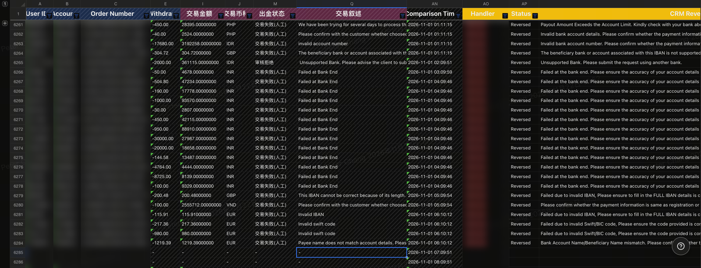
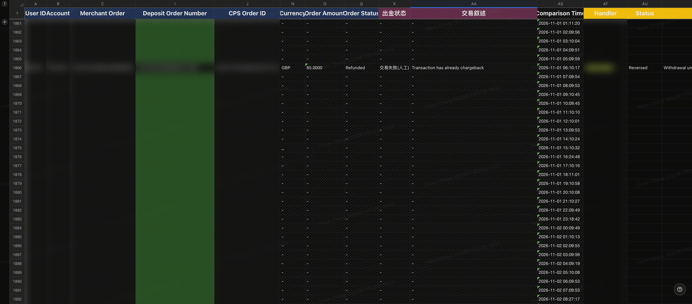
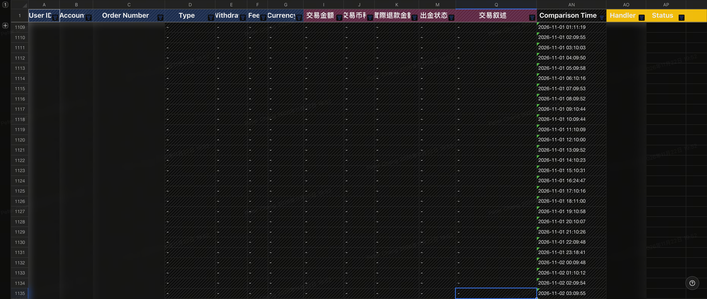

## Problem Assessment

<hr data-slide="背景與名詞">

- 客戶入金、出金時，訂單會經過兩個系統：**CPS** 對接各國渠道、實際收付款，**CRM** 記錄客戶帳戶與交易狀態。
- CPS 的結果要回寫到 CRM。當渠道回呼 CPS 失敗（例如上游系統異常），營運會手動更新 CPS 的狀態，但**手動更新不會回寫 CRM**，就形成**掉單**：入金 CPS 已成功、CRM 仍停在審核或處理中，客戶付了錢卻沒入帳；出金 CRM 顯示完成、CPS 實際失敗，錢沒出去也沒退回。
- 掉單落在後置流程，往往是客戶先發現，再透過 CS、Sales、Finance 來詢問。

<details class="glossary-details">
<summary>名詞說明<span class="mono">14 個名詞 · 點擊展開</span></summary>
<table>
<thead><tr><th>名詞</th><th>說明</th></tr></thead>
<tbody>
<tr><td>入金／出金（Deposit／Withdrawal）</td><td>客戶存入／提領資金</td></tr>
<tr><td>CRM</td><td>內部管理客戶帳戶與交易紀錄的系統，客戶與營運看到的訂單狀態以這裡為準</td></tr>
<tr><td>CPS</td><td>內部支付系統，對接各國銀行與支付渠道，實際執行收款與付款</td></tr>
<tr><td>渠道（Channel）</td><td>實際處理款項的外部通道，例如各國銀行轉帳、QR、電子錢包、加密貨幣、信用卡</td></tr>
<tr><td>回呼（Callback）</td><td>渠道處理完款項後，把結果通知 CPS</td></tr>
<tr><td>掉單</td><td>CRM 與 CPS 對同一筆訂單的狀態不一致，且沒有自動同步回來</td></tr>
<tr><td>LBT</td><td>Local Bank Transfer，本地銀行轉帳出金</td></tr>
<tr><td>IBT</td><td>International Bank Transfer，國際電匯出金</td></tr>
<tr><td>Crypto & e-Wallet</td><td>加密貨幣與電子錢包出金</td></tr>
<tr><td>CreditCard 出金</td><td>信用卡充值（Recharge）的客戶出金時，款項以退款（Refunded）退回原卡</td></tr>
<tr><td>原入原出</td><td>信用卡出金須退回充值時使用的原卡，並對應原本的充值訂單</td></tr>
<tr><td>Reverse</td><td>出金失敗時，在 CRM 把已扣除的金額退回客戶帳戶</td></tr>
<tr><td>Handler／Checker</td><td>Handler 依案件到 CRM 補登入金或 Reverse；Checker 是營運人員的事後複盤</td></tr>
<tr><td>心跳列（Heartbeat Row）</td><td>該次執行沒有新案件時，只寫入偵測時間的一列，用來證明管線有正常執行</td></tr>
</tbody>
</table>
</details>

<hr data-slide="一筆訂單的旅程">

錢有沒有真的動，只有 CPS 知道；客戶看到的卻是 CRM。所以每筆訂單在 CPS 處理完之後，結果都要**回寫**到 CRM。以兩筆印度的實際訂單為例：入金 9,301 INR 走 UPI，出金 55,704 INR 走本地銀行轉帳。

正常情況下，渠道處理完會**回呼** CPS，CPS 再回寫 CRM。問題出在回呼失敗的時候：營運會手動把 CPS 改成「交易成功(人工)」或「交易失敗(人工)」，但手動修改不會回寫 CRM，兩邊就停在不同的狀態：

<figure class="split-figure">
<div class="split-scroll">
<svg viewBox="0 0 760 310" role="img" aria-labelledby="jr-title"><title id="jr-title">一筆訂單的旅程：入金與出金的結果都要從 CPS 回寫 CRM，渠道回呼失敗後的人工修改不會回寫</title><defs><marker id="jr-arrow" viewBox="0 0 8 8" refX="7" refY="4" markerWidth="8" markerHeight="8" orient="auto"><path class="sf-head" d="M0,0 L8,4 L0,8 z"/></marker></defs><g data-b="lanes"><text class="sf-s" x="95" y="22">CRM（客戶看到的狀態）</text><text class="sf-s" x="410" y="22">CPS（實際收付）</text><text class="sf-s" x="665" y="22">渠道</text><text class="sf-h sf-start" x="20" y="50">入金 · 9,301 INR · UPI</text><rect class="sf-node" x="20" y="60" width="150" height="48" rx="6"/><text class="sf-t" x="95" y="89">CRM</text><rect class="sf-node" x="335" y="60" width="150" height="48" rx="6"/><text class="sf-t" x="410" y="89">CPS</text><rect class="sf-node" x="590" y="60" width="150" height="48" rx="6"/><text class="sf-t" x="665" y="89">UPI</text><line class="sf-sep" x1="20" y1="166" x2="740" y2="166"/><text class="sf-h sf-start" x="20" y="194">出金 · 55,704 INR · 本地銀行轉帳</text><rect class="sf-node" x="20" y="204" width="150" height="48" rx="6"/><text class="sf-t" x="95" y="233">CRM</text><rect class="sf-node" x="335" y="204" width="150" height="48" rx="6"/><text class="sf-t" x="410" y="233">CPS</text><rect class="sf-node" x="590" y="204" width="150" height="48" rx="6"/><text class="sf-t" x="665" y="233">本地銀行</text></g><g data-b="d-flow"><path class="sf-line" d="M590 84 H491" marker-end="url(#jr-arrow)"/><path class="sf-line" d="M335 84 H176" marker-end="url(#jr-arrow)"/><text class="sf-s" x="540" y="77">回呼</text><text class="sf-s" x="255" y="77">回寫</text><text class="sf-s" x="665" y="128">已收到款項</text></g><g data-b="d-cb"><text class="sf-miss" x="540" y="102">✕ 回呼失敗</text></g><g data-b="d-manual"><text class="sf-s" x="410" y="128">營運手動改成</text><text class="sf-link" x="410" y="146">交易成功(人工)</text></g><g data-b="d-stuck"><text class="sf-miss" x="255" y="102">✕ 沒有回寫</text><text class="sf-miss" x="95" y="128">仍停在 Audit</text><text class="sf-bad-t sf-small" x="95" y="146">付了錢卻沒入帳</text></g><g data-b="w-flow"><path class="sf-line" d="M170 220 H329" marker-end="url(#jr-arrow)"/><path class="sf-line" d="M485 220 H584" marker-end="url(#jr-arrow)"/><path class="sf-line" d="M590 240 H491" marker-end="url(#jr-arrow)"/><path class="sf-line" d="M335 240 H176" marker-end="url(#jr-arrow)"/><text class="sf-s" x="255" y="214">出金指令</text><text class="sf-s" x="540" y="214">付款</text><text class="sf-s" x="540" y="256">回呼</text><text class="sf-s" x="255" y="256">回寫</text><text class="sf-s" x="95" y="276">Completed（已扣款）</text><text class="sf-s" x="665" y="276">轉帳失敗</text></g><g data-b="w-cb"><text class="sf-miss" x="540" y="274">✕ 回呼失敗</text></g><g data-b="w-manual"><text class="sf-s" x="410" y="276">營運手動改成</text><text class="sf-link" x="410" y="294">交易失敗(人工)</text></g><g data-b="w-stuck"><text class="sf-miss" x="255" y="274">✕ 沒有回寫</text><text class="sf-bad-t sf-small" x="95" y="294">錢沒出去，也沒退回</text></g></svg>
</div>
<figcaption>圖 1　一筆訂單的旅程：渠道回呼 CPS 失敗時，營運手動改 CPS 狀態，但手動修改不會回寫 CRM，於是形成掉單（兩筆皆為本頁公開 CSV 的實際案件）</figcaption>
</figure>

<hr data-slide="掉單判定規則">

掉單發生時，CRM 與 CPS 各自看起來都正常，只有把同一筆訂單在兩邊的狀態放在一起看，才看得出不一致。因此要解決的不是「查得不夠快」，而是**沒有機制持續核對 CRM 與 CPS 上同一筆訂單的狀態**。

我先和營運端逐條對齊「什麼狀態組合算掉單」，再把規則寫成程式。下表是五種案件類型的判定規則：

| 案件類型 | CRM 狀態 | CPS 狀態 | 代表的情況 | 處理動作 |
|---|---|---|---|---|
| Deposit | 尚未成功（Audit、Submit to third party、Processing 等） | 交易成功、交易成功(人工) | 客戶已付款，CRM 未入帳 | Handler 到 CRM 補登入金 |
| Withdraw-LBT／Crypto&Wallet／IBT | Apply Status 為 Completed | 交易狀態或出金狀態為失敗、拒絕 | CRM 已扣款，渠道實際沒有出金 | Handler 到 CRM Reverse，依失敗原因回覆客戶 |
| Withdraw-CreditCard | Success 或 Partial Success，且 Order Status 為 Refunded | 出金失敗 | CRM 已記退款，CPS 實際沒有退回原卡 | 同上 |

<hr data-slide="對照範例">

五種案件類型各舉一筆實際案件，對照 CRM 與 CPS 的狀態；前兩列就是圖 1 的兩筆訂單：

| 案件類型 | CRM 狀態 | CPS 交易／出金狀態 | 金額 | 處理 |
|---|---|---|---|---|
| Deposit | Audit | 交易成功(人工) | 9,301 INR | 補登入金（done） |
| Withdraw-LBT | Completed | 處理完成／交易失敗(人工) | 55,704 INR | Reverse（reversed） |
| Withdraw-Crypto&Wallet | Completed | 提交拒絕 | （空白） | Reverse（reversed） |
| Withdraw-CreditCard | Success | 處理完成／交易失敗(人工) | 50 EUR | Reverse（reversed） |
| Withdraw-IBT | Completed | 審核拒絕／審核拒絕 | 461.82 USD | Reverse（reversed） |

*取自本頁公開 CSV 的實際案件（2026/04 與 2026/09；CSV 保留來源系統的簡體字）。Crypto&Wallet 這筆在來源資料中沒有金額；幣別去掉 CC_、IBT_ 前綴。*

- **Deposit**：營運已把 CPS 手動改成交易成功，CRM 仍停在 Audit，客戶付了錢卻沒入帳。
- **出金四類**：CRM 已顯示完成或成功，CPS 實際失敗或被拒絕，錢沒出去也沒退回，由 Handler 到 CRM Reverse。

<hr data-slide="痛點與證據">

<figure class="pain-figure">
<div class="pain-grid">
<section class="pain-card tone-red pain-wide">
<h4 class="pain-title">掉單後置發現，客戶先等</h4>
<p class="pain-label"><span>Pain</span>發現時已經太遲，只能事後補救</p>
<ul class="pain-note">
<li>人工每日只能各抽查 Deposit、Withdrawal 約 2 次，兩次之間發生的掉單要等下一輪才看得到。</li>
<li>CS、Finance 詢問資金狀態時，回應速度跟不上，增加等待與來回確認。</li>
</ul>
<div class="pain-evidence">
<p class="pain-evidence-title">一次人工抽查的耗時（估計）</p>
<div class="pain-timebar">
<span class="seg-platform" style="flex: 33">下載 CRM、CPS 兩份報表　約 30–35 分</span>
<span class="seg-excel" style="flex: 27">Excel 運算、整理與搬移</span>
</div>
<p class="pain-caption">合計每次約 <b>1 小時</b>；Deposit、Withdrawal 每日各抽查 2 次。</p>
</div>
</section>
<section class="pain-card tone-grey">
<h4 class="pain-title">排查要逐層定位</h4>
<p class="pain-label"><span>Pain</span>卡點出現後仍要人工層層追</p>
<ul class="pain-note">
<li>一筆訂單要分別在 CRM 與 CPS 查狀態，再判斷卡在哪個渠道、什麼原因。</li>
<li>渠道多、類型雜，比對規則不容易靠人記住。</li>
</ul>
<div class="pain-evidence">
<p class="pain-evidence-title">證據：要比對的範圍</p>
<ul class="pain-flow">
<li>資料期間內的掉單涵蓋 <b>181 種渠道類型</b>、<b>136 個國家</b>、<b>64 種幣別</b>。</li>
<li>出金分成 LBT、Crypto & e-Wallet、CreditCard、IBT 四大類，各自的失敗狀態不同。</li>
<li>出金失敗原因有 6 大類、33 種子類別（見 Result）。</li>
</ul>
</div>
</section>
<section class="pain-card tone-yellow">
<h4 class="pain-title">人力難以釋放</h4>
<p class="pain-label"><span>Pain</span>依賴熟悉完整架構的人</p>
<ul class="pain-note">
<li>判斷掉單要同時懂 CRM 狀態、CPS 狀態與渠道特性。</li>
<li>人員請假、交接或疏漏時，監控就出現空窗。</li>
</ul>
<div class="pain-evidence">
<p class="pain-evidence-title">證據：人工監控的成本是固定的</p>
<ul class="pain-flow">
<li>每次抽查約 1 小時，頻率提高幾倍，人力就要增加幾倍。</li>
<li>要做到每小時檢查一次，在人力上不可行。</li>
</ul>
</div>
</section>
</div>
<figcaption>圖 2　原流程的三個痛點（工時為估計值；比對範圍取自本頁公開 CSV）</figcaption>
</figure>

<hr data-slide="值得投入的理由">

**值得投入解決的理由：**

1. **掉單是日常，不是偶發**：Deposit 上線後的 233 天中有 220 天出現掉單；Withdrawal 的 70 天中有 67 天。
2. **上游故障時會瞬間爆量**：2026/11/6 上游系統異常，客戶大量卡單（圖 3）。10 點與 11 點兩次執行就揭露 933 筆入金掉單，涵蓋 85 種渠道、61 個國家；每日 2 次的人工抽查無法及時看到這種規模。
3. **人工成本無法隨頻率擴充**：每次抽查約 1 小時（圖 2），頻率提高幾倍，人力就要增加幾倍。

<figure class="bar-figure">
<ul class="bar-list">
<li class="is-peak" style="--v: 100%"><span class="bar-label">11/6 11:00 執行</span><span class="bar"></span><span class="bar-value">483</span></li>
<li class="is-peak" style="--v: 93%"><span class="bar-label">11/6 10:00 執行</span><span class="bar"></span><span class="bar-value">450</span></li>
<li style="--v: 16%"><span class="bar-label">其他日子單次執行最多</span><span class="bar"></span><span class="bar-value">75</span></li>
<li style="--v: 4%"><span class="bar-label">11/6 其餘 22 次執行合計</span><span class="bar"></span><span class="bar-value">18</span></li>
</ul>
<figcaption>圖 3　2026/11/6 上游故障時，單次執行揭露的入金掉單筆數（取自本頁公開 CSV）</figcaption>
</figure>

## Solution Design

<hr data-slide="痛點與解決方向">

**痛點 → 解決方向**（對應圖 4 的架構）：

- **掉單後置發現** → 排程每小時自動比對，新掉單在下一次整點執行就會出現。
- **排查要逐層定位** → 一次取齊 CRM 報表、CPS 資料與信用卡明細，依掉單判定規則（見 Problem）判定；出金案件自動帶出原因類別與狀態軌跡。
- **依賴熟悉架構的人** → 判定規則寫進程式，案件寫入 LarkSheet；Handler 只處理已判定的案件。
- **監控中斷沒人知道** → 沒有新案件時也寫入心跳列，區分「沒有掉單」和「管線沒跑」。

**設計時必須面對的限制：**

- CRM 沒有開放資料庫權限，只能用營運帳號登入（含 2FA）下載報表，且報表要先觸發產生、再下載。
- 4 個監管主體（regulator）的報表分開產生，要各自下載再合併。
- CRM 與 CPS 有時間差與時區差，訂單狀態也會在數天內持續變動，所以 CRM 出入金報表回看 4 天、信用卡明細與 CPS 回看 7 天。
- 同一筆掉單在處理完之前，每小時都會被比對出來，必須去重，否則同一筆會被重複派工。

## Alternative Solutions

當時評估過四個方案，前三個為替代方案：

| 方案 | 做法 | 優點 | 缺點 |
|---|---|---|---|
| A. 直接查 CRM 資料庫 | 以 SQL 直接查詢 CRM 的訂單狀態 | 資料最即時、最完整 | 沒有 CRM 資料庫權限，申請時程無法掌握 |
| B. 請 CPS 加上主動通知 | 由 CPS 在訂單狀態異常時主動推送 | 從源頭通知，延遲最短 | 需要 CPS 端排入開發，時程與規格不在我們手上 |
| C. 共同表單通知 | 透過跨部門的共同表單回報與追蹤掉單 | 不需開發 | Owner 不是我們，欄位與流程難以控管 |
| **D. 跨系統掉單管線（採用）** | 每小時自動下載 CRM 報表、查詢 CPS 資料，依規則判定後寫入 LarkSheet | 不必等其他團隊；規則、輸出欄位與去重都由我們掌握 | CRM 報表下載要處理 2FA 與非同步產生；上游格式變動時要跟著調整 |

## Selected Solution

<hr data-slide="選擇理由">

**選擇 D：跨系統掉單管線**

1. **不需要新權限**：A 卡在 CRM 資料庫權限。CRM 報表本來就是營運每天在下載的，改成程式下載即可；CPS 端已有資料庫讀取權限，直接查詢。
2. **不必等待外部團隊**：B 的時程不可控，D 可以先上線；未來若 CPS 提供主動通知，只需要替換擷取層。
3. **輸出由我們控管**：C 的 owner 不是我們。D 的案件寫入我們維護的 LarkSheet，欄位、去重規則與處理狀態都由我們定義，Handler 與 Checker 直接在上面作業。
4. **分階段降低風險**：第一階段先讓掉單「被看見、被派工」；運行穩定約 3–6 個月後，第二階段才做自動點擊，讓人員免除到 CRM 手動處理的負擔。

<hr data-slide="系統架構">

每小時一次的完整流程：



*圖 4　出入金掉單監控管線（依專案程式碼整理）*

<hr data-slide="設計重點">

**設計重點：**

- **去重**：以 Order Number 為 Unique Key（信用卡為 Merchant Order + Deposit Order Number），每次先查 LarkSheet 已有的訂單，只追加新案件，同一筆掉單只派工一次。
- **還在回寫中的訂單**：判定前沒有設等待時間，剛成功、尚未回寫的訂單也可能被標出，由 Handler 確認後略過。
- **心跳列**：某類案件沒有新掉單時，仍寫入一列只有偵測時間的紀錄。表上「沒有新案件」和「管線停了」因此可以區分。
- **狀態軌跡與原因**：出金案件把 CRM 與 CPS 的狀態串成一條 Status Workflow（例如 `Risk Audit -> Accepted -> Completed -> 處理完成 -> 交易失敗(人工)`），並由 Reason Table 帶出原因類別與子類別，Handler 不必再開兩個後台對照，可以直接依原因回覆客戶。
- **可追溯**：每次執行產生一個 `uid`，JSON log 帶 `service`、`stage`、`status`；CPS 原始資料每次備份到 Lark Drive，事後可以查核當時比對的資料。
- **權限範圍**：CRM 使用營運的既有帳號（含 2FA），只下載報表、不寫入；CPS 只執行 SELECT 查詢；Lark 透過自建 App 寫入案件表與備份資料夾。CRM 與 CPS 的帳密從唯讀掛載的設定檔讀取，不寫在程式碼中。TODO：補充帳號使用的核准者。

## Result

<hr data-slide="操作畫面">

### 操作畫面：LarkSheet 案件表

每種案件類型一個工作表。Handler 處理完在 `Status` 標 Done（已補登）或 Reversed（已退回），出金並附上回覆客戶的原因；沒有新案件的時段，每小時仍留下一列只有偵測時間的心跳列：

<figure class="shot-gallery">
<div class="shot-strip">
<div class="shot-item">
<p class="shot-label"><span class="mono">1 / 5</span>Deposit：Handler 補登入金後標 Done</p>



</div>
<div class="shot-item">
<p class="shot-label"><span class="mono">2 / 5</span>Withdraw - Crypto&Wallet：Reverse 後標 Reversed，並寫明回覆客戶的原因</p>



</div>
<div class="shot-item">
<p class="shot-label"><span class="mono">3 / 5</span>Withdraw - LBT：同一小時揭露多筆，逐筆 Reverse</p>



</div>
<div class="shot-item">
<p class="shot-label"><span class="mono">4 / 5</span>Withdraw - CreditCard：一筆案件夾在心跳列之間</p>



</div>
<div class="shot-item">
<p class="shot-label"><span class="mono">5 / 5</span>Withdraw - IBT：沒有新案件時，每小時仍寫一列心跳</p>



</div>
</div>
<figcaption>圖 5　LarkSheet 案件表實際畫面（左右滑動看 5 個工作表；已裁掉瀏覽器與文件路徑，客戶 ID、帳號、訂單編號與 Handler 姓名已模糊；點擊圖片可放大）</figcaption>
</figure>

<hr data-slide="一次實際執行">

### 一次實際執行的紀錄

- 以下是 2026-11-18 03:00 那次執行的 log 節錄，原始格式為 JSON，這裡只保留時間、stage 與訊息。
- 重複的下載紀錄已省略；CRM 的內部系統名稱改為 `CRM`，工作表 ID、檔名前綴與網址已移除。

```text
03:00:02  Lark Init and Connect     Lark Access Token acquired
03:00:06  Download DataSource       Successfully connected to CPS database.
03:00:27  Download DataSource       Deposit query finished, rows=195438.
03:06:13  Download DataSource       CPS report downloaded successfully. deposit_rows=195438, withdraw_rows=1037
03:06:15  Download DataSource       Login successful
03:06:15  Download DataSource       Token obtained successfully
03:07:55  Download DataSource       Finish downloading CRM DW Report for all brands, total rows: 322159
   ...    (CRM 信用卡明細，3 個 regulator × 近 7 天)
03:10:43  Download DataSource       共取得 7078 筆 Records                      <- Reason Table
03:10:52  Upload Failed DataSource  Upload success (file_name=<cps_withdraw_failed_cc>.csv)
03:10:55  Compare Existing Data - Deposit                 Total unique keys in LarkSheet: 6492, Total new mismatch cases to upload: 1
03:10:57  Compare Existing Data - Withdraw_CryptoWallet   Total unique keys in LarkSheet: 1080, Total new mismatch cases to upload: 1
03:11:00  Compare Existing Data - Withdraw_LBT            Total unique keys in LarkSheet: 7717, Total new mismatch cases to upload: 10
03:11:01  Compare Existing Data - Withdraw_IBT            Total unique keys in LarkSheet: 47, Total new mismatch cases to upload: 0
03:11:02  Upload Detection Time - Withdraw_IBT            Append success (total_rows=1)
03:11:02  Compare Existing Data - Withdraw_CreditCard     Total unique keys in LarkSheet: 1028, Total new mismatch cases to upload: 0
03:11:03  Upload Detection Time - Withdraw_CreditCard     Append success (total_rows=1)
03:11:03  LarkSheet Upload Complete Upload total data to LarkSheet Finish
```

從這段紀錄可以看到：

- **一次完整執行約 11 分鐘**，其中約 6 分鐘花在 CPS 出金查詢，CRM 報表下載約 4 分半。
- 五種案件類型各自先查 LarkSheet 已有的訂單，只寫入新案件：這次 Deposit 1 筆、Crypto&Wallet 1 筆、LBT 10 筆。
- IBT 與 CreditCard 沒有新案件，各寫入一列心跳列，而不是什麼都不寫。

<figure class="tech-figure">
<div class="tech-labels">
<div class="tech-label">
<p class="tech-label-kicker">Tech Label</p>
<p class="tech-label-name">Hourly Cross-System Reconciliation</p>
<p class="tech-label-desc">每小時整合 CRM 報表與 CPS 資料，依案件類型套用掉單判定規則。</p>
</div>
<div class="tech-label">
<p class="tech-label-kicker">Tech Label</p>
<p class="tech-label-name">Case Ledger with Heartbeat</p>
<p class="tech-label-desc">去重後只追加新案件；沒有案件時寫入心跳列，證明監控沒有中斷。</p>
</div>
<div class="tech-label">
<p class="tech-label-kicker">Tech Label</p>
<p class="tech-label-name">JSON Logging Design</p>
<p class="tech-label-desc">每次執行一個 uid，每個階段皆有 structured log。</p>
</div>
</div>
</figure>

<hr data-slide="輸出格式">

### 輸出格式

案件寫入 LarkSheet，每種案件類型一個工作表。以下取自 2026/11 的實際案件與一列心跳列，已去除客戶 ID、帳號、訂單編號與人員姓名；表中只列判定用的狀態與處理結果，偵測時間、渠道與金額見下方公開 CSV（CSV 保留來源系統的簡體字）：

| Case Type | CRM Status | CPS 狀態（交易／出金） | 原因（類別／子類別） | 處理狀態 |
|---|---|---|---|---|
| Deposit | Processing | 交易成功 | — | done |
| Withdraw-LBT | Completed | 處理完成／交易失敗(人工) | 渠道問題／限額問題 | reversed |
| Withdraw-CreditCard | Success | 處理完成／交易失敗(人工) | 客戶問題／銀行端交易失敗 | reversed |
| Withdraw-IBT | Completed | 處理完成／交易失敗(人工) | 客戶問題／SWIFT 錯誤 | reversed |
| Withdraw-IBT | - | - | 只有偵測時間 2026-11-17 23:11:40 | |

- 最後一列是心跳列：該次執行沒有新案件，只留下偵測時間。
- `處理狀態` 由 Handler 填寫：入金為 done（已補登），出金為 reversed（已退回）。

<hr data-slide="失敗原因">

### 出金失敗原因

出金案件由 Reason Table 帶出原因類別，Handler 依原因回覆客戶。四類出金合計 8,898 件：

<figure class="bar-figure">
<ul class="bar-list">
<li class="is-peak" style="--v: 100%"><span class="bar-label">客戶問題</span><span class="bar"></span><span class="bar-value">6,649</span></li>
<li style="--v: 10.1%"><span class="bar-label">渠道問題</span><span class="bar"></span><span class="bar-value">669</span></li>
<li style="--v: 1.5%"><span class="bar-label">商戶問題</span><span class="bar"></span><span class="bar-value">102</span></li>
<li style="--v: 0.4%"><span class="bar-label">銀行問題</span><span class="bar"></span><span class="bar-value">27</span></li>
<li style="--v: 0.1%"><span class="bar-label">CPS 問題、內部疏失</span><span class="bar"></span><span class="bar-value">7</span></li>
<li style="--v: 21.7%"><span class="bar-label">未分類（原因欄位空白）</span><span class="bar"></span><span class="bar-value">1,444</span></li>
</ul>
<figcaption>圖 6　出金失敗原因類別（Withdrawal 2026-09-09 ~ 11-17，取自本頁公開 CSV）</figcaption>
</figure>

- **客戶問題**的子類別以銀行端交易失敗、帳號錯誤、無效帳戶、姓名錯誤為主。
- **渠道問題**的子類別以渠道維護、系統異常、合規/風控問題為主。

<hr data-slide="執行統計">

### 執行統計（Deposit 2026-03-30 ~ 11-17；Withdrawal 2026-09-09 ~ 11-17）

資料來源：管線寫入 LarkSheet 的完整紀錄（公開 CSV）。「案件」指 Tx 不是 `-` 的列；信用卡出金依原入原出，一張出金單可能對應多筆原充值單，以「出金單 × 原充值單」計為一件，與管線的去重單位相同。「執行次數」指不重複的 Comparison Time。

| 案件類型 | 案件 | 日均 | 執行次數 | 有新案件的執行 | 處理狀態 |
|---|---|---|---|---|---|
| Deposit | 6,495 | 27.9 | 4,808 | 2,585 | done 5,540、未標記 942、其他 13 |
| Withdraw-LBT | 6,833 | 97.6 | 1,466 | 1,055 | 全部 reversed |
| Withdraw-Crypto&Wallet | 992 | 14.2 | 1,466 | 552 | 全部 reversed |
| Withdraw-CreditCard | 1,027（出金單 590 張） | 14.9 | 1,436 | 93 | 全部 reversed |
| Withdraw-IBT | 46 | 0.7 | 1,466 | 43 | 全部 reversed |
| **合計** | **15,393** | | | | |

- **執行間隔**：中位數 1.00 小時、P90 1.03 小時。
- **未標記的 942 筆**中，930 筆是 11/6 上游故障當天揭露的入金案件。

<details class="csv-details">
<summary>完整資料（已去識別化）<span class="mono">21,707 列 · 點擊展開</span></summary>
<div class="csv-viewer" data-src="../../data/drop-order-cases-2026.csv">
<p><a href="../../data/drop-order-cases-2026.csv" download>下載去識別化 CSV（Deposit 2026-03-30 ~ 11-17、Withdrawal 2026-09-09 ~ 11-17，21,707 列，含心跳列）</a></p>
</div>
</details>

## Impact

<hr data-slide="已驗證的成果">

### 已驗證的成果

<figure class="ba-figure">
<div class="ba-table">
<div class="ba-row ba-head"><p class="ba-item">項目</p><p class="ba-before">Before：人工抽查</p><p class="ba-after">After：掉單監控管線</p></div>
<div class="ba-row"><p class="ba-item">監控頻率</p><p class="ba-before">Deposit、Withdrawal 各每日 2 次；等下一輪抽查或客戶詢問才發現</p><p class="ba-after">排程每小時 1 次，新掉單在下一次整點寫入 LarkSheet；實際平均每日 20.6 次（Deposit）、20.9 次（Withdrawal）<small>依據：執行次數 ÷ 天數（Deposit 233 天、Withdrawal 70 天），執行次數與間隔見 Result</small></p></div>
<div class="ba-row"><p class="ba-item">人力</p><p class="ba-before">Deposit、Withdrawal 各每日約 2 小時</p><p class="ba-after">取數與比對 0 人工；Handler 只處理已判定的案件<small>依據：每次約 1 小時 × 每日 2 次（見 Problem）；至 11/17 約節省 606 小時（Deposit 233 天 × 2 小時 = 466、Withdrawal 70 天 × 2 小時 = 140），估計值</small></p></div>
<div class="ba-row"><p class="ba-item">比對範圍</p><p class="ba-before">人工 Excel 比對，筆數未紀錄</p><p class="ba-after">每次比對 CPS 入金約 19.5 萬筆、CRM 出入金約 32.2 萬筆<small>依據：Result 的執行 log</small></p></div>
<div class="ba-row"><p class="ba-item">監控連續性</p><p class="ba-before">依賴人工排班，請假、交接時有空窗</p><p class="ba-after">每次執行都留下紀錄：有新案件寫案件，沒有就寫心跳列，共 6,314 列心跳<small>依據：公開 CSV 中 Tx 為 - 的列</small></p></div>
</div>
<figcaption>圖 7　Before / After 對照（人工工時為估計值）</figcaption>
</figure>

<hr data-slide="尚未量化">

### 尚未量化或需要說明的部分

- **進線量**：目標是降低 CS、Sales、Finance 因資金狀態不明而產生的查詢與追單；目前沒有導入前後的進線統計，尚未量化。
- **溝通次數降低 ≥ 50%、渠道定位 ≤ 1 小時**：是設計目標，目前沒有量測資料。
- **揭露時間的意思**：1 小時是排程的檢查顆粒。從掉單發生到揭露，還取決於 CRM 與 CPS 資料何時可以取得，不是端到端的保證。
- **執行次數少於每日 24 次**：上表的實際平均低於排程上限，原因是部分整點沒有執行紀錄。
- **工時是估計**：人工每次約 1 小時是估算值，不是計時紀錄（見 Problem 的耗時長條）；起算日為各自的上線日。
- **處理仍靠人**：第一階段只做到「看見並派工」，補登入金與 Reverse 仍由 Handler 在 CRM 手動操作。第二階段在運行穩定約 3–6 個月後，規劃以自動點擊取代這段人工操作。
