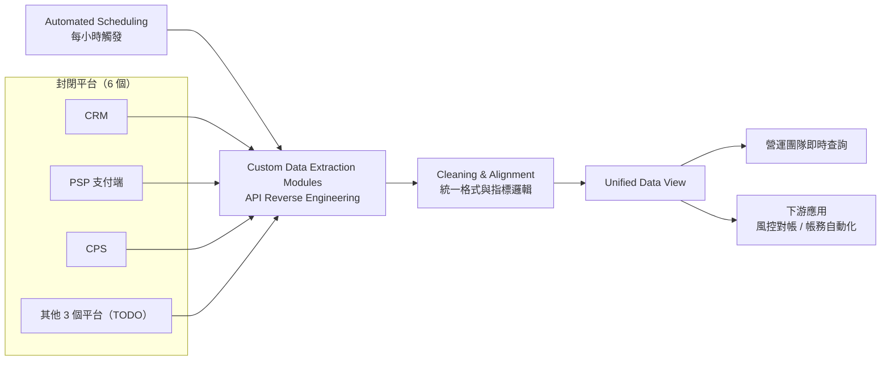

## Project Overview

營運資料散落在多個封閉平台（CRM、PSP、CPS 等），公司內部沒有可以直接查詢的資料庫。這個專案從 0 開始建立營運資料底層，後續的[信用卡異常出金偵測](../credit-card-anomaly-detection/)與[營運帳務自動化引擎](../account-automation-engine/)都建立在這層之上。

## Business Problem

- 沒有 DB 權限、沒有可用的 DB 資料源、沒有標準化 API 文件。
- 資料分散在多個封閉平台，形成資料孤島（Data Silos）。
- 營運人員查一筆資料需要切換 10+ 個頁面人工查找（以 CRM 平台為例）。
- 各系統欄位與格式不一致，各部門產出的報表數字無法對齊。

## Technical Challenges

1. **沒有官方介面**：資料只能透過平台的 Web 介面取得，必須自行分析其背後的 API 才能程式化擷取。
2. **異質資料源**：6 個平台的資料結構、欄位命名與指標定義各不相同。
3. **資料即時性**：營運決策需要接近即時的資料，不能依賴人工定期匯出。

> TODO：補充逆向過程中實際遇到的技術難點（例如驗證機制、分頁、速率限制），目前來源文件未記載細節。

## My Contribution

- 主導營運資料底層從 0 到 1 的完整規劃。
- 以 API 逆向工程分析封閉平台，開發客製化資料擷取模組（Custom Data Extraction Modules）。
- 獨立設計 100% 自動化的資料攝入管線（Data Ingestion Pipeline），實作每小時增量同步。
- 制定跨平台資料清洗（Cleaning）與對齊（Alignment）規範，定義統一的資料格式與指標邏輯。

## Technical Stack

| 層級 | 技術 |
|---|---|
| Extraction | Python、API Reverse Engineering、Custom Data Extraction Modules |
| Orchestration | Automated Scheduling（每小時增量同步） |
| Transformation | Data Cleaning、Data Normalization、指標對齊 |
| Serving | Unified Data View |

> TODO：確認排程與儲存層實際使用的工具（職務標籤列有 Apache Airflow、Apache Superset，尚未確認是否用於本專案）。

## System Architecture

## Engineering Solution

1. **Reverse Engineering 取代等待權限**：不等 DB 權限或官方 API 開放，直接分析各平台介面，為每個平台建立獨立的擷取模組。
2. **ETL + 自動排程**：擷取、轉換、載入集中在同一條管線，以每小時增量同步取代人工調取。
3. **標準化先於應用**：先統一欄位格式與指標邏輯，再提供給下游使用，避免每個應用各自解讀原始資料。
4. **統一資料視圖**：營運人員不再切換多個平台，從單一視圖查詢。

## Business Impact

| 項目 | 建置前 | 建置後 |
|---|---|---|
| 資料來源 | 6 個封閉平台各自查詢 | 統一資料視圖 |
| 查詢方式 | 切換 10+ 個頁面人工查找 | 單一入口查詢 |
| 資料攝入 | 人工調取 | 100% 自動化、每小時增量同步 |
| 資料一致性 | 各部門報表數字有落差 | 統一格式與指標邏輯 |

這層基礎設施是後續兩個自動化專案的資料來源。

> TODO：補充可量化的查詢耗時前後對照（例如單次查詢分鐘數）。
