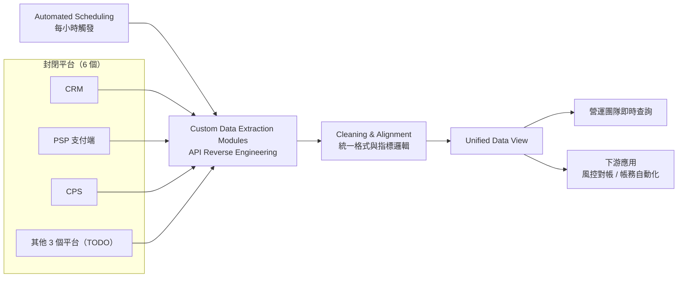

## Problem Assessment

- 營運資料散落在多個封閉平台（CRM、PSP、CPS 等），公司內部沒有可以直接查詢的資料庫。
- 這個專案從 0 開始建立營運資料底層，後續的[信用卡異常出金偵測](../credit-card-anomaly-detection/)與[營運帳務自動化引擎](../account-automation-engine/)都建立在這層之上。

名詞說明9 個名詞 · 點擊展開

<table>
<thead><tr><th>名詞</th><th>說明</th></tr></thead>
<tbody>
<tr><td>CRM</td><td>內部管理客戶與交易帳戶的系統</td></tr>
<tr><td>PSP</td><td>Payment Service Provider，外部支付服務商</td></tr>
<tr><td>CPS</td><td>內部渠道支付平台</td></tr>
<tr><td>DB 權限</td><td>直接查詢資料庫的權限</td></tr>
<tr><td>API 逆向工程</td><td>分析網頁背後呼叫的 API，改由程式直接取得資料</td></tr>
<tr><td>資料孤島（Data Silos）</td><td>資料分散在彼此不互通的系統</td></tr>
<tr><td>增量同步</td><td>每次只抓上次之後新增或變動的資料</td></tr>
<tr><td>ETL</td><td>Extract、Transform、Load：擷取、轉換、載入</td></tr>
<tr><td>統一資料視圖</td><td>多平台資料整理成同一格式後的集中查詢入口</td></tr>
</tbody>
</table>

<figure class="pain-figure">

<section class="pain-card tone-grey pain-wide">
<h4 class="pain-title">查一筆資料要切換多個頁面</h4>

Pain資料孤島，只能人工查找

<ul class="pain-note">
<li>資料分散在多個封閉平台，彼此不互通。</li>
<li>以 CRM 平台為例，查一筆資料需要切換 10 個以上的頁面。</li>
</ul>
</section>
<section class="pain-card tone-red">
<h4 class="pain-title">拿不到資料源</h4>

Pain沒有 DB 權限，也沒有 API 文件

<ul class="pain-note">
<li>沒有可用的 DB 資料源。</li>
<li>平台沒有標準化的 API 文件，資料只能從 Web 介面取得。</li>
</ul>
</section>
<section class="pain-card tone-yellow">
<h4 class="pain-title">報表數字對不齊</h4>

Pain欄位與指標定義各自為政

<ul class="pain-note">
<li>各系統的欄位命名與格式不一致。</li>
<li>各部門產出的報表數字無法對齊。</li>
</ul>
</section>

<figcaption>圖 1　原狀態的三個痛點（依履歷專案描述整理）</figcaption>
</figure>

**值得投入解決的理由：**

1. **影響所有營運查詢**：資料分散在 6 個平台，任何跨平台的問題都要人工拼湊。
2. **它是後續自動化的前提**：信用卡異常出金偵測與帳務自動化引擎，都需要穩定、格式一致的資料來源。

TODO：補充可以量化問題的數字（例如每日查詢次數、單次查詢耗時）。

## Solution Design

**痛點 → 解決方向**（對應圖 2 的架構）：

- **拿不到資料源** → 分析各平台 Web 介面背後的 API，為每個平台建立獨立的擷取模組。
- **查一筆資料要切換多個頁面** → 擷取後的資料集中到統一資料視圖，營運從單一入口查詢。
- **報表數字對不齊** → 先制定跨平台的清洗與對齊規範，統一欄位格式與指標邏輯，再提供給下游。
- **資料需要接近即時** → 排程每小時增量同步，取代人工定期匯出。

**設計時必須面對的限制：**

- 沒有官方介面：資料只能透過平台的 Web 介面取得。
- 異質資料源：6 個平台的資料結構、欄位命名與指標定義各不相同。
- 資料即時性：營運決策需要接近即時的資料，不能依賴人工定期匯出。
- TODO：補充逆向過程中實際遇到的技術難點（例如驗證機制、分頁、速率限制）。

## Alternative Solutions

| 方案 | 做法 | 優點 | 缺點 |
|---|---|---|---|
| A. 維持人工調取 | 需要時由營運各自到平台查詢、匯出 | 不需開發 | 要切換多個頁面；資料無法即時；各部門數字對不齊 |
| B. 等待 DB 權限或官方 API | 向系統負責單位申請正式資料介面 | 最穩定、有官方支援 | 取決於外部單位，時程無法掌握 |
| **C. API 逆向工程 + ETL（採用）** | 分析平台介面背後的 API，自建擷取模組與每小時同步管線 | 不必等待權限；資料格式由我們統一 | 平台介面變動時要跟著調整 |

> TODO：確認當時實際評估過的方案；目前 A、B 依原頁面「取代人工調取」「不等 DB 權限或官方 API 開放」整理。

## Selected Solution

**選擇 C：API 逆向工程 + ETL**

1. **取代等待權限**：不等 DB 權限或官方 API 開放（B），直接分析各平台介面，為每個平台建立獨立的擷取模組。
2. **取代人工調取**：擷取、轉換、載入集中在同一條管線，以每小時增量同步取代人工匯出（A）。
3. **標準化先於應用**：先統一欄位格式與指標邏輯，再提供給下游使用，避免每個應用各自解讀原始資料。

*圖 2　營運資料底層架構（依履歷專案描述整理）*

**設計重點：**

- **分層**：
  - Extraction：Python、API Reverse Engineering、Custom Data Extraction Modules。
  - Orchestration：Automated Scheduling，每小時增量同步。
  - Transformation：Data Cleaning、Data Normalization、指標對齊。
  - Serving：Unified Data View。
- **我負責的範圍**：主導從 0 到 1 的完整規劃；開發客製化擷取模組；獨立設計 100% 自動化的資料攝入管線；制定跨平台資料清洗與對齊規範。
- TODO：確認排程與儲存層實際使用的工具（職務標籤列有 Apache Airflow、Apache Superset，尚未確認是否用於本專案）。
- **權限範圍**：TODO：補充使用的帳號、讀寫範圍、核准者與帳密存放方式。

## Result

這層基礎設施目前作為兩個下游專案的資料來源：

- [信用卡異常出金偵測](../credit-card-anomaly-detection/)：每小時擷取 PSP 與 CRM 的信用卡報表進行對帳。
- [營運帳務自動化引擎](../account-automation-engine/)：跨 regulator 批量查詢 CRM 帳戶狀態。

<figure class="tech-figure">

Tech Label

Custom Extraction Modules

每個封閉平台一個擷取模組，以逆向分析的 API 取代人工操作介面。

Tech Label

Hourly Incremental Sync

每小時只同步新增或變動的資料，取代人工定期匯出。

</figure>

TODO：補充一次實際執行的 log、輸出格式範例與執行統計。

## Impact

### 已驗證的成果

<figure class="ba-figure">

項目

Before：建置前

After：建置後

資料來源

6 個封閉平台各自查詢

統一資料視圖<small>依據：履歷專案描述</small>

查詢方式

切換多個頁面人工查找（見 Problem）

單一入口查詢<small>依據：履歷專案描述</small>

資料攝入

人工調取

100% 自動化、每小時增量同步<small>依據：履歷專案描述</small>

資料一致性

各部門報表數字有落差

統一格式與指標邏輯<small>依據：履歷專案描述</small>

<figcaption>圖 3　Before / After 對照</figcaption>
</figure>

### 尚未量化或需要說明的部分

- **查詢耗時**：沒有建置前後單次查詢的耗時紀錄。TODO：補充可量化的前後對照。
- **平台清單**：6 個平台中目前只列出 CRM、PSP、CPS，其餘 3 個待補。
