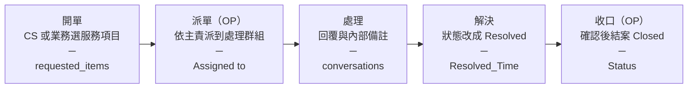
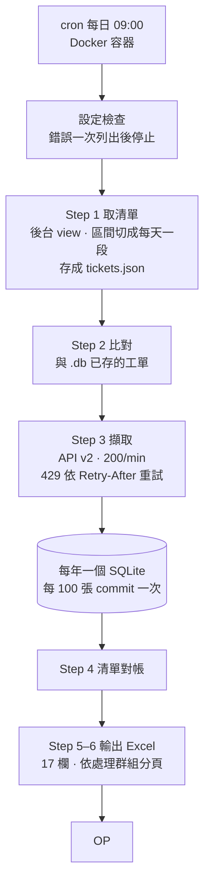
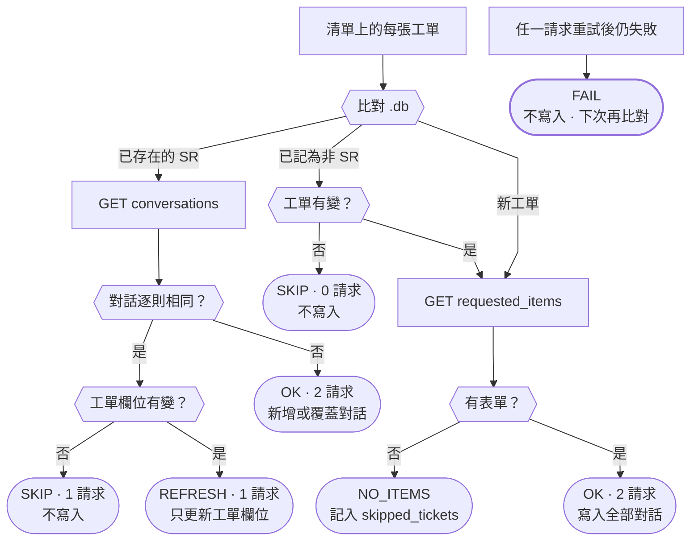

## Problem Assessment

<hr data-slide="背景與名詞">

- 營運相關的客戶問題都在 **Freshservice** 開成工單。**OP 是中樞**：依案件的主責把工單派給對應部門處理，最後再由 OP 收口結案。
- 派單規則記在營運的**人效項目清冊**：每個服務項目對到一個負責團隊與一個人效點數。清冊共 222 個服務項目、14 個負責團隊，其中 132 項由 OP 自行處理、79 項轉派給其他部門（Trading、Risk、Admin 等）。
- 中樞要看全貌，但工單資料過去得向其他非平行單位索取：曠日費時、維度經常錯置，來回溝通之後仍拼不出完整的現況，也就難以「看到就改善」。

一張工單從開到結的流程，以及每一步留下、被這個專案擷取的資料：



*圖 1　一張工單的一生。中間可能經過 Pending、Awaiting Approval 等狀態；每個方框最下面一行是對應的欄位或 API 物件。*

<details class="glossary-details">
<summary>名詞說明<span class="mono">15 個名詞 · 點擊展開</span></summary>
<table>
<thead><tr><th>名詞</th><th>說明</th></tr></thead>
<tbody>
<tr><td>Freshservice</td><td>Freshworks 公司的雲端工單系統（類似 Jira Service Management、Zendesk），公司內部用它開單、派單、回覆與結案。<a href="https://www.freshworks.com/freshservice/" target="_blank" rel="noopener">官網</a></td></tr>
<tr><td>OP</td><td>營運團隊，負責派工單給對應部門，並在最後收口結案</td></tr>
<tr><td>工單（Ticket）</td><td>一件案件的處理紀錄，包含狀態、處理群組與對話</td></tr>
<tr><td>Service Request（SR）</td><td>由服務目錄表單開立的工單，帶有表單欄位（例如帳號、金額）</td></tr>
<tr><td>服務項目（Service Item）</td><td>開單時選的案件類型，例如 W1. Withdrawal Status Check</td></tr>
<tr><td>負責團隊</td><td>人效項目清冊中，每個服務項目指定的主責團隊，例如 OP-DW、Risk Team</td></tr>
<tr><td>人效點數</td><td>人效項目清冊中，每個服務項目代表的工作量權重（2–8 點）</td></tr>
<tr><td>處理群組（Group）</td><td>工單目前指派的處理單位，例如 (OP)Withdrawal Team</td></tr>
<tr><td>Conversation</td><td>工單內的每一則回覆或內部備註</td></tr>
<tr><td>View</td><td>後台儲存好的工單篩選條件，例如「Q4 建立的工單」</td></tr>
<tr><td>Rate Limit／429</td><td>API 每分鐘可呼叫的次數上限；超過時回傳 HTTP 429，要求等待後再試</td></tr>
<tr><td>回補（Backfill）</td><td>一次把過去一段期間的資料補抓進資料庫</td></tr>
<tr><td>冪等（Idempotent）</td><td>同一份資料重跑多次，結果都一樣，不會產生重複</td></tr>
<tr><td>清單對帳</td><td>跑完後逐張確認：每張工單都已寫入、確認非 SR，或列在失敗清單</td></tr>
<tr><td>PoC</td><td>Proof of Concept，先用小範圍資料驗證做法可行</td></tr>
</tbody>
</table>
</details>

<hr data-slide="痛點">

<figure class="pain-figure">
<div class="pain-grid">
<section class="pain-card tone-red pain-wide">
<h4 class="pain-title">中樞看不到全貌</h4>
<p class="pain-label"><span>Pain</span>資料靠向其他單位索取，拼不出現況</p>
<ul class="pain-note">
<li>工單資料要向其他非平行單位索取，等待時間長。</li>
<li>拿到的資料維度經常錯置（欄位、期間、群組不一致），要再來回溝通確認。</li>
<li>OP 負責派單與收口，卻看不到各群組手上的完整現況，問題發生時難以即時改善。</li>
</ul>
<div class="pain-evidence">
<p class="pain-evidence-title">證據：索取的成本與要掌握的量</p>
<ul class="pain-flow">
<li>每次索取：等待 <mark>XX 天</mark>、來回 XX 次；每月約 XX 次，整理約 XX 小時／月（估計）。</li>
<li>2026/10 建立的工單：單月 <mark>47,530</mark> 張，平均每天 1,533 張。</li>
<li>平日中位數 <mark>1,874</mark> 張（1,534–2,513），週末中位數 590 張（418–769）。</li>
<li>分散在 OP 底下 16 個處理群組；依清冊還可能轉派到另外 11 個負責團隊。</li>
</ul>
</div>
</section>
<section class="pain-card tone-grey">
<h4 class="pain-title">公開 API 讀不到要的清單</h4>
<p class="pain-label"><span>Pain</span>OP 用的是後台 view，公開 API 不支援</p>
<ul class="pain-note">
<li>公開 API 不能讀後台自訂的 view，實測各種參數與路徑都回 400 或 404。</li>
<li>改用公開的篩選條件，整段條件上限 512 字，放不下 view 裡全部的群組條件。</li>
</ul>
</section>
<section class="pain-card tone-yellow">
<h4 class="pain-title">舊版程式塞爆共用額度</h4>
<p class="pain-label"><span>Pain</span>抓得快，但所有人一起被擋</p>
<ul class="pain-note">
<li>舊版不限速並行，被限速時不等待也不重試，失敗就跳過。</li>
<li>API 額度整個帳號共用，同事的其他整合一起被擋；中斷後也不能續跑（見下一張）。</li>
</ul>
</section>
</div>
<figcaption>圖 2　現況的三個痛點（索取成本為估計；工單量取自 2026 年的 .db）</figcaption>
</figure>

<hr data-slide="共用額度">

<figure class="quota-figure">
<ul class="quota-list" style="--limit-sub: 13.3%; --limit-total: 41.7%">
<li class="is-over" style="--v: 100%"><span class="quota-label">舊版：不限速並行（峰值，推算）</span><span class="quota-bar"></span><span class="quota-value">≈1,200</span></li>
<li style="--v: 16.7%"><span class="quota-label">新版：固定速率（設定值）</span><span class="quota-bar"></span><span class="quota-value">200</span></li>
</ul>
<p class="quota-legend"><span class="quota-mark is-sub"></span>工單 API 子限制 160／分鐘　<span class="quota-mark is-total"></span>帳號總額度 500／分鐘</p>
<figcaption>圖 3　每分鐘請求數與 Freshservice 額度（實測）的對照。舊版峰值依 10 個並行、每個請求約 0.5 秒推算；新版刻意略高於子限制，超出的部分依 <code>Retry-After</code> 等待後重試。</figcaption>
</figure>

<hr data-slide="值得投入的理由">

**值得投入解決的理由：**

1. **量大**：單月約 4.8 萬張工單（見痛點），靠索取與人工整理無法持續。
2. **OP 是收口的人**：派單與結案都經過 OP，OP 看不到全貌，延誤就只能事後追。
3. **不能再犧牲別人**：舊版的峰值是帳號總額度的 2 倍以上（見圖 3），新的做法必須在共用額度內完成。

<hr data-slide="成功標準">

**開工前定義的成功標準**（驗收結果見 Impact）：

1. **更快**：OP 取得工單資料，從向其他單位索取（XX 天）變成每日自動。
2. **完整**：OP 處理群組的 Q4 工單與對話全部落地；驗收方式為清單對帳。
3. **能對照人效**：每張工單都對到人效項目清冊的負責團隊與點數；驗收方式為對照率。
4. **不影響同事**：在共用 API 額度內執行；驗收方式為沒有因限速而失敗的工單。
5. **可靠**：中斷可以續跑、重跑不重複；驗收方式為重跑紀錄。

## Solution Design

<hr data-slide="痛點與方向">

**痛點 → 解決方向**（對應 04 的架構）：

- **中樞看不到全貌** → 直接從 Freshservice 擷取，落地到 OP 自己的資料庫；輸出固定 17 欄、依處理群組分頁的 Excel，維度每次一致。
- **公開 API 讀不到 view** → 清單改用後台 view（沿用 OP 已在用的條件），每張工單的明細與對話用公開 API v2 取得。
- **塞爆共用額度** → 程式端主動控制請求間隔；遇到 429 照 `Retry-After` 等待後重試；已存在且沒變的工單只確認、不重抓。

<hr data-slide="範圍決策">

PoC 刻意收斂範圍，先證明價值，再決定要不要擴大：

| 決策 | 這次的選擇 | 理由 | 代價 |
|---|---|---|---|
| 期間 | 只做 Q4（2026-10-01 起） | 先用一季證明價值；避開全量回補的額度與時程風險 | 沒有更早的歷史 |
| 範圍 | 只抓 OP 的處理群組 | 先服務中樞本身的派單與收口；沿用 OP 已在用的兩個 view | 轉派到其他部門的工單看不到 |
| 儲存 | 每年一個 SQLite 檔 | 不必架設資料庫服務；單一檔案好搬、好備份 | 不適合多人同時寫入；沒有版本歷史 |
| 輸出 | 依處理群組分頁的 Excel | OP 不必學新工具就能使用 | 不是即時看板 |

**這次不做（Non-goals）**：轉派部門的工單、轉派時間軸與停留時間、與 CRM 的 JOIN、對話質檢、BI 看板（見 Impact 的擴充路線）。

<hr data-slide="設計限制">

**設計時必須面對的限制：**

- **登入有 reCAPTCHA**：讀 view 需要後台登入狀態，只能人工登入一次後保存狀態重複使用。
- **時間條件只到「天」**：實測送「11/16 10:00–12:00」，回傳的是 11/16 整天；不認得的條件不會報錯，而是**直接回傳全部工單**，所以設定錯誤必須在打 API 之前擋下。
- **一次抓一個月太大**：一個月約 4 萬張（估計）時，取清單要很久、看起來像卡住，中斷了也得整份重抓。
- **回補要跑好幾小時**：中途一定會遇到限速與網路中斷，必須能從斷點續跑、重跑不重複。

## Alternative Solutions

| 方案 | 做法 | 優點 | 缺點 |
|---|---|---|---|
| A. 向其他單位索取（現況） | 需要時請其他單位匯出提供 | 不需開發 | 曠日費時；維度經常錯置；看不到全貌 |
| B. 舊版程式 | 全部走後台內部 API，10 個並行、不限速 | 跑得快 | 峰值超過帳號額度、被擋不重試；中斷不能續跑；以可編輯清單取工單，唯讀的工單會漏 |
| C. 只用公開 API 的篩選條件 | 用 API Key 呼叫 `/tickets/filter` | 不需要後台登入 | 讀不到 view；條件上限 512 字，放不下全部群組條件 |
| **D. view 取清單 + 公開 API 取明細（採用）** | 後台 view 取清單，API v2 取明細，固定速率寫入每年一個 SQLite | 沿用 OP 的條件；在額度內穩定執行；可續跑、可重跑 | 需要保存後台登入狀態；登入過期要人工重登 |

## Selected Solution

<hr data-slide="選擇理由">

**選擇 D：view 取清單 + 公開 API 取明細**

1. **取代 A 的索取**：資料直接從來源擷取，欄位與群組由程式固定，不再因為轉手而錯置。
2. **修正 B 的額度問題**：每張工單的明細只要 2 個請求（舊版 3 個），並以固定速率送出；被限速就等待，不再一起塞住。
3. **補上 C 做不到的**：清單沿用 OP 在後台已設定好的 view，時間範圍改由設定檔決定，不必每次進後台改條件。

<hr data-slide="系統架構">



*圖 4　每日同步的流程（Step 編號與程式一致）。回補時把時間範圍設成 10/01–10/31，同一條流程依天切段執行。*

<hr data-slide="設計重點">

**設計重點：**

- **可續跑**：清單第一次取得後固定存成 `tickets.json`；每批 100 張完成就 commit，中斷最多損失一批，重跑時已寫入的工單比對為 SKIP。
- **可重跑**：主鍵是 `(ticket_id, conversation_id)`，同一則對話不會出現兩次；每張工單的寫入在同一個 transaction 裡。
- **可驗收**：跑完逐張對帳，每張工單必須在 .db、在 `skipped_tickets`，或在失敗清單，三者之一；都不在就是 ERROR。
- **可追蹤**：每一列帶 `run_id`、`source`（來自哪個 view 的哪一段）、`fetched_at`；log 每行帶 `run_id` 與 `stage`。
- **有測試**：比對、寫入、設定檢查、重試與輸出共 195 個 pytest 測試函式；需要外部 API 的部分以 mock 取代。
- **結構升級不丟資料**：舊結構的 .db 打開時自動重建，核對筆數一致才刪除舊表。
- **權限範圍**：匯出流程只讀取，不建立或修改工單；清單用後台登入狀態，明細用 API Key。TODO：帳號歸屬、核准者與帳密存放方式。

<hr data-slide="比對邏輯">

每張工單先和 .db 比對，再決定要不要打 API、寫入什麼。已存在且沒變的工單只花 1 個請求確認，額度留給真正有變動的工單：



*圖 5　每張工單的比對流程。每張工單的寫入在同一個 transaction 裡；FAIL 不寫入，下次執行會再比對一次，所以重跑可以補抓。*

## Result

<hr data-slide="一次實際執行">

這一章分兩部分：先看**可靠性**（執行紀錄、回補統計），再看**業務產出**（處理時長、人效點數、案例）。

以下是 2026-11-20 重跑「10/20 更新的工單」這一段的紀錄（節錄，view ID 與執行資料夾已移除，`run_id` 只留前 8 碼）：

```text
13:09:17 [run=e39c313b stage=init]    Export started (view=<view_id>, time={"from": "2026-10-20", "to": "2026-10-20"}, limit=0)
13:09:26 [run=e39c313b stage=resolve] Resolve ticket list completed (tickets=736)
13:09:27 [run=e39c313b stage=compare] Compare with .db completed (non_sr_skipped=4, to_compare=724, to_fetch=8)
13:09:27 [run=e39c313b stage=fetch]   Fetch started (tickets=732, batches=8, batch_size=100, concurrency=20)
13:10:13 [run=e39c313b stage=fetch]   Batch saved (batch=1/8, progress=100/732 14%, ok=0, refresh=0, skip=104, failed=0, new=0, updated=0, elapsed=46s)
...
13:15:21 [run=e39c313b stage=fetch]   Batch saved (batch=8/8, progress=732/732 100%, ok=8, refresh=0, skip=728, failed=0, new=77, updated=0, elapsed=5m54s)
13:15:21 [run=e39c313b stage=verify]  Verify completed (in_db=732, no_items=4, failed=0, missing=0)
13:15:22 [run=e39c313b stage=summary] 清單 736 張：未變更跳過 728、只更新 ticket 欄位 0、完整重抓 8（新 ticket 8、conversation 有變 0）、非 SR 0、失敗 0
13:15:22 [run=e39c313b stage=summary] conversation：已存在 2193（其中內容更新 0）、新增 77
13:15:22 [run=e39c313b stage=summary] 驗收（清單對帳）通過：清單 736 = .db 內 732 + 非 SR 4 + 失敗 0
```

從這段紀錄可以看到：

- **重跑不重複**：736 張中 728 張已存在且沒變，直接跳過；只有 8 張新工單完整抓取，新增 77 則對話。
- **清單對帳**：736 = 732（.db）+ 4（非 SR）+ 0（失敗），沒有漏掉的工單。
- **每個步驟都有紀錄**：`stage` 依 init → resolve → compare → fetch → verify → summary 前進，每批都有進度。

<figure class="tech-figure">
<div class="tech-labels">
<div class="tech-label">
<p class="tech-label-kicker">Tech Label</p>
<p class="tech-label-name">Quota-aware Fetching</p>
<p class="tech-label-desc">程式端固定請求速率，429 依 Retry-After 等待；網路錯誤只重試可安全重送的請求。</p>
</div>
<div class="tech-label">
<p class="tech-label-kicker">Tech Label</p>
<p class="tech-label-name">Conversation-level Diff</p>
<p class="tech-label-desc">逐則比對 (conversation_id, updated_at)，決定 SKIP／REFRESH／OK，沒變的工單不重抓。</p>
</div>
<div class="tech-label">
<p class="tech-label-kicker">Tech Label</p>
<p class="tech-label-name">List Reconciliation</p>
<p class="tech-label-desc">每次執行逐張對帳：已寫入、非 SR 或失敗，三者之一，否則以 ERROR 結束。</p>
</div>
</div>
</figure>

<hr data-slide="回補統計">

統計口徑：2026-11-19 開始的 Q4 回補，「建立日」與「更新日」兩個 view 各依天切成 31 段，共 62 段；數字截至 2026-11-20（第 62 段仍在執行）。

| 指標 | 值 | 說明 |
|---|---|---|
| 已完成的段數 | 61／62 | 無失敗 12 段；有少量失敗 49 段（重跑同一個指令可補抓） |
| 各段輸出列數合計 | 288,998 | 一則對話一列；兩個 view 重疊的工單會重複計 |
| 抓取失敗 | 293 張次 | 皆為明細請求回傳 HTTP 404，成因待確認（XX） |
| 429 等待後重試 | 26,479 次 | 所有執行紀錄合計；全部依 `Retry-After` 等待，沒有因限速而失敗的工單 |
| 2026 年 .db 內容 | 75,598 張工單、234,177 列 | 另有 250 張非 SR 工單記在 `skipped_tickets` |
| 2026/10 建立的工單落地的對話 | 146,814 則 | 每張平均約 3.1 則（工單數見 Problem） |

<hr data-slide="各群組處理時長">

資料落地後，OP 第一次能直接比較各群組的處理時長：

<figure class="bar-figure">
<ul class="bar-list">
<li class="is-peak" style="--v: 100%"><span class="bar-label">(OP)Deposit Team（6,212）</span><span class="bar"></span><span class="bar-value">14.1 h</span></li>
<li class="is-peak" style="--v: 99%"><span class="bar-label">(OP)Withdrawal Team（11,361）</span><span class="bar"></span><span class="bar-value">14.0 h</span></li>
<li style="--v: 24%"><span class="bar-label">(OP)Acc-IB Adjustment（2,242）</span><span class="bar"></span><span class="bar-value">3.4 h</span></li>
<li style="--v: 11%"><span class="bar-label">(OP)Acc-QC Ranger（862）</span><span class="bar"></span><span class="bar-value">1.6 h</span></li>
<li style="--v: 6%"><span class="bar-label">(OP)Acc-CS（3,474）</span><span class="bar"></span><span class="bar-value">0.8 h</span></li>
<li style="--v: 6%"><span class="bar-label">(OP)Account Team（3,428）</span><span class="bar"></span><span class="bar-value">0.8 h</span></li>
<li style="--v: 2%"><span class="bar-label">(OP)Acc-ID/POA（4,798）</span><span class="bar"></span><span class="bar-value">0.3 h</span></li>
<li style="--v: 1%"><span class="bar-label">(OP)Acc-Account Owner Transfer（13,484）</span><span class="bar"></span><span class="bar-value">0.1 h</span></li>
</ul>
<figcaption>圖 6　2026/10 建立、已解決的工單，從建立到解決的中位數時長（依抓取當下的處理群組；括號內為工單數，只列 500 張以上的群組）。時長包含等待客戶回覆的時間，不等於部門的實際處理時間。</figcaption>
</figure>

<hr data-slide="人效點數">

工單的服務項目對照人效項目清冊後，每張工單都能自動得到負責團隊與人效點數。2026/10 建立的工單全部對得到清冊（對照率 100%）：

| 負責團隊 | 工單數 | 人效點數 | 每張平均 |
|---|---|---|---|
| OP-AC | 28,935 | 69,519 | 2.40 |
| OP-DW | 17,620 | 35,943 | 2.04 |
| OP-AC,OP-DW | 965 | 1,930 | 2.00 |
| Risk Team | 10 | 20 | 2.00 |
| 合計 | 47,530 | 107,412 | 2.26 |

- OP-AC 平均點數較高，主要來自 3 點的帳戶擁有人轉移類項目（清冊子分類 Account Owner Transfer，10,983 張）。
- 只有 Risk Team 這一列屬於 OP 以外的團隊：目前的 view 只取 OP 的處理群組，轉派出去的工單大多不在範圍內（見 Impact）。

<hr data-slide="從數據到行動">

**案例：XX**（待補一個 OP 看到數據後採取行動的真實案例）

- **看到什麼**：XX（例如圖 6 中某個群組的處理時長或積壓）。
- **做了什麼**：OP XX。
- **結果**：XX。

<hr data-slide="輸出格式">

OP 拿到的 Excel 固定 17 欄，總表之外依處理群組分頁；同一則對話出現在兩個 view 時只留一列：

```text
ticket_id | conversation_id | subject | category | private | Requester | service_item | department_name |
First_ModifyTime | Last_ModifyTime | Resolved_Time | Status | Assigned to |
username | body_text | created_at | updated_at
```

- 一則對話一列；`ticket_id` + `conversation_id` 是唯一鍵。
- 時間統一轉成 `+08:00`；代碼（狀態、群組）轉成名稱，對照不到時填 `unknown (…)`，不留空也不猜。
- 表單欄位、優先度、原始 HTML 只存在 .db，不輸出到 Excel。
- 範例列含客戶資料，不公開。

## Impact

### 已驗證的成果

<figure class="ba-figure">
<div class="ba-table">
<div class="ba-row ba-head"><p class="ba-item">項目</p><p class="ba-before">Before：向其他單位索取</p><p class="ba-after">After：OP Ticket Data Pipeline</p></div>
<div class="ba-row"><p class="ba-item">資料取得</p><p class="ba-before">向其他非平行單位索取，每次等待 XX 天、來回 XX 次（估計）</p><p class="ba-after">排程每日擷取（已設定，待累積紀錄）；Q4 回補已寫入 .db，可直接比較各群組處理時長<small>依據：回補統計、圖 6（見 Result）</small></p></div>
<div class="ba-row"><p class="ba-item">整理工時</p><p class="ba-before">每月約 XX 小時、XX 人（估計）</p><p class="ba-after">自動輸出固定格式的 Excel，不需人工整理<small>依據：輸出格式（見 Result）</small></p></div>
<div class="ba-row"><p class="ba-item">維度一致性</p><p class="ba-before">欄位、期間、群組經常錯置</p><p class="ba-after">固定 17 欄、依處理群組分頁，代碼統一轉成名稱<small>依據：輸出格式（見 Result）</small></p></div>
<div class="ba-row"><p class="ba-item">人效統計</p><p class="ba-before">依清冊人工對照，每月約 XX 小時（估計）</p><p class="ba-after">工單依服務項目自動對到負責團隊與人效點數，2026/10 對照率 100%<small>依據：人效點數（見 Result）</small></p></div>
<div class="ba-row"><p class="ba-item">共用 API 額度</p><p class="ba-before">舊版峰值超過帳號額度，被擋不重試</p><p class="ba-after">固定 200／分鐘，429 全部等待後重試<small>依據：圖 3、回補統計</small></p></div>
<div class="ba-row"><p class="ba-item">重跑與中斷</p><p class="ba-before">舊版中斷後不能續跑</p><p class="ba-after">重跑只抓有變的工單，並通過清單對帳<small>依據：一次實際執行（見 Result）</small></p></div>
</div>
<figcaption>圖 7　Before / After 對照</figcaption>
</figure>

**合計**：每月約節省 XX 小時（資料整理 XX + 人效統計 XX，估計）。成功標準 2–5 已由上表與 Result 驗證；標準 1 的時間縮短待估計值補齊。

<hr data-slide="待驗證">

### 尚未量化或需要說明的部分

- **估計值**：索取等待、整理與人效統計的工時（XX）為估計，過去沒有逐次紀錄。
- **使用情況**：OP 目前 XX 人使用，每 XX 查看一次（待補）。
- **每日排程**：Docker + cron 每日 09:00 的排程已設定，目前只有一次執行紀錄，穩定度尚待累積。
- **擷取範圍只到 OP**：兩個 view 只取 OP 的處理群組；清冊中 79 個轉派項目（Trading、Risk、Admin 等 11 個團隊）的工單大多不在範圍內，「派單 → 處理 → 收口」的完整循環還看不到。
- **資料範圍**：PoC 只涵蓋 Q4；11/1–11/4 建立的工單數明顯偏低，疑似該段尚未完整回補，因此統計只用 10 月。
- **沒有版本歷史**：工單欄位與被編輯的對話會直接更新成最新值，無法還原某次執行前的狀態，也看不到工單在各群組之間的轉派過程。
- **處理時長的意義**：圖 6 是建立到解決的時間，包含等待客戶的時間；要算部門的實際停留時間，需要轉派紀錄（見擴充路線）。

<hr data-slide="擴充路線">

**擴充路線（尚未開始）：**

1. **擴大到轉派部門**：view 納入清冊中的轉派項目，讓 OP 看到派出去的工單在其他部門的狀態。
2. **轉派時間軸**：抓取工單的 activities，重建派單 → 處理 → 收口的時間軸，算出各團隊的實際停留時間與人效。
3. **與 CRM 關聯**：把工單與 CRM 的客戶、出入金資料 JOIN，看出案件集中在哪些客戶與渠道。
4. **對話質檢**：用已落地的完整對話計算來回次數，再評估是否串接 LLM 評分。
5. **執行前快照**：每次執行前複製當年度的 .db，需要時可以還原到執行前的狀態。
6. **即時告警與看板**：高風險工單用 Webhook 即時通知；在資料庫上掛輕量 BI 看板，OP 自己看圖表。
